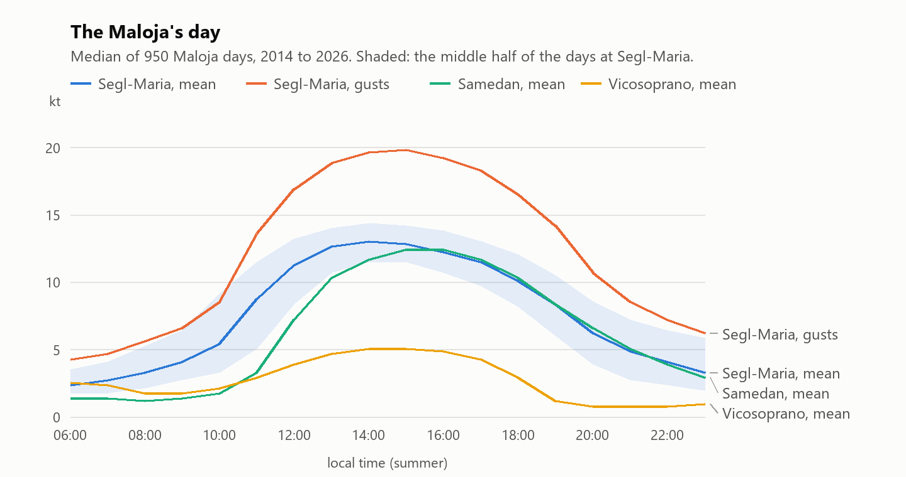
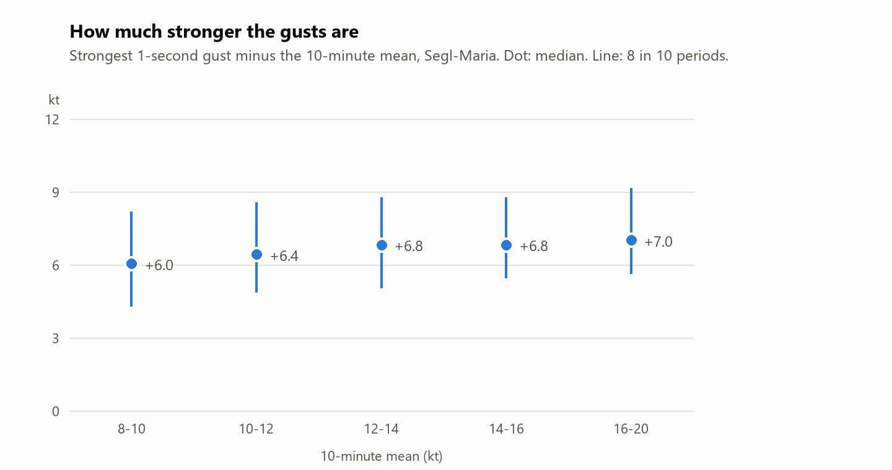
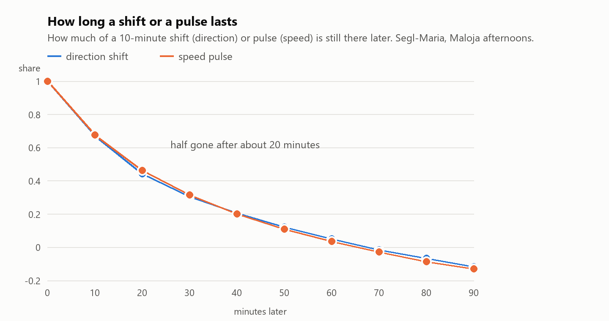
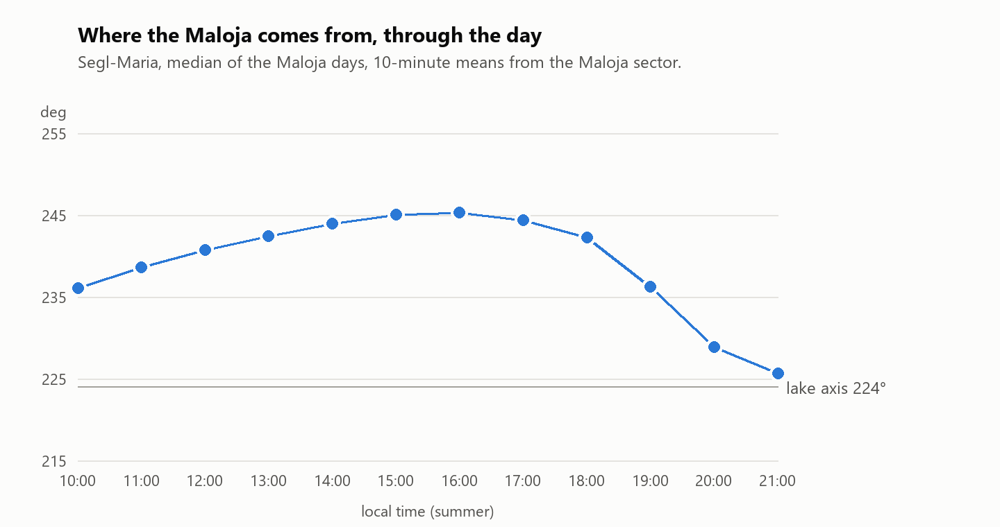
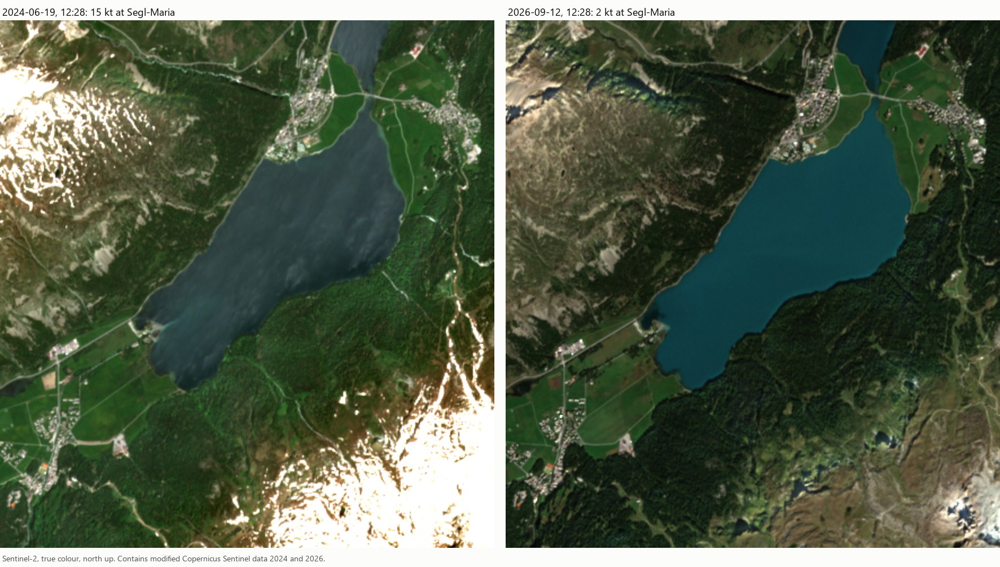
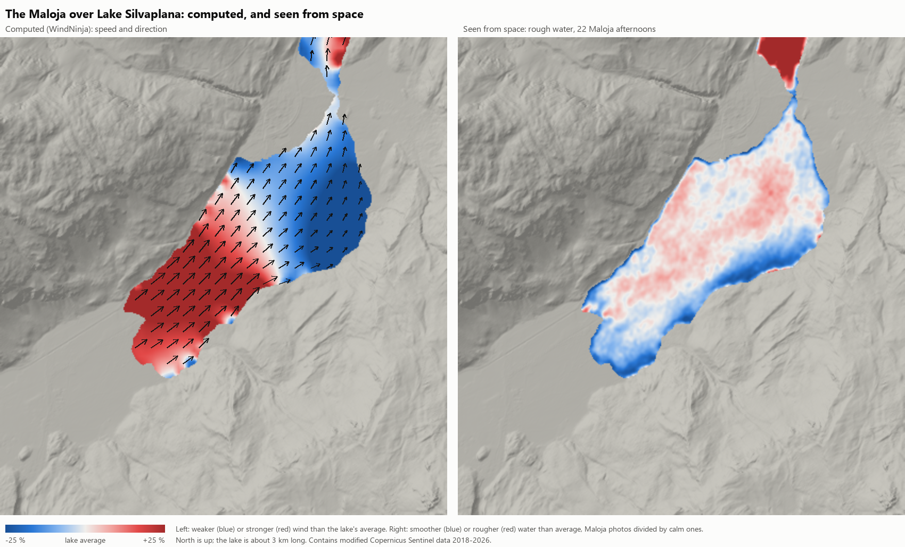
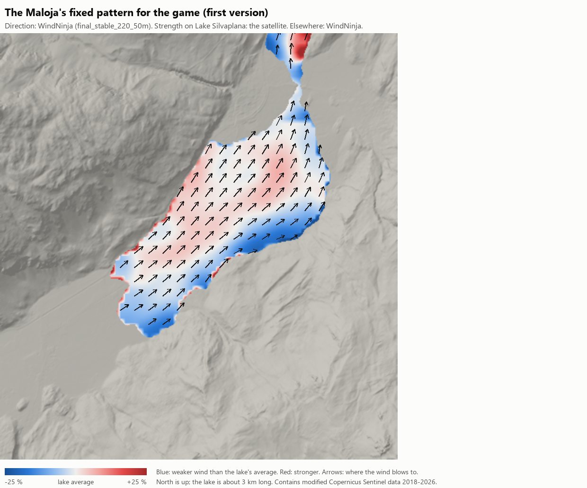
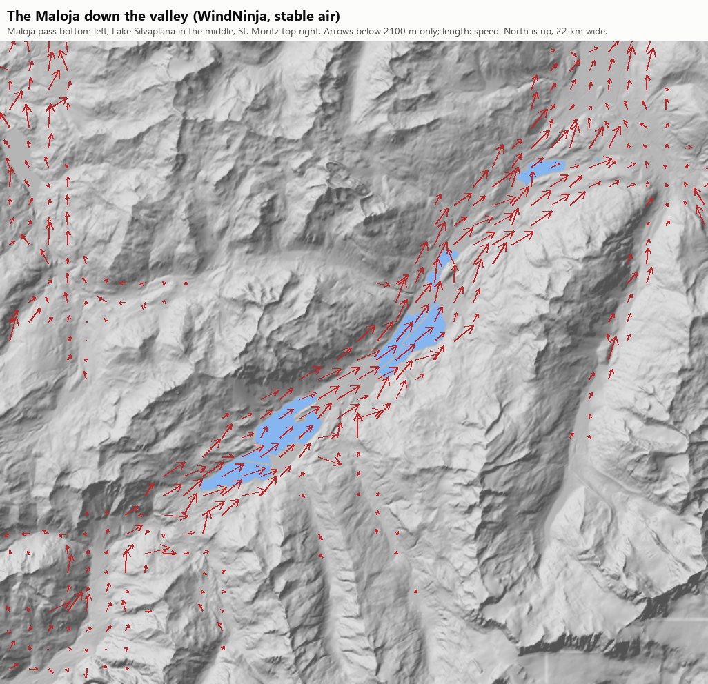

# The Maloja wind: how it behaves

Written 14 October 2026 (Session 42, map track) for the wind analyser (map plan, phase W0). It collects what is known about how the Maloja behaves **once it blows**: its day, its start, its strength, its gusts and shifts, and where on the lake it is strong or weak. When it comes (the forecast) is not part of this.

Three kinds of sources:
- **Measurements:** five MeteoSwiss stations along the Maloja's path, every 10 minutes, summers 2014 to 2026. Script: `tools/map/maloja_research.py`.
- **Satellite photos:** Sentinel-2 photographs the lake at 12:28 local time; rough water shows where the wind is. Script: `tools/map/satellite_wind.py`.
- **What people wrote:** an old measurement study (Mörikofer, 1938), weather services, spot guides, glider pilots and race reports. They are listed under [Sources](#sources).

The numbers here replace the first ones in [PHYSICS_REQUESTS_FROM_MAP.md](PHYSICS_REQUESTS_FROM_MAP.md) (R5, 2020 to 2025 only). They agree within a few per cent.

## In short: what the simulation has to do

| | What the Maloja does | Measured |
|---|---|---|
| **The day** | Builds late morning, holds from 13:00 to 17:00, fades slowly in the evening | 12.6 to 13.0 kt mean, 19 to 20 kt gusts at the station, 13:00 to 16:00 |
| **The start** | Comes quickly, "with a few blows", and travels down the valley | 4 → 9 kt within half an hour; reaches Samedan, 14 km on, about 70 minutes later |
| **Day to day** | Light, medium and strong days, but always the same character | Afternoon mean 11, 12.6 and 14 kt (the three thirds of the days) |
| **Gusts** | About +7 kt over the 10-minute mean, at every strength | 1-second gust 1.52 × the mean (8 in 10: 1.38 to 1.73) |
| **Pulses** | Stronger and lighter spells of 10 to 30 minutes | ±8 % for half the time, ±16 % for 8 in 10; half gone after 20 minutes |
| **Shifts** | Small and slow in the 10-minute means | ±6° typical, a swing of 8° within an hour (16° on 1 in 10 hours) |
| **Through the day** | Turns right until mid-afternoon, then left as it dies | 236° at 10:00, 245° at 15:00 to 16:00, 226° at 21:00 |
| **On the lake** | Along the lake (about 220°); weaker in a band under the south-east shore and at the Sils end | The station's 245° is its own spot turning the wind about 20° (WindNinja); the band is 200 to 300 m wide (satellite) |

All directions are where the wind comes **from**, in degrees, as the game uses them. "Turns right" (veers) means it comes more from the west; "turns left" (backs) means more from the south.

## What drives it

The Maloja is the valley wind of the **Val Bregaglia** (Bergell), on the Italian side, that spills over the Maloja pass into the Engadin:
- The Bregaglia climbs from about 300 m at Chiavenna to 1800 m at Maloja in only 20 km. Its steep, sunny slopes heat up fast in the morning, the warm air rises, and air is drawn up the valley from the south.
- The Maloja pass is hardly higher than the Engadin lakes. So the Bregaglia's valley wind does not stop at the top: it carries on over the pass and **down** the Upper Engadin, past the lakes of Sils, Silvaplana and St. Moritz. That is why it blows down the valley in the day, the opposite of a normal valley wind; locals call it "the wrong wind".
- The Engadin's own valley wind (the "Brüscha", blowing up the valley) is weak, because the Engadin falls only about 350 m over 50 km. The Maloja overpowers it.
- The heating in the Engadin itself is said to pull the flow along as well (Kitesailing.ch, SRF).

What the weather services add:
- It needs sunshine; clouds slow it down.
- A west to south-west wind higher up makes it stronger; a north to south-east wind higher up weakens it (SRF, DWD, Kitesailing.ch). The station data agree on the direction of the effect, but it is small once the Maloja blows (see "Day to day").
- Glider pilots: it is often capped by an inversion, so it is a shallow wind in the main valley only, while the higher slopes can have a different wind (CSVM Engadin).
- It rarely reaches Pontresina (SRF).

## The day

<picture><source media="(prefers-color-scheme: dark)" srcset="images/maloja/daily_cycle_dark.png"></picture>

A **Maloja day** has at least 3 hours of wind from 202 to 292° at 4 m/s (8 kt) or more at Segl-Maria between 13:00 and 18:00. That is **950 of 1584 summer days (60 %)** from 2014 to 2026, a little more in August and September (64 and 61 %) than in June and July (59 and 57 %).

Segl-Maria (SIA), at the south-west end of the lake, on the Maloja days, medians:

| | 10:00 | 11:00 | 12:00 | 13:00 | 14:00 | 15:00 | 16:00 | 17:00 | 18:00 | 19:00 | 20:00 | 21:00 |
|---|---|---|---|---|---|---|---|---|---|---|---|---|
| mean (kt) | 5.4 | 8.7 | 11.3 | 12.6 | 13.0 | 12.8 | 12.2 | 11.5 | 10.1 | 8.4 | 6.2 | 4.9 |
| half the days between (kt) | 3.3–9.1 | 5.1–11.5 | 8.4–13.2 | 10.7–14.0 | 11.5–14.4 | 11.5–14.2 | 10.7–13.8 | 9.7–13.0 | 8.2–12.1 | 6.0–10.5 | 3.9–8.6 | 2.7–7.2 |
| 1-second gust (kt) | 8.6 | 13.6 | 16.9 | 18.9 | 19.6 | 19.8 | 19.2 | 18.3 | 16.5 | 14.2 | 10.7 | 8.6 |
| from (°) | 236 | 239 | 241 | 242 | 244 | 245 | 245 | 244 | 242 | 236 | 229 | 226 |
| share from the Maloja sector | 54 % | 78 % | 91 % | 97 % | 99 % | 100 % | 99 % | 97 % | 91 % | 81 % | 66 % | 51 % |

The station stands on land, at 10 m. **Over the open water the wind is stronger**: spot guides give 15 to 25 kt on most summer days (Ben Beholz), 4 to 5 Beaufort with gusts of 6 (SRF, Kitesailing.ch), 3 to 6 Beaufort (ESYS). Mörikofer measured 12 to 16 kt in the Maloja, 16 to 19 kt as the strongest hour, in 1935 on a roof at Sils-Baselgia, on the flat land between the two lakes. How much stronger the water is than the station is one of the questions for Max (below).

**The other stations on the same days:**
- **Samedan** (SAM), 14 km down the valley: the Maloja arrives there too, turned to 218° by the valley, and peaks later (12.4 kt at 15:00 to 16:00). On about 1 in 5 Maloja days Samedan has something else in the afternoon; it gets the Maloja on 95 % of the strong days but only 69 % of the light ones.
- **Vicosoprano** (VIO), down in Val Bregaglia at 1089 m: only 5 kt, from 232°, 13:00 to 17:00, and gone by 19:00. Its start is not earlier than the lake's (the lake starts first on 69 % of days). So this station, on the wide floor of the lower valley, does not time the Maloja; the strong flow builds higher up, near the pass. Moll studied the Bregaglia's winds with pilot balloons in 1937; that study was not found online.
- **Piz Corvatsch** (COV), 3294 m: the wind above the valley is light in summer afternoons (4 to 5 kt, from the west). It is a different wind from the Maloja below.
- **Bivio** (BIV), behind the Julier pass, has its own light afternoon wind from the west (6 kt) and is not connected.

## The start, and how it travels

Mörikofer (1935, Sils-Baselgia): after weak air, "the wind sets in abruptly with a few blows". He found the start at 09:30 to 10:05 on undisturbed days, the end at about 19:15 to 19:40 ("it dies down very gradually"), so about 10 hours.

The station data:
- **Start at Segl-Maria** (the wind from the Maloja sector and at least half the afternoon's strength for 30 minutes): **11:00** on a typical day; 1 in 10 days by 09:00, 1 in 10 after 13:00. Later than in 1935, but the definitions differ.
- **It comes quickly:** from 4.4 kt in the half hour before the start to 8.8 kt in the half hour after. It reaches 80 % of the afternoon's strength **30 minutes** after the start (1 in 10 days: within 10 minutes; another 1 in 10: after 80 minutes or more).
- **It travels down the valley:** Samedan starts 70 minutes after Segl-Maria (1 in 10 days: 30 minutes, 1 in 10: 3 hours). Over 13.8 km that is a front moving at **3.3 m/s (6 kt), about half the wind's speed**. Mörikofer found the same in the 1930s: Celerina, 12 km down the valley, started 40 minutes after Sils.
- Across the 3 km lake, that is about **15 minutes** from the Sils end to the Silvaplana end: the line of dark, rippled water should be visible coming down the lake.
- **From the valley floor up:** in 1918 Mörikofer found it starts 1.5 hours later 700 m above the valley floor (Muottas Muragl) than in Sils. It starts at the bottom and then deepens.
- **No cold front:** the air at Segl-Maria keeps warming when the wind starts (+0.8 °C in the next hour, typical).

The end:
- The 10-minute mean drops below half the afternoon's strength at **about 20:10** (1 in 10 days by 18:00, 1 in 10 after 23:00). It is gradual: about 1 kt per hour after 16:00, faster after 18:00.
- As it dies it **turns left**, from 245° to 226° at 21:00, and the gusts become relatively bigger (gust factor 1.50 at 14:00, 1.63 at 20:00).
- Mörikofer: in the evening the slope winds take over. Further down the valley (Celerina) they make the wind last longer; high up (Muottas Muragl) they end it earlier.

## Day to day

The Maloja days split into three equal groups by the afternoon mean (13:00 to 17:00) at Segl-Maria:

| | light | medium | strong |
|---|---|---|---|
| days (2014 to 2026) | 316 | 292 | 342 |
| afternoon mean (kt): 1 in 10 / typical / 9 in 10 | 8.9 / 10.9 / 11.8 | 12.1 / 12.6 / 13.2 | 13.4 / 14.2 / 15.7 |
| strongest 1-second gust 13:00 to 17:00 (kt) | 17.9 / 21.0 / 23.9 | 20.8 / 22.7 / 24.7 | 22.2 / 24.1 / 27.0 |
| gust factor | 1.57 | 1.52 | 1.47 |
| from | 242° | 244° | 245° |
| start (typical) | 11:30 | 11:10 | 10:50 |
| reaches Samedan | 69 % | 85 % | 95 % |
| wind on Piz Corvatsch 12:00 to 15:00, from | 264° | 247° | 224° |

So the days differ more in strength than in character. Strong days start earlier, are relatively less gusty, and come with a south-west wind above the mountains. Once the Maloja blows, the wind above changes it only by about a knot: the afternoon mean is 13 kt with a south or south-west wind on Corvatsch and 12 kt with a north wind. The strength of the wind above hardly matters (correlation +0.05).

## Gusts

<picture><source media="(prefers-color-scheme: dark)" srcset="images/maloja/gusts_dark.png"></picture>

In 26 714 ten-minute periods of Maloja at Segl-Maria (13:00 to 18:00):
- The strongest **1-second gust** is **1.52 ×** the 10-minute mean (8 in 10 periods: 1.38 to 1.73), the strongest **3-second gust 1.46 ×**.
- **In knots the gusts are almost the same at every strength: +6 to +7 kt** over the mean. As a factor that is 1.64 at 8 to 10 kt and 1.41 at 16 to 20 kt.
- The 3-second gust keeps 88 % of the 1-second gust's extra: **a gust lasts several seconds**, not just a 1-second spike.
- If the gusts follow the usual pattern of turbulence (the strongest of many random ups and downs in 10 minutes is about 3 standard deviations above the mean), the wind's ups and downs within 10 minutes have a standard deviation of about **2.2 kt (about 17 % at 13 kt)**.
- **Other stations:** Samedan, on the open valley floor, is less gusty (1.44); Vicosoprano (1.70) and Corvatsch (1.73, a summit) more.

What the station can't tell, and what is known about gusts from elsewhere:
- **How big a gust is and how it moves.** The station only gives the strongest gust per 10 minutes at one point. Measurements over Lake Ontario showed that the large eddies **travel faster than the wind at the surface**: they come from higher up, where the wind is stronger. A gust patch on the water should move downwind at least at the mean wind speed.
- **The fan.** Sailors describe a gust as air coming down onto the water and spreading out, so the wind turns one way on one side of the gust and the other way on the other side (lifts and headers). The station shows **no link between strength and direction** in the 10-minute means (stronger periods turn −0.1° per knot, correlation −0.03). The fan, if it is there, works on the scale of single gusts (seconds, a few hundred metres) and is invisible in 10-minute means. That is for Max to check on the water.
- **Race reports** from Silvaplana describe "gusty and shifting winds" and "short but powerful gusts" (Formula Wing, June 2024, on a cold day after snow, so not a typical Maloja), and riders finding "a similar pattern to what I discovered in training".

## Shifts and pulses

<picture><source media="(prefers-color-scheme: dark)" srcset="images/maloja/persistence_dark.png"></picture>

In the afternoon of the Maloja days (13:00 to 18:00), the 10-minute means at Segl-Maria against that day's afternoon average:
- **Direction:** half of the time within ±3°, 8 in 10 within ±7°, 9 in 10 within ±10° (standard deviation 6°). From one 10-minute period to the next it changes 2° typically, 7° on 1 in 10. **Within an hour it swings 8°** typically (max minus min of the six 10-minute means), 16° in 1 in 10 hours.
- **Speed:** half of the time within ±8 % of the day's afternoon mean, 8 in 10 within −16 to +15 %.
- **How long they last:** a shift or a pulse is half gone after 20 minutes and almost gone after an hour. Direction and speed behave the same. So there are **stronger and lighter, more-left and more-right phases of 10 to 30 minutes**, not a regular oscillation.
- **Day to day the direction differs more:** 236° on 1 in 10 days, 252° on another 1 in 10 (typical 245°).
- **During the afternoon** the direction drifts slowly to the right, about 3° from 13:00 to 16:00.

<picture><source media="(prefers-color-scheme: dark)" srcset="images/maloja/direction_by_hour_dark.png"></picture>

A 10-minute mean hides everything faster. Shifts within a minute, at the scale of a gust, are certainly bigger than these numbers; how much bigger is not measured. On the lake there will also be **shifts tied to places** (along a shore, at the end of the lake), which the station can't see. Those come from the terrain (step W1).

## Over the lake: where it is strong or weak

What we know:
- Mörikofer (1938): "the typical Maloja wind can be observed most undisturbedly in the Upper Engadine lake region between Maloja and Champfèr", where "the Maloja wind blows almost constant on good weather days". Further down, behind the narrows at St. Moritz, it is more disturbed.
- **Direction:** the lake's long axis runs from 224° to 44°, but Segl-Maria reads 245°. The station stands at the mouth of the Val Fex, on the south side of the plain at Sils, and may be turned by that. WindNinja says it is (W1, below): in stable air the lake gets about 220° while the station's spot reads 20° more. Max's experience is the check.
- **At the launch** (Silvaplana, the downwind end): the Maloja comes "sideonshore von rechts", with a disordered wind chop, typically enough for a 7 m² sail or a 12 m² kite and rarely much more; the mountains speed it up by a nozzle effect (Spotnetz).
- **The upwind end:** the wind reaches the lake over the flat meadows of Sils. Surfspot.de says that at the Sils surf centre the wind is "meistens ein bisschen schwächer und ablandig" (mostly a bit weaker and offshore); it doesn't say whether that means Lake Sils or the Sils end of Lake Silvaplana. Over the smooth water the wind speeds up with distance from the upwind shore, because water slows the air less than land (measured on Lake Balaton). On a 3 km lake that zone of speeding up can cover much of the lake.
- **Shores:** a forest on the upwind shore shelters the water for about 50 tree heights downwind (wind-tunnel and field measurements, Markfort et al. 2010). With the Maloja along the lake that matters only where the wind comes off the land at an angle: if it comes from 245° instead of 224°, it crosses the north-west shore (the forested slope below the Julier road) at about 20°, and that shore would be in a lee.
- **The Julier wind**, a different wind: rare, a cold north wind down the slope from the Julier pass, offshore at the launch, strong but gustier than the Maloja, with flat water (ESYS, Surfspot.de, Spotnetz).

The satellite photos (next section) show where the water is rough on Maloja afternoons, and step W1 computes the terrain's effect. Both are checked against Max's experience.

## Seen from space



Sentinel-2 photographs the lake every few days at **12:28 local time**, when the Maloja is usually already blowing. Rough water reflects more of the bright sky, so a windy lake looks grey and streaky, and a calm one shows the water's own turquoise (above). Script: `tools/map/satellite_wind.py`.

**What was used.** Of the 153 summer photos since 2017, 65 were taken in a Maloja (at least 10 kt from the Maloja sector at Segl-Maria in those 10 minutes) and 17 in a calm (at most 4 kt). A photo was only used when it was clean: no clouds or cloud shadows within 500 m of the lake, and no haze over the water. That left **22 Maloja photos and 5 calm ones**. The first, looser selection let cloud shadows through and was thrown away.

**How.** The red band is used. In the near-infrared, where water is darkest, the satellite's atmospheric correction leaves the water at almost exactly zero, too little to see the wind in. Each photo is divided by its median over the open water, the Maloja photos are averaged, and that average is divided by the calm photos' average. That removes what is in every photo: the bright shores lighting the water next to them, the shallow lakebed, the water's colour. What is left is how much rougher or smoother each place is on a Maloja afternoon than the lake as a whole.



**What it shows** (right half of the picture above):
- **A smoother band along the south-east shore**, under the forest of the Corvatsch side, about 200 to 300 m wide, from the middle of the lake to the Silvaplana end. The single photos show it too (the darker strip on the left photo at the top).
- **Rougher water down the middle and the north-west half.**
- **Smoother water at the Sils tip**, the first few hundred metres where the wind comes onto the water (about 10 % below average there).
- **Along the lake the roughness hardly changes** from 750 m after the Sils tip to the Silvaplana end (within ±4 %).

**What it can't show:**
- **The wind's direction on the lake.** The streaks were measured too, and the Maloja photos give 214°. But the calm photos give 207° just as clearly, and a calm lake has no wind streaks. So the streaks the method finds are mostly the satellite's own scan stripes and the lake's shape. This measurement is not usable.
- **Wind speed in knots.** Brightness rises with roughness, and roughness with the wind, but by how much is not known for this lake and this light. The map shows where the water is rougher or smoother, not by how many knots.
- **Other times of day.** All photos are from 12:28, when the Maloja is building (11 kt median at the station). The afternoon pattern may differ.

So the satellite gives two places to check on the water: the band under the south-east shore, and the Sils tip.

## Computed over the terrain (W1)

Script: `tools/map/windninja_pattern.py`. Checks: `tools/map/tests/test_wind_pattern.py`.

**How.** [WindNinja](https://github.com/firelab/windninja) 4.0.0 (US Forest Service, free) computes how terrain steers a wind. Its fast solver takes a wind from one direction and adjusts it to the mountains so that no air is lost on the way. How easily the air goes over a ridge instead of around it is set by one number, "alpha": 1 for neutral air, small for stable air, which flows around and follows the valleys. The glider pilots describe the Maloja as capped by an inversion, which is stable air.
- The terrain: swissALTIRegio averaged to 30 m, from the top of Val Bregaglia over the Maloja pass to St. Moritz (22 × 20 km).
- 12 runs on a 100 m mesh: incoming directions 220, 230, 240 and 250°, each in stable (alpha 0.1), slightly stable (0.3) and neutral air (1.0). Wind 5 m above the ground. Each run takes about 10 seconds.
- Each run is compared with the station (Segl-Maria reads 245° in a Maloja) and with the satellite's map.

| air | lake wind from | Segl-Maria would read | strength along the lake (8 in 10 cells) | agreement with the satellite |
|---|---|---|---|---|
| stable | 216 to 222° | 237 to 242° | 0.69 to 1.31 × the lake's median | +0.08 to +0.18 |
| slightly stable | 211 to 222° | 231 to 240° | 0.78 to 1.21 | +0.05 to +0.14 |
| neutral | 219 to 231° | 229 to 239° | 0.87 to 1.13 | −0.17 to +0.06 |
| momentum solver, neutral, 230° | 228° | 230° | 0.65 to 1.15 | +0.18 |

(The agreement is the correlation between the computed speed and the satellite's roughness on the open water, 100 m or more from the shore: 1 would be perfect, 0 no relation.)

The last row is WindNinja's slower **momentum solver** (OpenFOAM), which, unlike the fast one, lets the air keep its speed like a jet. It only knows neutral air, and one run on a 35 m mesh took 52 minutes. It puts the stronger wind on the north-west side and in the middle, and the weaker wind toward the south-east (Surlej) side of the Silvaplana half, like the satellite. But it still weakens the wind toward the Silvaplana end, and it turns the station only 2°, far from the measured 20°.

**What it found:**
1. **In stable air the valley sets the direction.** Whatever comes in, from 220 to 250°, the lake gets 216 to 222°, **along the lake's axis** (224°).
2. **The station is turned by its spot.** In those same runs Segl-Maria reads about **20° further right** than the lake (237 to 242°), close to the measured 245°. So the station's 245° does not mean the wind on the lake comes from 245°: on the lake it probably comes from about 220°, along the lake. In neutral air the station would be turned only 8 or 9°, which fits the measurement less well.
3. **For the strength, WindNinja and the satellite disagree.** In stable air WindNinja has the wind 20 to 25 % stronger at the Sils end and as much weaker towards Silvaplana, where the valley widens at the Julier opening. The satellite shows an even lake with a smoother band under the south-east shore. No run agrees with the satellite better than a correlation of 0.18, the momentum solver included. Two reasons:
   - The fast solver has no inertia: it lets the air spread out wherever the valley widens, where real air keeps going like a jet. The momentum solver, which has inertia, halves that slowing down but keeps it.
   - It has one roughness for all ground (grass), so it can't know about the forest along the south-east shore.
4. **Both solvers and the satellite agree that the south-east side is weaker.** The fast solver in stable air (weakest in the east corner), the momentum solver (most of the south-east half) and the satellite (a band along the shore) all put lighter wind on the south-east (Surlej, Corvatsch) side of the Silvaplana half.
5. **The forest explains the band.** A forest on the upwind shore shelters the water for about 50 tree heights downwind, about 1 km for 20 m trees (Markfort et al. 2010). If the wind on the lake comes from about 215 to 220°, a little left of the lake's axis, it crosses the south-east shore at 5 to 10°, and the sheltered strip is about 1 km × sin 5 to 10° ≈ 90 to 170 m wide. That is about the size of the band the satellite shows (200 to 300 m), and it fits point 2.

**The pattern for the game, first version** (`Game/maps/silvaplana/wind/maloja_pattern.json` + `.bin`, generated, don't edit):
- Per 50 m cell from the Maloja pass to St. Moritz: the speed relative to the lake's median, and the turn relative to the lake's mean direction (222°).
- **Direction:** WindNinja, stable air, 220° incoming, rerun on a 50 m mesh.
- **Strength on Lake Silvaplana:** the satellite's roughness map, smoothed twice over 150 m, with 10 % rougher taken as 10 % more wind (the water's slope grows about in proportion to the wind; Cox and Munk 1954), limited to ±30 %. That last step is an assumption, for Max to check.
- **Strength elsewhere** (land, Lake Champfèr, Lake Sils): WindNinja.
- On the lake that gives 0.77 to 1.30 × the median (1 to 99 % of the cells).





**The checks** (`python tools/map/tests/test_wind_pattern.py`, 6 of 6 pass): the file is complete and covers the pass to St. Moritz; the factors are relative to the lake (median 1.00, mean turn −1°); no extreme values on the lake; the lake's wind comes from 222°, 2° from the lake's axis; the pattern turns the wind at Segl-Maria to 241° (measured: 245°).

**For Max to check on the water:**
- Is the wind weaker in a band along the south-east (Corvatsch) shore, especially on the Silvaplana half?
- Is it weaker at the Sils end?
- Does it blow along the lake, straight from the Sils end to the Silvaplana end?
- Is it about the same strength along the lake (the satellite), or clearly weaker at the Silvaplana end (WindNinja alone)?

## What Max says (15 October 2026)

Max checked the first pattern ([SILVAPLANA_SPOT_NOTES.md](SILVAPLANA_SPOT_NOTES.md) has his words):
- **Confirmed:** weaker along the south-east (Corvatsch) shore and at the Sils end; the wind blows along the lake; a little more wind on the north-west side.
- **New: gusts reach into the weak parts.** In the south, near "the little corner", every so often a gust comes that is as strong as in the strongest parts. So a weak zone has a lower mean but not lower gusts: its gusts are relatively bigger.
- **New: gustier upwind, steadier downwind.** Gusts are on the whole lake, but there are more at the starting (Sils) end, and it gets a little steadier further downwind. That fits the physics: the air arrives turbulent from the land at Sils, and over the smooth water the turbulence slowly dies down.
- **Confirmed: gusts stand out more on light days.** That matches the station: gust factor 1.57 on light days, 1.47 on strong ones (see "Day to day").

And on the gusts themselves:
- **"The little corner"** is the bend of the south-east (Corvatsch) shore, around the middle of the lake: the lee band of the satellite map, where now and then a full-strength gust breaks through.
- **A gust patch is about 100 to 200 m across.**
- **Timing: all scales at once, randomly.** Sometimes every 10 to 30 seconds for a few seconds, sometimes every minute or so for 5 to 15 seconds, sometimes every few minutes for half a minute or more. That is how turbulence looks: no single rhythm, but small, quick ups and downs on top of bigger, slower ones. It also fits the station's pulses of 10 to 30 minutes, one scale further up.
- **The turn in a gust "depends on where you are"**, the common lake-sailing picture of a gust spreading out (the fan, under "Gusts"): one side of a gust lifts, the other heads, and near a shore the gust follows the shore.

And on strength and tactics:
- **On the water a competition day is 12 to 22 kt**, depending on the day (12 to 14, 15 to 18 or 18 to 22 kt), while the station shows 11 to 14 kt on its light to strong days. So the water is about the same as the station on a light day and up to about 1.5 times it on a strong one. The simulation's day types use the water's numbers.
- **What wins upwind: all of it**, pressure, shifts and the shores. The viewer has to show all three.
- **The north-west side usually pays upwind**, which fits the pattern: a little more wind on the north-west side, less under the south-east shore.
- **The evening turn to the left** is still open (Max is usually off the water by then).

For the simulation (W3) that means:
- the gustiness depends on the place: more at the Sils end and in the weak zones, less downwind;
- the gusts in a weak zone can reach the strength of the strong zones;
- gust patches of 100 to 200 m on top of slower, bigger swells of wind, with no fixed rhythm (several layers of noise, each with its own size and speed);
- each gust spreads out, so the direction depends on where you are in it.

## What we don't know yet: questions for Max

The station stands on land, at one end of the lake, and gives 10-minute averages. The rest comes from the water. Max, what do you see out there? Short answers are fine (they can go in [SILVAPLANA_SPOT_NOTES.md](SILVAPLANA_SPOT_NOTES.md)):
1. **How much stronger** is it on the water than the station's 12 to 13 kt? (Spot guides say 15 to 25.)
2. **Direction on the water:** along the lake (224°, straight from the Sils end to the Silvaplana end), or more from the west like the station (245°)?
3. **Strong and weak places:** where is it strongest? Is there a lighter band under one shore (the forest on the north-west side, or under Corvatsch on the south-east side)? Near the launch?
4. **Gusts:** do you see them coming as dark patches? How big are they (a boat length, 100 m, a few hundred metres), how often do they come, and how long does one last?
5. **The fan:** in a gust, does the wind turn one way on one side and the other way on the other side? Or does a gust come with a typical shift?
6. **Shifts:** do you sail on shifts there (phases of more left and more right), or is it about the pressure (the stronger and weaker lanes)? Is one side of the lake usually better?
7. **The start:** do you see it come down the lake as a line? How long from the first ripples to full strength?
8. **The evening:** does it turn left (more from the south) as it dies, as the station says?

## Data and how to repeat it

From the repo root:
```
python tools/map/download.py wind-valley       # 0.4 GB, MeteoSwiss, five stations, 2010 to now
python tools/map/maloja_research.py            # the tables, about 40 s
python tools/map/maloja_charts.py              # the pictures in Documentation/images/maloja/
python tools/map/satellite_wind.py             # the satellite photos, about 45 minutes the first time
```
The results land in `.map_data/work/wind_research/` (`report.txt`, `results.json`, `satellite/`), which is not committed.

**Method notes:**
- MeteoSwiss timestamps are UTC and mark the end of the 10 minutes; the scripts add 2 hours (Swiss summer time).
- Segl-Maria measures wind speed since March 2014, Vicosoprano since 2013, Bivio since 2015.
- The "Maloja sector" (202 to 292°) is the most common afternoon direction ±45°, as in the first analysis.
- A gust factor is the strongest gust in 10 minutes divided by the 10-minute mean.
- The 2.2 kt estimate uses a peak factor of 3 (the usual value for a 1-second gust in 10 minutes); it is an estimate, not a measurement.
- Windfinder shows live readings from stations named "Silvaplana See" and "Silser See". Their owner isn't named and their history is behind a paywall, so they are not used here. Max could compare them with the water on a Maloja day.

## Sources

Measurements and data:
- MeteoSwiss Open Government Data, SwissMetNet stations Segl-Maria (SIA), Vicosoprano (VIO), Piz Corvatsch (COV), Samedan (SAM), Bivio (BIV), 10-minute values: [STAC collection ch.meteoschweiz.ogd-smn](https://data.geo.admin.ch/api/stac/v1/collections/ch.meteoschweiz.ogd-smn). Source: MeteoSwiss.
- Copernicus Sentinel-2 L2A, via [Element 84 Earth Search](https://earth-search.aws.element84.com/v1) (Sentinel-2 Cloud-Optimized GeoTIFFs on AWS).
- W. Mörikofer, *Zur Klimatologie des Malojawindes*, Meteorologische Zeitschrift 55 (1938), 215–217. English translation: [The Climatology of the Maloja Wind, DTIC ADA112064 (1982)](https://archive.org/details/DTIC_ADA112064). It cites Klainguti-Schaumann, Met. Z. 54 (1937), 289–295 (anemograph records, Celerina 1936), E. Moll, Beitr. Phys. fr. Atm. 24 and 25 (1938) (pilot balloons, Maloja and Bergell 1937), and Mörikofer, Jahresbericht Naturf. Ges. Graubünden 63 (1924) (Muottas Muragl 1918). Those three were not found online.

What it is and what drives it:
- SRF Meteo: [Thermischer Wind – Malojawind](https://www.srf.ch/meteo/meteo-stories/thermischer-wind-malojawind) and [Engadin – Dank Malojawind ein Wassersportmekka (2024)](https://www.srf.ch/meteo/meteo-stories/wassersportmekka-engadin-malojawind-der-verlaesslichste-engadiner-kommt-aus-dem-bergell).
- Deutscher Wetterdienst: [Der Malojawind im Engadin: Ein verkehrter Wind (2020)](https://www.dwd.de/DE/wetter/thema_des_tages/2020/8/1.html).
- Kitesailing.ch: [Wind & Wetterprognose](https://www.kitesailing.ch/en/spot/weather-watersports).
- ESYS: [Der Malojawind](https://www.esys.org/wetter/Malojawind.html) and [Revierinformation Silvaplanersee](https://www.esys.org/rev_info/Schweiz/silvaplanersee.html).
- Segelfluggruppe CSVM Engadin: [Malojawind](https://www.segelflug-csvm-engadin.ch/styled-30/styled-31/).
- [Wikipedia: Malojawind](https://de.wikipedia.org/wiki/Malojawind); [AMS Glossary: Maloja wind](https://glossary.ametsoc.org/wiki/maloja-wind/).

On the water:
- Ben Beholz: [Lake Silvaplana kite, wing and pumpfoil spot guide](https://benbeholz.com/knowledge/lake-silvaplana-kite-pumpfoil-wingfoil-spot-guide).
- [Surfspot.de: Silvaplana](https://surfspot.de/surfspots/europa/schweiz/silvaplana-silvaplanersee/), [Spotnetz: Silvaplana](https://www.spotnetz.de/w/schweiz/silvaplana/).
- Race report: [MySailing, Formula Wing at Silvaplana, June 2024](https://www.mysailing.com.au/the-first-to-cross-the-finish-line-is-the-first-to-the-sauna/).

Wind over water and gusts in general:
- Taylor's hypothesis tested over Lake Ontario: large eddies travel faster than the local wind ([Boundary-Layer Meteorology, doi:10.1007/BF00223388](https://link.springer.com/doi/10.1007/BF00223388)).
- Wind speeding up over Lake Balaton with distance from the shore ([Periodica Polytechnica](https://pp.bme.hu/ci/article/download/455/212)).
- C. D. Markfort et al., Wind sheltering of a lake by a tree canopy or bluff topography, Water Resources Research 46 (2010), W03530 ([abstract](https://infoscience.epfl.ch/record/146727)).
- L. Gilbert, [the cat's-paw gust model](https://onemetre.net/Race/Gust/Gust.htm) (sailing, qualitative).
