# The gear brands: logos, colours and the Brand resource (31 October 2026)

Part 3 of [the fleet's training and the gear](PLAN.md), by the designer agent on the branch `gear/logos`. Michiel made up eleven brand names after the sport's real makers and asked: "Please make logo alternatives inspired by these names". This document holds each brand's idea, its colours and where they go, the files, and the choices left for the team. It is the one place in the project that names the real brands, so that the game's files never have to.

To see them all at once, run `python -I tools/brands/make_logos.py`. It redraws everything and writes the contact sheet `.screenshots/brands.png`. Each row of the sheet shows, from left to right: the logo on the menu's dark blue, the mark on white, the mark on the menu's blue, the wordmark printed on the brand's own cloth, and both drawn small (a 40 px menu icon, and a sail's print seen from far away).

## The rules the logos follow

- **No real name in the game.** No real maker's name appears anywhere under `Game/`. The unit test `tests/unit/test_brands.gd` checks every brand's name and tagline and every SVG drawing against a list of sixteen real names. It fails if one slips in (I checked this by planting one).
- **Our own shapes.** Every mark is drawn from scratch out of simple geometry (circles, curves, polygons) in `tools/brands/make_logos.py`. No real mark was traced or copied. Each one nods to its namesake's colours and mood, never to its symbol.
- **Free letters, as outlines.** The wordmarks use letters from free fonts under the SIL Open Font License: Fira Sans, Fira Sans Condensed, Open Sans Condensed, Noto Sans and Noto Serif Display. The license allows their letters in artwork like this. The letters are saved as outlines, not as text, so the files look the same on every computer, in Godot and in Blender, and nobody needs the fonts installed.
- **Readable at ten metres and at 40 px.** Each mark is one bold shape with strong contrast inside it, so it reads on white, on the menu's dark blue and on the brand's own cloth. The wordmarks use heavy letters with no thin strokes. The sheet's last column shows them small.

## How the colours and the logos are used

Every brand has three colours (`Brand.primary`, `secondary`, `accent`):

| Colour | On a sail | On a board |
|---|---|---|
| **primary** | the main cloth panels | the deck |
| **secondary** | the second panels (the luff panel, the foot panel) | the rails and the deck's stripes |
| **accent** | small highlights: the luff sleeve's tip, the batten ends, the clew | the fin, the footstraps' trim, the tail's logo |

The three drawings per brand, each as an SVG and as a PNG 1024 px on its long side with a transparent background:

- **wordmark**: the name, wide, for the print on the sail's panels and along the board's deck. It is drawn in the **print ink** that reads on the brand's primary colour (listed per brand below). On a white background a white ink is invisible, so judge the wordmarks on the cloth, as the sheet shows them.
- **mark**: the symbol alone, for the gear page's cards, the fin and the board's tail.
- **logo**: the mark above the wordmark on a rounded square plate in the primary colour, i.e. the brand as it looks on its own cloth. For a brand's header on the gear page.

## The eleven brands

The colour nods come from general knowledge of the real brands' looks. The researcher's `brand_research.md` (part 2) has their actual liveries, and any colour can be changed (see "Changing a brand" at the end).

### Tripletone (after Duotone): sails and boards

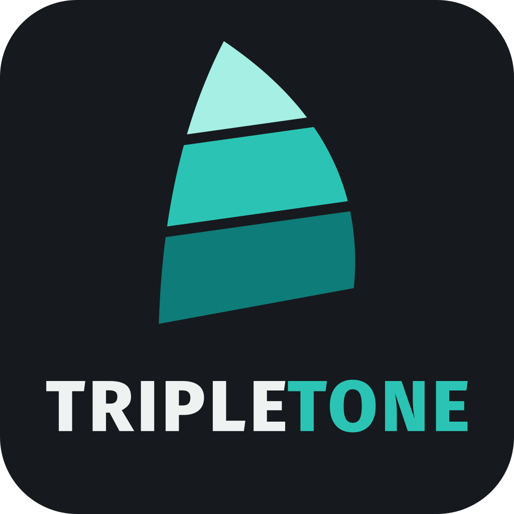

**Idea:** a windsurf sail cut into three panels that step from dark to light teal. A two-ink print is a "duotone"; a three-ink print is a tritone. **Nod:** the namesake's premium, technical black-and-white look with one bright colour.

| Colour | Hex | Where |
|---|---|---|
| primary: carbon | `#16191E` | sail cloth, deck |
| secondary: aqua | `#2BC4B4` | second panels, rails; "TONE" in the print |
| accent: white | `#EEF3F2` | highlights; "TRIPLE" in the print |
| the mark's three tones | `#0E7C78` `#2BC4B4` `#A5EFE4` | the sail's panels, bottom to top |

Print ink: white and aqua on carbon. Font: Fira Sans ExtraBold, capitals, a little letter spacing.

Choices for the team:
1. A second colourway: white cloth with a carbon print.
2. The three tones in another colour per sail size (three oranges, three blues).
3. The wordmark in one colour (all white) for a calmer print.

### Savanna (after Severne): sails and boards

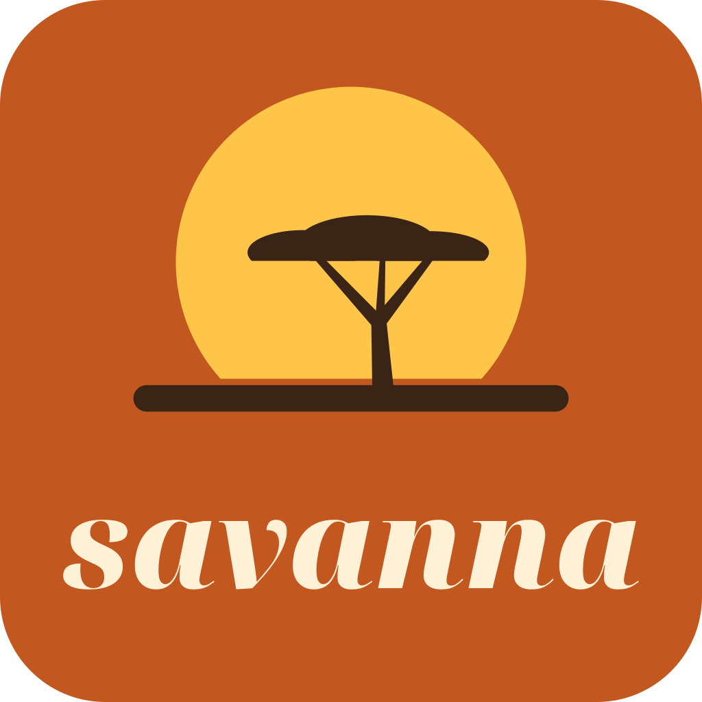

**Idea:** a low sun over the plain with an umbrella-topped acacia in front of it. The name is set in a heavy serif italic. **Nod:** a design-led brand, warm and a little adventurous.

| Colour | Hex | Where |
|---|---|---|
| primary: terracotta | `#C2581F` | sail cloth, deck |
| secondary: acacia brown | `#3A2416` | second panels, rails; the tree and the horizon |
| accent: sun gold | `#FFC548` | highlights; the sun |
| print ink: cream | `#FFF1D6` | the wordmark |

Font: Noto Serif Display Black Italic, lower case.

Choices for the team:
1. A sand or white colourway for the boards, with a brown print.
2. The name in lower-case serif (as now) or in capitals without serifs (more "race", less "travel").
3. The horizon bar wider than the sun (as now) or cut to the sun's width.

### Point.9 (after Point-7): sails

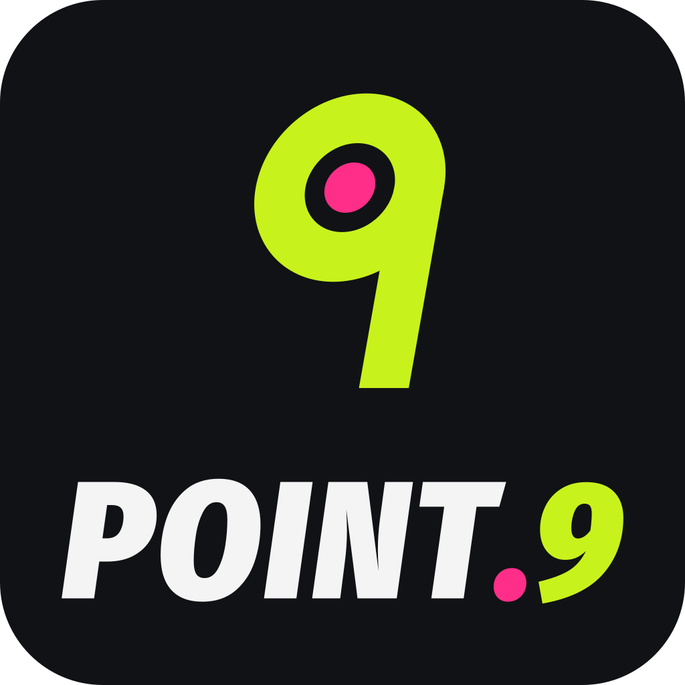

**Idea:** a 9 whose round bowl holds a point, on a slanted racing tile. **Nod:** a race-bred brand, black with a fluorescent colour.

| Colour | Hex | Where |
|---|---|---|
| primary: black | `#111215` | sail cloth |
| secondary: lime | `#C8F21C` | second panels; the 9 |
| accent: magenta | `#FF2E88` | highlights; the point |

Print ink: white "POINT", a magenta ".", a lime "9". Font: Fira Sans Condensed Heavy Italic.

Choices for the team:
1. On the sail: the mark with its tile, or the bare 9.
2. Lime or fluorescent orange as the second colour.
3. The 9 upright instead of leaning.

### Moonboard (after Starboard): boards

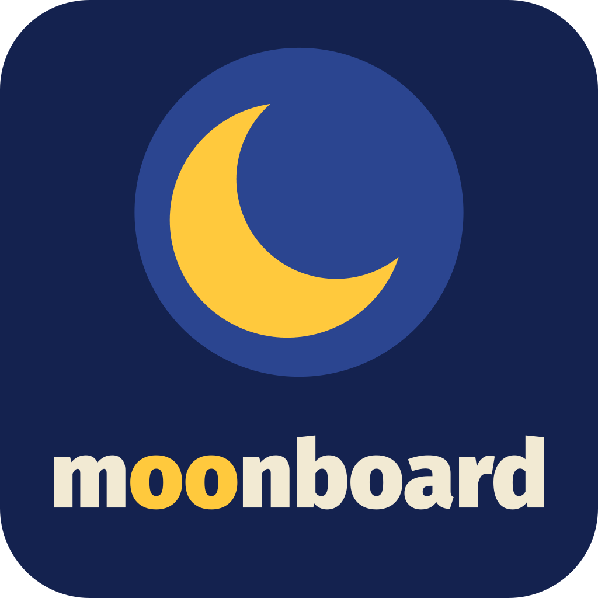

**Idea:** a crescent moon on a night-blue disc. In the wordmark the "oo" is in moon yellow. **Nod:** the namesake is a board maker with a friendly, colourful style; the star became a moon.

| Colour | Hex | Where |
|---|---|---|
| primary: midnight | `#14224F` | deck |
| secondary: moon cream | `#F2EAD3` | rails, stripes; the print |
| accent: moon yellow | `#FFC93D` | fin, highlights; the moon, the "oo" |
| the mark's disc | `#2B4590` | |

Print ink: cream with a yellow "oo". Font: Fira Sans Heavy, lower case.

Choices for the team:
1. A cream deck with a midnight print. The midnight plate almost disappears on the menu's dark blue (see the general choices).
2. A small board inside the crescent's hollow: more of a story, but less clean at 40 px.
3. The "oo" drawn as a full moon and a crescent.

### NielsTrots (after NeilPryde): sails

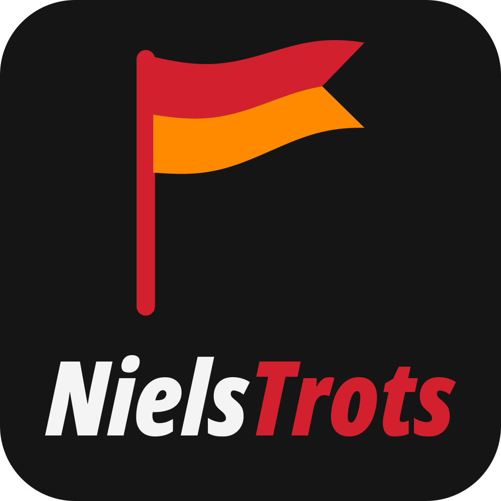

**Idea:** a swallow-tailed pennant, red over Dutch orange, flying high from its mast (*trots* is Dutch for proud). **Nod:** the namesake's bold race look in red, black and white; the orange is for the Dutch name.

| Colour | Hex | Where |
|---|---|---|
| primary: black | `#151515` | sail cloth |
| secondary: crimson | `#D3202F` | second panels; the mast, the pennant's top half, "Trots" |
| accent: Dutch orange | `#FF8A00` | highlights; the pennant's lower half |

Print ink: white "Niels", crimson "Trots". Font: Open Sans Condensed ExtraBold Italic.

Choices for the team:
1. A crimson-cloth colourway, with "Niels" in white and "Trots" in black.
2. "NielsTrots" written as one word (as given, and as on the sail now) or as "Niels Trots".
3. An orange mast.

### PJ New Sealand (after JP Australia): boards

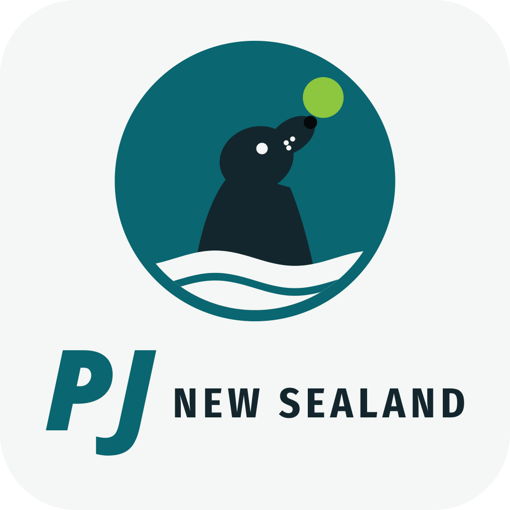

**Idea:** a seal coming up through the surf with a ball on its nose: the "seal" in "Sealand". "PJ" is set in big leaning capitals, followed by "NEW SEALAND" in spaced capitals. **Nod:** the namesake is a board maker with white decks and a playful streak.

| Colour | Hex | Where |
|---|---|---|
| primary: white | `#F4F7F5` | deck |
| secondary: sea teal | `#0A6670` | rails, stripes; the disc, "PJ" |
| accent: fern green | `#8DC63F` | fin, highlights; the ball (a nod to the country's fern, not its emblem) |
| the seal, "NEW SEALAND" | `#14262D` | |

Print ink: teal "PJ" and slate "NEW SEALAND" on white. Fonts: Noto Sans Black Italic and Fira Sans Condensed Bold.

Choices for the team:
1. "NEW SEALAND" is small and fades at a distance. Print "PJ" alone on the nose and the full name along the rails.
2. A fern-green ball (as now) or a coral one.
3. Two initials followed by a country is the namesake's layout. If the team finds that too close, put "NEW SEALAND" under the seal instead (a one-line change in the script).

### BMX Boards (after FMX Boards): boards

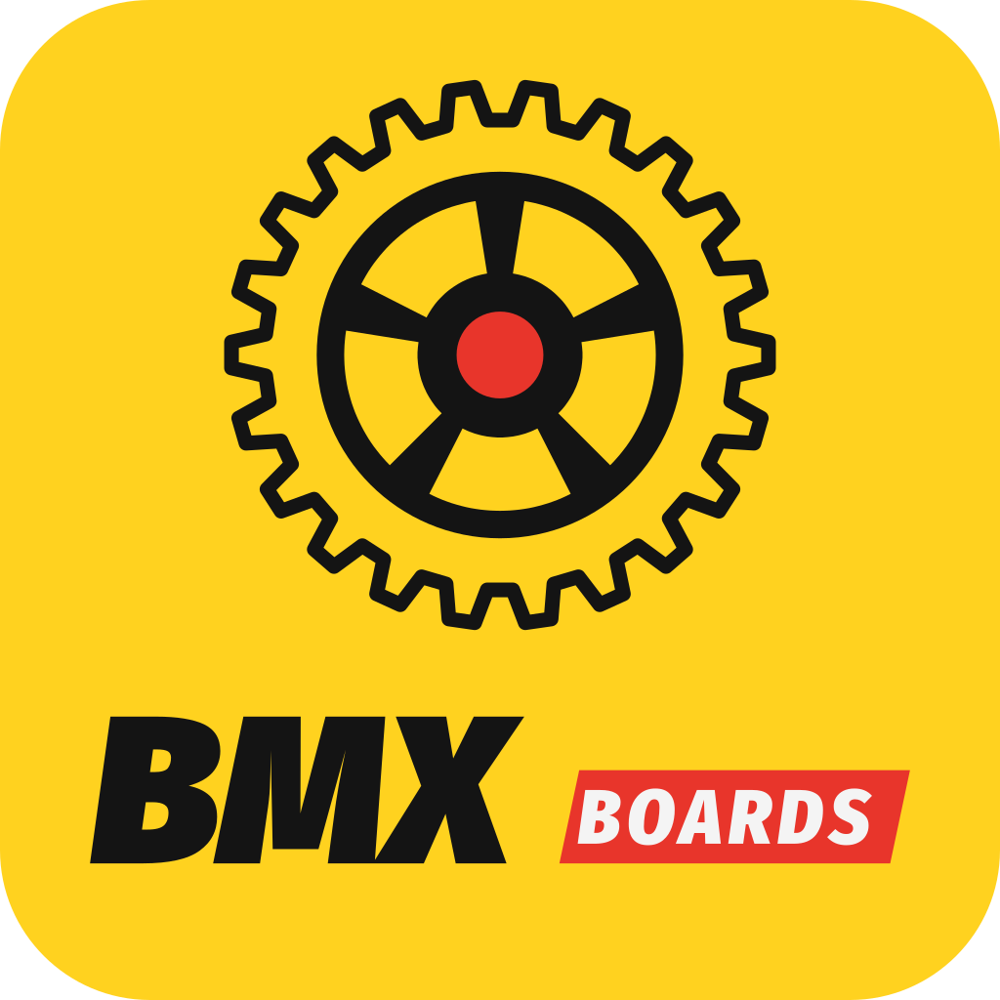

**Idea:** a chainring, the toothed sprocket of a BMX bike. "BMX" is set in heavy leaning capitals, with "BOARDS" on a red tag. **Nod:** a small, boutique board maker; here it gets a street, playful style.

| Colour | Hex | Where |
|---|---|---|
| primary: yellow | `#FFD21F` | deck |
| secondary: black | `#141414` | rails, stripes; the sprocket's outline and spider, "BMX" |
| accent: red | `#E8352B` | fin, highlights; the axle, the tag |

Print ink: black "BMX", a red tag with white "BOARDS". Fonts: Fira Sans Ultra Italic and Fira Sans Condensed Heavy Italic.

Choices for the team:
1. A black deck with a yellow print.
2. The red tag, or "BOARDS" plain in black.
3. The chainring's five spider arms, or a solid ring with a symbol cut in it (a BMX tradition).

### SouthSails (after North Sails): sails

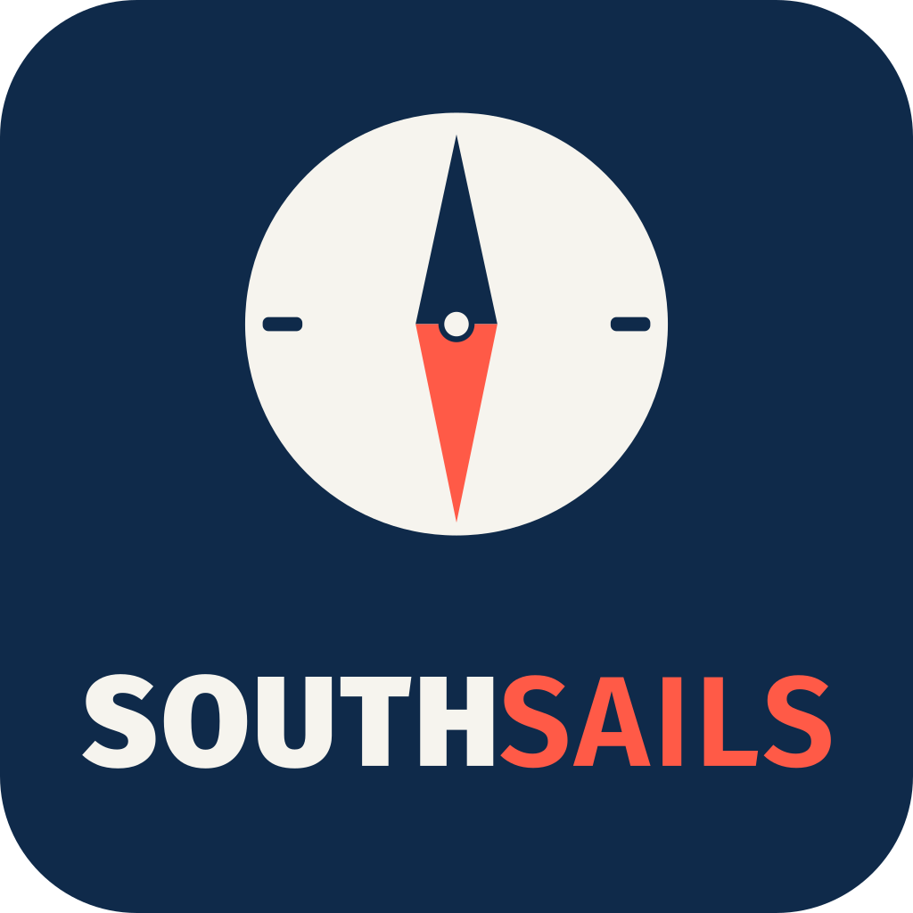

**Idea:** a compass whose painted half of the needle points the other way: south. The name is "SOUTH" in heavy white with "SAILS" in coral. **Nod:** the namesake's classic sailing navy and white, mirrored.

| Colour | Hex | Where |
|---|---|---|
| primary: navy | `#0F2A4A` | sail cloth |
| secondary: coral | `#FF5A47` | second panels; the south needle, "SAILS" |
| accent: off-white | `#F6F4EE` | highlights; the compass face, "SOUTH" |

Font: Fira Sans Heavy and SemiBold.

Choices for the team:
1. Coral (as now) or a true red for the south needle and "SAILS".
2. A white-cloth colourway with a navy print.
3. The navy plate on the navy menu (see the general choices).

### s3kauai (after S2Maui): sails

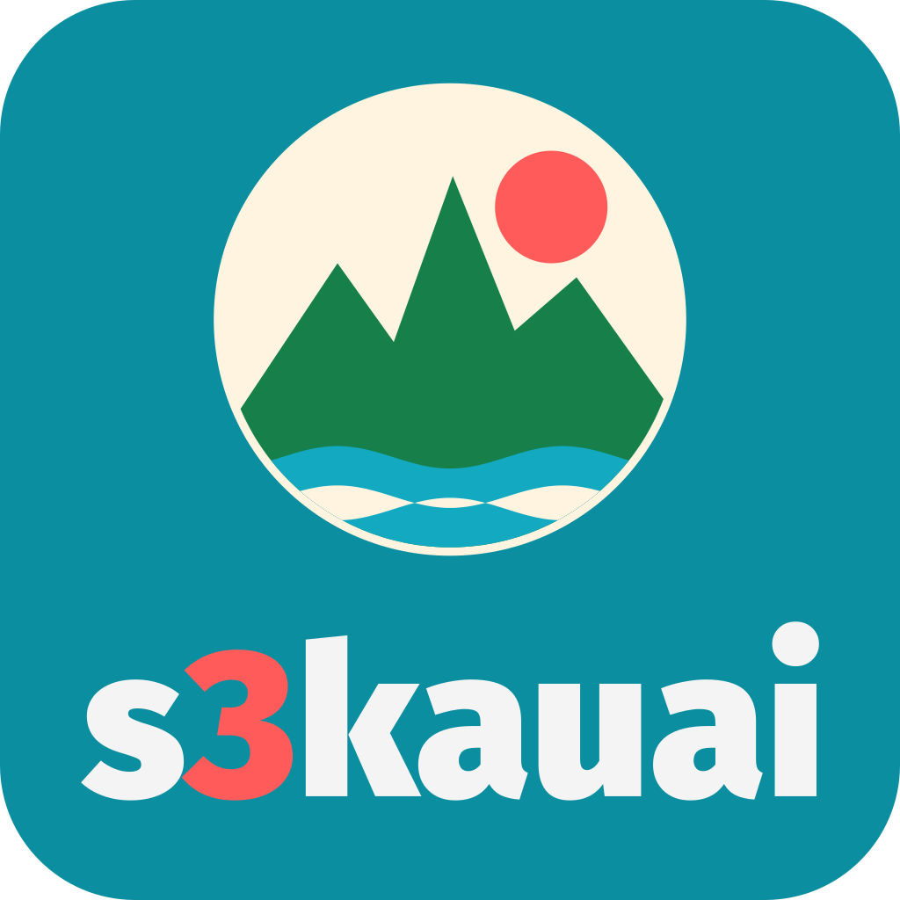

**Idea:** three green peaks of the Garden Island over the lagoon, with a coral sun. The "3" is three peaks: one island further than the namesake's. **Nod:** custom race sails from Hawaii, colourful.

| Colour | Hex | Where |
|---|---|---|
| primary: lagoon | `#0B8FA0` | sail cloth; the badge's rim |
| secondary: jungle green | `#17804A` | second panels; the peaks |
| accent: hibiscus coral | `#FF5B5B` | highlights; the sun, the "3" |
| the badge's cream, the water | `#FFF4E0` `#13A9C0` | |

Print ink: white with a coral "3". Font: Fira Sans Heavy, lower case.

Choices for the team:
1. The "3" in coral (as now) or in green.
2. On the sail: the full-colour badge as well, or only the wordmark.
3. Written in lower case (as given), which keeps it a little informal.

### Forbidden (after Tabou): boards

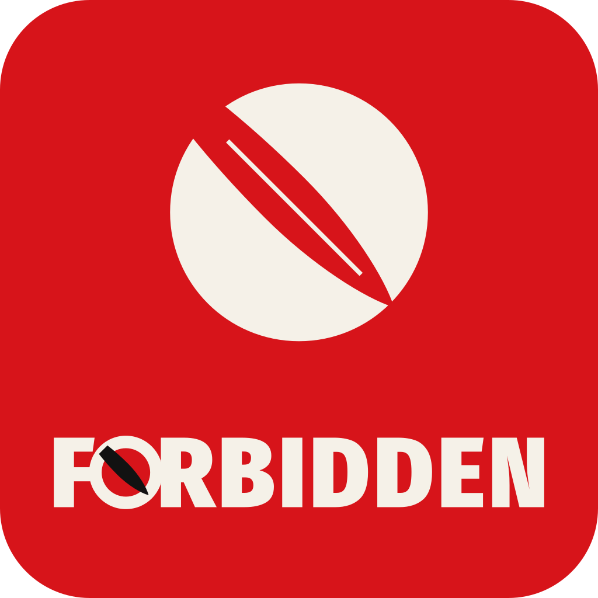

**Idea:** a "not allowed" sign whose bar is a windsurf board. In the wordmark the O is the sign. **Nod:** "tabou" is French for taboo; the namesake's graphics are cheeky and playful.

| Colour | Hex | Where |
|---|---|---|
| primary: signal red | `#D7141A` | deck; the sign's ring and board |
| secondary: black | `#121212` | rails, stripes; the board in the wordmark's O |
| accent: bone | `#F5F1E8` | fin, highlights; the sign's field, the print |

Print ink: bone white with a black board in the O. Font: Fira Sans Condensed Heavy, capitals.

Choices for the team:
1. The board in the sign's red (the sign reads first, as now) or in black (the board reads first).
2. The O as the sign (as now) or a plain O.
3. A black deck with a red print.

### GG Sails (after GA Sails): sails

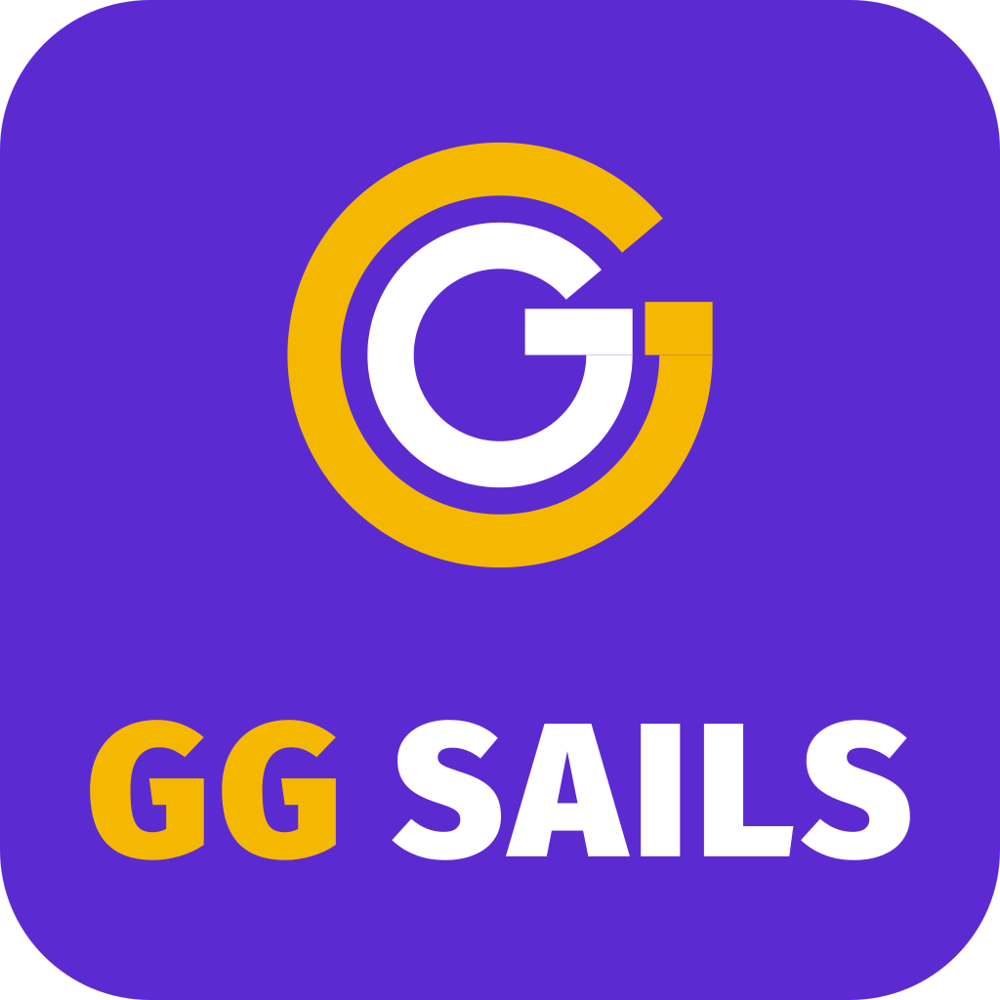

**Idea:** two Gs, one inside the other. "GG" also means "good game", a nod to the players. **Nod:** the namesake is a clean, race-minded sail maker with Dutch roots; the gold and violet are the game's own.

| Colour | Hex | Where |
|---|---|---|
| primary: violet | `#5B2BD1` | sail cloth; the mark's disc |
| secondary: charcoal | `#1D1B26` | second panels |
| accent: gold | `#F5B800` | highlights; the outer G, "GG" |

Print ink: gold "GG", white "SAILS". Font: Fira Sans Heavy.

Choices for the team:
1. Violet (as now) or a blue colourway closer to the namesake.
2. The inner G in white (as now) or in gold, with the outer one in white.
3. The tagline "Good game." or something about sails.

### Montag (after Sonntag): fins

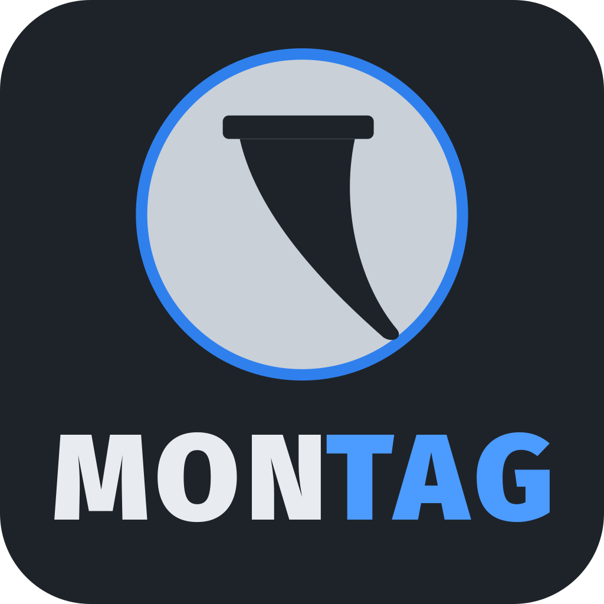

Added by the shaper (part 4) on the lead's decision of 1 November 2026: none of the eleven brands makes fins, and the gear page's Fin tab needs a brand for the game's five fins. **Idea:** a swept race fin hanging from its base on a silver disc. *Montag* is Monday, the day after *Sonntag* (the custom fin maker's name means Sunday), in the spirit of Michiel's names; he may rename it. **Nod:** hand-made carbon race fins: dark carbon, silver, one cool blue.

| Colour | Hex | Where |
|---|---|---|
| primary: carbon | `#1E2329` | the plate, the fin in the mark |
| secondary: silver | `#C9D0D8` | the disc |
| accent: blue | `#2F80ED` | the disc's rim, "TAG" in the print |

Print ink: light grey "MON" and blue "TAG" on carbon. Font: Fira Sans Heavy, capitals. The fins themselves are plain black carbon (no print). Since 6 November 2026 `Brand.makes_fins` is true for Montag, the five fin brands below and PJ New Sealand (whose fin is the game's default fin).

## The five fin brands (6 November 2026)

Max's ask: "Add more fins: Z fins > M fins, Finish fins > Start fins, Carpenter fins > Blacksmith fins, Hurricane fins > Typhoon fins, NP7 > NT8." The name after the arrow is the game's; the real maker's name stays out of `Game/` (it is in the real makers' list of `Game/tests/unit/test_brands.gd`, which the tests check every brand and every fin against). Drawn by `tools/brands/make_logos.py` like the others, in Open Sans (SIL Open Font License), on Max's Windows PC through the script's new fallback (the letters from the font's `.ttf`, the PNGs by Godot). The colours are my choice in the spirit of each name, not copied from the real makers' looks (not checked against them). Each brand's fin wears the brand's colours on the water: a body colour and a coloured tip (`GearItem.fin_colour`, `fin_tip_colour`, `fin_tip_share`). How the fins work: [fin_brands.md](fin_brands.md).

| Brand (after) | Slug | Tagline | Mark | Primary / secondary / accent | The fin |
|---|---|---|---|---|---|
| 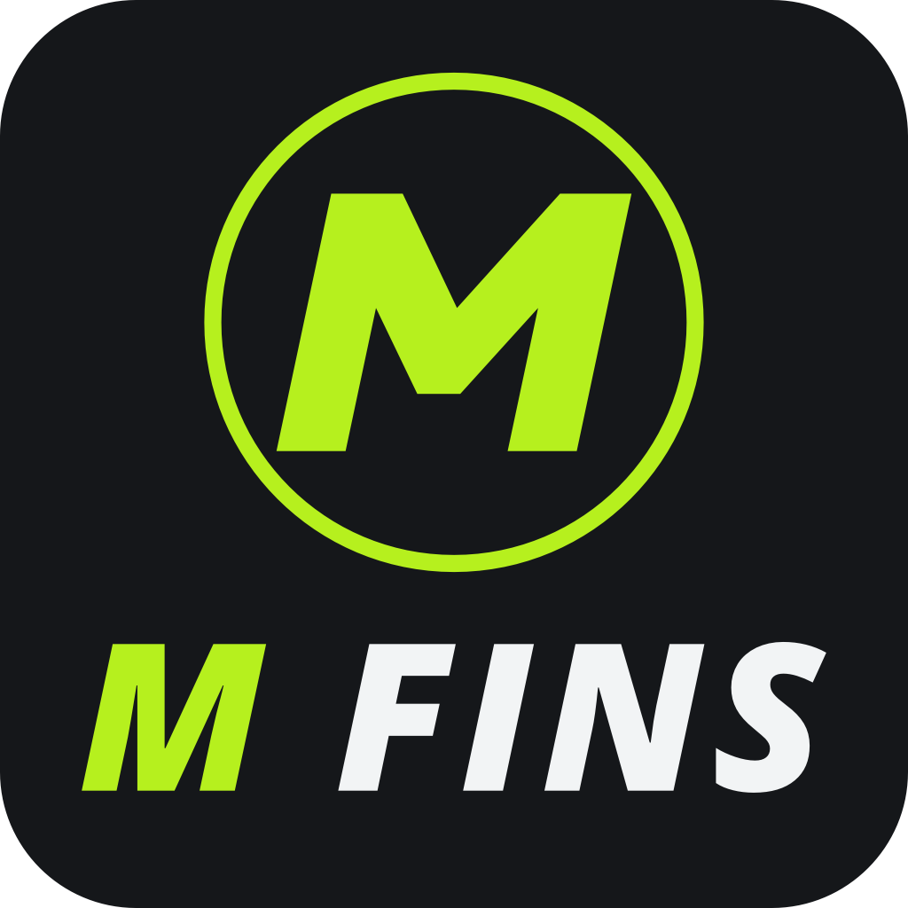 **M Fins** (Z fins) | `m_fins` | Made to measure. | a forward-leaning lime M on a carbon disc | carbon `#15171A` / white `#F2F4F5` / lime `#B6F01E` | "Mach": carbon, the lowest 22 % lime |
| 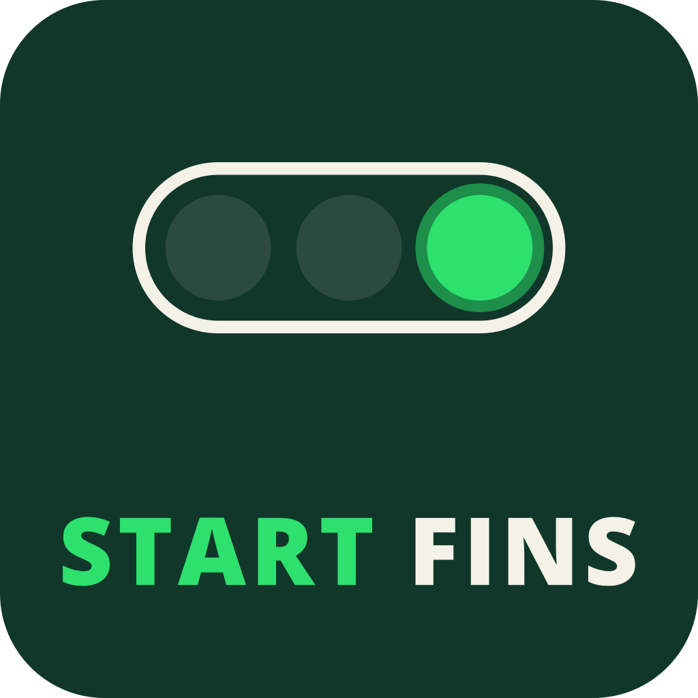 **Start Fins** (Finish fins) | `start_fins` | First off the line. | the start lights: two out, the last one green | racing green `#10372A` / off-white `#F4F1E6` / start green `#2EE06E` | "Holeshot": dark green carbon, the lowest 15 % start green |
| 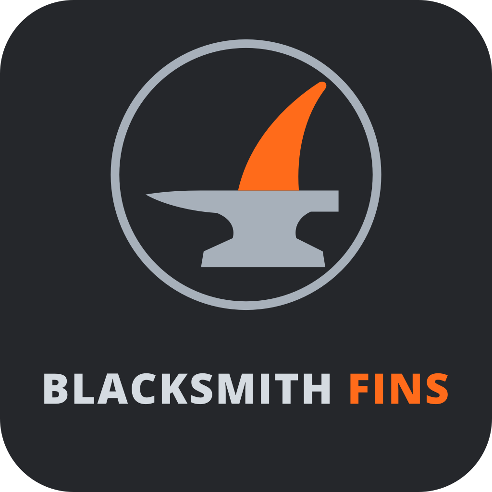 **Blacksmith Fins** (Carpenter fins) | `blacksmith_fins` | Forged, not poured. | a fin glowing on an anvil | iron `#25272B` / steel `#A7B0BA` / ember `#FF6B1A` | "Tempered": iron grey, the lowest 28 % ember orange (hot from the forge) |
| 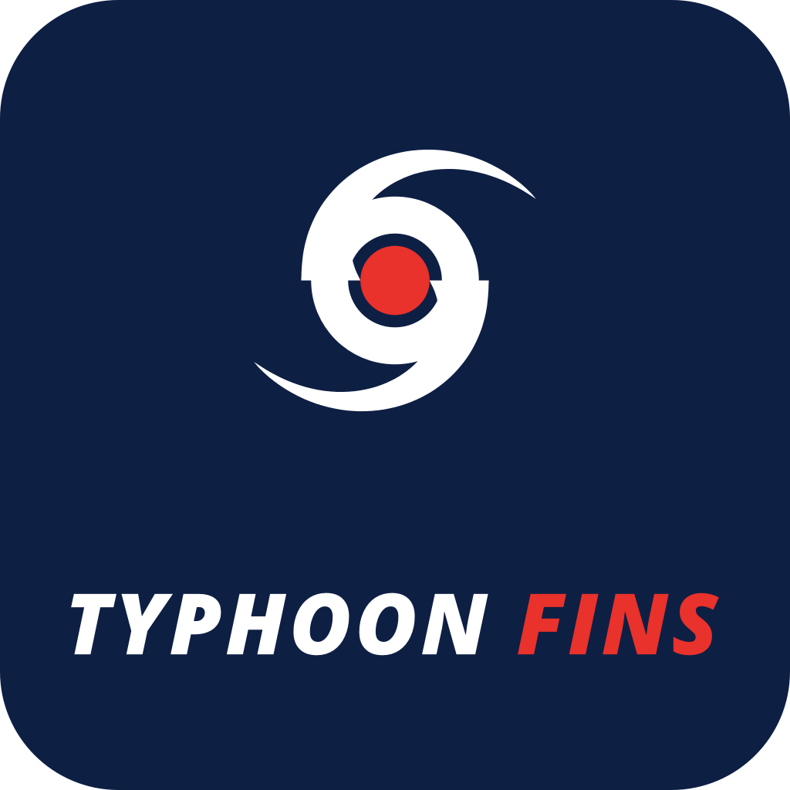 **Typhoon Fins** (Hurricane fins) | `typhoon_fins` | Calm in the eye of the storm. | the weather map's storm: a ring round a red eye, two arms | navy `#0E1F44` / white `#FFFFFF` / storm red `#E8322B` | "Eyewall": navy, the lowest 15 % red |
| 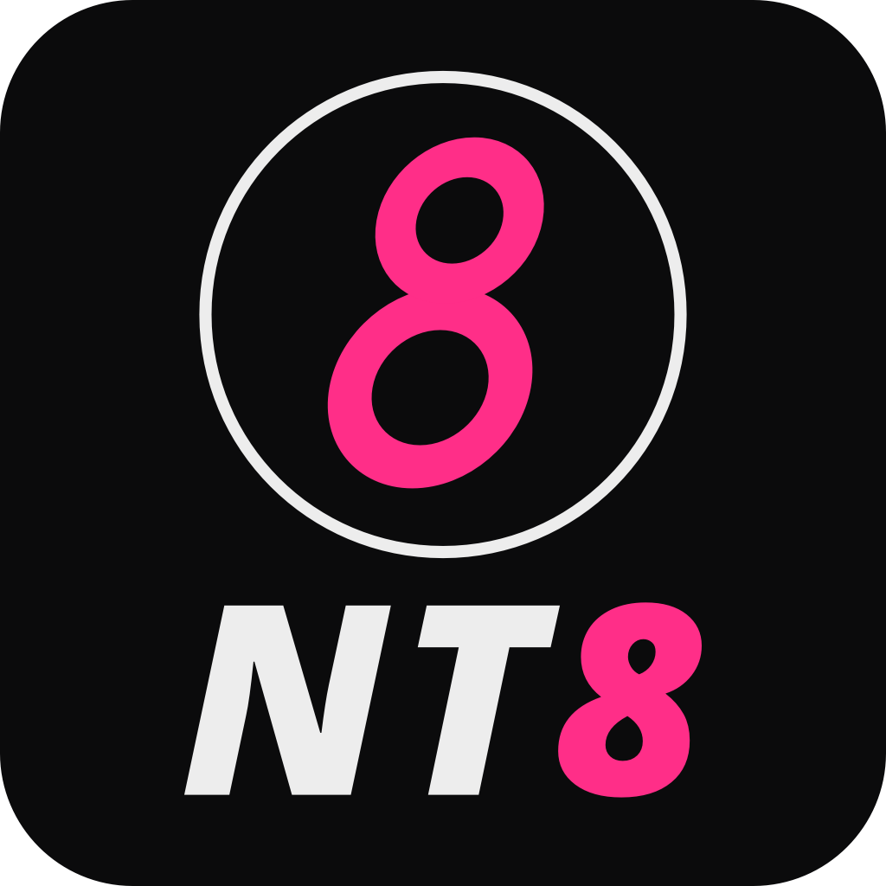 **NT8** (NP7) | `nt8` | Infinity, stood up. | a magenta 8 of two rings on a black disc | black `#0B0B0C` / white `#EDEDED` / magenta `#FF2E88` | "Octane": carbon, the lowest 20 % magenta |

Print ink: the light colour, then the accent ("M" lime and "FINS" white; "START" green; "BLACKSMITH" steel and "FINS" ember; "TYPHOON" white and "FINS" red; "NT" white and "8" magenta), on the primary. The model names are made up. The fin brands appear on the gear page's Fin tab only (they make no boards or sails).

## Choices for every brand

1. **The plate.** The logo sits on a rounded plate in the brand's colour. Moonboard's and SouthSails' navy plates almost disappear on the menu's dark blue. The gear page can give each card a thin light border, or show the mark there (all eleven marks read on the menu's blue).
2. **One-colour wordmarks.** If the shaper wants to tint the print in Godot (a white texture times any colour), the script can also write an all-white wordmark per brand. That is a few lines; not done yet.
3. **The names (Michiel decides).** Built as given. Two things worth knowing before a public release, from general knowledge and not checked in a trademark register: *MoonBoard* is a well-known climbing training board, and *Forbidden* is a mountain-bike maker. Both are other sports, but a quick search before 1.0 would be wise. A tweak to consider for the print is "PJ" alone on the deck (choice 1 under PJ New Sealand).

## For the shaper and the gear page: how to use `Brand`

`Game/gear/brand.gd` (class `Brand`, a Resource) holds one brand: `name`, `slug`, `tagline`, `makes_boards`, `makes_sails`, `makes_fins`, the colours `primary`, `secondary`, `accent`, and the textures `logo`, `wordmark`, `mark`. The eleven are in `Game/gear/brands/<slug>.tres`.

```gdscript
for brand: Brand in Brand.all():          # the eleven, in the gear page's order
	if brand.makes_sails:
		add_sail_brand_card(brand.mark, brand.name, brand.tagline)
var savanna: Brand = Brand.find("savanna")  # null if no brand has that slug
sail_cloth_material.albedo_color = savanna.primary
```

- **The shaper (part 4)** colours the sail's main panels with `primary`, the second panels with `secondary` and the small parts with `accent`. It does the same on the board: deck, rails and stripes, fin. It prints `wordmark` on the sail's panels and along the deck, and puts `mark` on the board's tail and the fin. In 3D the print needs mipmaps, or it shimmers at a distance. The PNGs are imported as plain 2D textures (Godot's default), so turn on `mipmaps/generate` in the import settings of the ones used on the gear. Godot's 3D detection may also do this in the editor the first time a texture is used in a material. The print reads correctly from one side only; a real sail shows it mirrored through the cloth on the other side.
- **The gear page (part 5)** shows `mark` on each brand's card with `name` and `tagline`, can colour the card's stripe with `primary`, filters by `makes_boards` and `makes_sails`, and uses `logo` for a brand's header.

## Changing a brand

- **The drawings and their colours** are in `tools/brands/make_logos.py`, one short function per brand. Run `python -I tools/brands/make_logos.py <slug>` to redraw a brand and the contact sheet. It needs Python with pycairo and PyGObject's Pango, `rsvg-convert` and `magick` (all on Michiel's machine), and the fonts named above, but only to redraw.
- **The game's colours, name and tagline** are in `Game/gear/brands/<slug>.tres`. When a brand's colours change, change both places: the script draws the logos and the `.tres` dresses the gear.
- Afterwards run `tools/check.sh` (Godot re-imports the PNGs) and `tools/test.sh unit -gselect=brands`.

## Files

| What | Where |
|---|---|
| The drawings, per brand | `Game/assets/brands/<slug>/logo.svg`, `wordmark.svg`, `mark.svg` and their `.png` (plus Godot's `.import` files) |
| The brands | `Game/gear/brand.gd`, `Game/gear/brands/<slug>.tres` |
| The test | `Game/tests/unit/test_brands.gd` |
| The script that draws them | `tools/brands/make_logos.py` |
| The contact sheet (not committed) | `.screenshots/brands.png` |

The slugs: `tripletone`, `savanna`, `point9`, `moonboard`, `nielstrots`, `pj_new_sealand`, `bmx_boards`, `southsails`, `s3kauai`, `forbidden`, `gg_sails`, and `montag` for the fins.
