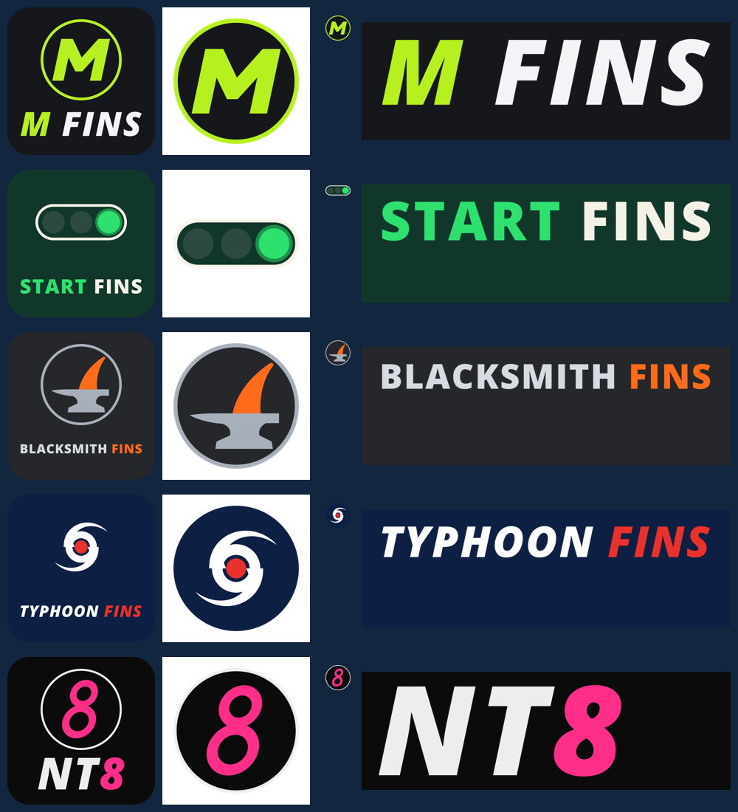

# GE8: five fin brands, and every fin at any depth from 28 to 52 cm

**Branch:** `gear/fin-brands`, from `play/6nov-evening` at f01bc9f. 6 November 2026, one Opus builder, no agents. **No physics change:** nothing in `Game/sim/` was touched.

**Max's ask:** "Add more fins: Z fins > M fins, Finish fins > Start fins, Carpenter fins > Blacksmith fins, Hurricane fins > Typhoon fins, NP7 > NT8. Add just the brands with a size slider from 28-52 cm. Also add this for the fins already in the game."

## 1. In short

- **Five new fin brands:** M Fins, Start Fins, Blacksmith Fins, Typhoon Fins and NT8, each with a name, a line in its own voice, three colours, a logo, a mark and a wordmark (section 2). The real makers' names are not in the game; they are now in the list the brands' test checks every brand and every fin against.
- **One fin per brand, any depth.** On the gear page's Fin tab you pick a brand, then set the fin's depth with a slider from 28 to 52 cm. Beside the slider: the depth and the fin's area ("38 cm · 311 cm²"). Under it, an orange mark at the depth the brands recommend for your board's width (38 cm for the default 72 cm board). The fin is kept the moment the slider moves, and the 3D preview's fin grows or shrinks with it.
- **The fins already in the game have the slider too:** Montag and PJ New Sealand (the default fin). Your saved choice keeps working: "montag_slalom_38" or "pj_new_sealand_slalom_38" load exactly the numbers they had.
- **What a depth changes** (section 4): the depth, the area (that of a real race fin of that depth), the stiffness (it follows from the depth and the chord by itself), the wind range on the card. **The brands differ only in their look:** at the same depth their fins sail alike. The one exception is PJ New Sealand's fin, the game's default fin, which has a wider chord (17 % more area at every depth), as it always had.
- **The AI fleet** sails all seven fin makers: each of the twenty personas has its fin brand, and its fin's depth comes from its board's width and the wind (section 5).
- **The physics at the ends** (section 6): the default board with a 28 cm and a 52 cm fin at 12, 18 and 24 kt. Sailing straight: no fall, no NaN, nothing blew up; the 52 cm fin is the fastest in 12 kt, the 28 cm fin the fastest in 24 kt, as on the water. In the whole manoeuvre matrix the 28 cm fin never fell; the 52 cm fin tipped the sailor back twice while bearing away into a gybe in 18 kt (a big fin in a breeze; the default fin did not); the one 24 kt catapult the default fin has in a gybe, the 28 and 52 cm fins did not have.
- **A question for Michiel** (section 9): the race-shaped fins (Montag's since GE3, and now the five brands') bend about twice as much as the measured test fin at the same depth, and in 18 kt and more their tips reach the beam's 35 degree cap. Not changed: it is his call.

## 2. The five brands and their looks



| Brand (after) | Tagline | The mark | The fin on the water |
|---|---|---|---|
| **M Fins** (Z fins) | Made to measure. | a forward-leaning lime M on a carbon disc | "Mach": carbon, the lowest 22 % lime |
| **Start Fins** (Finish fins) | First off the line. | the start lights: two out, the last one green | "Holeshot": dark green carbon, the lowest 15 % start green |
| **Blacksmith Fins** (Carpenter fins) | Forged, not poured. | a fin glowing on an anvil | "Tempered": iron grey, the lowest 28 % ember orange, hot from the forge |
| **Typhoon Fins** (Hurricane fins) | Calm in the eye of the storm. | the weather map's storm: a ring round a red eye, two arms | "Eyewall": navy, the lowest 15 % red |
| **NT8** (NP7) | Infinity, stood up. | a magenta 8 of two rings on a black disc | "Octane": carbon, the lowest 20 % magenta |

The colours, the print and the files are in [brands.md](brands.md) ("The five fin brands"). The colours are my choice in the spirit of each name; they are not copied from the real makers (I did not look their looks up). The model names are made up.

**How they were drawn.** `tools/brands/make_logos.py`, like the other twelve brands. It needed tools this PC does not have (Pango for the letters, rsvg-convert for the PNGs, ImageMagick for the contact sheet), so it now has a fallback: the letters are read straight from the font's `.ttf` file (`tools/brands/ttf_outlines.py`, plain Python), Godot draws the PNGs (`tools/brands/svg_to_png.gd`), and the contact sheet is skipped. The new brands use Open Sans (free, SIL Open Font License), which Windows and Linux both have.

**The fin's look.** All seven brands' fins have the same shape: the race fin of Montag's 38 cm model (built by Blender from the gear table), stretched to the depth and the chord. Each new brand paints it: a body colour and a coloured tip (`GearItem.fin_colour`, `fin_tip_colour`, `fin_tip_share`; the fin's shader `fin_bend.gdshader` paints the tip below a depth). Montag's and PJ New Sealand's fins stay plain black carbon, as before. No brand mark is printed on the fin (the fin model has no picture coordinates; a mark would need a Blender model per brand).

## 3. How the slider works

- **A fin choice is a brand and a depth.** The id stays "<brand>\_slalom\_<cm>" ("nt8\_slalom\_44"), saved in the settings (`[gear] fin=`), sent over the LAN and used by the AI as before.
- **Files and made fins.** `Game/gear/fins/` holds each fin brand's 38 cm fin (and Montag's five sizes, 34, 38, 40, 42 and 46 cm, which stay). Any other depth is made from the brand's 38 cm fin the first time it is asked for, then kept (`GearCatalogue.fin_of()`, `make_fin()`): the same fin, with
  - the depth asked for (`span_m`);
  - the area of a race fin of that depth (`Game/gear/fin_sizes.tres`), times the 38 cm fin's own share of the race fin's area at 38 (1 for every brand but PJ New Sealand: 365/311);
  - the same planform, section and flex test (the same material; section 4);
  - the wind range and the card's line of that depth;
  - the 38 cm fin's model and colours, stretched to the depth and to the chord (`RigVisuals.fin_stretch()`: down to the depth, along the board by the mean chord; not across, so the bend stays the simulation's).
- A depth that has a file (Montag's five) uses the file: the old numbers, exactly. A test makes Montag's five depths from its 38 cm fin and checks that they come out the same as the files, number for number.
- **The area by depth** (`fin_sizes.tres`): Select's race fin, the Rhino Pro, every 2 cm from 30 to 48 cm (its published areas, [brand_research.md](brand_research.md) section 1.4), the odd sizes and 29 cm as the research put them. **What I fitted:** for 28 cm and 49 to 52 cm, a power law through Select's ten sizes by least squares on the logarithms: **area = 2.19 x depth^1.363** (cm², cm), within 3 cm² of each of the ten (root mean square 1.3 cm²). It gives 28 cm: 205 cm², 49: 440, 50: 452, 51: 464, 52: 477 cm². The same table is in `tools/blender/gear_set.py` (`RACE_FIN_AREA_CM2`, now 28 to 52 cm).
- **The recommended depth** is the brands' rule from the research, to the whole centimetre: depth = 0.30 + 0.64 x (board width - 0.60) m. 38 cm for the default 72 cm board.
- **The wind range** is the rule the catalogue writer used for Montag's five fins, so the cards agree: the range starts at 52 - 0.95 x depth knots (rounded) and is 11 kt wide; the deeper the fin, the lighter the wind. New: it never starts below 6 kt (a slalom board hardly planes below that; it only matters from 49 cm, where the rule would say 3 or 4 kt).
- **The page** (`Game/ui/gear_page.gd`): the seven fin brands' cards; under the chosen brand's header the slider (`FinDepth`, whole centimetres, a tick per centimetre), the depth and area, a line about the orange mark, then the fin's card (the name and depth, the wind range, a line about it). Moving the slider chooses that brand's fin at that depth; choosing another brand's card shows its fin at the slider's depth, and its card (or the slider) chooses it. The note at the bottom says the brands differ in their look. Esc > Change gear opens the same page (the pause menu's own copy of it), so the slider is there too; the pause menu itself did not change (its tests pass; not tried by hand). Choosing a board on the Board tab moves the Fin tab's orange mark at once.

## 4. What a depth changes in the physics

Nothing in `Game/sim/` changed: a fin of another depth is a `FinConfig` with another `span_m` and `area_m2`, which the physics already sails. The stiffness follows by itself: the fin is a beam whose bending stiffness is a material number times the chord to the fourth power (`FinModel`), and the material number comes from the flex test (100 N hung at 80 % of the depth of a 37 cm carbon slalom fin moves it 20 mm, Nascimento 2017), drawn on the game's default fin (38 cm, 365 cm²). Every brand's fin keeps those flex test numbers: the same material.

The race fin (Montag, M Fins, Start Fins, Blacksmith Fins, Typhoon Fins, NT8), printed by `tools/matrix.sh --gear_fin=<id>`:

| Depth | Area | Root chord | The flex test's load (100 N at 80 % of its depth) bends it | Stiffness at the root (EI) | Wind on the card | For boards about |
|---|---|---|---|---|---|---|
| 28 cm | 205 cm² | 10.7 cm | 23.7 mm | 29 N m² | 25 to 36 kt | 57 cm wide |
| 34 cm | 267 cm² | 11.5 cm | 32.1 mm | 39 N m² | 20 to 31 kt | 66 cm |
| 38 cm | 311 cm² | 12.0 cm | 37.9 mm | 46 N m² | 16 to 27 kt | 72 cm |
| 40 cm | 333 cm² | 12.2 cm | 41.3 mm | 49 N m² | 14 to 25 kt | 76 cm |
| 46 cm | 405 cm² | 12.9 cm | 50.3 mm | 61 N m² | 8 to 19 kt | 85 cm |
| 52 cm | 477 cm² | 13.4 cm | 61.6 mm | 72 N m² | 6 to 14 kt | 94 cm |

PJ New Sealand's fin (the default fin's wider chord, 17 % more area):

| Depth | 28 cm | 34 cm | 38 cm (the default fin) | 40 cm | 46 cm | 52 cm |
|---|---|---|---|---|---|---|
| Area | 241 cm² | 313 cm² | 365 cm² | 391 cm² | 475 cm² | 560 cm² |
| Root chord | 12.6 cm | 13.5 cm | 14.0 cm | 14.3 cm | 15.1 cm | 15.7 cm |
| Bend under the flex test's load | 12.5 mm | 16.9 mm | 20.0 mm (the test) | 21.8 mm | 26.5 mm | 32.5 mm |
| EI at the root | 55 N m² | 73 N m² | 86 N m² | 92 N m² | 116 N m² | 136 N m² |

**Is it plausible?** The trend is right: the shorter the fin, the stiffer; the deeper, the softer (a 52 cm fin bends 2.6 times as much as a 28 cm one under the same load at the same share of its depth). The level is the question for Michiel (section 9): the race-shaped fins have a narrower chord than the test fin was drawn with, so at the same depth they bend 1.9 times as much (37.9 mm against 20 mm at 38 cm), and a 28 cm race fin comes out softer than the measured 37 cm fin, which a real 28 cm fin is not. This was already so for Montag's five fins (GE3 gave them the default fin's flex test numbers); the slider only makes it visible at the ends.

## 5. The AI's picks

- Each persona has a fin brand (`Persona.fin_brand`, in its `.tres`), spread so a race shows all seven makers:

| Fin brand | Personas |
|---|---|
| Montag | Aiko, Kofi, Pia |
| M Fins | Bruno, Lena, Ravi |
| Start Fins | Elin, Liv, Sven |
| Blacksmith Fins | Greta, Mara, Tobias |
| Typhoon Fins | Hana, Noor, Tomas |
| NT8 | Ines, Marco, Yusuf |
| PJ New Sealand | Jonas, Pavel |

- **The depth** (`Persona.fin_depth_for()`): the depth the brands recommend for the width of the board it picked for the wind, a little deeper for a sailor who rigs big and shorter for one who rigs small (`rig_power()`: from 3 cm shorter to 1 cm deeper than the board's depth), kept within the depths whose wind range holds the wind (in 12 kt 42 to 52 cm, in 18 kt 36 to 47 cm, in 24 kt 29 to 41 cm), rounded to whole centimetres.
- **The race** (`tools/race.sh --course=t1_loop --skippers=persona:hana,persona:marco,persona:mara --seconds=300`, 15 kt), its log:

```
Hana sails Forbidden Stingray 122 L  ·  Point.9 BC-1 8.8 m²  ·  Typhoon Fins Eyewall 41 cm
Marco sails Forbidden Stingray 122 L  ·  Point.9 BC-1 8.8 m²  ·  NT8 Octane 41 cm
Mara sails PJ New Sealand Slalom T-SEC 125 L  ·  Savanna Cheetah 8.5 m²  ·  Blacksmith Fins Tempered 40 cm
```

  All three started, sailed two of the six steps in the 300 s without a fall (the race is longer than 300 s: "DNF" means stopped by the clock). The log also shows the race tool's usual script errors at load ("Identifier not found: GameSettings" in `hud.gd` and `main.gd`), from files this branch did not touch; the race then runs.

## 6. The physics check at the ends of the range

The default board (PJ New Sealand 117 L) and the default 8.0, with a fin of the slider, through the manoeuvre matrix: `tools/matrix.sh --gear_fin=<id>` (new: the matrix now takes a gear page item; the logs are in `.screenshots/fins/`). The race fins are Montag's (the five brands' are the same numbers); the default fin is PJ New Sealand's 38 cm, as every matrix before sailed.

**Straight on a beam reach**, the speed over the last 15 s (m/s):

| Fin | 12 kt | 18 kt | 24 kt | Falls | NaN |
|---|---|---|---|---|---|
| race fin 28 cm (205 cm²) | 7.91 | **12.98** | **14.77** | 0 | 0 |
| race fin 38 cm (311 cm², Montag's file) | 8.12 | 12.80 | 14.50 | 0 | 0 |
| race fin 52 cm (477 cm²) | **8.51** | 12.65 | 14.07 | 0 | 0 |
| PJ New Sealand 28 cm (241 cm²) | 7.89 | 13.02 | 14.86 | 0 | 0 |
| **the default fin**, PJ New Sealand 38 cm (365 cm²) | 7.94 | 13.05 | 14.73 | 0 | 0 |
| PJ New Sealand 52 cm (560 cm²) | 8.00 | 12.75 | 14.31 | 0 | 0 |

The deep fin is the fastest in light wind (more lift for the same slip, less leeway) and the slowest in a strong wind (more wetted area and drag); the short fin the other way round. That is what the real fins' wind ranges say.

**The fin's load in the same window:** its lift, its slip angle, its share of the board's sideways grip and how far its tip has turned under the bend (the beam caps the slope at 35 degrees, `max_bend_deg`):

| Fin | Wind | Lift | Slip | Share | Tip turned |
|---|---|---|---|---|---|
| race 28 cm | 12 / 18 / 24 kt | 334 / 666 / 684 N | 5.9 / 4.3 / 3.4° | 0.60 / 0.44 / 0.35 | 14 / 28 / 29° |
| race 38 cm | 12 / 18 / 24 kt | 397 / 691 / 700 N | 4.2 / 2.9 / 2.3° | 0.43 / 0.30 / 0.24 | 20 / 35 / **35°** (the cap) |
| race 52 cm | 12 / 18 / 24 kt | 446 / 709 / 711 N | 2.7 / 1.9 / 1.6° | 0.28 / 0.20 / 0.16 | 26 / **35 / 35°** (the cap) |
| the default fin, 38 cm | 12 / 18 / 24 kt | 389 / 712 / 591 N | 3.8 / 2.6 / 1.7° | 0.39 / 0.26 / 0.17 | 10 / 19 / 16° |

The race fins' tips turn about twice as far as the default fin's under the same lift, and the 38 and 52 cm ones reach the cap from 18 kt: section 4's stiffness question for Michiel (section 9).

**The whole matrix** (tacks, gybes, turns on a run, out of irons, straight; 24 cases each):

| Fin | Falls | NaN | Manoeuvres not completed |
|---|---|---|---|
| race 28 cm | 0 | 0 | 0 |
| race 38 cm (Montag's file, as it was) | 1: the beam gybe in 24 kt, a catapult at 27.3 s | 0 | 0 |
| race 52 cm | 2: the broad gybe and the beam gybe in 18 kt, tipped back at 27.3 and 28.1 s, while bearing away into the gybe | 0 | 1 (the broad gybe after its fall) |
| the default fin | 1: the beam gybe in 24 kt, a catapult at 27.3 s (the same case as Montag's 38) | 0 | 0 |

No spin-outs: the game has no real spin-out yet (PH6). The 52 cm fin's two falls are new: bearing away hard in 18 kt with the deepest fin, the sailor is tipped backwards. A big fin in a breeze is hard to hold on the water too, but whether these two falls are right is for Michiel and Max's play-test; the 24 kt gybes, where the default fin catapults, the 52 cm fin sailed through.

## 7. Screenshots

- **In git:** [fin_brands_tab_1280.png](fin_brands_tab_1280.png): the Fin tab at 1280 x 720 with Blacksmith Fins' 30 cm chosen (the orange tip in the preview, the slider at 30, the orange mark at 38, "30 cm · 226 cm²", the line about the mark; the fin's card starts at the bottom and the rest of it is a scroll away, as the model cards on the other tabs). [fin_brands_tab_wide.png](fin_brands_tab_wide.png): the same at Max's 3137 x 1263 (shrunk to 1600 px wide for git) with Typhoon Fins' 48 cm: the navy fin with its red tip, long in the preview. [fin_brands_logos.png](fin_brands_logos.png): the five logos, the marks on white and small, the wordmarks on their colour.
- **Not in git** (`.screenshots/fins/` in this worktree): the full-size pictures, the race log `race_t1.log`, the matrix logs `matrix_ends.log` and `matrix_full.log`.
- How to take them: a settings file with only `[gear]` and `fin="blacksmith_fins_slalom_30"`, then `tools/screenshot.sh res://ui/start_menu.tscn <png> 120 --page=gear/fin --settings=<file> [--resolution=3137x1263]`.

## 8. What Max should look at

1. **The Fin tab:** start the game, Gear, Fin. Seven brand cards; do the five new logos read, and do the names and taglines sound right?
2. **The slider:** move it with the mouse and with the arrow keys (click the slider first; Up and Down leave it). The depth and area beside it change, the preview's fin grows and shrinks, the orange mark sits at your board's depth. Change the board on the Board tab and come back: the mark moves (a 63 cm board: 32 cm; an 85 cm board: 46 cm).
3. **The colours on the water:** choose, for example, Blacksmith Fins at 40 cm and sail. The fin is under water, so its orange tip shows when the board jumps a wave or after a fall (the F1 panel's first line names the fin).
4. **Your saved fin:** if you had a Montag fin chosen before, it is still chosen, at its depth.
5. **A race with the fleet's fins:** a race with personas and "Their own gear" on: their fins are of the seven makers, each as deep as its board and the wind call for (you see a fin when a board falls; `tools/race.sh` prints each persona's gear).
6. **The ends:** sail a 28 cm and a 52 cm fin in a strong and a light wind. Does a small fin in light wind feel like it slides away, and a big one in a gale like it lifts too much? (The physics has the area, the depth and the bend; whether it feels like the real thing is yours to judge.)
7. **Esc > Change gear** between races: the Fin tab there has the slider too.

**Not verified:** how any fin feels to sail (yours to judge); the slider dragged by hand (the tests set its value and check the setting, the card, the preview and the mark; the screenshots show it); Esc > Change gear by hand; a made fin between two PCs on the LAN (its id travels as any gear id did; `tools/lan_test.sh` was not run, as the play-test is on this PC); the five logos drawn on a computer with Pango (here the fallback drew them, without kerning; Pango would space the letters slightly differently); the fins' colours seen on the water while sailing (only in the gear page's preview).

## 9. Open questions

1. **For Michiel: the race fins' stiffness.** The flex test (20 mm under 100 N at 80 % of a 37 cm fin) is drawn on the default fin's wide planform (38 cm, 365 cm²). Montag's fins and the five brands' have a real race fin's area (311 cm² at 38 cm), a narrower chord, and with the same material they bend 1.9 times as much: 37.9 mm at 38 cm, 23.7 mm at 28 cm, 61.6 mm at 52 cm; in 18 kt and more the tip of the 38 cm and deeper race fins reaches the beam's 35 degree cap (section 6). A real 37 cm slalom fin has about 296 cm², so the measured test fin was probably race-shaped too. If so, the race fins' flex test should be drawn on a race fin (in their files: `flex_test_span_m = 0.37`, `flex_test_area_m2 = 0.0296`; numbers only, no code), which makes them about 1.9 times stiffer: about 20 mm at 37 and 38 cm, 12 mm at 28 cm, 32 mm at 52 cm (worked out from the beam's scaling with the depth cubed over the chord to the fourth, not run). That changes how Montag's fins sail today, so I did not do it. Your call: (a) leave it; (b) give the race fins the race-shaped flex test; (c) something else (a stiffer layup for the long fins, as makers do).
2. **For Max: the brands' looks.** The colours and the marks are mine. Should a brand's mark be printed on its fin (a Blender model per brand with picture coordinates, about an hour)?
3. **For Max: the wind ranges.** The card's ranges are a rule of thumb (the one Montag's fins had); in 52 cm the card says 6 to 14 kt. Fine as they are?
4. **For the lead: PJ New Sealand's fin.** It stays the default fin's wider shape at every depth (17 % more area than a race fin of that depth: 560 cm² at 52 cm). The alternative is to make it a race fin like the others except at 38 cm, which would make the slider jump there.

## 10. Files

| What | Where |
|---|---|
| The five brands | `Game/gear/brands/{m_fins,start_fins,blacksmith_fins,typhoon_fins,nt8}.tres`, `Game/assets/brands/<slug>/`, `Game/gear/brand.gd` (`PATHS`); PJ New Sealand's `makes_fins` is true now |
| Their 38 cm fins | `Game/gear/fins/<slug>_slalom_38.tres` (Montag's 38 cm numbers and model, the brand's colours) |
| The depths | `Game/gear/fin_sizes.gd`, `Game/gear/fin_sizes.tres` (class `FinSizes`) |
| The fins of any depth | `Game/gear/catalogue.gd`: `fin_of()`, `fin_template()`, `make_fin()`, `fin_brands()`, `find()` |
| The fin's look | `Game/gear/gear_item.gd` (`fin_colour`, `fin_tip_colour`, `fin_tip_share`, `model_built_for`), `Game/windsurfer/rig_visuals.gd` (`fin_stretch()`, `_paint_fin()`), `Game/windsurfer/fin_bend.gdshader` |
| The page | `Game/ui/gear_page.gd` (`_fill_fin_part()`) |
| The AI | `Game/race/persona.gd` (`fin_brand`, `fin_depth_for()`), `Game/race/personas/*.tres` |
| The tools | `tools/matrix.sh --gear_fin=<id>` (`Game/dev/run_matrix.gd`, also `--gear_board`, `--gear_sail`; prints the fin's stiffness), `tools/brands/make_logos.py` (the five drawings, the Windows fallback), `tools/brands/ttf_outlines.py`, `tools/brands/svg_to_png.gd`, `tools/blender/gear_set.py` (the areas to 52 cm), `tools/gear/make_catalogue.py` (keeps the five brands' fins) |
| The tests | `test_brands.gd` (17 brands, the real fin makers' names), `test_gear.gd` (every brand at every depth; the old ids' numbers; outside the range; the fin sizes; a 28 and a 52 cm fin sail; the made fin's model and colours; the slider sets the setting), `test_personas.gd` (a persona's fin brand and depth; the fleet sails all seven) |

## 11. Tokens

About 0.5 M tokens for this package (my estimate: one Opus builder, no agents; no counter is shown to me).
