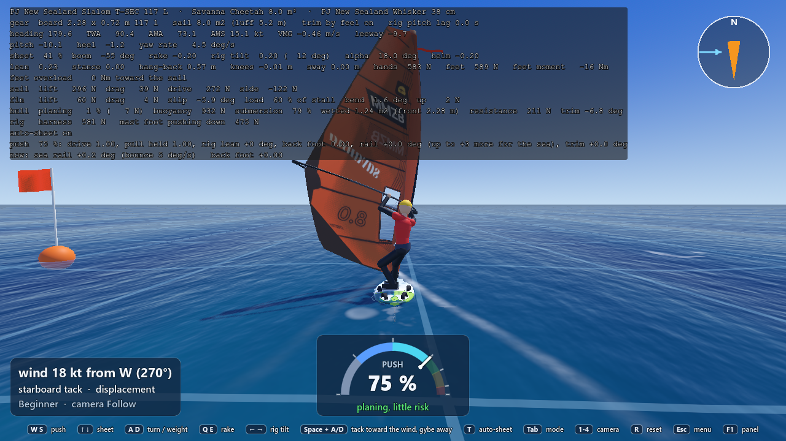
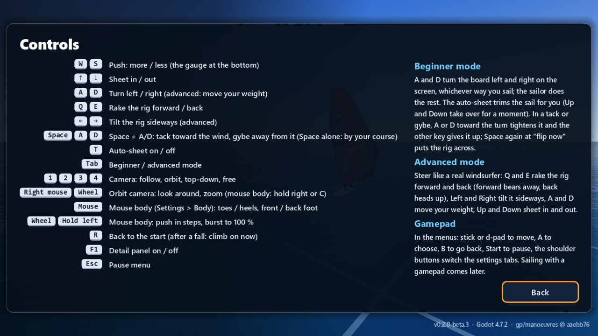

# GP12: Space + A/D chooses the manoeuvre, and interactive tacks and gybes

**Branch:** `gp/manoeuvres`, from `play/6nov-evening` at e9238fa. 6 November 2026, evening, one Opus builder, no agents. **No physics change:** nothing in `Game/sim/` was touched, and the AI boards' manoeuvres are exactly as before (every new part is switched off for an AI skipper's hands; a unit test holds that).

**Max's asks:**
1. "downwind button (a/d) while pressing space to gybe instead of heading. now sometimes it tacks when we want to gybe and otherwise"
2. "more interactive gybes and tacks"

## 1. In short

- **Space + A or D now decides:** the key toward the wind gives a **tack**, the key away from the wind a **gybe**, from any course (also a gybe from a beam reach, where Space alone tacks). Space alone works as before (a tack up to 100° from the wind, a gybe beyond). A or D pressed up to 0.3 s *after* Space still counts. Commit aaebb76, on its own, so it can be taken alone.
- **Interactive tacks and gybes**, three parts, each with its own switch in **Settings > Sailing** (all on):
  1. **Turn with A/D:** in the turn, holding the key toward the turn makes it tighter; letting go, it goes on at its usual pace; the other key gives the manoeuvre up and steers you back.
  2. **Body carves** (only with the mouse body on): the mouse toward the inside of the turn carves harder, toward the outside flattens the board and widens the turn; in a gybe, pulling the mouse back puts the weight on the back foot (the nose lifts, the board pivots).
  3. **Flip on your cue:** a second Space when the strip shows **Space flip now** puts the rig across at once. No second Space: it goes across by itself, as before.
- **Doing nothing is exactly as before:** the whole manoeuvre matrix (24 cases) gives the same numbers to the last digit with these changes in.
- **Measured (section 4):** each part used alone, at full, never fell in 45 tacks and gybes with waves at 12, 18 and 24 kt (today's hands-off: 0 in 45 too). Holding the key makes a tack about 0.9 s quicker and a gybe 0.7 to 1.0 s quicker. **Everything at once at full** (key + toes + back foot + cue) is the fastest gybe of all (3.3 s instead of 6.0) but falls 5 times in 45, all at 24 kt: that is the risk you take when you push everything in strong wind.
- **Not verified:** how it feels to play. The tests and the scripted runs press the keys by values; please play it (section 5).

## 2. The A/D rule

| You are on | You hold | That turns | Result |
|---|---|---|---|
| Starboard tack (wind from the right) | **D** (right) | toward the wind | **tack** |
| Starboard tack | **A** (left) | away from the wind | **gybe** |
| Port tack (wind from the left) | **A** (left) | toward the wind | **tack** |
| Port tack | **D** (right) | away from the wind | **gybe** |
| either | nothing | (by your course) | tack up to 100° from the wind, gybe beyond (as before) |

- The key can be held before Space, or pressed up to **0.3 s after** Space (then the manoeuvre already started is changed, before the board has gone through the wind).
- The key strip says **Space + A/D: tack toward the wind, gybe away**; the Controls page says **Space + A/D: tack toward the wind, gybe away from it (Space alone: by your course)**.
- In the matrix, Space with A on a beam reach at 12, 18 and 24 kt (the new case `gybe_beam_key`) gybes and comes out on the new reach, no falls, at three wave timings; Space alone there tacks as before.

## 3. What "interactive" means now, and the settings

All three are switches in **Settings > Sailing** ("Turn with A/D", "Body carves", "Flip on your cue"), on by default, so you can switch one off and compare. They only change something when you use them.

**Turn with A/D.** During a tack or gybe:
- the key **toward the turn**: a gybe turns at **40° a second** instead of 30, a tack's carve up to the wind at **20°** instead of 15;
- **let go**: the turn goes on at its usual pace (a beginner can just hold Space's choice and let it run);
- the **other key** (after the 0.3 s choosing window): the manoeuvre is given up cleanly (the rig back to neutral, as when a manoeuvre times out) and the key steers you, so you turn back.
- The key acts only **into** the turn: in a gybe until the sail is across, in a tack until the rig is across. The way out goes at the usual pace. (Carried on faster, the 12 kt gybes rounded up past their exit at walking pace and the sailor fell off; the 24 kt tacks spun on into a catapult.)

**Body carves** (with Settings > Body > Mouse body on). During a tack or gybe:
- the mouse **toward the inside of the turn** (as seen from behind: the way the board is turning; in a gybe that is the toes, in a tack the heels) makes the turn up to a third tighter; **toward the outside** flattens the board and the turn is up to a third wider;
- in a **gybe** only, **mouse back** = weight on the back foot (the nose lifts, the board pivots on its tail: the quickest gybe, but it comes out slower), **mouse forward** = the front foot (the nose down, for the exit);
- the mouse stays where you put it through the turn and goes back to the middle when the manoeuvre ends (your choice "comes back to the middle at every tack and gybe" now means at the end, not the start, so you can carve through);
- key and body together are never asked more than 40° a second in a gybe and 20° in a tack's carve.
- The body gauge still says "in a turn" during a manoeuvre (it does not yet say "carving").

**Flip on your cue.** The strip's first chip shows **Space flip now** while a second Space helps:
- a **gybe**: from 5° before dead downwind until the sail goes over by itself; Space then holds the rig on the new side;
- a **tack**: from 18° through the wind (and the sail would fill on the new side) until the rig goes across by itself at 25°; Space then makes the autopilot's own flip happen now;
- **no second Space**: it flips by itself, exactly as before.
- Honest result: in this physics the flip by itself is already at a good moment, so the cue does not make the manoeuvre faster (section 4); its value is that **you** do it. Earlier windows were tried and made it worse: a gybe cued at 160° was up to 1.2 s slower (the sail backed before the run); a tack whose rig was held across by hand at 18° was 0.8 to 1.2 s slower (the boom stayed pushed across the centreline), which is why the tack's cue now triggers the autopilot's own flip; cued as early as 1° through the wind it came out slower (6.0 m/s after it instead of 7.3).
- The sheet keys are not a cue: during a manoeuvre they take the sail over by hand, which stops the backing of the sail in a tack.

## 4. The measurements

**How:** `tools/matrix.sh` drives the player's own controller with key presses (the same code as your keyboard). The open water with waves, 12, 18 and 24 kt; five cases (tack on starboard, tack on port, gybe from a broad reach, gybe from a beam reach after a bear-away, Space + A on a beam reach); each at three wave timings (Space at the case's time, 1.3 s and 2.6 s later): 45 manoeuvres per row. "Space to new course" is from Space until the board is 50° off the wind on the new tack (a tack) or back up to 120° (a gybe); "speed after" is the mean speed in the 12 s after it. New options of the matrix do the player's hands: `--hold_turn=1`, `--body_carve=±1`, `--body_back=±1`, `--cue=1`, `--shift=<s>`.

**With the defaults (final):**

| What the player does | Falls | Tack: Space to new course, s (12 / 18 / 24 kt) | Gybe: Space to new course, s | Gybe: speed after, m/s | Which fell |
|---|---|---|---|---|---|
| Nothing (as today) | **0 of 45** | 6.6 / 7.3 / 7.6 | 5.6 / 6.0 / 6.7 | 2.8 / 8.4 / 11.5 | none |
| Key held toward the turn | **0 of 45** | 5.7 / 6.4 / 6.8 | 4.9 / 5.2 / 5.7 | 2.8 / 8.8 / 11.8 | none |
| Body: mouse toward the inside (carve) | **0 of 45** | 5.7 / 6.3 / 6.7 | 4.9 / 5.2 / 5.7 | 2.8 / 8.8 / 11.8 | none |
| Body: mouse toward the outside (flatten) | **0 of 45** | 8.8 / 8.7 / 9.2 | 8.7 / 7.7 / 8.5 | 2.6 / 7.8 / 10.1 | none |
| Body: back foot (gybes only) | **0 of 45** | as today | **4.1 / 3.8 / 3.9** | 3.0 / 7.7 / 7.3 | none |
| Body: front foot (gybes only) | **0 of 45** | as today | 5.6 / 6.1 / 6.9 | 2.8 / 8.4 / 11.2 | none |
| Flip on cue (Space as "flip now" shows) | **0 of 45** | 6.6 / 7.3 / 7.6 | 5.5 / 6.0 / 6.7 | 2.8 / 8.4 / 11.5 | none |
| **Everything at once** (key + carve + back foot + cue) | **5 of 45** | 5.6 / 6.4 / 7.0 | **3.0 / 3.3 / 3.3** | 3.1 / 8.6 / 9.1 | all at 24 kt: 3 gybes from a beam reach (fell off on the way in), 2 tacks (a catapult 12 s later on the new reach) |

**How the limits were found (the rounds before the final one):**

| Tried | Falls in 45 | What it taught |
|---|---|---|
| Key: gybe 45°/s, tack 20°/s, through the whole turn | 4 | 3 at 12 kt at the gybe's exit (the board rounded up at walking pace), 1 catapult bearing away from a beam reach at 24 kt. So: the key only into the turn |
| Body carve +50 %, the whole turn | 5 | the same exits, and a 24 kt tack's quicker exit spun the board on into a catapult |
| Back foot in tacks and gybes | **13** | 12 of 18 tacks at 18 and 24 kt catapulted: weight on the back foot while carving up into the wind pulls you over the sail. So: the back foot only in gybes (0 falls there, and the quickest gybe) |
| Key and carve only into the turn, gybe at 45°/s | 1 each | the 24 kt bear-away from a beam reach at 45°/s still catapulted once |
| Gybe at 40°/s (key, or carve a third) | **0 of 27** each | the limit kept: 40° a second in a gybe, 20 in a tack's carve |
| Cue: gybe from 160°, tack from 10° (the rig held across by hand) | 1 | gybes up to 1.2 s slower: too early (the sail backed before the run). So: the gybe from 175° |
| Cue: tack from 18°, the rig held across by hand | 0 | tacks 0.8 to 1.2 s slower (the boom stayed pushed across). So: the tack's cue makes the autopilot's own flip happen now, from 18° and only with a sail that fills: as quick as today (12°, 18° and 22° tried: the same) |

## 5. What Max should try

1. **Gybe from a beam reach with A held** (starboard tack, wind from the right): hold A, press Space. It should gybe, not tack. Then the same on port tack with D.
2. **Tack with D** on starboard tack (A on port): hold the key and press Space; keep holding it: the tack is a little quicker. Let go halfway: it goes on by itself.
3. **Space alone on a beam reach:** it should still tack as before. Press A just after Space (within a blink): it should turn into a gybe.
4. **Give up a gybe:** start a gybe with A, then press D: the board should turn back up, no gybe.
5. **Flip on cue:** in a gybe, watch the strip for **Space flip now** (first chip, bottom left) and press Space: the sail goes across. Try never pressing it too: it should still go across by itself.
6. **The body through a gybe** (Settings > Body > Mouse body on): in the gybe, move the mouse toward the turn (left when turning left): a tighter carve; away: a wider, flatter turn; pull the mouse back: the nose lifts and the board pivots quickly (you come out slower). The mouse goes back to the middle when the gybe is done.
7. **Compare:** switch each of "Turn with A/D", "Body carves" and "Flip on your cue" off in Settings > Sailing and on again.
8. **24 kt, everything at once** (key + mouse in + mouse back + cue): the fastest gybe, but expect a fall now and then.

## 6. Checks

- `tools/test.sh`: **927 of 927** passed (9 new tests in `test_player_controller.gd`: both tacks, both keys, near the beam reach, the grace window, the AI's hands for ask 1; the key's rate, giving up, the body's carve and feet, the cue's windows, the AI's hands and the HUD's "flip now" for ask 2).
- `tools/check.sh`: 0 failed.
- The manoeuvre matrix with no keys (`tools/matrix.sh --waves=1`, the final code): the 24 old cases identical to before, to the last digit.
- Screenshots looked at: the key strip at 1280 × 720 and 3137 × 1263 (fits on one line), the Controls page at both sizes (the new text fits; the beginner text explains the turn keys and "flip now"), Settings > Sailing at both sizes (the three switches). The "flip now" chip itself is checked by a unit test, not by a screenshot (it shows only during a gybe or tack).

## 7. Open questions

1. **The cue's reward.** In this physics the automatic flip is already at a good moment, so the cue gives control, not speed. Should a cue-less flip become a little *late* (the sail held a moment longer, as GP8 proposes) so a good cue pays? That changes the hands-off manoeuvre, so it is your call.
2. **The sheet keys as the cue** (the brief's "or the sheet keys"): left out, because Up/Down during a manoeuvre take the sail over by hand and stop the tack's backing. Wanted anyway?
3. **The body gauge** says "in a turn" during a manoeuvre although the body now carves. A small change to `ui/body_gauge.gd` ("carving") if you want it.
4. **The mouse back to the middle** now happens at the *end* of a tack or gybe (so you can carve through). If you prefer it at the start, as before, it is one line.
5. **Everything at once at 24 kt falls 5 in 45.** Fine as the risk of pushing, or should the back foot ease the key's limit in strong wind?
6. **Advanced mode:** A/D move the weight there; Space + A/D chooses the manoeuvre in both modes. Fine?

## 8. The roadmap row I would add (for the lead)

| ID | Item | Files | Waits on | Size | Version |
|---|---|---|---|---|---|
| GP12 | **Built (6 November 2026, evening, `gp/manoeuvres`; [gp_manoeuvres_6nov.md](Documentation/reports/gameplay/gp_manoeuvres_6nov.md)).** Space + A/D chooses: toward the wind a tack, away a gybe, from any course (0.3 s grace after Space; Space alone as before). Interactive tacks and gybes, three Settings > Sailing switches, on: the key toward the turn tightens it (gybe 40°/s, tack's carve 20°/s, only into the turn), the other key gives it up; the mouse body carves (a third tighter or wider) and in gybes presses the back or front foot; a second Space at "flip now" puts the rig across (gybe from 175°, tack from 18° with a filling sail). The player's only; the AI and the hands-off manoeuvre bit for bit as before. Measured: each part alone 0 falls in 45 (today 0 in 45); all at once 5 in 45 at 24 kt. Open: the cue's reward (GP8's held flip), the body gauge's "carving", the sheet keys as a cue | `windsurfer/player_controller.gd`, `ui/hud.gd`, `ui/controls_page.*`, `ui/settings_*.gd`, `main.gd`, `dev/run_matrix.gd` | Max's play-test | S | 0.2 |

And in GP8's row: "Partly built in GP12: the second Space flips the rig in a window; the held flip (too early stalls, too late backs) is still open."

## 9. Token use

About 0.45 M tokens for this session (one Opus builder, no agents).
