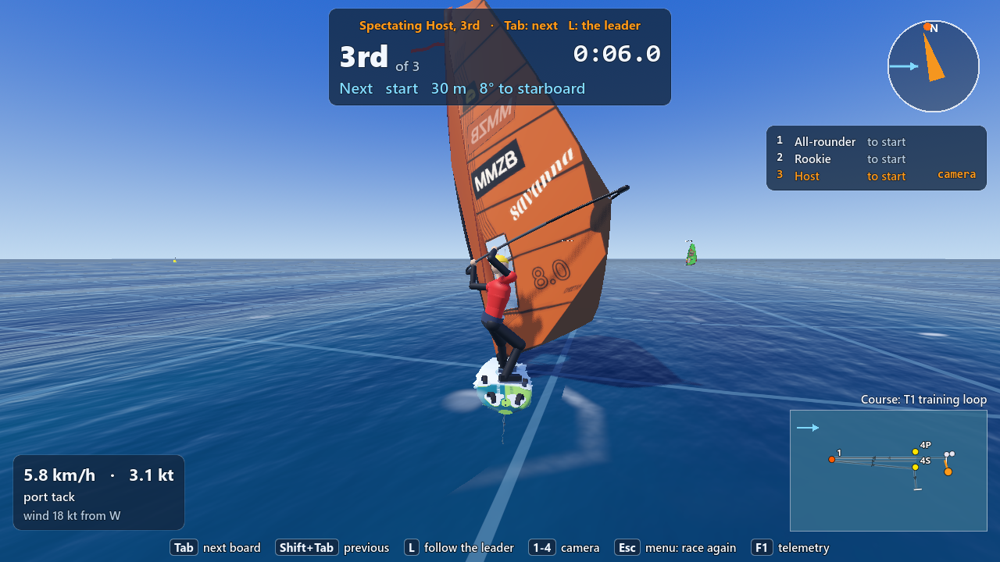
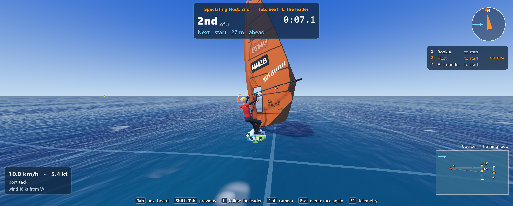
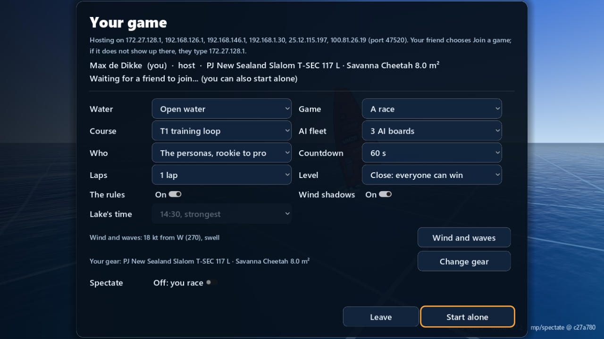
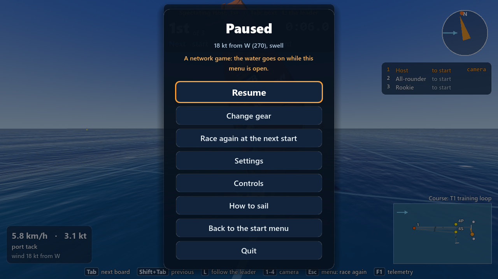

# Spectating a LAN race (6 November 2026, evening)

**Max's ask:** "host and joiners can spectate racers".
**Branch:** `mp/spectate` (worktree `WindsurfingMMZB-gp2`), from `play/6nov-evening` dae6fda. Built by an Opus agent for the lead.

## In short

- In a LAN race **anyone can watch instead of race**: the host and every guest. The camera, the HUD and the sounds then follow **any racer on the water**: the AI boards, the other PCs' players and the host's board. **Tab** goes to the next board in race order (the finish list's order), **Shift+Tab** to the previous one, **L** back to the leader; **1 to 4** and the orbit camera work on the watched board.
- The HUD says who you watch and where they are: **"Spectating Hana, 3rd · Tab: next  L: the leader"** above the race card; the standings mark that board with "camera"; the minimap's orange dot is the watched board, the white dots the others.
- Four ways in: the lobby's **Spectate** switch; the Esc menu's **Spectate** during a race (your board **retires**: every PC's finish list says "retired"); **finishing** (four seconds after your finish the camera goes to the others, the finish list stays); **joining while a race is on** (you watch it, and get a board at the next start).
- Back to racing: at the **next start** your board is back at its spot behind the line, by itself, unless you chose **Stay a spectator** in the Esc menu (then the Esc menu offers **Race again at the next start**).
- Checked with game instances on this PC (all PASS, the place every PC shows of every board within 0.0000 m) and 11 new unit tests; **not yet tried on two real PCs**.

## How to spectate

| Who | How | What happens |
|---|---|---|
| **Host or guest, from the start** | In the lobby ("Play with a friend"), the **Spectate** switch: "On: you watch the race, no board in it". The players' list says "spectating" instead of your gear; no gear is needed. A guest still presses Ready. | You have no board in the race. The camera starts on the leader; Tab picks another racer. The host who spectates is still the race director (M, the next start, the course). |
| **A racer, mid-race** | Esc, then **Spectate (retire from this race)** (under Change gear). | Your board leaves the water and is out of this race: "retired" on every PC's finish list, last in the order. You race again at the next start by yourself. Esc again: **Stay a spectator (also the next races)**; and then **Race again at the next start** to come back. |
| **A racer who finished** | Nothing to do. | Four seconds after your finish the camera goes to the others (the leader first; Tab, L). The finish list stays on the screen. At the next start your board is back at its spot behind the line. |
| **A guest who joins late** | Join while a race is on. | You watch the race under way ("A race is on: you join it at the next start" on the race card). At the next start (the race director's automatic one) you get your board at your spot behind the line. |

While you watch, your own board is **off the water**: hidden on every PC, not sailed, and your PC sends nothing of it. The keys at the bottom change to the watching keys (Tab, Shift+Tab, L, 1-4, Esc). On a guest R does nothing while watching (only the host restarts a race).

## What travels on the wire

- **The lobby's list** (`LanPlayer`) carries two new flags per player: **spectator** (they watch instead of racing, from the next start on) and **parked** (their board is off the water now). The host sends the list to every PC whenever a flag changes; a guest's change goes to the host first (a new message `_watch_state`). Every PC hides a parked player's board until it is back, and shows it again with the first state it sends after that (never an old one).
- **A spectator's PC sends no board states** (nor does a racer's while their board is off the water). It still listens to everything, so it sees every board.
- **A guest's retirement** goes to the host (a new message `_retire`); the host's race marks that board retired, and the race's state (ten times a second, as before) carries a "retired" flag per board to every guest. A guest who **leaves the game** mid-race is now retired too, so the race does not wait for them.
- **The host's race** leaves spectators out from the next start; a spectating host is not in the race either (the other players are then numbered from the first board, which every PC agrees on).
- **The host's clock** (the water and the gusts) goes on from the AI boards' wind clock while the host's own board is off the water, and from the parked board's own wind when no board is sailed on the host at all (a spectating host with no AI fleet).
- **The protocol number** is now 3 (was 2): two PCs with different builds refuse each other politely. The layout hash check is unchanged. Nothing in `Game/sim/` changed.

## The tests

**Unit tests** (`Game/tests/unit/test_spectate.gd`, 11 tests): a retired board is last, "retired" in the results and the race ends without it; a race of retired boards only is over; the retirement reaches a guest's copy of the race (and an older state reads as not retired); Tab on the host goes through AI boards and other players' boards in race order and skips boards off the water; a spectating host numbers the other players from the first board; Tab on a guest goes through the host's board, the AI and skips a spectating guest; a player who finished watches four seconds later (host and guest); in a real race scene, Spectate retires the board, the camera goes to an AI board, Tab moves it, the next start puts the board back at its spot, Stay a spectator leaves the player out of the following start, Race again brings them back; the lobby's flags travel; the title's text. `tools/test.sh`: see the lead's message for the final count. `tools/check.sh`: 0 failed.

**LAN tests** (`tools/lan_test.sh`, two or three game instances on this PC, headless, the robot sailing the players' boards):

| Run | What | Result |
|---|---|---|
| `--guests=2 --spectate=2 --retire_at=8 --robot=allrounder --time_limit=25 --prestart=10 --seconds=60` | the 2nd guest spectates (Tab every 3 s), the 1st races and retires 8 s after the gun | PASS. The spectator saw all 3 boards the host sails (583 moments) and the racing guest's board, every one within 0.0000 m of where its own PC had it; no PC drew the spectator's board; its camera went to Host, Rookie, All-rounder and Guest. All three finish lists of race 3 agree: "4 Guest retired". |
| `--guests=2 --late=20 --robot=allrounder --time_limit=25 --director_gap=5 --prestart=10 --seconds=60` | the 2nd guest joins 20 s late, during race 2 | PASS. It watched race 2 (camera on Guest, then Host), was back on the water at the next start (race 3, host tick 2910), and the host showed its board 90 moments within 0.0000 m. Race 2's lists agree on every PC. |
| `--guests=1 --robot=allrounder --prestart=10 --seconds=45 --host_options="--lan_spectate=1 --lan_tab_every=3"` | the host spectates | PASS. The host sent no board of its own, the guest drew none; the host's camera went round All-rounder, Rookie and Guest; the guest's board 243 moments within 0.0000 m. |

New options for these runs: `--spectate=<n>` (the n-th guest spectates), `--retire_at=<s>` (the first guest retires then); in the game `--lan_spectate=1`, `--lan_tab_every=<s>`, `--lan_retire_at=<s>`, `--lan_watch=<board number>` (the screenshots). `tools/lan/check_sync.py` now checks that a spectator saw every board, was drawn by nobody and watched at least two boards, one a player's.

**Screenshots** (in `spectate_6nov/`): spectating the host's board from a guest at 1280 x 720 and 3137 x 1263; the lobby's switch; a spectator's Esc menu. Looked at: the title, the race card, the standings' "camera" mark, the minimap and the keys fit both windows. The watched board's floating name label is hidden (it sat behind the race card at the top of the screen; the title names the board).

**Not checked:** two real PCs; how it feels to watch (the camera's distance and the moment it switches after a finish); the finish list while watching after a real finish on screen (only in the unit tests, the race to the finish takes 10 minutes); the sounds of a watched board.

## What Max and Michiel should try on two PCs

1. Host a race with 3 AI boards; Michiel joins with **Spectate** on in the lobby. Michiel's screen: "Spectating ..."; Tab goes through the AI boards and Max's board; L back to the leader; 1 to 4 and the orbit work on the watched board; the minimap's orange dot is the watched board. Max's screen: no board of Michiel's anywhere.
2. Both race. Mid-race Michiel: Esc, **Spectate (retire from this race)**. His board disappears on both screens; the standings say "retired"; at the end both finish lists say "retired". At the next start (3 minutes after the race, or the race director's "start now" with M) his board is back behind the line.
3. Race to the finish: four seconds after the first of you finishes, their camera goes to the others; the finish list stays; Tab works; their board comes back at the next start.
4. Michiel: Esc, **Stay a spectator**: the next start leaves him out; Esc, **Race again at the next start**: the start after that takes him back.
5. Max spectates (the lobby's switch, or Esc mid-race): Michiel's race goes on, the AI still sails, the gusts still roll on Michiel's screen, M still opens the race director.
6. Michiel joins while a race is on: he watches it, then races from the next start.
7. Lake Silvaplana: the same with the lake (the parked board is hidden there too; look for anything odd about the water or the wind ripples while watching).

## Open questions

1. **After the finish:** four seconds, then the camera goes to the leader (who may have finished too). Would you rather it went to the first board still racing, or stayed on your own board until you press Tab?
2. **A finished player's board** is off the water until the next start and comes back at its spot behind the line. Do you want a "Sail now" entry to sail around between races instead?
3. **A race alone** (no LAN): the Esc Spectate entry and watching after the finish are LAN only. Do you want them in a race alone with the AI too?
4. **Free sailing together:** spectating counts only in a race (a spectator in free sailing simply sails). Should there be a spectator in free sailing?
5. **The Esc entry** is one button whose words change (Spectate / Stay a spectator / Race again). Clear enough, or two buttons?

## ROADMAP rows (for the lead; the next free numbers after MP11, renumber as you like)

| ID | What | Files | Status |
|---|---|---|---|
| MP12 | **Spectating a LAN race (built 6 November 2026, Max to test with Michiel):** the host and every guest can watch any racer (the AI, the other players, the host): Tab / Shift+Tab / L in race order, "Spectating Hana, 3rd", the cameras and the minimap on the watched board. Ways in: the lobby's Spectate switch; the Esc menu's Spectate (the board retires: "retired" on every finish list), Stay a spectator, Race again at the next start; watching four seconds after your finish (the finish list stays); a late joiner watches until the next start. A watching player's board is off the water (hidden on every PC, no states sent) and comes back at its spot at the next start. Protocol 3. Report `Documentation/reports/multiplayer/spectate_6nov.md`. | `race/race_runner.gd`, `race/race_sim.gd`, `race/spectate_choice.gd`, `race/race_hud.gd`, `net/race_mirror.gd`, `net/net_boards.gd`, `net/lan_session.gd`, `net/lan_player.gd`, `ui/pause_menu.gd`, `ui/lan_page.gd`, `main.gd`, `tools/lan_test.sh --spectate --retire_at` | built on `mp/spectate`; needs the two-PC test |
| MP13 | Spectating, next: Max's answers to the report's open questions (where the camera goes after a finish; a "Sail now" between races; spectating in a race alone and in free sailing; one Esc button or two) | | waits for Max |

## The commits

1. `19f2f64` A race board can retire: RaceSim.retire()
2. `3d69d80` RaceRunner: watch any board of the race, the other PCs' players too (race_runner.gd's own commit: only spectating code; restart() changes two lines)
3. `8c4e2f6` LAN spectating: finished players watch the others, Tab over every racer
4. `c27a780` LAN spectating: the menu's Spectate / Race again, the lobby's switch, the LAN test
5. the screenshots, the hidden name label, `--lan_watch`, this report (see the lead's message)

## Tokens

About 0.35 M tokens for this work (an estimate).
