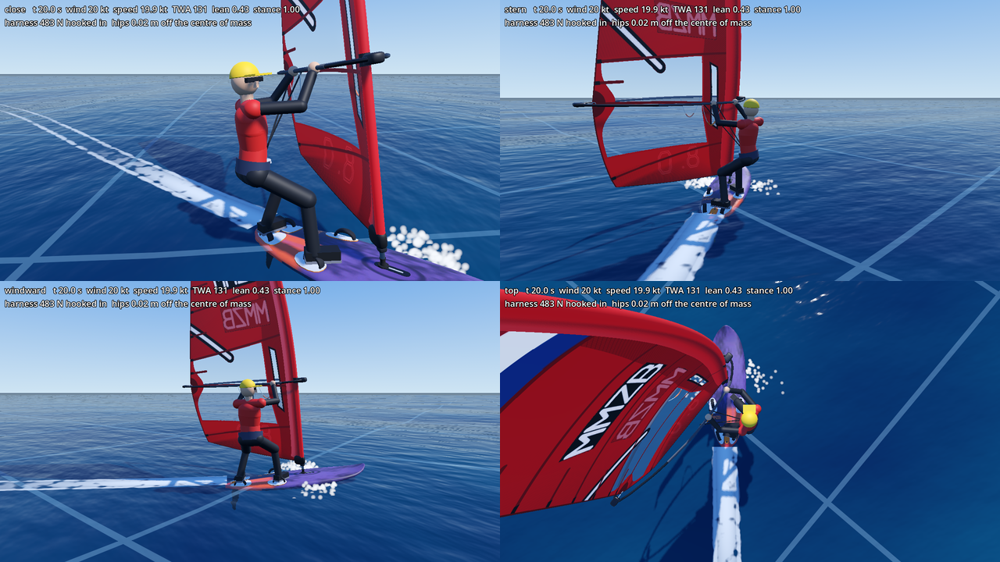
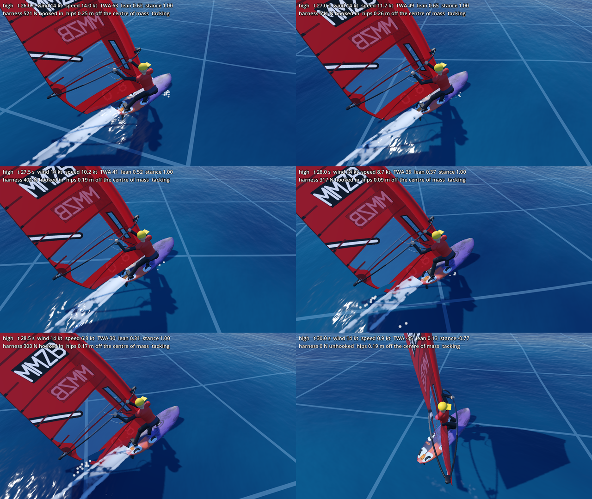
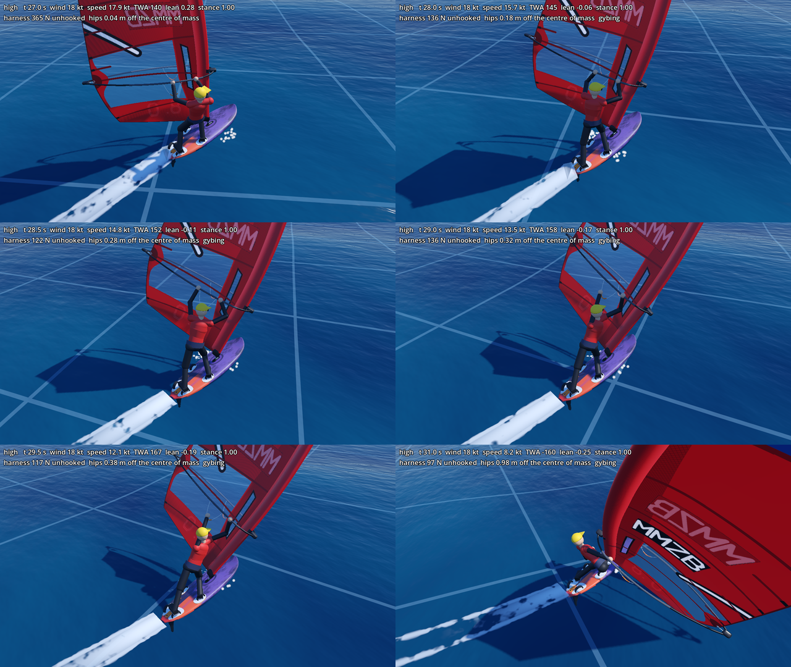

# Sailor polish (6 November 2026): the figure moves like a sailor, feet in the straps

**Branch:** `gr/sailor-polish`, from `night2/look` at 707888e (the build Max played this morning). Claude Opus 5.5, one session, no agents. **Nothing in `Game/sim/` changed**: every fix is in how the figure and the rig are drawn (`Game/windsurfer/`), and nothing drawn feeds back into the physics.

Max asked: *"the animations of the character are glitching a bit. make this more polished and how a real sailor moves. also … when planing a real windsurfer stays in the footstraps."* He saw all four kinds of glitch: (1) the body shakes at speed and in the chop, (2) hands jump along the boom and arms snap straight, (3) tacks and gybes look wrong, (4) feet slide or pop and knees snap.

## 1. In short

- **The feet now stay in the footstraps while planing** (the windward front and back strap of the board), also downwind and also with the mouse's back foot at 100 %. Moving the weight is done by the hips and knees, as a real sailor does. Off the plane the feet **step** (lift, move, put down, one foot at a time, round the front of the mast in a tack) instead of sliding.
- **The hands hold on.** Each hand grips the boom (or the mast) at one place and moves with it; it slides along slowly, or lets go and regrips, one hand at a time.
- **The body no longer shakes.** In 24 kt of lake chop the head used to shake **14 times more than the board it stands on**; now it shakes about as much as the deck, and the hips less (the knees take it). The mast's jitter is a fifth of what it was.
- **Tacks and gybes**: the sail no longer jumps from one side to the other in one frame; the boom swings round the mast (over the tail in a tack, round the nose in a gybe), the front hand goes on the mast in a tack, the back hand lets go and crosses over in a gybe.
- **Waterstart**: the sailor swims to the windward side, pulls the rig round, and both get up in 0.9 s instead of popping up.
- **Why the sailor stood in the middle of the board** (section 2): two things together. The figure drew the feet where the *weight* pressed (with the back foot at 100 % that put the back foot up to 30 cm behind the tail), and with the back foot at 100 % on a broad reach in the lake's conditions the physics' board rears up (nose 12 to 30° up), slows down to walking pace, and the physics then walks the sailor forward to the mast. The first is fixed. The second is the physics answering a rider who stands on the tail downwind; it is for Max and Michiel (section 8).

## 2. The "middle of the board" (the footstraps)

I reproduced Max's photo headless on the lake (`Game/dev/figure_motion.gd`, cases `max18`, `max24`, `maxmap`: broad reach 140°, push 100 %, toes 100 %, back foot 100 %; the body pressed only after the board had planed, as Max did) and logged the physics every tick (stance, the feet's press, speed, the nose's depth) and where the figure's feet stood against the straps (front strap 0.315 m, back strap 0.905 m aft of the board's middle).

What I found:

1. **The figure drew the feet in the wrong place.** It stood the feet around the physics' *feet pressure point*. Since the mouse's feet press (GP2) that point moves to the back strap with the back foot pressed, and the figure followed it: the feet were **0.3 to 0.5 m behind the straps** in the pressed cases (the back foot behind the tail). Without the body press the feet were 5 to 9 cm in front of the straps.
2. **The physics walks the sailor forward when the board stalls.** With the back foot at 100 % the board's nose rose to 12 to 30° and the board slowed to 3 to 5 m/s (mean speed 2.5 m/s at 18 kt, 3.9 at 24 kt, 2.7 in the map's own wind), with a catapult at 24 kt. Each time it dropped below 2.7 m/s the physics' stance went back to 0 (feet at the mast: the middle of the board) and back out again as it picked up speed: the stance was under half way 26 to 61 % of the time. That cycle is the physics' own rule (step forward when the board stops) and looks right for a stalled board; the stall itself comes from holding all the weight on the tail on a broad reach. Without the press the board planed on the beam reach (9.8 to 10.7 m/s) and the stance stayed at 1 the whole time. (On the lake a broad reach from rest sits on the hump at 18 kt, 5.4 m/s, as GP11 found.)

**Fixed:** planing (the physics' stance at 0.9 or more, not turning), the figure's feet are put **exactly in the windward straps** of the board (`BoardConfig`: from the tail and out from the centreline) and stay there until the stance falls below 0.6 or the sailor turns. The trim and the mouse's press now move the hips over the feet. A new test checks that the feet do not move when the weight is pushed 0.4 m either way.

**Not fixed (needs a decision, section 8):** that holding the back foot at 100 % on a broad reach stalls the board on the lake.

## 3. What was wrong, glitch by glitch

I measured every joint of the figure in the board's axes at every physics tick (60 a second): the largest step in one tick, and the largest change of that step from one tick to the next (the "spike": smooth movement changes its step by a few millimetres a tick; a jump or a snap by centimetres). Also, in the world, how much the head, hips, a hand and the mast top shake compared with the deck under the feet.

1. **Body shake.** Three causes: (a) the crouch of a turn followed the board's yaw rate, and in chop that jumps by 20 to 30°/s from one tick to the next, so the hips bobbed up to 10 cm a tick; (b) the physics' centre of mass alternates by ±4 to 5 cm sideways from one tick to the next at 24 kt (a 30 Hz wobble in the physics, section 8); (c) the physics' rig jitters (the mast top moved 27 cm in one tick a hundredth of the time at 24 kt) and the hands, arms and torso followed it.
2. **Hands jump / arms snap.** The hands were put on the boom where the physics' grip was every tick, slid toward the body; when the sail changed sides the windward arm of the wishbone swapped sides in one tick (a 0.5 m jump); the shoulder line was taken from the line between the hands, so it flipped round when the hands crossed; the elbow's direction could flip from one side of the arm to the other.
3. **Tacks and gybes.** The physics turns the sail over in **one tick** (in a gybe the clew jumped 4.4 m), and at a tack's flip the beginner's controller swings the rake from full back to full forward at once (the mast top moved 3.6 m in a fifth of a second). The body turned round at a fixed rate with sudden starts and stops; the hands slid through each other.
4. **Feet and knees.** The feet slid along the deck with the weight (the trim, the press, the rail press) and the stance, and jumped at a reset.

**Between frames on Max's screen:** the figure's parts *are* smoothed between physics ticks by the engine (physics interpolation): `Game/dev/figure_interp_check.gd` ran the game loop at 145 frames a second and every moving part took 2 or more places within each tick. So a faster monitor shows smooth motion between ticks; what it cannot hide is a jump inside the 60 ticks, which is what was fixed.

## 4. What I changed and why (and what real sailors do)

What I based it on: the coaching the figure already followed (boards.co.uk "Speed and control"; the "figure 7" planing stance; surfertoday and cal-sailing on the stance; seabreeze on harness lines) plus the standard technique of the moves: **planing** both feet stay in the straps, the front leg long, the back leg bent, the weight moved with the hips and knees, the knees soaking up the chop so the upper body stays still; **a hand** is moved one at a time, the other holding on; **a basic tack**: front hand onto the mast below the boom, small steps round the front of the mast, the new front hand onto the boom on the new side, then the other hand; **a carve gybe**: front hand toward the mast, at the flip the back hand lets go, the rig rotates with the clew round the nose, the old back hand crosses over to take the new side, then the other hand follows.

| What | Where | What it does |
|---|---|---|
| Feet | `Game/windsurfer/figure_feet.gd` (new) | A foot is planted or stepping: a step lifts it 7 cm, takes 0.3 s, goes round the front of the mast, one foot at a time (the front foot first). A planted foot only turns on its ball. |
| Straps | `figure_skeleton.gd` `_place_feet` | Planing: feet in the windward straps (front strap 0.825 m, back strap 0.235 m from the tail), held until the stance drops below 0.6 or a turn. Otherwise round the physics' stance point *without* the press. |
| Hands | `Game/windsurfer/figure_hands.gd` (new) | Each hand holds the boom's windward arm (with the arm's real curve) or the mast; slides at 0.35 m/s at most, or lets go and regrips in 0.18 to 0.4 s, one hand at a time. Tack: the hand that led goes on the mast and stays till the tack is done. Rig flip: the back hand lets go, then takes the new side first (crossing over). |
| Rig as drawn | `Game/windsurfer/drawn_rig.gd` (new), `windsurfer.gd` | The drawn mast and boom follow the physics' through a spring (about a fifth of a second) and turn at most 2.5 rad/s (mast) and 4 rad/s (boom). When the sail changes sides the boom swings round the mast in 0.35 to 0.8 s: over the tail in a tack, round the nose in a gybe. The sailor's hands hold this drawn rig. |
| Steady body | `figure_skeleton.gd` | The hips and the neck follow their places through springs (about 2 Hz) in the board's *level* frame, so the board can pitch, roll and heave under the body and the legs bend. An arm that cannot reach pulls the hips only 30 % of the way per tick (pulled fully, arms and legs fought every tick). |
| Turning signals | `figure_skeleton.gd` | The crouch of a carve uses the yaw rate felt over about a second; the head's look over a third of a second, and turns smoothly. The body turns round in a tack or gybe like a damped spring (about 0.7 s, gentle start and stop). The shoulder line comes from the way the body faces (never flips). The elbows turn smoothly. |
| Wishbone arm | `rig_visuals.gd` `windward_arm_offset` | Changes over with the sail's belly instead of by its sign (it jumped 0.5 m mid-flip). |
| Waterstart | `sailor_figure.gd`, `rig_visuals.gd`, `windsurfer.gd` | After the fall the sailor swims to the windward side and the rig is pulled round the nose to that side; at the waterstart both get up over 0.9 s and the body unfolds from how it lay in the water. |
| Measurement | `Game/dev/figure_motion.gd`, `Game/dev/figure_interp_check.gd` (new) | The joint-by-joint measurement (16 cases on the lake, options in the header) and the between-frames check. |
| Tests | `Game/tests/unit/test_sailor_figure.gd` | 3 new: feet stay in the straps while the weight moves 0.4 m; the drawn boom swings across (never more than 11° in a tick) instead of jumping; hands slide and regrip one at a time. The hand-on-boom check now uses the physics' own boom (square to the mast), as the game does. |

**Cost:** a few springs and two small step/grip planners per figure, no loops added; cheap enough for the 20 AI boards (not measured with a full fleet).

## 5. Before and after

All in centimetres per tick per tick (the "spike"): worst / 99th percentile, per body part (the worst joint of the group). "Before" is the morning's build, "after" this branch, the same cases on the lake. The "before" joints were read from the skeleton (identical to the drawn parts while sailing; for the waterstart the old run did not include the fall's movement).

| case | hips/back/head | arms | hands | legs | feet | knee bend (deg) | elbow bend (deg) |
|---|---|---|---|---|---|---|---|
| beam18 before | 28 / 11.8 | 31 / 11.5 | 8 / 5.9 | 10 / 3.8 | 2 / 1.1 | 8 / 3.9 | 106 / 36.0 |
| beam18 after | 2 / 1.2 | 7 / 4.5 | 2 / 1.3 | 2 / 0.8 | 0 / 0.0 | 6 / 1.7 | 23 / 16.2 |
| beam24 before | 34 / 15.1 | 33 / 13.8 | 11 / 7.4 | 29 / 8.9 | 3 / 2.0 | 69 / 20.8 | 72 / 31.2 |
| beam24 after | 4 / 2.1 | 9 / 6.2 | 4 / 2.3 | 3 / 1.3 | 0 / 0.0 | 8 / 1.1 | 31 / 22.5 |
| broad24 before | 15 / 8.1 | 13 / 7.0 | 7 / 4.9 | 5 / 2.7 | 1 / 1.0 | 10 / 5.9 | 13 / 6.5 |
| broad24 after | 2 / 1.0 | 9 / 5.6 | 3 / 1.7 | 2 / 1.2 | 0 / 0.0 | 6 / 3.1 | 33 / 19.4 |
| max24 before | 35 / 6.0 | 70 / 7.0 | 8 / 3.0 | 20 / 3.7 | 7 / 1.6 | 41 / 7.9 | 76 / 17.8 |
| max24 after | 6 / 3.7 | 9 / 4.4 | 4 / 2.3 | 17 / 7.0 | 2 / 1.4 | 41 / 17.2 | 31 / 14.7 |
| maxmap before | 137 / 5.0 | 148 / 5.7 | 130 / 2.5 | 137 / 2.1 | 108 / 1.5 | 20 / 3.6 | 44 / 10.1 |
| maxmap after | 2 / 1.1 | 11 / 2.2 | 2 / 1.0 | 3 / 1.7 | 2 / 1.4 | 7 / 4.4 | 20 / 5.2 |
| body24 before | 87 / 11.4 | 89 / 11.6 | 72 / 7.1 | 91 / 9.4 | 96 / 2.5 | 57 / 19.9 | 101 / 13.8 |
| body24 after | 17 / 2.2 | 18 / 2.9 | 18 / 2.6 | 14 / 1.4 | 10 / 0.8 | 9 / 2.7 | 20 / 5.0 |
| tack18 before | 37 / 13.1 | 122 / 32.7 | 128 / 6.0 | 19 / 7.2 | 2 / 1.5 | 32 / 14.5 | 122 / 46.0 |
| tack18 after | 5 / 2.0 | 12 / 4.0 | 8 / 2.0 | 5 / 1.8 | 3 / 1.6 | 12 / 3.7 | 33 / 10.1 |
| gybe18 before | 89 / 4.2 | 137 / 4.0 | 143 / 3.0 | 31 / 2.1 | 2 / 0.9 | 28 / 4.4 | 74 / 2.9 |
| gybe18 after | 6 / 2.9 | 15 / 3.8 | 7 / 2.9 | 14 / 3.1 | 4 / 1.4 | 42 / 6.6 | 55 / 7.6 |
| max18 before | 10 / 3.0 | 8 / 2.9 | 6 / 1.9 | 6 / 1.9 | 5 / 1.3 | 10 / 3.4 | 27 / 4.3 |
| max18 after | 5 / 2.9 | 8 / 2.8 | 3 / 2.2 | 12 / 5.8 | 2 / 1.6 | 29 / 17.5 | 29 / 9.8 |
| broadmap before | 20 / 12.6 | 17 / 11.0 | 11 / 6.3 | 14 / 7.0 | 2 / 1.3 | 38 / 19.8 | 31 / 18.2 |
| broadmap after | 4 / 1.9 | 4 / 1.9 | 4 / 2.0 | 2 / 1.2 | 0 / 0.0 | 2 / 1.0 | 15 / 2.5 |
| beammap before | 15 / 8.2 | 16 / 9.8 | 7 / 4.8 | 5 / 3.0 | 3 / 0.7 | 5 / 2.9 | 59 / 32.5 |
| beammap after | 2 / 1.0 | 8 / 4.2 | 2 / 1.2 | 1 / 0.7 | 0 / 0.0 | 3 / 1.2 | 27 / 14.8 |
| body18 before | 11 / 6.5 | 11 / 5.9 | 5 / 4.3 | 12 / 7.8 | 3 / 2.5 | 27 / 13.6 | 11 / 6.2 |
| body18 after | 2 / 1.3 | 4 / 1.6 | 3 / 1.6 | 1 / 0.8 | 0 / 0.0 | 3 / 1.3 | 14 / 1.0 |
| tack12 before | 37 / 4.7 | 123 / 12.8 | 129 / 2.8 | 18 / 1.6 | 2 / 1.0 | 27 / 3.7 | 108 / 2.1 |
| tack12 after | 5 / 1.0 | 6 / 2.9 | 6 / 1.0 | 11 / 1.2 | 2 / 1.4 | 27 / 2.5 | 22 / 6.1 |
| gybe24 before | 79 / 7.2 | 128 / 7.5 | 134 / 6.4 | 23 / 6.6 | 2 / 1.0 | 43 / 11.2 | 57 / 10.2 |
| gybe24 after | 5 / 2.0 | 10 / 3.4 | 6 / 2.9 | 28 / 2.3 | 1 / 0.8 | 72 / 6.3 | 38 / 7.3 |
| water18 before | 128 / 5.1 | 140 / 4.9 | 82 / 2.9 | 108 / 1.9 | 54 / 1.0 | 15 / 4.4 | 42 / 4.2 |
| water18 after | 40 / 1.7 | 39 / 1.7 | 38 / 1.6 | 36 / 1.6 | 31 / 1.4 | 7 / 3.0 | 12 / 1.7 |
| broad18 before | 7 / 3.3 | 6 / 3.0 | 4 / 2.0 | 2 / 1.1 | 1 / 1.0 | 4 / 2.4 | 4 / 2.2 |
| broad18 after | 1 / 0.3 | 6 / 3.1 | 1 / 0.6 | 1 / 0.5 | 0 / 0.0 | 3 / 1.4 | 20 / 11.0 |

Read it as: a "spike" of 1 to 2 cm is smooth movement; 10 cm or more is a jump you see. Cases: `beam`/`broad` reaches at 18 and 24 kt in the lake's own waves (steady wind), `max` Max's settings (broad reach, toes and back foot 100 %), `map` the map's own gusty wind at 14:30, `body` the mouse swept about every 1.5 s, `tack`/`gybe` the beginner's Space, `water` a catapult and waterstart.

World shake, cm per tick per tick, rms / worst (what a smoothly following camera sees). Before, on the old build, measured with the same harness: beam reach 24 kt deck 0.48 / 3.3, hips 2.67 / 22.6, **head 4.30 / 34.9**, hand 1.96 / 8.3, **mast top 6.76 / 26.9**; 18 kt deck 0.20, hips 1.07, head 3.02, hand 1.43, mast top 4.99.

| case | deck | hips | head | hand | mast top |
|---|---|---|---|---|---|
| beam18 after | 0.10 / 0.7 | 0.14 / 0.8 | 0.17 / 0.8 | 0.28 / 1.9 | 0.84 / 2.9 |
| beam24 after | 0.13 / 0.8 | 0.19 / 1.1 | 0.30 / 1.1 | 0.44 / 2.5 | 1.26 / 3.5 |
| broad24 after | 0.07 / 0.3 | 0.17 / 1.0 | 0.22 / 1.0 | 0.23 / 0.7 | 0.69 / 2.4 |
| max24 after | 0.17 / 1.0 | 0.75 / 6.5 | 0.77 / 6.3 | 0.12 / 0.9 | 0.37 / 2.9 |
| maxmap after | 2.19 / 65.5 | 7.88 / 236.1 | 11.26 / 337.6 | 10.32 / 309.5 | 30.55 / 916.2 |
| body24 after | 1.95 / 58.1 | 0.65 / 14.2 | 0.78 / 17.0 | 0.94 / 21.7 | 2.75 / 68.3 |
| tack18 after | 0.23 / 1.3 | 0.21 / 3.0 | 0.34 / 4.0 | 0.34 / 3.7 | 1.09 / 21.5 |
| gybe18 after | 0.12 / 1.0 | 0.24 / 2.1 | 0.54 / 6.0 | 0.31 / 5.4 | 0.75 / 20.1 |
| max18 after | 0.22 / 1.1 | 0.59 / 4.6 | 0.60 / 4.7 | 0.06 / 0.4 | 0.19 / 1.5 |
| broadmap after | 0.12 / 1.0 | 0.17 / 1.4 | 0.21 / 1.4 | 0.32 / 1.5 | 0.94 / 2.9 |
| beammap after | 0.08 / 0.3 | 0.11 / 0.6 | 0.15 / 0.6 | 0.25 / 2.2 | 0.75 / 2.5 |
| body18 after | 0.06 / 0.4 | 0.11 / 0.5 | 0.15 / 0.5 | 0.13 / 0.6 | 0.39 / 2.0 |
| tack12 after | 0.14 / 1.1 | 0.26 / 5.1 | 0.33 / 5.0 | 0.30 / 5.2 | 0.91 / 21.2 |
| gybe24 after | 0.12 / 0.7 | 0.26 / 2.4 | 0.42 / 4.5 | 0.40 / 5.4 | 0.96 / 19.8 |
| water18 after | 2.67 / 56.4 | 1.53 / 35.6 | 1.78 / 39.5 | 1.64 / 37.8 | 2.51 / 46.5 |
| broad18 after | 0.02 / 0.1 | 0.09 / 0.5 | 0.09 / 0.5 | 0.06 / 0.3 | 0.16 / 0.5 |

In the cases with a fall in the window (`maxmap`, `body24`, `water18`) the world numbers' worst values are the physics putting the board back across the wind at the waterstart (the whole board turns in one tick; the camera is reset there), not the figure.

**Worse than before, honestly:** the elbows' bend changes more per tick on the plain reaches (broad reach 18 and 24 kt: 20 to 33° worst against 4 to 13°; the elbow now turns smoothly but the arm's bend follows the hands on the moving boom while the shoulders stay steady); the knees with the back foot pressed at 18 kt and in the 24 kt gybe (the legs now take the board's movement and the pressed weight that the body used to follow). Both are well below the old jumps elsewhere but are the next thing to smooth.

What is left (the bigger numbers in the after table): the fall itself (a catapult hits the water hard, 40 cm/tick² at the splash, unchanged); in the tack, the hand on the mast is very close to the shoulder and its elbow still swings fast for a few ticks; just after the gybe's flip the hips are pulled up to a metre from the physics' centre of mass for a moment while the crossed hands take the new side (visible in the gybe sheet's last frame); standing slowly with the back foot pressed (Max's stalled board) the hips still move a few centimetres a tick.

## 6. Pictures

Open water, from `res://dev/figure_view.tscn` (1280x720):

- Planing broad reach, 20 kt, feet in the straps: 
- A tack at 14 kt (from above the starboard quarter, 1 s steps then the step round the mast): 
- A gybe at 18 kt (the carve, the flip, the hands crossing): 

**Not made (out of time):** the wide 3137x1263 screenshot, and a picture of Max's own case on the lake with the lake waves. The beam reach in chop is covered by the numbers only.

## 7. What I could not verify, and a play-test checklist

Not verified: how it looks moving on Max's screen and monitor (only numbers and still pictures); the wide window; a full AI fleet's frame time with the new figure; the LAN puppet (it uses the same code); `tools/test.sh validation` (no physics changed).

Play-test (`tools/play.sh lake`, and the mouse body on):

1. Plane on a beam reach in the lake chop: do the body and the sail look calm, the knees working, the feet in the straps?
2. Bear away to a broad reach, press the back foot 100 %: do the feet stay in the straps? (Expect the board to rear up and stall: section 8.)
3. Move the mouse quickly about: the feet must not move; the body should shift over them.
4. Tack (Space from a close reach): front hand to the mast, steps round the front of the mast, the sail swinging over the tail, hands onto the new side.
5. Gybe (Space from a broad reach): the back hand lets go, the sail swings round the nose, the hands cross.
6. Fall off and waterstart: swim, rig pulled round, getting up.
7. Watch an AI board close by: any new glitch?

## 8. For Max and Michiel (no physics change made)

No commit touches `Game/sim/`. Three things the measurements showed, for Michiel to judge:

1. **The back foot at 100 % on a broad reach stalls the board on the lake** (nose 12 to 30° up, 3 to 5 m/s, catapults at 24 kt), and the physics then walks the sailor forward to the mast each time it drops below 2.7 m/s. Physically plausible for a rider standing on the tail downwind; whether the mouse's full back foot should be able to do that (or the press should ease with the nose's angle) is a gameplay/physics decision (GP2/GD7).
2. **The sailor's centre of mass wobbles at 30 Hz.** On the 24 kt beam reach in lake chop the physics' centre of mass in the board's axes alternates by ±4 to 5 cm sideways from one tick to the next (and `knee_bend_m` with it), e.g. 0.642, 0.731, 0.639, 0.715, 0.629 m at 26.17 to 26.25 s: a sign of a leg or harness force that is too stiff for the time step. The figure now filters it out; whether it matters for the physics is Michiel's call.
3. **The rig in the physics turns in one tick**: at a tack's flip the beginner controller sets the rake from full back to full forward at once (`player_controller.gd`, the rake follows `helm_right * tack`), and the sail's side flips in one tick (`SailModel.update_side`). The drawing now hides both; in the physics they are steps in the sail's force.

## 9. Next steps (not done)

- The wide screenshot and a lake picture of Max's case; a look at it moving on Max's screen.
- The mast hand in the tack: let the body stand back a little from the mast so that arm is not folded against the shoulder.
- Just after a gybe's flip: keep the hips nearer the centre of mass while the crossed hands regrip (let the hand wait rather than pull the body).
- A foot change in the gybe (the feet change with the facing now; a real carve gybe changes them at the end of the turn, back foot first).
- Frame time with 20 AI boards (`tools/fleet_measure.sh`).
