# The race screen, the marks and the mini-map (6 November 2026)

Branch `ui/race-screen` (from `night2/look` 707888e, the build Max played this morning). Built by an
Opus agent for the lead of the LAN race-director job, which runs on another branch at the same time.

## What Max asked

- "The buoys and committee boat need to be bigger. Make from the buoys a cylinder in a bright colour
  1,2 m high and 0,7 m wide. The boat just a bit bigger so it's better to see."
- "In the UI everything is in the left top corner, make it more over the whole screen."
- "Make the minimap bigger and in the settings how big it is." (The live update from the host is the
  lead's part; the hooks it needs are in the last section.)

## In short

- **Every buoy** is now a plain upright cylinder, **1.2 m high and 0.7 m wide**, in **fluorescent
  orange** (a mark you round) or **fluorescent yellow** (the two marks of a gate). They glow a little,
  as fluorescent paint does, so they stay bright on their shaded side and far away. The pin ends of
  the start and finish lines are the same orange buoy now (they were small 0.8 m buoys).
- **The committee boat and the finish boat** are **1.4 times as big** (8.4 m instead of 6 m), with
  the mast and flag grown with them.
- **The screen is spread over the whole window**, the way racing games do it: the race clock at the
  top in the middle, the standings down the right side, the speed at the bottom left, the push gauge
  at the bottom in the middle, the mini-map at the bottom right, and the keys along the bottom edge.
  **Everything grows with the window** and stays sharp: on Max's 3137 x 1263 window the whole screen
  is 1.75 times as big as before.
- **The mini-map** is bigger (35 % of the screen's height; it was a fixed 200 pixels) and has a
  setting: **Settings > Sailing > Mini-map size**, 20 % to 50 %. It changes at once, also from the
  pause menu while sailing.

## 1. The buoys and the boats

| Before (left) and after (right): mark 1 from 9 m |
|---|
| 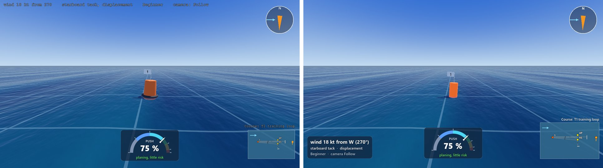 |

| The committee boat, before and after | The start line on the lake, before and after |
|---|---|
| 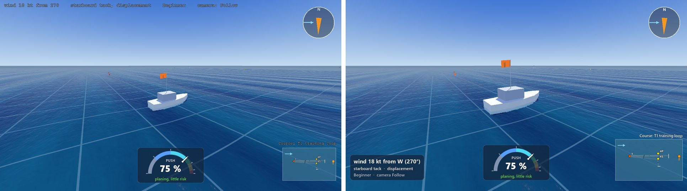 | 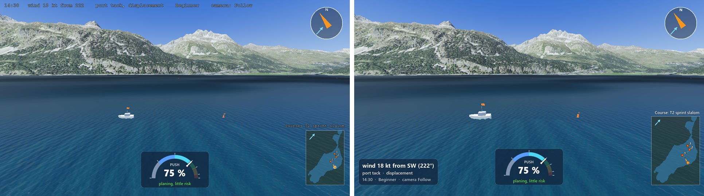 |

A gate's mark (yellow) and the start line from behind (the committee boat with its orange flag, the
pin with its orange flag):

| Gate mark 4S | The start line |
|---|---|
| 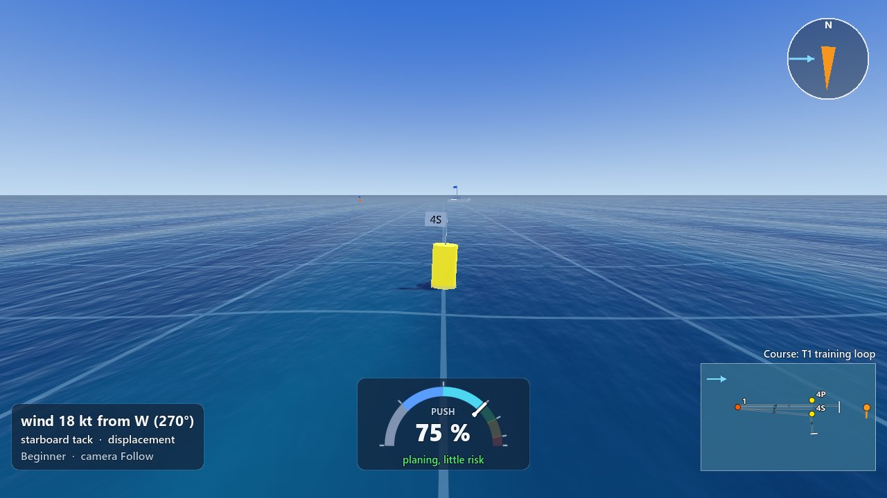 | 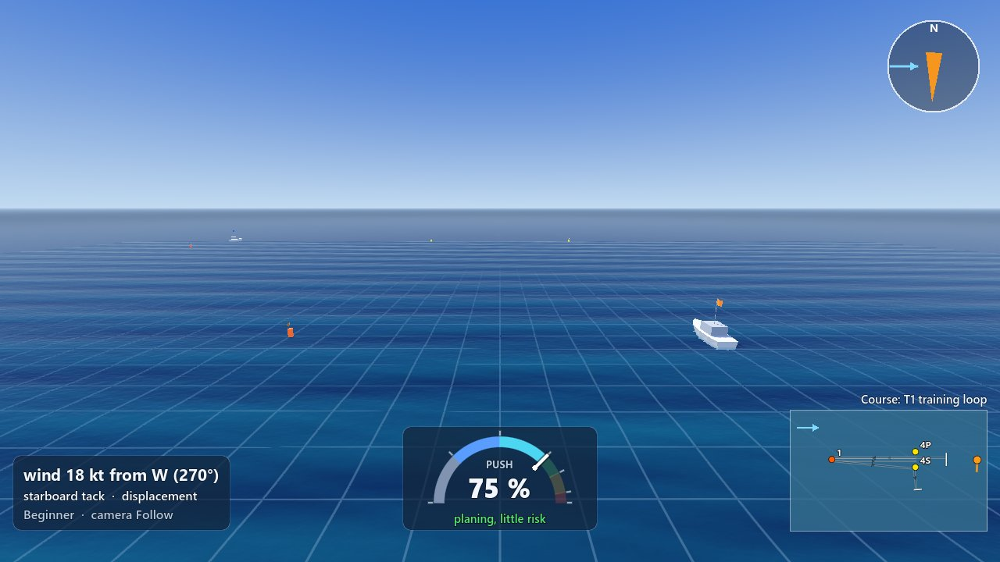 |

**What I chose and why:**

- **Exactly Max's numbers:** a straight cylinder 1.2 m high and 0.7 m across, with 0.1 m of it under
  the water (so 1.1 m stands out of the water). The dark float ring at the bottom is gone ("a
  cylinder").
- **An honest note:** the old buoy was 1.5 m high and 1.1 m wide at its base (on a 1.4 m float
  ring), so Max's buoy is in fact a bit *slimmer* than the one he saw. What makes it easier to see is
  the colour: real fluorescent orange (and fluorescent yellow for gates) that glows a little, so it no
  longer turns brown on its shaded side. If Max wants them bigger after playing, it is two numbers in
  `Game/race/course_on_water.gd` (`BUOY_HEIGHT_M`, `BUOY_RADIUS_M`); for example 2.0 m by 1.0 m.
- **The pins (the line ends) became the same orange buoy** as the rounding marks. The old 0.8 m pin
  was the hardest thing to see at the start, and the pin is what you aim at. The rule for the player is
  now simple: orange is a mark you sail to or round, yellow is a gate, and the flag on top says which:
  a white flag with the mark's name, an orange flag for the start line's pin (like the committee boat's
  flag), a blue flag for the finish line's pin (like the finish boat's).
- **The boats: 1.4 times as big** (the middle of "about 1.3 to 1.5"): 8.4 m long, the cabin, the mast
  (now 3.6 m) and the flag (1.3 by 0.8 m) all grown together, so it still looks like the same boat.
- Everything still floats and tilts with the waves, the boats still lie head to wind and the flags
  still stream downwind (the old tests check that, and pass).
- The mini-map uses the same orange and yellow for its dots.
- Not changed: the course maker's top view (`course_overlay.gd`) keeps its own colours.

## 2. The screen over the whole window

Max's window, 3137 x 1263, a race with 20 AI boards (before above, after below):

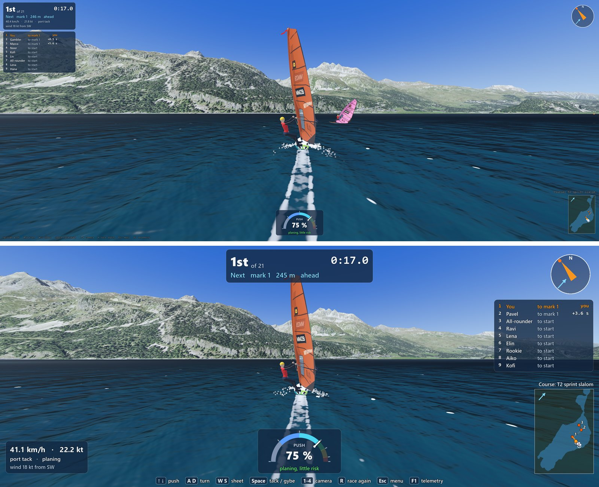

The countdown on Max's window, before and after:

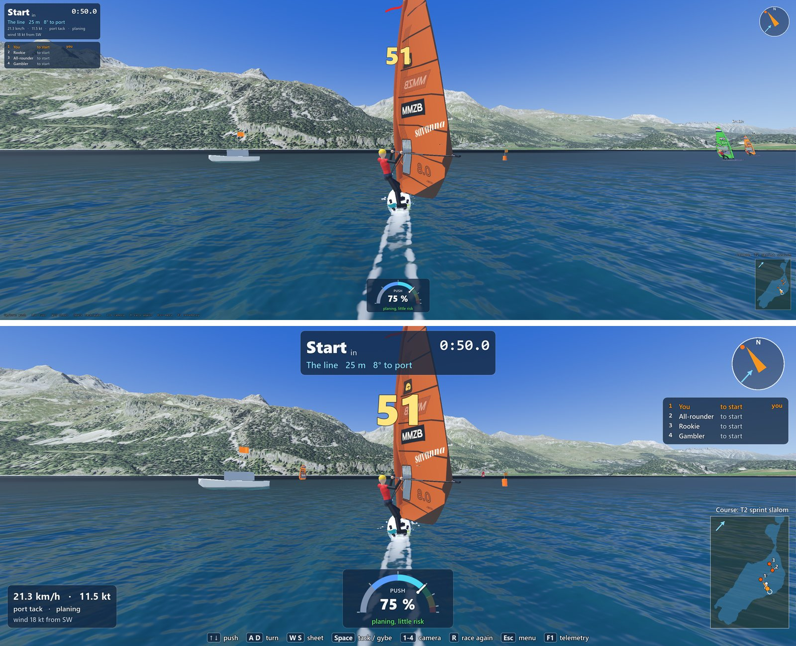

**Where everything is now:**

```
+-------------------------------------------------------------------------------+
| F1 panel (team)          [ 1st  of 21        0:17.0 ]              (compass)  |
|                          [ Next  mark 1  245 m  ahead ]                       |
| (race director's         [ (two lines for the LAN race director) ]  standings |
|  panel comes here)                  big countdown / split /          1 You    |
|                                     warnings                         2 Pavel  |
|                                                                      ...      |
|                                                               Course: T2 ... |
| [ 41.1 km/h · 22.2 kt ]          [ PUSH 75 % ][ body ]            [ mini-   |
| [ port tack · planing  ]          [          ][ gauge]            [  map    ] |
|        [Up Dn] push  [A D] turn  [W S] sheet  [Space] tack / gybe  ...  [F1]   |
+-------------------------------------------------------------------------------+
```

- **Top middle, the race card:** the place and the race clock large ("Start in 0:50.0" in the
  countdown), the next mark with its distance and which way to turn, and room for two more lines
  (the LAN race director's "Next start in 1:30" and its news). The big countdown, the split at each
  mark and the warnings (over the line early, wrong side, penalty) come just under it.
- **Right side, under the compass, the standings:** place, name, where each board is going and its gap
  to you. It shows as many lines as fit above the mini-map (9 with the default size; 4 to 13), and
  in a big fleet the leaders, a gap ("..."), then you and the boards around you, so a LAN race with 8
  players and 20 AI boards stays compact.
- **Bottom left, the speed card:** the speed large, then the tack and planing, then the wind (and a
  wind shadow). In free sailing the same card shows the wind large instead, without the speed, as the
  "Sailor's view" setting has always done.
- **Bottom middle:** the push gauge (and the body gauge beside it with package B on). If a big
  mini-map in a narrow window would cover them, they move left out of its way.
- **Bottom right:** the mini-map, with the course's name above it.
- **Along the bottom edge:** the keys, each key in a small dark chip and what it does next to it. A
  narrow window makes the text a little smaller so it always fits on one line.
- **Top left:** free for the LAN race director's panel. The F1 detail panel (the team's physics
  numbers) is still there when it is on; it is a little smaller (13 instead of 15) because it now grows
  with the window like everything else.
- **The results** at the end of a race come up in the middle, in two columns for a big fleet.

The other states, at Max's size (before above, after below):

| Free sailing on the open water | A time trial on the lake |
|---|---|
| 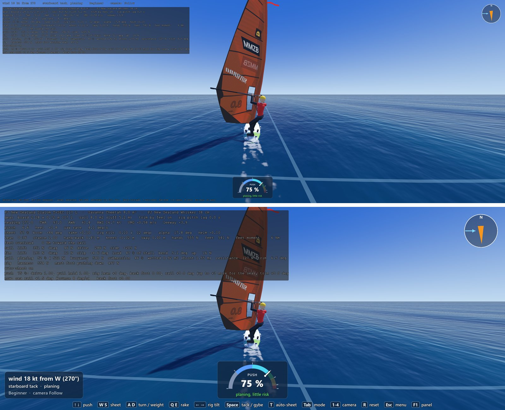 | 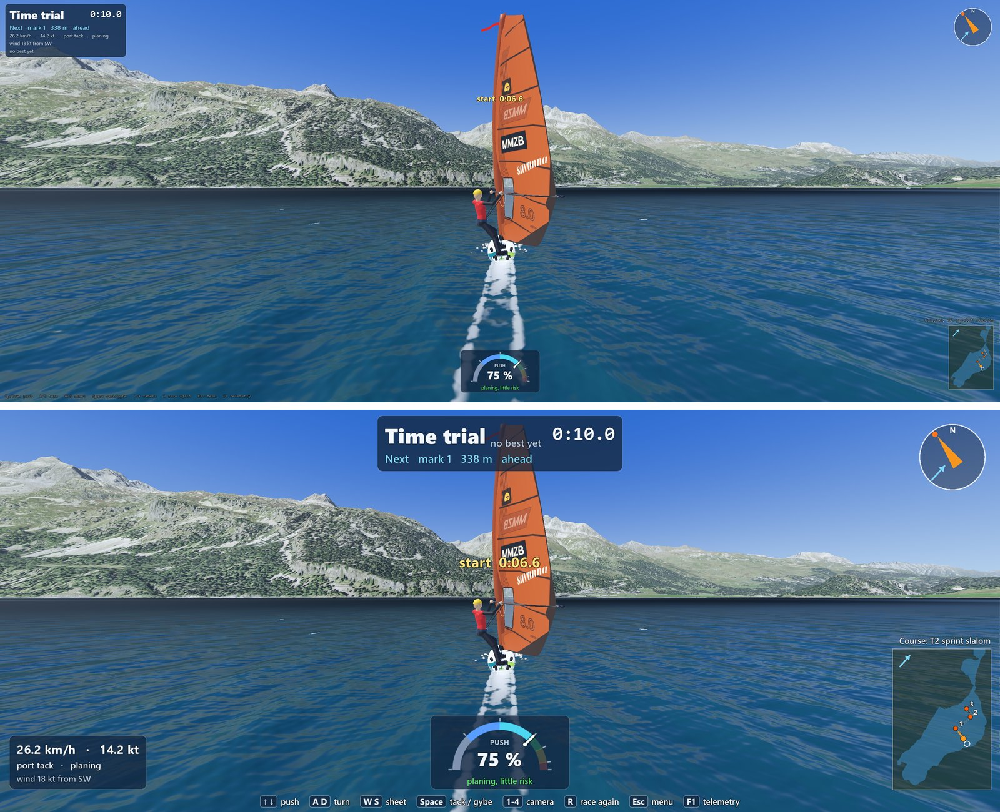 |

Free sailing on the lake: 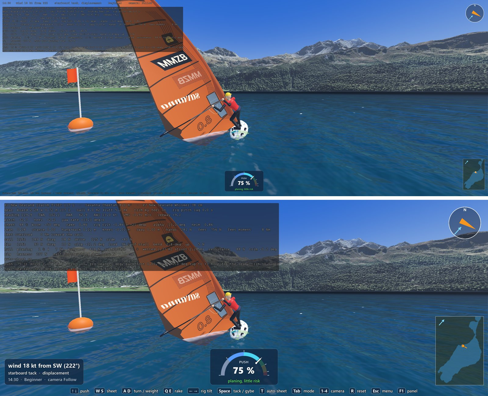

Spectating (the camera on the leader of 20 AI boards), and a race on the open water, both after:

| Spectating | Open water, T1 |
|---|---|
| 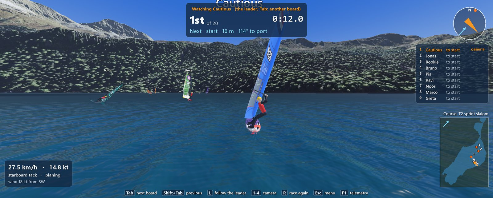 | 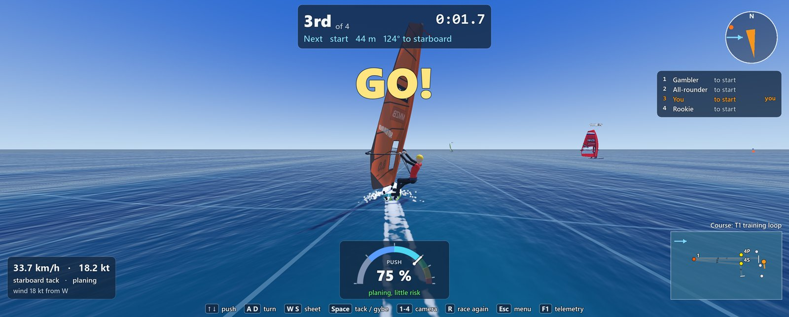 |

And at 1280 x 720 (before left, after right): the race with 20 AI boards, the countdown, the time
trial, free sailing:

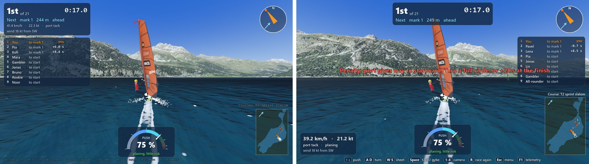
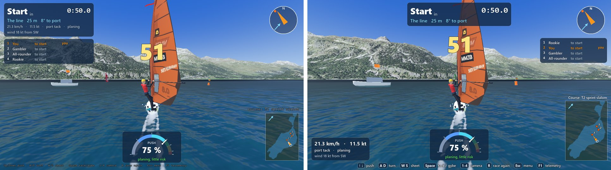
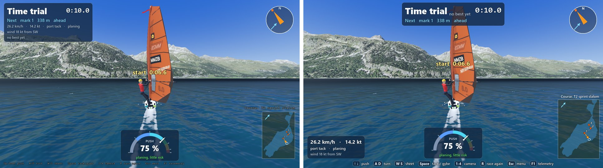
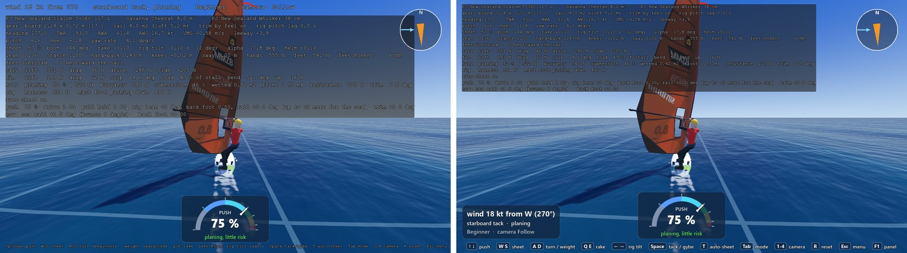

**Sharp, not stretched** (crops at Max's full resolution, nothing scaled):

| The standings | The speed card and the keys |
|---|---|
| 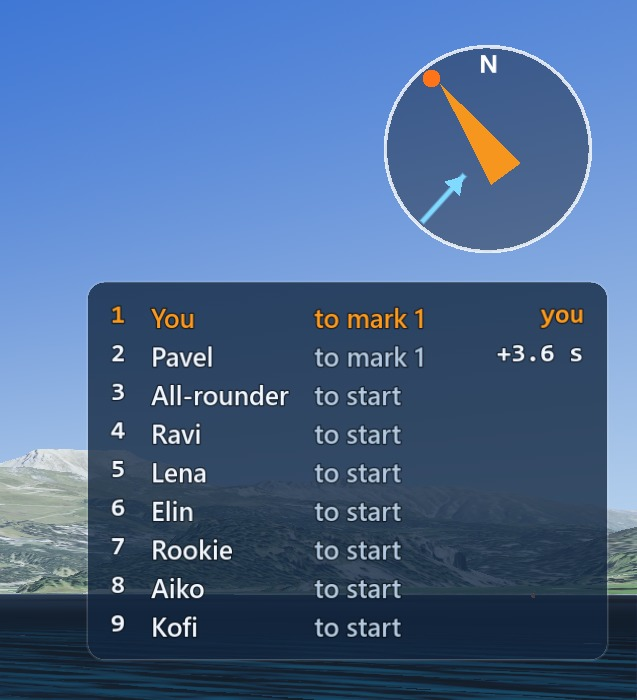 | 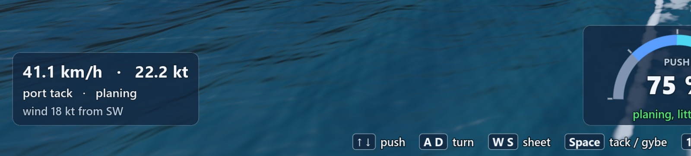 |

**How it grows with the window, and why this way:** the screen is laid out once for a window 720
pixels high, and Godot's "canvas items" stretch (one setting in `project.godot`) draws all of it as
much bigger as the window is taller: 1.5 times in a 1920 x 1080 window, 1.75 times in Max's 3137 x
1263. Godot draws the text and the shapes at the window's real resolution, so nothing is blown up
from small pixels (no `Control.scale`, Max's rule). A wider window just gives the panels more room
across, because each one is anchored to its corner or edge. It is the same way the wind viewer and
the start menu (UI4) already fit any window, now for the whole game, so the pause menu and the
settings grow with the window too (they were small on Max's window). The 3D picture itself is not
affected: it is drawn at the window's full resolution as before. I chose the project setting over
doing it per scene because it is one line, it is Godot's own way for games, and the start menu and
the wind viewer, which switch to their own sizes while they are up, give the window back to it.

Two side effects, handled:

- **The orbit camera's mouse feel stays the same:** the camera now reads the mouse's own pixels
  (`screen_relative`), so dragging turns the camera as far in any window size. (The terrain fly-over's
  camera, a map tool, now turns at the same speed as in the wind viewer, which already had this
  scaling: on Max's window that is slower than before.)
- **Screenshots at another size** (`tools/screenshot.sh ... --resolution=3137x1263`) now show the
  screen as the player sees it when the window can be that big; on a smaller screen they still draw the
  game at that size but with the HUD unscaled, and say so.

## 3. The mini-map

- **Bigger:** its longer side is 35 % of the screen's height by default (252 of 720; on Max's window
  about 440 pixels, more than twice the 200 it was). The mark names, the dots of the boards and your
  own board are a little bigger too.
- **The setting:** Settings > Sailing > **Mini-map size**, a slider from 20 % to 50 % of the screen's
  height in steps of 5, with a word next to it (small, medium, large, extra large). It is saved with
  the other settings and changes the map at once, also from the pause menu in a running game.
- **At most half the height,** so a race's standings always keep at least four lines above the map
  (the leader, a gap, you and one neighbour). Here the biggest map with the body gauge on, in a
  1280 x 720 window: the gauges moved left out of its way.

  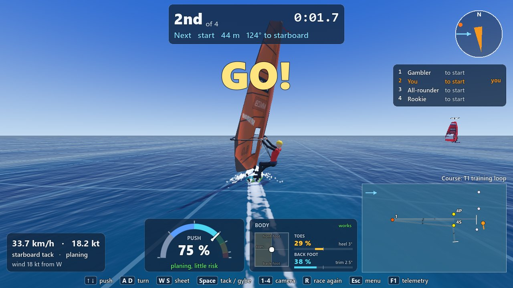

- The settings in the pause menu now grow with Max's window too:

  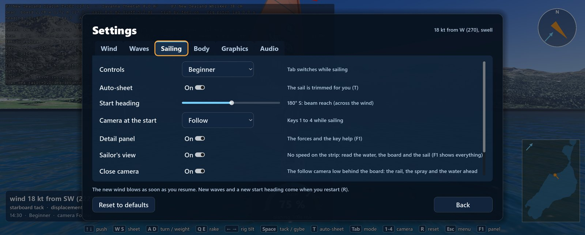

## What I could not verify

- **How it feels to play**: whether the new layout is calm while racing, whether the buoys are easy
  to find at 300 m on the lake in Max's light, whether the boat's size feels right. That is Max's
  play-test.
- **A LAN race with two PCs**: the guest's screen uses the same race card and standings (the same
  code), but I did not run two PCs. The guest's keys line says "R after a fall: back on the board".
- **The results table at the end of a real race** with a big fleet: a test checks that 28 boards go
  into two columns that fit; I did not sail a race to the end for a screenshot.
- **A window taller than 16:9** (a portrait or 4:3 screen): the layout then gets more room in height;
  not looked at.

## Play-test checklist for Max

1. Start a race on the lake with several AI boards. Is the clock at the top easy to read during the
   countdown? Do you find the start line's pin (the orange buoy with the orange flag) and the
   committee boat quickly?
2. Sail to mark 1. From how far do you see the orange buoy? Is it big enough, or should it be bigger
   than Max's 1.2 by 0.7 m? (Two numbers to change.)
3. Look at the gate (yellow): easy to tell from the orange marks?
4. Is the committee boat now big enough to see from the far end of the line?
5. While racing: the standings on the right, the speed at the bottom left: can you read them with a
   quick look, without searching? Is anything in the way of the water ahead?
6. Settings > Sailing > Mini-map size: slide it while sailing (Esc, Settings). Does the map change at
   once? Which size do you like? (The default is 35 %.)
7. Try a different window size (make the window smaller, then maximize it): does everything stay in
   its place and sharp?
8. Spectate a race (Race page, spectate) and a time trial: does the card on top say the right things?

## Interface for the LAN track

All of these are on `ui/race-screen` and have tests.

**The course on the water, live:** `CourseOnWater.set_course(course: Course) -> void`
(`Game/race/course_on_water.gd`)

- Call it again and again with the changed course: the same `Course` object changed in place, or a
  new one (a `copy()`). Marks are matched **by their name** (`CourseMark.id`):
  - a mark whose position changed: its buoy or boat (the same node) moves there at once, on the water,
    without sliding (its physics interpolation is reset);
  - a new name: a new buoy, pin or boat is built (sharing the meshes and materials);
  - a name that is gone: its pieces are taken out of the scene and `queue_free()`d (nothing leaks; a
    test waits a frame and checks they are gone);
  - a renamed mark (`Course.rename_mark()`) is a removed one plus a new one (its name is on its flag);
  - the start and the finish line on the water are drawn again only when one of their ends moved, and
    freed when an end is gone.
- Cost: a few lookups and transforms per mark; a test calls it 100 times in a row with a moving mark
  and requires well under 2 ms a call (it is far less).
- `build(course, height_at, clock, wind_at)` works as before (it now calls `set_course()` itself).
  Call `set_course()` only after `build()`.
- Also new, for your own checks: `line_at(boat_id) -> MeshInstance3D` (the start or finish line's
  strip; null when none). `part_at(id)`, `parts_of_kind(kind)` and `flag_at(id)` as before.
- Note: `main.gd`'s `_lay_the_course_again()` (RA24, a turned wind at R) still frees the whole
  `CourseOnWater` and builds a new one. It could use `set_course()` now; I left `main.gd` alone so your
  branch can change it without a clash.

**The mini-map, live:** `Hud.show_course(course: Course) -> void` (`Game/ui/hud.gd`) or
`MiniMap.show_course(course: Course) -> void` (`Game/ui/mini_map.gd`)

- Callable again with the changed course; it redraws at once. The course's marks, lines and legs are
  read from the course every frame, so a course changed in place shows even without the call; call it
  anyway when the course object is replaced.
- On the open water (no lake map) the map is framed on the course; it frames itself anew only when a
  mark comes within 40 m of its edge (so it does not zoom while a mark is dragged). Its size may change
  then; the HUD keeps it in its corner (it listens to the map's `resized`).
- `Hud.show_course()` also sets the line "Course: <name>" above the map.
- The other boards' dots stay live as before (`Hud.set_other_boards()` every frame).

**The two extra lines on the race card:** `RaceHud.set_card_line(index: int, text: String,
colour: Color = HudStyle.DIM_COLOR) -> void` (`Game/race/race_hud.gd`)

- `index` 0 or 1 (`RaceHud.CARD_LINES` = 2). They sit on the race card at the top in the middle, right
  under the "Next mark" line; an empty text hides the line, and the card (and the countdown, the split
  and the warnings under it) grow down to make room. Suggested: line 0 "Next start in 1:30" (the
  automatic next start), line 1 the race director's short news ("Mark 2 moved", in
  `HudStyle.HIGHLIGHT_COLOR` for a moment if you like). `card_line(index) -> String` reads one back.
- `RaceHud.reset()` (a new start) does **not** clear them: they are the race director's, not the race's.
- The same `RaceHud` runs on the guest's PC (`RaceMirror` makes one), so the guest can show them too.
- In the code they are made in `_build_race_card()`, in the loop marked "The LAN race director's lines
  go here"; add more labels there if you need a third.

**Merging with `mp/race-director`** (what the lead told me it adds):

- **The key "M race director":** the keys are no longer one text in `set_race_mode()`; they are lists
  of [key, what it does] at the top of `hud.gd`. Add `["M", "race director"]` to `RACE_KEYS` (and to
  `GUEST_KEYS` if the guest has it); it fits on one line at 1280 x 720 (the text shrinks a point if not).
- **`RaceNotice` anchored at the top middle, 150 pixels from the top:** in the new layout the race
  card covers the top middle from 10 to about 110 pixels (more with its extra lines), and the big
  countdown starts right under it (about 118 to 248), so a notice at 150 sits on the countdown during
  the start sequence. Either put the notice's text on the card (`set_card_line(1, text,
  HudStyle.HIGHLIGHT_COLOR)`, the slot made for it), or move the notice under the warning line: the
  first free spot in the middle is about `card bottom + 215` (in a race the HUD's own message line uses
  380, `Hud.MESSAGE_TOP_IN_RACE`).

**Room for the race director's panel:** the left side of the screen, from the top down to the speed
card at the bottom left, is free during a race (the F1 detail panel is hidden in races unless F1 is
pressed). The layout is for a window 720 pixels high: a panel anchored to the left edge with
`set_anchors_and_offsets_preset()` grows with the window like the rest. `Hud.MARGIN` (16) is the gap
the other panels keep from the edges; `Hud.BOTTOM_INSET` is where the bottom row ends.

## For the lead to decide

1. **The buoy's size:** Max's 1.2 x 0.7 m is slimmer than the old 1.5 x 1.1 m buoy, though it reads
   better for its colour. Keep Max's numbers until he has played it (my advice), or go bigger now.
2. **The pins** are now the same orange buoy as the marks with a coloured flag. If the team wants pins
   in their own colour, it is one material in `_add_pin()`.
3. **The project-wide stretch** (`project.godot`: `canvas_items`, `expand`) scales every scene's 2D,
   the menus and the map tools too. I think that is what Max wants everywhere; say so if a scene
   should keep its own pixel sizes.
4. **The F1 panel** is on by default (setting "Detail panel") and on Max's window it now covers a
   good part of the top left. Leave it on by default, or turn the default off now that it is big?

## The code

| File | What changed |
|---|---|
| `Game/race/course_on_water.gd` | The new buoys (one cylinder, fluorescent materials), the pins as buoys, the bigger boats (`BOAT_SCALE`), `set_course()`, `line_at()` |
| `Game/world/effects/wind_flag.gd` | `place()` takes a size (the boat's mast and flag grow with it) |
| `Game/project.godot` | The window's stretch: `canvas_items`, `expand` (the 2D grows with the window) |
| `Game/camera/camera_rig.gd` | The orbit camera reads the mouse's own pixels (`screen_relative`) |
| `Game/dev/dev_capture.gd` | Screenshots at another size show the HUD as played when the window can be that big |
| `Game/ui/hud.gd` | The layout: the free-sailing card at the bottom left, the gauges in a row in the middle, the keys in chips along the bottom, the mini-map's size from the setting (at once), `right_column_bottom()` for the standings |
| `Game/race/race_hud.gd` | The race card at the top in the middle with `set_card_line()`, the speed card at the bottom left, the standings on the right fitting above the map (`fleet_room_rows()`), short tables keeping you and the leader, results in two columns |
| `Game/ui/mini_map.gd` | `size_px`, `size_for()`, `size_name()`, bigger dots and names, re-framing only when a mark leaves the map |
| `Game/ui/settings_values.gd`, `Game/ui/settings_menu.gd` | The setting "Mini-map size" (saved as `sailing/minimap_size_percent`) |
| `Game/tests/unit/test_course_on_water.gd` | The new sizes; `set_course()`: a moved, a removed, a new and a renamed mark, 100 calls in a row |
| `Game/tests/unit/test_race_screen.gd` (new) | No panel on another at 1280 x 720 and each in its place; the free-sailing card; the mini-map's size from the setting at once; a changed course on the map; the card's two lines; two result columns; a short standings table; the settings slider |
| `Game/tests/unit/test_game_settings.gd` | The new setting saved and clamped |
| `Game/tests/unit/maps/test_course_editor.gd` | Turns the project's stretch off while it runs: its sums count in the test runner's own 64-pixel window (about 7 m a pixel), which the stretch would make 1280 layout pixels wide. The course maker in play is unchanged (the wind viewer already used this stretch) |

The screenshots were made with `tools/screenshot.sh <scene> <out.png> <frames> --resolution=<size>
<options>`, at 1280x720 and 3137x1263; the before pictures are of `night2/look` 707888e:

| Picture | Scene, frames, options |
|---|---|
| free sailing | `res://main.tscn` 240 |
| free sailing on the lake | `res://maps/silvaplana/sail_silvaplana.tscn` 300 |
| countdown | the lake, 600, `--course=t2_slalom --skippers=allrounder,gambler,rookie` |
| race with 20 AI boards | the lake, 1500, `--course=t2_slalom --prestart=8 --skippers=allrounder,cautious,gambler,rookie,persona:aiko,...,persona:ravi` (20) |
| time trial | the lake, 900, `--course=t2_slalom --time_trial=1 --prestart=5` |
| spectating | the lake, 1200, the race's options with `--spectate=1` |
| biggest mini-map | `res://main.tscn` 400, `--settings=<a file with sailing/minimap_size_percent=50 and body/mouse_body=true> --course=t1_loop --skippers=allrounder,rookie,gambler --prestart=5` |
| close-ups | `res://main.tscn` 120, `--course=t1_loop --course_view=1` (or `start_boat`, `4S`, `start`); the lake 300, `--course=t2_slalom --course_view=start` |
| settings | the lake, 200, `--pause=1 --page=settings/sailing` |
