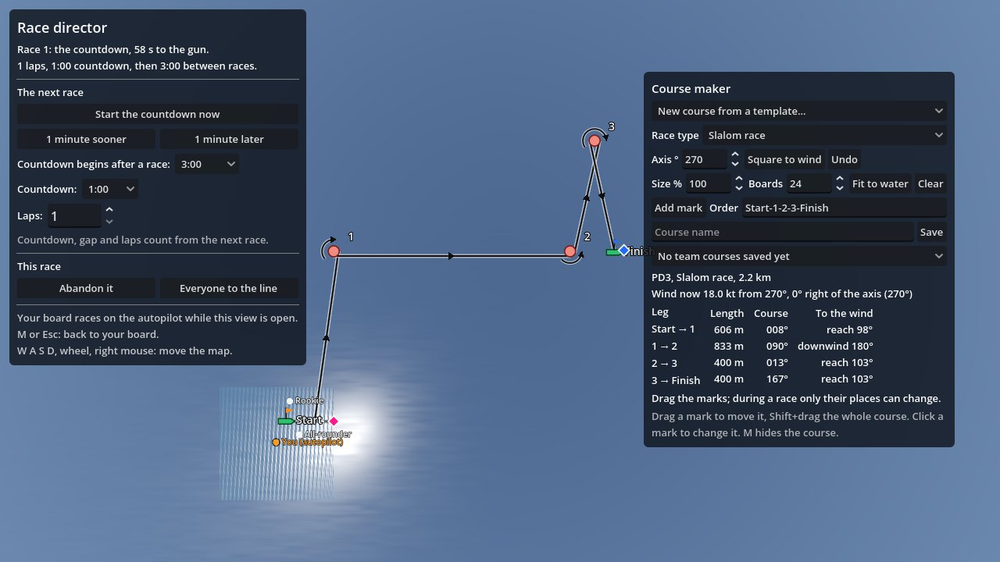
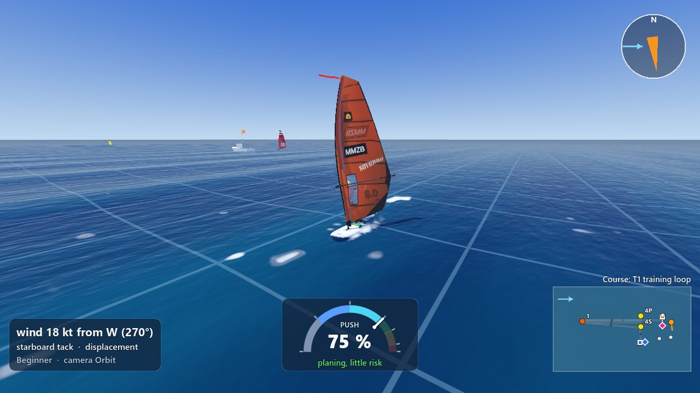
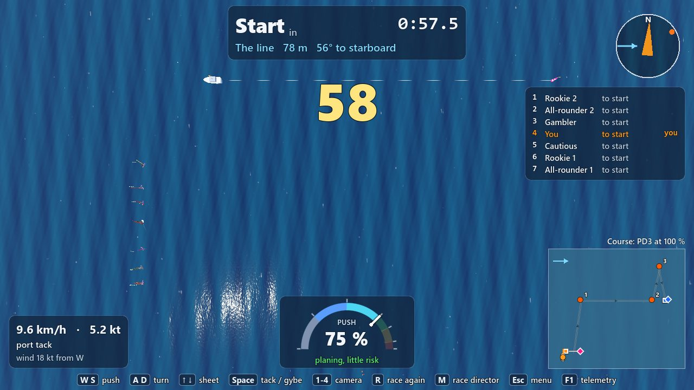
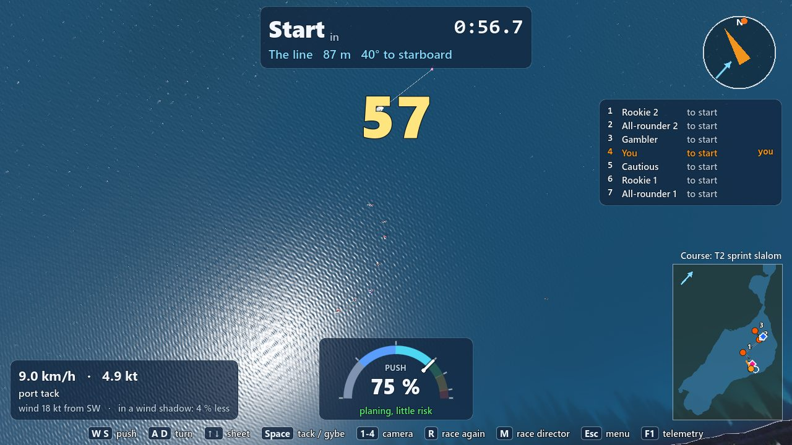
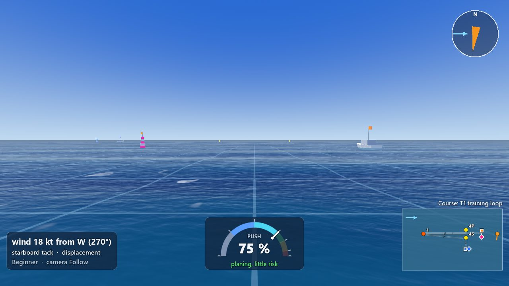
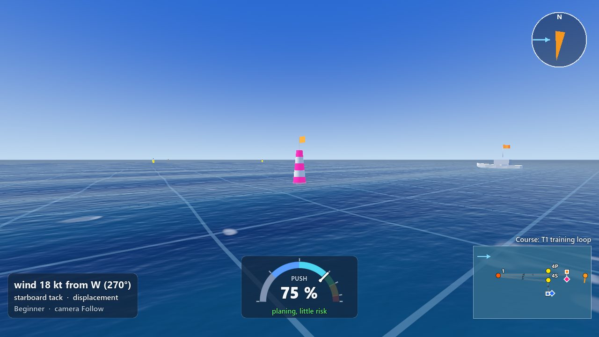
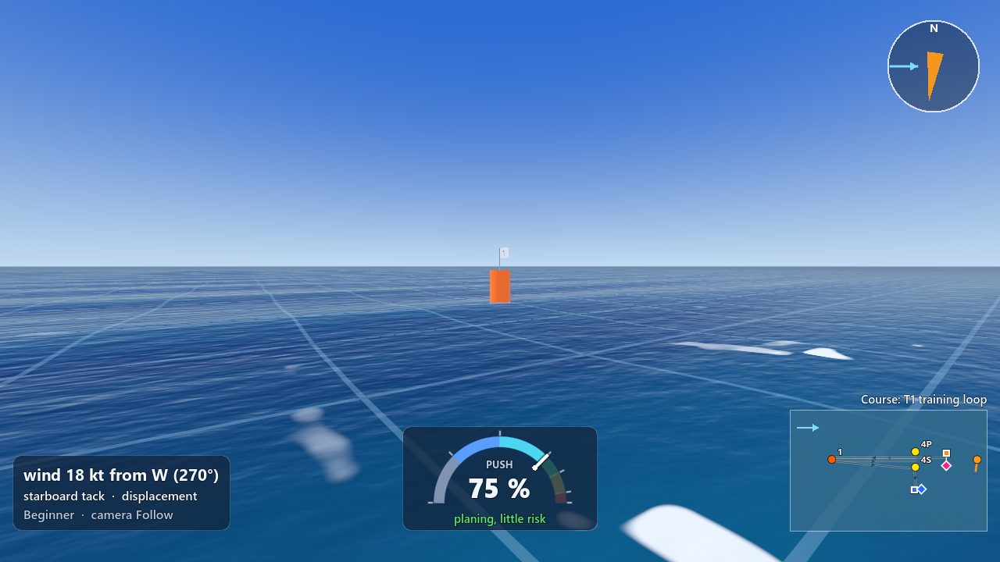
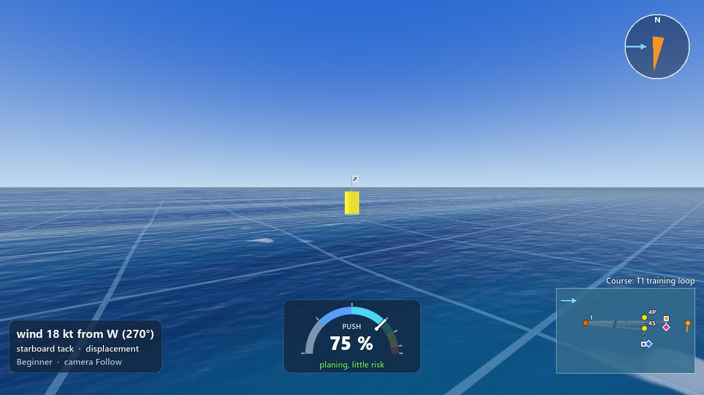
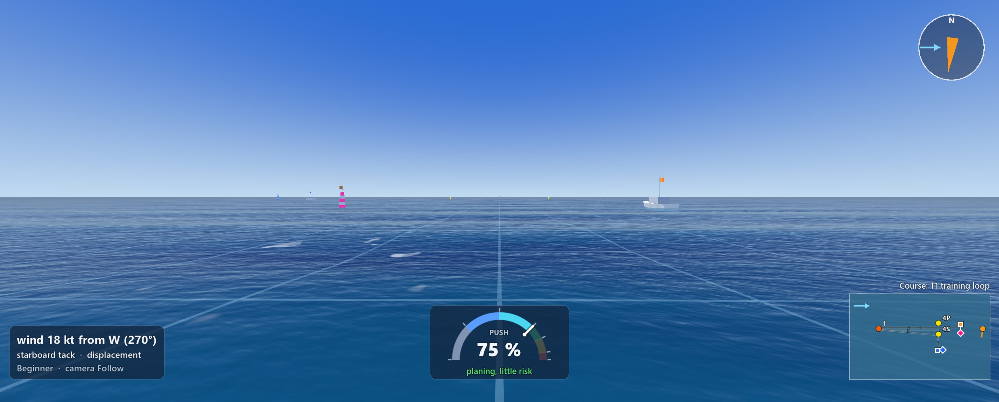
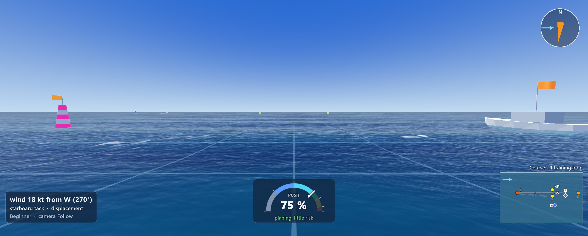

# Race types, the slalom start and the new marks (6 November 2026)

Branch `race/types-start-marks` (from `play/6nov-evening` 355df1c). Built by an Opus agent for the
lead of the evening's play-test.

## What Max asked

- "Start upwind of the startboat on a slalom race. On the course builder a option for slalom race,
  course race and iq hybrid race and then also free sailing. Also easier for ai to train."
- "Start bouys are different than rounding marks. In general marks bigger."

## In short

- **Every course now has a race type**: Slalom race, Course race, iQ hybrid race or Free sailing.
  It is a selector in the course maker ("Race type", just under the template list), in the wind
  viewer's course maker and in the race director's (they are the same panel). It is saved with the
  course and travels to the other PC with the race director's changes.
- **A slalom starts upwind of the committee boat.** The boards wait in a row 35 m upwind of the
  boat, spread across the wind on the side away from the course, you in the middle. At the gun
  everyone bears away onto a broad reach and reaches down onto the line.
- **The AI knows the type and starts a slalom that way**: it sails to its own spot in the row,
  waits there luffed up on the tack of its reach down, and goes when the time it needs to its
  crossing is the time left; the reach down is steered straight, never deeper than 148 degrees from
  the wind. Nobody was over early in any race. **But it is not yet as quick off the line as the old
  start behind the line** (section 3): the AI's slalom start needs more tuning, and the last
  version's numbers are for the night run.
- **Free sailing**: no countdown and no results; the marks stay on the water and the AI boards sail
  free around the start. In a LAN game the race director can switch to free sailing and back.
- **The marks are bigger** (1.8 m high and 1.1 m wide; they were 1.2 by 0.7 m), and **the start and
  finish pins look different**: a tall striped pillar (3 m), pink and white at the start, blue and
  white at the finish, with the line's flag on top. The mini-map and the course maker draw the pins
  as diamonds in those colours.

## 1. The race types and what each changes

| Race type | Templates that have it | Where the boards wait | The AI's start | Countdown and results |
|---|---|---|---|---|
| **Slalom race** | PD3, SD3 (the sprint slaloms), T2 | In a row 35 m upwind of the committee boat, across the wind, on the side away from the course; you in the middle | To its spot in the row, waits luffed up on its reach's tack, then a broad reach (about 140 degrees from the wind, at most 148) down onto the line | Yes |
| **Course race** | LG2, LR2 (windward-leeward), O2, I2 (trapezoids), T1 | Behind the start line, spread along it (as before) | The timed run-in, as before | Yes |
| **iQ hybrid race** | US3, US4 (upwind sprints), PM1, SM1 (medal race MR1) | Behind the start line (as a course race) | As before | Yes |
| **Free sailing** | none by default: choose it in the course maker | Placed as for the course's type | The AI sails free around the start | **No countdown, no results, no race card** |

The race director's course maker with the new selector (PD3: Slalom race; the summary line names
the type, and the pin is a pink diamond):



Free sailing on T1 with three AI boards (`--race_type=free`): no countdown and no race card, the
course on the water and on the mini-map, the AI boards (white dots) sailing free:



- Which template is which type: the iQFOiL Notice of Race in `Documentation/` names the disciplines
  "Course Racing" (windward-leeward, trapezoid) and "Sprint Racing" (sprint slalom, upwind sprint),
  and the finals' MR1 and MR2. It does not use the word "hybrid"; I followed the lead's brief: the
  upwind sprints and MR1 mix a course race's beat with a slalom's reaches, so they are "iQ hybrid".
  For now hybrid starts like a course race (behind the line); see the open questions.
- A course saved before today has no race type in its file: it gets its template's type when it is
  loaded (`iq_pd3` and `t2_slalom` are slaloms, `iq_lg2` a course race, `iq_us3` a hybrid, ...).
- **Changing the type in the race director** (LAN or alone): to Free sailing stops the race at once
  (no result, everyone sails on where they are, "Free sailing: no races until the race director
  picks a race type"); back to a race type plans the next countdown after the director's gap (or
  press "Start the countdown now"). Between Slalom, Course and Hybrid the next start uses the new
  type.

## 2. The slalom start

Seen from above on the open water (the template PD3; the wind from the west, so it blows from left
to right, as the arrow in the mini-map shows): the committee boat at the top left, the dashed start
line running down the wind to the pink pin at the top right, and the boards waiting in a column
upwind (left) of the boat, below the line's side away from the course (mark 1 is up, to the north):



The same on Lake Silvaplana's T2 (the wind from the south-west, from the bottom left): the boat,
the short line (40 m) to the north-east, and the row running down from upwind of the boat: on a
line this short the far end of the row waits further up the wind, so the boards keep some 9 m
apart:



The geometry, with the wind from the top:

```
                         wind
                          |
                          v
   o   o   o   o   Y   o   o        the row: 35 m upwind of the boat,
    \   \   \   \   \   \   \       some 30 to 115 m out to the side
     \   \   \   \   \   \   \
      \   \   \   \   \   \  [B]    committee boat (the line's upwind end)
       \   \   \   \   \   \  |
        \   \   \   \   \   \ |     each board's broad reach (140 degrees
         \   \   \   \   \   \|     from the wind) meets the line: the
          \   \   \   \   \   |     nearer the boat in the row, the nearer
                              |     the boat it crosses          --> mark 1
                             [P]    pin (pink and white)
```

- How the row is made: each spot is a point of the start line (from the boat end to 100 m down the
  line) moved back up a 140-degree broad reach until it is 35 m upwind of the boat. So every board's
  reach down from its spot meets the line. On a line shorter than 100 m (T2's 40 m, iq_pd3's 84 m)
  the far spots cross by the pin and wait further up their reach, so the row keeps its width.
- My first row had fixed spots 35 to 120 m out; on iq_pd3's short line the far end's reach ran past
  the pin, Bruno aimed at the pin from too far up, sailed over the line's extension and started
  15 s late. The row above fixes that (the numbers below are with it).
- The row is inside the area where the AI boards sail before a race (on a slalom it now reaches 120 m
  upwind of the line, it was 50 m), and on the lake it is kept off the shore.
- A slalom laid with a start line square to the wind (an upwind start) starts like a course race,
  behind the line: you cannot reach down onto it from upwind of the boat.
- The numbers are estimates, not class rules, and easy to change in `Game/race/race_courses.gd`:
  `SLALOM_WAIT_UPWIND_M` (35 m), `SLALOM_FARTHEST_CROSSING_M` (100 m) and `SLALOM_DIVE_TWA_DEG`
  (140 degrees).

## 3. The AI on a slalom start: before and after

Eleven personas (Aiko, Bruno, Elin, Greta, Hana, Ines, Jonas, Kofi, Lena, Liv, Mara), seed 0, a
60 s countdown, the rules and the wind shadows on, each persona on its own gear
(`tools/race.sh --course=<course> --skippers=persona:aiko,... --seconds=420`).

The race tool puts every board on its spot at the start of the countdown (`--spawn=line`, its
default); the game instead spawns the AI around the start area. "Start" is how long after the gun a
board crossed the line; "mark 1" is the median time to mark 1. The 60 s finish window (the race ends
60 s after the first finisher) makes the "finished" count small and is not about the start.

**iq_pd3 (the sprint slalom saved on the lake, 84 m line), open water, 15 kt** (each line is one
version of the AI's slalom start, in the order I built them):

| Version | Over early | Start median / slowest | Not started | Mark 1 (median) | Falls | Finished |
|---|---|---|---|---|---|---|
| **Before** (the old start: behind the line, a beam reach in) | 0 | 4.5 s / 9.9 s | 0 | 43 s | 0 | 10 |
| Row of fixed spots, the navigation's dive (cd6f35e) | 0 | 3.8 s / 15.4 s | 0 | 49 s | 0 | 6 |
| ... going 1.5 s earlier | 0 | 4.0 s / 15.4 s | 0 | 46 s | 0 | 7 |
| Row set along each board's reach (46cec3d) | 0 | 4.8 s / 16.4 s | 0 | 54 s | 0 | 6 |
| ... the reach down steered straight | 0 | 6.1 s / 16.8 s | 0 | 46 s | 0 | 6 |
| ... waiting on the reach's tack (28f2861) | 0 | 15.9 s / 42.8 s | 1 | 71 s | 0 | 6 |
| ... never deeper than 148 degrees (0615b84, **the final code**) | not measured: stopped for the night run | | | | | |

**T2 (40 m line) on Lake Silvaplana, the lake's wind of 14:30 (17 kt), its waves**:

| Version | Over early | Start median / slowest | Not started | Mark 1 (median) | Falls | Finished |
|---|---|---|---|---|---|---|
| **Before** (raced as a course race: `--race_type=course`, the old start) | 0 | 9.4 s / 17.2 s | 0 | 51 s | 0 | 6 |
| Row set along each board's reach, the navigation's dive (46cec3d) | 0 | 32.1 s / 119.4 s | 0 | 70 s | 0 | 9 |
| **The final code** (0615b84) | not measured: stopped for the night run | | | | | |

What the runs showed, and what each fix was for:
- **Nobody was over early** in any slalom run (the old start had none either).
- The navigation took the 140-degree reach down for a run and sailed it with gybes, off on the
  wrong gybe: on T2 the fleet started 19 to 119 s late. Fixed by steering the reach straight.
- A board waiting on the other tack gybed late at a crawl; one bearing away past about 150 degrees
  went through the wind's eye onto the other gybe (Hana, 15 s late). Fixed by waiting on the reach's
  tack and never sailing deeper than 148 degrees. The "waiting on the reach's tack" version alone
  made the start slower (15.9 s median), most likely because of the deep reaches the next fix caps;
  that is not proven until the night run measures the final code.
- On iq_pd3 the sailing area round the start line is fitted to the lake's shore, and it moves some
  boards' waiting spots; their reach then meets the line at its end, deeper than planned. The final
  code's cap covers that case; a better fix would keep the whole row inside the fitted area.

**For the night run** (the exact commands; the final code is 0615b84 on `race/types-start-marks`):

```
P=persona:aiko,persona:bruno,persona:elin,persona:greta,persona:hana,persona:ines,persona:jonas,persona:kofi,persona:lena,persona:liv,persona:mara
tools/race.sh --course=iq_pd3 --skippers=$P --seconds=420
tools/race.sh --course=t2_slalom --map=lake --skippers=$P --seconds=420
tools/race.sh --course=t2_slalom --map=lake --race_type=course --skippers=$P --seconds=420    # the old start, to compare
tools/race.sh --course=iq_pd3 --race_type=course --skippers=$P --seconds=420                 # the old start on iq_pd3
```

Read the "Starts:" block at the end of each (the OCS count and each board's start after the gun);
`tools/race_matrix.sh`-style repeats with `--seed=1..5` would show how much is luck. If the final
code is still slower off the line than the old start, the numbers to try first are in
`Game/race/skipper.gd` (`SLALOM_GO_SPARE_S`, `SLALOM_DIVE_DEEPEST_TWA_DEG`) and
`Game/race/race_courses.gd` (`SLALOM_DIVE_TWA_DEG`, `SLALOM_WAIT_UPWIND_M`).

One race per type after the change, the same eleven personas, 15 kt:

| Race type | Course | Over early (OCS) | Start: median / slowest after the gun | Falls | Finished in the finish window |
|---|---|---|---|---|---|
| Course race | T1 (LG2 at 30 %), open water | 0 | 2.5 s / 7.0 s | 0 | 4 of 11 (10:10 race; the other 7 were 2 to 350 m short when the window closed) |
| iQ hybrid race | US3 at 50 %, open water | 0 | 2.1 s / 4.8 s | 0 | 9 of 11 |

- "Finished in the finish window": the race tool, like the game, ends a race 60 s after the first
  board finishes; a board still sailing then is DNF. It is not about the start.
- The course race and the hybrid start as before (behind the line); these numbers are there to show
  that the race types changed nothing for them (0 over early, everyone away within 7 s).

## 4. The marks

| The start line from 50 m, at a sailor's eye height (1280 x 720) | The start pin from 20 m |
|---|---|
|  |  |

| Mark 1 (orange, rounding) from 20 m | A gate's mark (yellow) from 20 m |
|---|---|
|  |  |

On Max's wide window (3137 x 1263), the start line from 50 m and from 20 m:





- **Rounding marks**: orange cylinders, **1.8 m high and 1.1 m wide** (1.7 m out of the water). Max
  asked for 1.2 by 0.7 m this morning and for "bigger" this evening, so they grew by half. The flag
  on top and the mark's name on it grew with them.
- **Gates**: the two marks of a gate are the same yellow cylinder.
- **The pins** (the start line's and the finish line's pin ends): a **3 m tall tapered pillar**,
  striped across, **pink and white at the start, blue and white at the finish**, with the line's
  flag on top (orange at the start, blue at the finish, the same as the boat at the line's other end
  flies). Pink is a colour no mark you round has, and the shape is different too, so you tell the pin
  from a rounding mark at a glance even far away (in the 50 m picture the gate's yellow marks are on
  the horizon beside it). The flags now glow a little like the buoys (lit from behind, the orange
  flag looked brown).
- **The committee boat** stays a boat (8.4 m, its orange flag).
- **The mini-map and the course maker**: the pins are diamonds in their stripe colour with a white
  edge, the boats small white squares with their flag's colour; the rounding marks are a little
  bigger dots (orange or yellow, as on the water).
- What I could not check: how it looks on Max's screen and in the lake's evening light. Two numbers
  each if they should change (`Game/race/course_on_water.gd`: `BUOY_HEIGHT_M`, `BUOY_RADIUS_M`,
  `PIN_HEIGHT_M`, `START_PIN_COLOR`).

## 5. What Max should try

1. Start the wind viewer (`tools/play.sh wind`), open the course maker, choose "Sprint slalom, start
   left (PD3)": the Race type says **Slalom race**. Change it to Course race and back; Undo works.
2. Race on Lake Silvaplana on T2 (a slalom): at the start you are in the middle of the row upwind of
   the committee boat. The AI boards appear around the start area as before and sail to their own
   spots in the row during the countdown. Watch them: do they wait there and reach down onto the line
   at the gun? Is anyone over early? (In a LAN game the other player's spot is in the row too.)
3. Race on T1 (a course race): you still start behind the line, as before.
4. In a LAN game as host, press M (race director), choose **Free sailing** as the race type: the
   race stops, the race card goes, the marks stay; choose Slalom race again: the next countdown is
   planned (or press "Start the countdown now").
5. Any course as another type from the command line: `tools/play.sh res://main.tscn --course=template:PD3
   --skippers=rookie,allrounder,gambler --race_type=slalom` (or `course`, `hybrid`, `free`).
6. Look at the marks: can you tell the pink striped start pin from the orange marks at a glance?
   Are the marks big enough now (from the water, at the start and at mark 1)?

## 6. Open questions

1. **iQ hybrid**: the class's documents in `Documentation/` don't use the word. I made US3, US4,
   PM1 and SM1 "iQ hybrid", and a hybrid starts like a course race (behind the line). PM1 and SM1
   have a reaching start (the line along the wind): should they start like a slalom instead?
2. **The slalom's waiting row**: 35 m upwind of the boat and some 30 to 115 m out to the side, diving at
   140 degrees from the wind. Should the row be closer to the boat (a deeper dive), or further up?
3. **The pin's colour**: pink was chosen because no mark you round has it. Real events also use a
   yellow or orange inflatable with a flag, or a pin boat; Max may prefer another colour.
4. **The AI's slalom start is not yet better than the old start** (section 3). Should the AI keep
   the new start (it waits where Max asked and is never early) while the night run tunes it, or
   start behind the line again until it is quicker? The player's start upwind of the boat does not
   depend on this.
5. **The AI brains (the neural network)**: the scripted AI uses the race type now. The trained
   brains do not see it yet; giving it to them changes their inputs, so it waits for the next
   training round (a roadmap row below).
6. The **start menu's Race page** has no race type selector: a saved course's type is used as it is.

## 7. Roadmap rows

| ID | Item | Files | Waits on | Version |
|---|---|---|---|---|
| RA27 | Race types on the course (Slalom, Course, iQ hybrid, Free sailing): the selector in the course maker, saved and sent over LAN; the slalom start upwind of the committee boat (the row, the AI's dive start); free sailing with no countdown and no results. **Built** 6 November 2026 (`race/types-start-marks`); open: the AI's slalom start is not yet as quick off the line as the old start (the night run measures the final code, section 3), and Max play-tests the row's numbers | `Game/maps/course/course.gd`, `course_panel.gd`, `course_editor.gd`, `Game/race/race_courses.gd`, `race_runner.gd`, `race_director.gd`, `skipper.gd`, `Game/net/race_mirror.gd` | Max's play-test | 0.2 |
| RA28 | The race type as an input of the trained brains (RaceObservation) and of the training's stages (a slalom stage that starts from the row upwind of the boat): "easier for the AI to train" | `Game/race/race_observation.gd`, `training_drops.gd`, `tools/train/` | RA27; a training round | 0.2 |
| UI9 | Bigger marks (1.8 by 1.1 m) and start/finish pins that look different (3 m striped pillars, pink at the start, blue at the finish; diamonds on the mini-map and in the course maker). **Done** 6 November 2026; Max checks them on his screen | `Game/race/course_on_water.gd`, `Game/ui/mini_map.gd`, `Game/maps/course/course_overlay.gd` | Max's look | 0.2 |

## 8. Checks

- `tools/test.sh`: 943 of 943 passing on the final tree (new: `Game/tests/unit/test_race_types.gd`, 10 tests: the type of
  every template and saved course; the type saved, copied, sent as JSON and read back; the course
  maker's selector; the slalom's row upwind of the boat, its broad reaches meeting the line, also on
  T2's and iq_pd3's short lines; a course race still behind the line; the skipper's crossing; free
  sailing in the scene (no countdown, no race card, the marks stay); the race director following the
  type. `test_course_on_water.gd`: the buoys at least 1.6 by 1.0 m, the pins taller, striped, a colour
  no buoy has, start and finish told apart).
- `tools/check.sh`: 479 files, 0 failed.
- `tools/lan_test.sh --map=lake --seconds=40 --host_options=--director_move=1,15,0@-40` (the port
  47520 checked free first): **SYNC CHECK: PASS**, and both PCs' logs print the director's course as
  `COURSE type=slalom, ...`: the race type travels with the course (T2 is a slalom, so the two
  players also started from the row upwind of the boat).
- Headless races: the tables in section 3 (the final code's slalom numbers are missing: the race
  testing was stopped for the night run; the commands are there).
- Not verified: how the slalom start feels to Max and Michiel in the game (the AI was measured with
  the race tool, which puts the boards on their spots; in the game they appear around the start and
  sail to the row in the countdown), the marks on Max's own screen, and the director's switch to free
  sailing in a real LAN game (tested in a unit test with a stand-in, and in a scene alone).

## Tokens

About 0.9 M tokens for this work (one Opus agent, no helpers), including a restart after the usage
limit.
