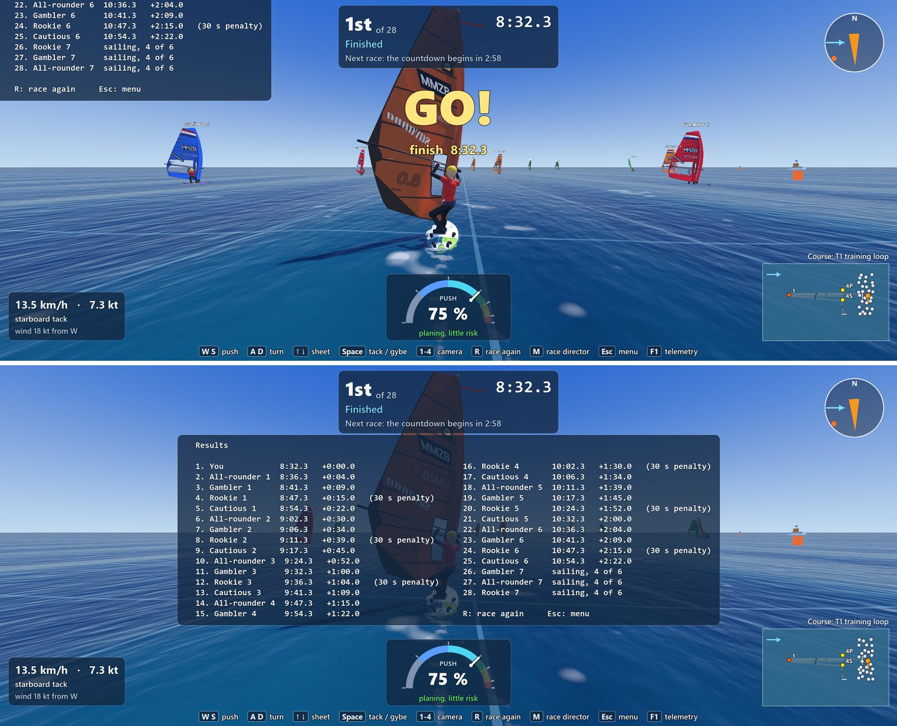
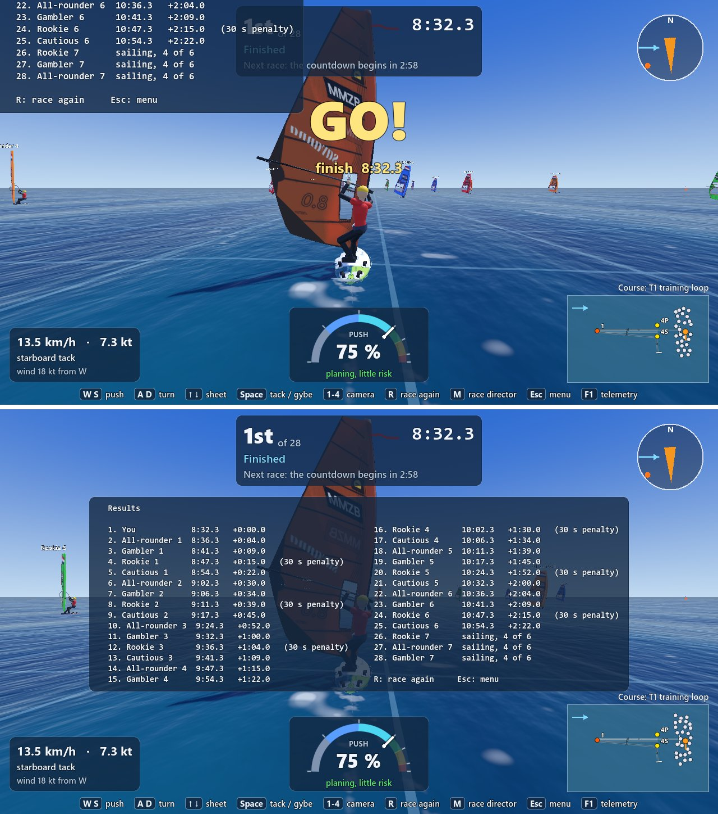
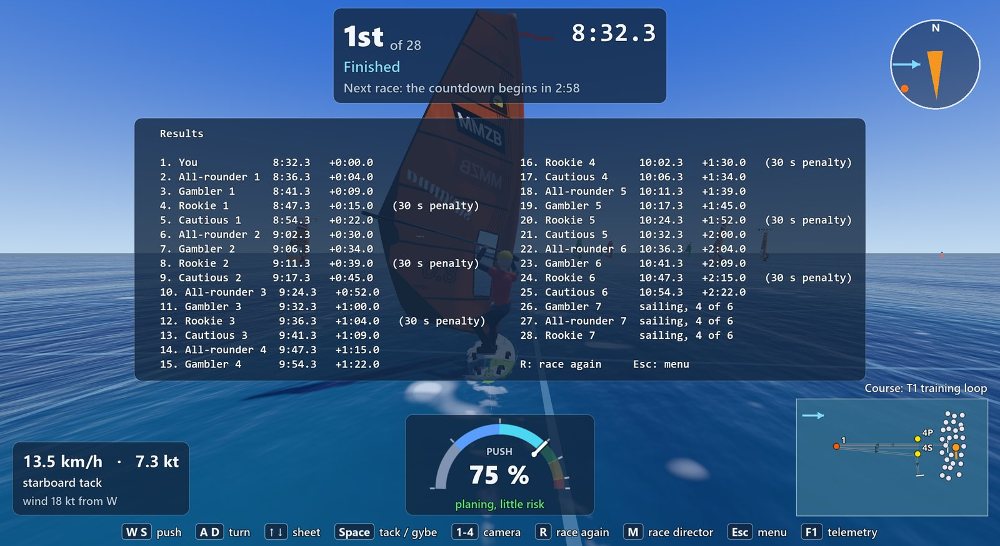
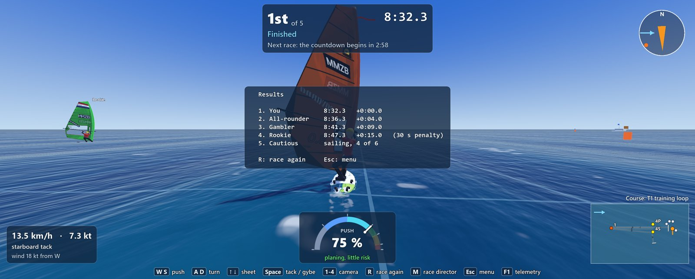
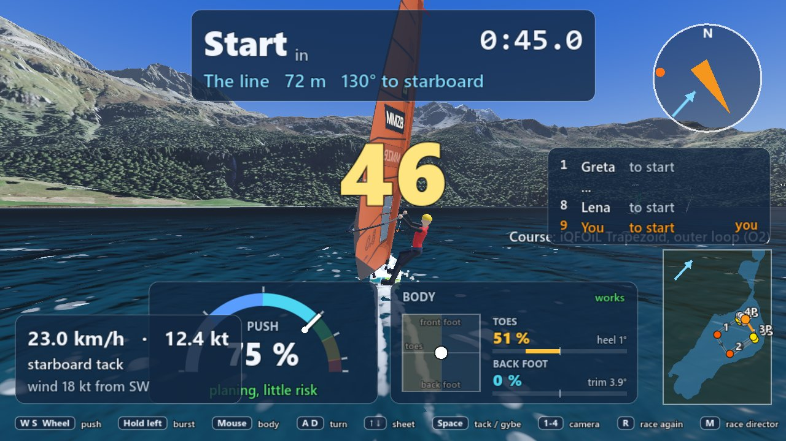
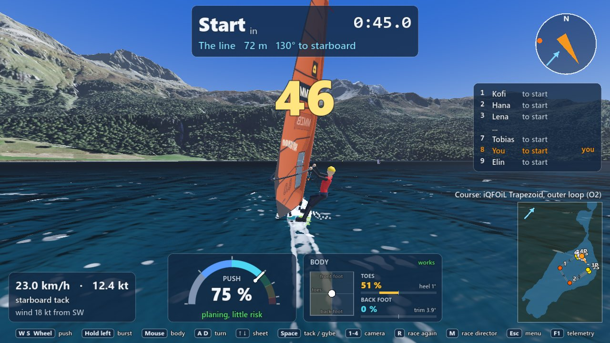
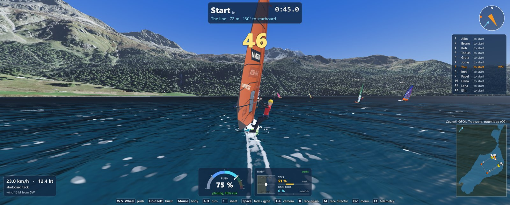
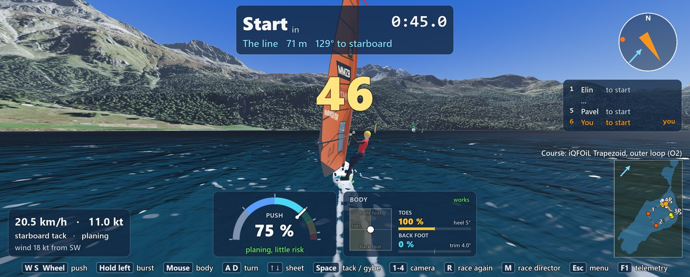

# Three small fixes for the LAN play-test of 6 November 2026 (evening)

Branch `fix/push-and-leaderboard` (from `play/6nov-evening` b61f39c), worktree `WindsurfingMMZB-gp2`.
Built by an Opus agent for the lead. Nothing in `Game/sim/` changed (no physics). `ROADMAP.md`, the
progress log and the changelog were not touched: the rows for the lead are at the end.

## In short

1. **The push gauge no longer disappears** after the race director's view (M) or the Esc menu in a
   LAN game (and Change gear from it), for the host and the guest. The level you had comes back, and
   W, S and the wheel work again. Its own commit, so it can be taken alone.
2. **The finish list stays inside the window** at every window size. It was centred on the window's
   top left corner, so half of it was out of the picture, on every screen. Now it sits under the race
   card and above the gauges, in up to three columns and a smaller text when the fleet is big.
   Also new: **Settings > Graphics > UI scale** (75 % to 150 %): the whole in-game screen (race card,
   standings, gauges, mini-map, keys) bigger or smaller, every part still in its corner; above 100 %
   only as much as fits the window (up to about 129 % on Max's 3137 x 1263 window).
3. **Settings > Graphics > Draw distance**: Near, Normal, Far, Very far (and `--draw_distance=` on
   the command line). Normal is exactly what the game drew before. The frame times are in section 3.

| Commit | What |
|---|---|
| `8f2b578` | The push gauge comes back after the race director's view and a network game's menu (the fix and its five tests, on its own) |
| `80c3a15` | The finish list stays inside the window at any size (and `res://dev/results_view.tscn`) |
| `b6354ee` | Settings > Graphics: UI scale and Draw distance |
| (this report) | The report and its pictures |

## 1. The push gauge after the race director's view or a menu

**What Max saw:** "host and joined player after changing things in racedirector or gear menu push
slider is gone".

**What it was.** The push slider is shared with the AI: an AI skipper puts its "hands" on the same
controller the player uses. Hands that say nothing about the push *let go* of the slider (that is
how an AI board sails the autopilot's own margin). Two things in a LAN game put such hands on *your*
board for a while:
- the **Esc menu** of a network game (the game does not pause, so "still hands" hold your course
  while the menu is open; **Change gear** is reached from this menu), on the host and the guest;
- the **race director's view** (M): an all-rounder races your board while you move marks.

When the hands went away again, nothing put your slider back. With no slider the gauge hides itself,
and W, S and the wheel had nothing to move. That is why it happened on both PCs, and only in a LAN
game: alone, Esc pauses the game and no hands are needed.

**The fix** (`Game/windsurfer/player_controller.gd`, `_slider_back_after_hands()`): when hands take
the board, the controller remembers the slider's level; when they let go, it puts it back. A board
that never had a level (an AI board) gets none back, so the AI sails as before. While the menu is
open the board still sails the autopilot's steady margin, as before; only the return is fixed.

**The body gauge and the mouse capture** were never lost (they do not depend on the slider); the new
tests check them too.

**Tests** (`Game/tests/unit/test_push_after_menus.gd`, five tests, all red before the fix): the
level comes back after still hands and after a skipper that pushed at its own level; an AI board
stays without one; in the sailing scene, after a network game's menu and after the race director's
view, the level is the one you had and both gauges are up.

**How to see it is gone:** in a LAN race (host or guest), sail with the push at, say, 85 %; press Esc,
choose Change gear, close it and go back to the water: the gauge shows 85 % and W and S move it. As
the host, press M, drag a mark, press M again: the same.

## 2. The finish list, and the UI scale

### The finish list

**What it was.** The results panel was anchored to the middle of the screen with
`set_anchors_preset()`, which keeps a panel's corner where it was made: the window's top left corner.
The table then grew around that corner, half of it above and to the left of the window. The race
screen's report of this morning said the results at the end of a real race were not looked at; this
is what a look shows. It happened at every window size:

Before (above) and after (below), a finished race of 28 boards (3 still sailing, every fourth with a
30 s penalty), on Max's 3137 x 1263 window:

At 1280 x 720 and 1920 x 1080, before and after:

And after, at 2560 x 1400 (this PC's screen cannot open a 2560 x 1440 window: 1400 is the nearest that
draws the screen as in play; the before picture there is the same bug):

A small fleet (5 boards) on Max's window: one column in the big text, in the middle of the room:

**The fix** (`Game/race/race_hud.gd`): the anchors and the offsets set together; the table is placed
in the room between the race card and the gauges, centred, clear of the mini-map. It takes the
biggest text (17 down to 11) in the fewest columns (1 to 3) that fit, so a small fleet gets one big
column and 28 boards (8 players and 20 AI boards) still fit at 1280 x 720. While it shows, the big
split ("finish 8:32.3") and the countdown give it the room: the finish time is on the race card and
in the table.

To make these pictures without sailing a race to the end there is a small dev scene:
`tools/screenshot.sh res://dev/results_view.tscn out.png 200 --boards=27 --sailing=3
--resolution=3137x1263` (a race whose boards all get a finish time, three still sailing, every fourth
with a penalty; `--long_names=1` for long LAN names). It changes nothing in the game.

### The UI rule, and the new UI scale

**The rule the game already has** (since this morning's race screen, `project.godot`): the whole 2D
screen is laid out for a window 720 pixels high and drawn as much bigger as the window is taller
(Godot's `canvas_items` stretch with `expand`), sharp at the window's own resolution; a wider window
gives the panels more room across, because each panel is anchored to its corner or edge. On Max's
3137 x 1263 window everything is 1.75 times as big as at 1280 x 720; at 1920 x 1080 1.5 times; at
2560 x 1440 2 times. So the HUD already scales with the resolution; what was out of frame was the
finish list's own bug above.

**New: Settings > Graphics > UI scale** (75 % to 150 %, 100 % by default; `--ui_scale=<x>` on the
command line). It makes the in-game screen (race card, standings, speed card, gauges, mini-map,
compass, keys, finish list) bigger or smaller on top of the window rule, and it changes at once. Each
part keeps its corner: the HUD lays itself out on a screen "UI scale times smaller" than the window
and is drawn that much bigger (`Game/ui/hud.gd`, `_screen`, `add_part()`). The menus are not
scaled by it: they fit the window by their own rule (the start menu as a 1280 x 800 page, the pause
menu with the game's stretch) and are checked below.

**Above 100 % it grows only as much as fits.** The first try, 150 % in a 1280 x 720 window, put the
speed card on the push gauge and cut the keys off (the upper picture). So the screen now keeps at
least 1180 x 560 of its own pixels: in a 16:9 window that is about 108 %, in Max's 3137 x 1263 window
about 129 % (the lower picture). Below 100 % it always shrinks as asked. The slider's line says "as much as fits the window".

| 150 % at 1280 x 720: the first try (overlaps), then with the rule |
|---|
|  |
|  |

Max's window at 75 % (everything smaller, all twelve boards in the standings) and at 150 % (129 % used):

### Every panel at the four sizes

A 12-board race on the lake (the player and 11 personas, iQFOiL O2) with the body on the mouse (both
gauges), in the countdown; the finish list above; the race director's view; the Esc menu and the
settings. Every picture looked at; nothing out of the window, nothing on top of something else, the
text readable, the gauges 1.5 to 1.95 times their 1280 x 720 size in the bigger windows.

| | 1280 x 720 | 1920 x 1080 | 2560 x 1400 | 3137 x 1263 |
|---|---|---|---|---|
| Race HUD, both gauges, countdown, standings, mini-map | [ok](small_fixes_6nov_evening/lake12_1280x720.jpg) | [ok](small_fixes_6nov_evening/lake12_1920x1080.jpg) | [ok](small_fixes_6nov_evening/lake12_2560x1400.jpg) | [ok](small_fixes_6nov_evening/lake12_3137x1263.jpg) |
| Finish list (28 boards) | fixed | fixed | fixed | fixed |
| Race director's view | [ok](small_fixes_6nov_evening/director_1280x720.jpg) | (same rule) | (same rule) | [ok](small_fixes_6nov_evening/director_3137x1263.jpg) |
| Esc menu | (same rule) | | | [ok](small_fixes_6nov_evening/pause_menu_3137x1263.jpg) |
| Settings > Graphics (in a race) | [ok](small_fixes_6nov_evening/pause_graphics_1280x720.jpg), [new rows](small_fixes_6nov_evening/graphics_rows_1280x720.jpg) | | | [ok](small_fixes_6nov_evening/pause_graphics_3137x1263.jpg) |
| Settings > Wind (Lake wind row), start menu | [ok](small_fixes_6nov_evening/menu_wind_1280x720.jpg) | | | |
| Settings > Body (Push on the mouse rows), start menu | | | | [ok](small_fixes_6nov_evening/menu_body_3137x1263.jpg) |

The mini-map's size setting: unchanged from this morning's race screen (35 % of the height by
default, 20 to 50 %), checked there at its biggest at 1280 x 720 with the body gauge on; the new UI
scale test checks the standings and the mini-map stay apart at every scale.

Not looked at this time: the start menu's other pages (the Race page, the LAN page, Gear) at the four
sizes: they did not change today and fit by the start menu's own rule (UI4, checked on 6 November).

## 3. The draw distance

**Settings > Graphics > Draw distance**: Near, Normal, Far, Very far, with a line next to it that
says what the step does. On the command line: `--draw_distance=near|normal|far|very_far` (or 0 to 3),
for that run. **Normal is exactly what the game drew before**, so nothing changes unless you move it.
It changes at once while sailing (the water's mesh when the settings close).

| | Near | **Normal** (before) | Far | Very far |
|---|---|---|---|---|
| The camera's far plane (nothing past it is drawn) | 15 km | **35 km** | 50 km | 80 km |
| Far meshes' detail (the terrain's and the gear's automatic simpler meshes; pixels a simpler mesh may be off) | 2 | **1** (Godot's own) | 0.5 | 0.25 |
| Open water: the waves keep their shape out to | 150 m | **200 m** | 300 m | 400 m |
| The other boards drawn with full care, and their names shown, out to | 200 m | **300 m** | 500 m | 800 m |
| The course's marks | always | **always** | always | always |

What each line means, plainly:
- **The far plane:** at Normal the camera already draws 35 km, past the farthest mountain seen from
  the lake (32 km). Far and Very far draw beyond it (for the wind viewer's views from high up and
  for future maps); Near cuts the far mountains, which saves a little.
- **The far meshes' detail:** the terrain tiles and the gear models come with simpler versions of
  themselves that Godot swaps in at a distance. Far and Very far keep the finer ones farther away (the
  mountains' ridges stay sharper), Near swaps sooner.
- **The waves on the open water:** the water around the camera is a fine mesh that carries the waves'
  shape; past its edge the water is flat and only shaded. Far and Very far make that mesh bigger
  (up to 800 m across). The lake's water is not changed: its waves are 1 to 8 m long, and the lake's
  mesh already shows them as shape as far as they can be seen (240 m); the whole lake is water at
  every step.
- **The other boards:** past this distance a board is posed every other tick (its fin's bend is not
  updated) and its name above the mast is hidden. Far and Very far keep them crisp and named farther
  out. The physics and the AI's thinking never change: only what is drawn.
- **The marks** are drawn at every distance at every step: a racer must never lose a mark.

Not part of it, on purpose: the fog (the air's look), the shadows (their own setting: a longer shadow
distance makes the near shadows blurrier) and the lake's far water.

### Frame times

A 12-board race on Lake Silvaplana (the player and 11 personas, iQFOiL O2, the follow camera, the
default settings), on this branch's release build (`.release/dd`, the engine without the editor, as
the team plays big fleets), `--measure=15`: 15 seconds after a 3-second warm-up, vsync off, in the
countdown (the boards close together behind the line). This PC, with another agent's two headless
lake races running at the same time (so the frame rate is noisy: it is held by the physics of twelve
boards, not by the drawing).

| Window | Step | Frames per second | A frame, average (worst) | Graphics card per frame |
|---|---|---|---|---|
| 1280 x 720 | Near | 83 | 12.0 ms (35.4) | 4.97 ms |
| 1280 x 720 | **Normal** | 99 | 10.1 ms (20.7) | 5.38 ms |
| 1280 x 720 | Far | 88 | 11.3 ms (19.9) | 6.11 ms |
| 1280 x 720 | Very far | 90 | 11.1 ms (22.7) | 6.00 ms |
| 3137 x 1263 | Near | 71 | 14.0 ms (38.8) | 8.77 ms |
| 3137 x 1263 | **Normal** | 78 | 12.8 ms (28.3) | 8.36 ms |
| 3137 x 1263 | Far | 70 | 14.3 ms (37.1) | 9.38 ms |
| 3137 x 1263 | Very far | 70 | 14.3 ms (38.5) | 8.95 ms |
| 3137 x 1263, open water (T1, the same 12 boards) | **Normal** | 103 | 9.7 ms (19.2) | 5.56 ms |
| 3137 x 1263, open water | Very far (the waves' mesh 800 m across) | 87 | 11.5 ms (20.4) | 6.13 ms |

**What it says:** the draw distance costs the graphics card about half a millisecond to one
millisecond a frame at Far and Very far (6.0 against 5.4 ms at 1280 x 720; 9.0 to 9.4 against 8.4 ms
on Max's window), mostly the finer far terrain on the lake, and on the open water the four times
bigger wave mesh (0.6 ms more). That is small: the frame is held by the boards' physics (about 12 ms
of physics work a frame here), so the game stays at 70 to 99 frames per second
at every step. The differences in frames per second between the steps are within the noise of the
other runs on this PC (Near came out slower than Normal, which it cannot be by its drawing). Near
saves about half a millisecond of drawing at 1280 x 720 and nothing measurable on the wide window.
Not measured: Max's own PC and the second PC (they have other graphics cards), and the race in full
flight (boards spread over the lake, where Far keeps more of them in full detail; each such board
costs about 0.15 ms of posing a tick, the "visuals" in the logs).

The logs: `.logs/draw_distance/<step>_<window>.log`.

## What Max should try

1. **The push after the menus (host and guest).** In a LAN race, set the push to about 85 % with W
   or the wheel. Press Esc, open Change gear, pick something, close it, go back to the water. Is the
   gauge there at 85 %, and do W, S and the wheel move it? Then (host) press M, drag a mark, press M
   again: the same? The body gauge and the mouse as the body should be back too.
2. **The finish list.** Sail a race to the end (or let the race director abandon it): is the whole
   table on your 3137 x 1263 screen, under the race card, readable? Is it fine that the big "finish"
   time under the card makes way for it?
3. **UI scale.** Settings > Graphics > UI scale: try 115 % and 125 % while racing (Esc, change it,
   back; on your window anything above about 129 % gives the same as 129 %). Is there a size you like
   better than 100 % on your wide screen? Does anything get in the way of something else?
4. **Draw distance.** Settings > Graphics > Draw distance: Far and Very far on the lake. Do the far
   mountains look sharper, are the other boards' names readable farther away, does the game stay
   smooth? On the open water, do the waves reach farther before the water goes flat?
5. **The guest.** The same checks 1 and 2 on the second PC (the guest's race screen is the same code).

## Open questions

1. **The board behind the menu.** While a LAN game's Esc menu is open, the board still sails the
   autopilot's own steady margin (about 78 % push), not your level, as it did before. It could hold
   your level instead (one line in `main.gd`, `_set_net_menu_open()`). Safer as it is (nobody steers);
   your choice.
2. **UI scale for the menus too?** It scales the in-game screen only. The menus fit the window by
   their own rule and looked right at all four sizes; if you want them bigger too, that is a second
   setting (or the same one) for the start menu and the pause menu.
3. **Draw distance beyond the lake:** the far plane at Very far (80 km) shows nothing more on today's
   map (the farthest land is 32 km away); it is there for bigger maps and the views from high up. Is
   the extra cost of Far and Very far (the table in section 3) worth it on your PC?
4. **Should the default be Far?** If Far looks better and stays smooth on both PCs, the default can
   move there; I kept Normal, as the brief asked.

## The checks

- `tools/test.sh` (all unit tests) on the last code commit `b6354ee`: **917 of 917 pass**, 95 scripts,
  107,705 asserts (478 s), no orphans. The base had 905; twelve are new (five for the push, one rewritten
  and kept for the finish list, seven for the UI scale and the draw distance).
- `tools/check.sh`: **479 files checked, 0 failed**.
- `tools/lan_test.sh --map=lake --seconds=40` (the port was free; nobody else was on it): **SYNC CHECK:
  PASS**, the worst difference 0.0000 m both ways, no script errors in either log. (It does not open
  the network menu, so it does not exercise the push fix itself; the unit tests do.)
- Every screenshot above looked at.

**What I could not verify:** how it feels and looks on Max's and the second PC (other screens, other
graphics cards); the push fix in a real two-PC LAN game (the unit tests run the same code path the
host and the guest use, `_set_net_menu_open()` and the race director's view); a race sailed to its
real end (the finish list pictures use a race given finish times by the dev scene); the draw distance's
look while sailing at speed, and its frame time with the fleet spread over the lake.

## The ROADMAP rows I suggest

The lead decides the IDs (other branches may take numbers today); my suggestions:

| ID | What | Files | Waits on | Size | Version |
|---|---|---|---|---|---|
| GP12 | **Fixed (6 November 2026 evening, `fix/push-and-leaderboard`; [small_fixes_6nov_evening.md](Documentation/reports/ui/small_fixes_6nov_evening.md)):** the push gauge gone for the host and the guest after a LAN game's Esc menu (Change gear) or the race director's view: hands that say nothing let go of the slider and nothing put it back. The controller keeps the level while hands hold the board and puts it back (`PlayerController._slider_back_after_hands()`); five tests | `windsurfer/player_controller.gd` | Max's LAN play-test | S | 0.2 |
| UI9 | **Fixed (same branch):** the finish list was centred on the window's top left corner (half out of the window at every size): placed under the race card, above the gauges, clear of the mini-map, the biggest text in the fewest columns (1 to 3) that fit; the split and the countdown make way. `res://dev/results_view.tscn` shows a finished race for screenshots | `race/race_hud.gd`, `ui/hud.gd`, `dev/results_view.gd` | Max's look | S | 0.2 |
| UI10 | **Built (same branch):** Settings > Graphics > UI scale, 75 to 150 % (`--ui_scale=`): the in-game screen bigger or smaller, each part in its corner (`Hud._screen`, `Hud.add_part()`); above 100 % only as much as fits (at least 1180 x 560 of the layout's pixels: about 108 % at 16:9, 129 % on Max's window). The menus keep their own fit | `ui/hud.gd`, `ui/settings_*.gd`, `ui/game_settings.gd`, `race/race_runner.gd`, `net/race_mirror.gd` | Max's look: which size on his window | S | 0.2 |
| GR11 | **Built (same branch):** Settings > Graphics > Draw distance, Near / Normal / Far / Very far (`--draw_distance=`): the camera's far plane (15 to 80 km), the far meshes' detail (`mesh_lod_threshold` 2 to 0.25), the open water's wave mesh (300 to 800 m), the boards in full detail and named (200 to 800 m); Normal is the old drawing; marks always drawn. Measured: +0.5 to 1 ms of graphics card at Far and Very far | `world/draw_distance.gd`, `camera/camera_rig.gd`, `main.gd`, `windsurfer/windsurfer.gd`, `race/race_runner.gd`, `net/net_boards.gd`, `ui/settings_*.gd`, `ui/game_settings.gd` | Max's look on both PCs | S | 0.2 |

## Token use

About 0.6 M tokens for this agent (one Opus session, no sub-agents): reading the code, the two full
test runs of 8 to 9 minutes each, about 30 screenshots looked at, and the report.
