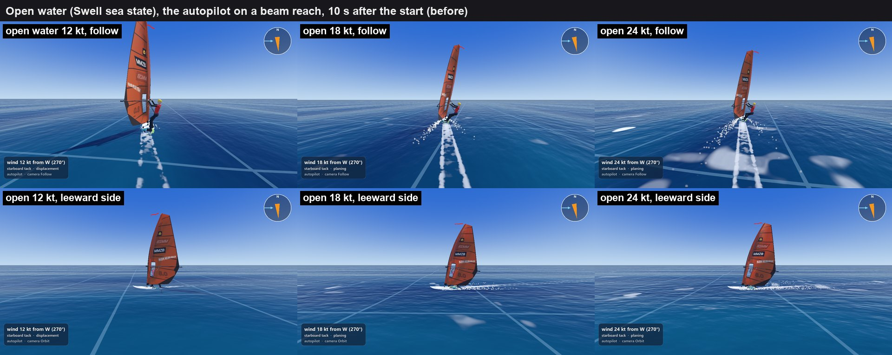
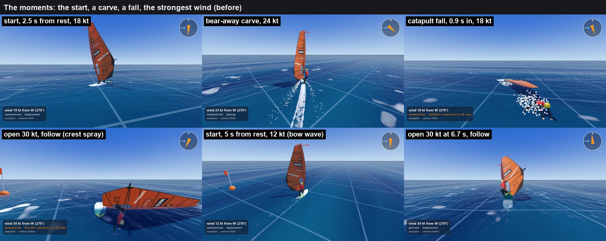
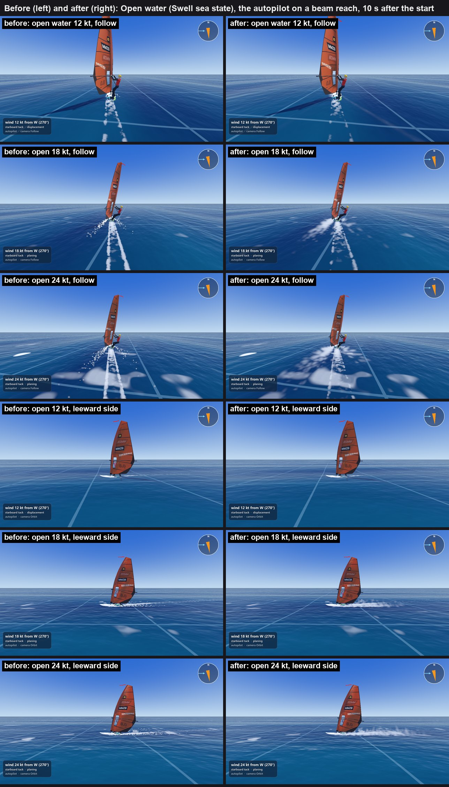
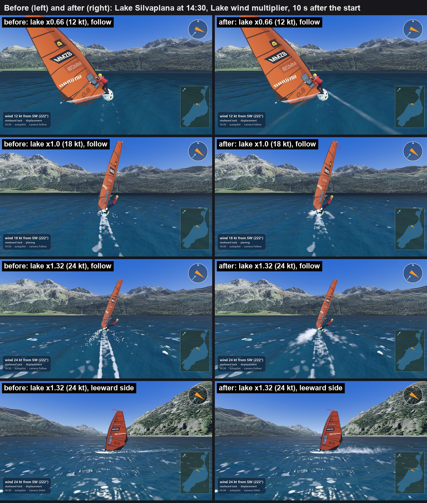
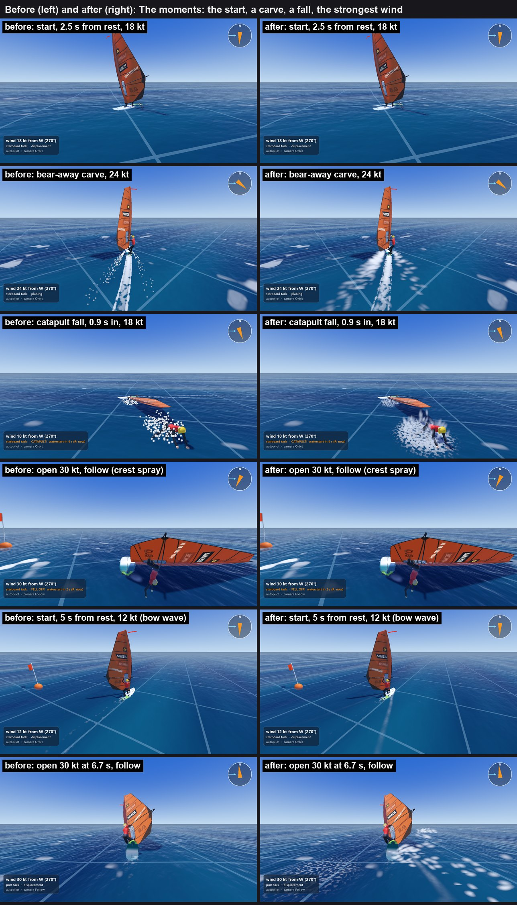
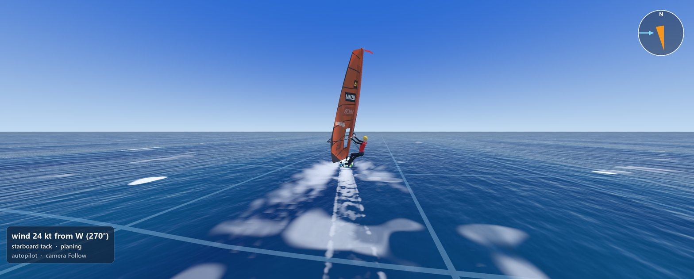
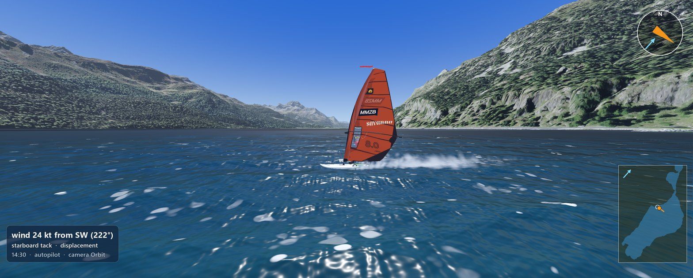

# The board on the water: spray, wake, splashes (GR, 6 November 2026)

Built on `gr/board-fx` (from `play/6nov-evening` 5e48758, today's play-test code with the wind on the water) by Claude Opus 5.5 on Max's PC, between about 17:10 and 21:30. Not pushed, not merged. Nothing in `Game/sim/` changed (`git diff 5e48758 -- Game/sim` is empty): the effects only read the simulation's state.

Max's ask: "General fx improvements (board to water)."

## In short

- **The spray** was a sparse trail of round white dots. It is now a low, white sheet of streaks off the leeward rail that trails one to two board lengths behind, the way the slalom photos show it, with a plume of white water behind the tail at full speed. The drops are lit by the sun (they glow when the sun is behind them), drawn out along their own motion, never drawn as big flat cards near the camera, and switched off for boards more than 80 m from the camera (a 20-board race only draws the spray of the boards near you).
- **The wake** was two hard straight white stripes running far behind, like a ski track. Now the white churn behind the fin is the main thing; the two rail lines are fainter, break up and fade sooner; the wake opens faster at speed; in a carve the inside rail's line is whiter. At the start and in a tack, a slow board draws the **bow wave's V**: two soft, faint bands from the bow at Kelvin's 19.5 degrees.
- **Landings and falls**: a landing's splash now grows with how hard the board lands (a low fan for a slap on chop, a tall crown for a hard landing after a crest), and every hard landing and every fall leaves a **patch of foam** that thins into lace and fades in about 5 s on the lake and 8 s at sea (the same foam life as the whitecaps of the wind work).
- **Spray off the crests** (the wind agent's leftover): from 25 kt, on the player's own board, bursts of spray blown downwind off the crests around it, as many as the whitecap law gives breaking crests (none at 24 kt, a few a second at 30 kt).
- **Not done**: water running off the deck after a landing, and a separate bow spray when the nose slaps a crest (the existing small splash on a chop slap and the spray law's chop term still do that job).
- **Cost**: nothing measurable. One board: the graphics card's time per frame the same before and after within the noise (about 1.0 to 1.3 ms), the board's visuals +0.02 ms per physics tick. A 12-board race on the release build: 5.63 against 5.65 ms on the graphics card at 1280 x 720, 107 fps both (details in Cost).

## What was wrong (before)

The same views before and after are in the comparison sheets below. Before this work (today's play-test code):

- **Spray**: a thin line of separate white dots, like confetti, mostly behind the tail. Seen from the side it was a dotted line; from behind, scattered dots either side. The photos show a continuous, very white, low fan.
- **Wake**: two bright parallel stripes all the way to the edge of the picture (a ski track), the same in a carve as on a straight line. Real wakes of planing boards are a white churn behind the fin and faint lines that break up within a few seconds.
- **The start**: a flat white patch under the board, no bow wave.
- **The fall**: a cloud of big white balls, no foam left behind.
- **30 kt**: no spray off the crests.
- **The lake at x1.65**: no landing to be seen (the 12 pictures every 0.2 s show the autopilot going between displacement and planing without leaving the water in that window: no landing to catch, before or after).

## The references

- **Max's photos** (`Documentation/images/Real life photos/`, the five Karpathos photos carry a photographer's mark: looked at, not copied): a planing slalom board throws a low, flat, very white fan off the leeward rail from about the middle of the board back past the tail, below knee height, trailing several board lengths; on the lake (Dutch photos), a short white flick at the tail and a thin wake.
- **Kelvin's wake angle**: 19.47 degrees either side (asin 1/3), independent of the speed; Rabaud and Moisy (Phys. Rev. Lett. 2013, https://ar5iv.arxiv.org/html/1304.2653) measured 18.6 +/- 1.8 degrees up to a hull Froude number of about 0.5 (about 2.4 m/s for a 2.4 m board), narrowing as about 1/Fr above it (about 7 degrees for the fastest boats): the bow wave's V belongs to the slow board only.
- **Planing spray**: the spray root is where the water meets the bottom; the whisker spray leaves it sideways at about twice the stagnation line's angle, and its height grows with the speed (Savitsky, through secondary sources: https://journal.hep.com.cn/jomsaa/EN/10.1007/s11804-014-1280-8); on a planing hull the sheet breaks straight into fine drops (https://arxiv.org/pdf/1410.1818). No source gave the spray's speed; the throw is set so the drops rise to about knee height at 12 m/s, as in the photos.
- **Foam life**: whitecap foam fades with a time of 2.54 s in fresh water and 3.85 s at sea (Monahan and Zietlow 1969, as Wu 2000 gives it; the wind work's numbers).
- **Spray off the crests**: Beaufort 6 (22 to 27 kt) "probably some spray", 7 "foam blown in streaks", 8 (34 to 40 kt) "edges of crests break into spindrift" (US National Weather Service, https://www.weather.gov/mfl/beaufort). The ocean literature puts the first spume much lower (7 to 11 m/s, Andreas 1995, https://people.nwra.com/resumes/andreas/publications/BLM_1995.pdf; Callaghan et al. 2008) but that is drops too small to see; the visible spray of Beaufort is used.
- **A person falling in**: no measured splash height found; a body falling 1 to 2 m hits the water at 4.4 to 6.3 m/s (sqrt 2gh), and a splash rising about as high as the fall is an estimate.
- **Games**: Sea of Thieves (SIGGRAPH 2018, "The Technical Art of Sea of Thieves", https://history.siggraph.org/wp-content/uploads/2022/09/2018-Talks-Ang_The-Technical-Art-of-Sea-of-Thieves.pdf): foam where objects meet the water and at the wave peaks, blurred over time so it spreads and fades; the wind sets how much. Blood Stone's speedboat (Bizarre Creations, https://cgw.com/Press-Center/Web-Exclusives/2010/Spy-Game-Blood-Stone-s-water-effects.aspx): the wake made of particles emitted by distance travelled, small opaque ones reading as foam, big faint ones as the spreading wake; spray as soft sprites that grow and fade. Uncharted (GDC 2012, "Water Technology of Uncharted", https://www.slideshare.net/slideshow/water-technologyofunchartedgdc2012/12977478): foam lit on top of the water. Skull and Bones (GDC 2023, "Making Waves for Skull and Bones", https://gdcvault.com/play/1029230/Making-Waves-for-Skull-and): the slides could not be read. Nothing was found on Riders Republic or the windsurf games. What this work takes from them: foam that spreads and fades rather than lines, a wake made by the distance travelled (the existing trail already is), soft growing sprites for spray, and big faint particles over small bright ones.

(The research was a helper agent's: one Sonnet session, about 25 searches and fetches.)

### The crest spray's numbers

What `crest_spray_rate()` gives over the 14 m circle ahead of the board (the whitecap cover is Callaghan et al. 2008, as the water shader draws it):

| Wind at 10 m | 18 kt | 24 kt | 26 kt | 28 kt | 30 kt | 34 kt |
|---|---|---|---|---|---|---|
| Whitecap cover (sea) | 0.55 % | 1.4 % | 1.75 % | 2.1 % | 2.55 % | 3.6 % |
| Bursts a second, open water | 0 | 0 | 0.2 | 2.3 | 6.1 | 14.6 |
| Bursts a second, the lake (x0.66) | 0 | 0 | 0.2 | 1.5 | 4.0 | 9.6 |

With 8 bursts in the pool living 1.2 s, at most about 7 a second are seen whole; above about 31 kt on the open water a new burst takes over one still in the air.

## What was built

| What | Where | The law, and where its numbers come from |
|---|---|---|
| The droplet look | `Game/world/effects/spray.gdshader`, `spray_material.tres` (one material for every water particle) | soft blobs lit by the sun and the sky with a wrapped light and a glow against the sun (`forward_scatter` 1.2, `self_light` 0.12, **by eye**); drawn out 2.6 times along their own motion (`stretch`, by eye: the photos show streaks); never bigger on screen than 4 % of their distance (`max_view_share`, about 2.3 degrees) and never smaller than 0.2 % (no sub-pixel flicker far away), drawn fainter when drawn bigger than they are; faded within 2.5 m of the camera (`near_fade_m`: the follow camera is 4.4 m behind) |
| The rail's spray sheet | `water_particles.gd` `make_spray()`, `effects.gd` `spray_intensity()` (today's law, kept) and `spray_side_shares()` | the amount as before: none below 1.5 m/s, then the square of the speed to full at 12 m/s, a quarter when not planing, up to 1.6 times with the fin loaded and 1.4 times at 10 degrees of heel; now up to 95 % off the leeward rail (was 90 %, the photos); up to 450 blobs a rail living 0.55 s (about the time a drop thrown 0.3 m up takes to fall back); thrown at 14 to 30 % of the board's speed (0.35 m high at 12 m/s, knee height in the photos); keeping 35 % of the hull's velocity, so the fan trails about 4 m behind the root at 21 knots (one to two board lengths, the photos) |
| The tail's plume | `make_plume()`, `plume_intensity()` | none below 6 m/s or off the plane, full at 14 m/s (12 to 27 knots of board speed), up to 1.5 times with the fin loaded; up to 160 blobs living 0.8 s, about 0.4 m high at 14 m/s (**by eye**, the photos) |
| Far boards cheap | `effects.gd` `distance_share()` | the spray full to 40 m from the camera, none beyond 80 m (a 2 m sheet is about 20 pixels there at 1280 x 720); no splash beyond 150 m |
| A landing's splash | `effects.gd` `splash_strength()`, `water_particles.gd` `splash_shape()` | the trigger as before (the water's support jumps by 2.5 weights within 0.2 s, measured October 2026); its size the larger of the jump (full at 3 weights over the trigger, as before) and the hull's sinking speed (full at 3 m/s, a drop from 0.46 m); a weak one a low wide fan (70 degrees from straight up), a strong one a tall crown (30 degrees, the fastest drops at 6 m/s rise 1.8 m: an **estimate**, no measured source) |
| Foam patches | `wake_trail.gd` `add_foam_patch()`, `wake_foam.gdshader` | where a landing of more than 0.4 strength splashed (2.2 m across at full), the sailor's fall (2.9 m) and the rig's (2.2 m); a ring that fills in, broken into lace by noise, spreading 0.15 m/s, fading over twice the whitecap foam's life: 5.1 s on the lake, 7.7 s at sea (Monahan and Zietlow); at most 8 |
| The wake | `wake_trail.gd`, `wake_foam.gdshader` | it spreads by 0.12 m/s plus 0.03 times the board's speed (0.48 m/s at 12 m/s; was 0.25 at any speed; **by eye**, inside Rabaud and Moisy's narrowing angle); the rail lines at 0.42 of the churn's whiteness and fading with the cube of the age (they were 0.6 and the square); the inside rail of a carve up to 1.8 times whiter and the outside down to 0.2 (full at 15 degrees of heel while turning at 15 degrees a second), the churn leaning in |
| The bow wave's V | `wake_trail.gd` `bow_wave_strength()`, `arm_offset_m()` | two soft faint bands (0.35 m wide, 0.22 white, shaded by crests 0.9 m apart, dimmed but not cut up by the foam noise; first drawn as a solid line, then dashed: both read as road markings) from the bow at 19.47 degrees, 14 m long, living 5 s; from 0.5 m/s, full at 2 m/s (about the hull speed), gone at 7 m/s and as the board planes |
| Spray off the crests | `effects.gd` `crest_spray_rate()`, `_update_crest_spray()`; `water_particles.gd` `make_crest_spray()`, `crest_spray()` | the player's own board only (the water around the camera); bursts a second = the whitecap cover by Callaghan et al. 2008 (`LakeLook.sea_whitecap_percent`, times 0.66 on the lake, as the water shader) x the area / a crest's 1.5 m2 / its 1 s of breaking (both **estimates**) x the onset: none below 25 kt, full at 34 kt (Beaufort 6 to 8); the wind is the wind at 10 m times the gust at the sail (the gust picture the physics feels); over a 14 m circle 8 m ahead of the board, each burst on the highest of 4 places tried (likely a crest), 70 blobs of 15 to 35 cm growing threefold along 2 m of crest; drops leave at 20 to 40 % of the wind and are pushed on at 3 m/s2 (an estimate for millimetre drops), so they fly a few metres downwind |
| Pictures and tools | `Game/dev/dev_capture.gd` (`--side_view=`, `--twa_at=`), `board_fx/shoot.sh`, `sheet.py`, `measure.sh`, `swap.sh` | |
| Tests | `Game/tests/unit/test_board_fx.gd`, 13 tests | no spray or plume at walking pace or off the plane; the leeward rail throws nearly all; far boards none; the splash grows with the landing and its shape; the crest spray only from 25 kt, more at 34, less on fresh water, one burst per breaking crest; the bow wave only at displacement speed and at Kelvin's angle; the carve's inside rail; the foam patches fade and stay few; the wake draws its four parts; a LAN puppet (never stepped, its state written) throws spray and leaves a wake from the written state |

How the pieces fit, in plain words: the board's effects node already got the simulation every physics tick; it now also asks how far the camera is, and every emitter's amount is multiplied by the distance share, so a far board costs nothing on the graphics card. The wake was already one mesh rebuilt every frame from the points the tail leaves behind; the bow wave's V and the foam patches are drawn in the same mesh with the same material, so they ride the same waves. A puppet board in a LAN game has its whole state (including the telemetry) written every tick, and the effects read only that state, so they work the same for it (tested).

## Cost

Measured on this PC (an AMD Radeon RX 6950 XT). The lead's live play-test had ended before these runs (wsim.exe had exited), but other sessions were running Godot on the processor, and the disk ran full for a moment during the work (another program; 8 GB free since), so the numbers carry about half a millisecond of noise. Each before run puts the effects' four files of 5e48758 in place (`board_fx/swap.sh`); the rest of the game is the same.

**One board** (the editor build, open water at 24 kt, the follow camera, the board starting from rest and planing for most of the 10 s measured; `board_fx/measure.sh`, before and after alternately, twice):

| | Before (5e48758) | After | Difference |
|---|---|---|---|
| Graphics card, 1280 x 720 | 1.12, 0.97 ms | 1.24, 1.01 ms | +0.04 to +0.12 ms |
| Graphics card, 3137 x 1263 | 1.29, 1.26 ms | 1.25, 1.21 ms | -0.04 to -0.05 ms |
| The board's visuals per physics tick (processor) | 0.28, 0.24 ms | 0.30, 0.26 ms | +0.02 ms |

Inside the budget (+0.5 ms at 1280 x 720). The graphics card was not at full clock in this light load (both sizes take about the same time), so the comparable part is the difference, measured the same way minutes apart.

**A 12-board race** (the release build, T1, 11 AI boards and the player's board on the autopilot, a 5 s countdown so the boards race while it measures, the follow camera, 12 s; `board_fx/measure_race.sh`, built once before and once after):

| | Before | After |
|---|---|---|
| 1280 x 720: fps, a frame on average / at worst | 107, 9.4 / 20.1 ms | 107, 9.3 / 20.4 ms |
| 1280 x 720: graphics card | 5.63 ms | 5.65 ms |
| 3137 x 1263: fps, a frame on average / at worst | 119, 8.4 / 17.2 ms | 107, 9.3 / 19.9 ms |
| 3137 x 1263: graphics card | 5.04 ms | 5.39 ms |
| An AI board's visuals per tick, median | 0.13 ms | 0.13 to 0.14 ms |

No visible drop: the race is held by the processor (the physics, about 9.7 ms of a frame), and the graphics card's time moves by less than the run-to-run noise (the before run at 3137 x 1263 measured less than the one at 1280 x 720). The far boards' spray is off beyond 80 m, so a bigger fleet adds spray only for the boards near the camera; a 20-board race was not measured.

## The after pictures

Before (left) and after (right), the same moments (the same physics: the board is in the same place in both):

Max's wide window, 3137 x 1263 (shrunk here; the full pictures are in `.screenshots/board_fx/after/`):

The after sheets on their own: `board_fx/sheet_after_open.jpg`, `sheet_after_lake.jpg`, `sheet_after_moments.jpg`; the lake landing series `landing_before.jpg` and `landing_after.jpg`.

What the pictures show (each looked at full size or cropped):

- **Planing (18 and 24 kt)**: from the side, a low, white sheet of streaks off the leeward rail trailing one to two board lengths, the photos' look; from the follow camera a white smear to leeward and the white churn behind the fin. The ski-track stripes are gone; the rail lines are faint and broken.
- **The carve**: two wings of streaks and the churn, the inside line whiter (the carve is mild in this shot: the autopilot bears away slowly).
- **The fall**: a crown of streaks over a lacy patch of foam, where before a cloud of white balls stood on clear water.
- **30 kt**: streaks of spray blown off the crests ahead of and beside the board, none before (the 6.7 s picture; at 30 kt the autopilot falls at 10 s). Close to the board they may be too many and too big (white flakes on the water rather than a fine spray): Max's eye decides; the numbers are `CREST_AMOUNT` and the blobs' size in `water_particles.gd`, `CREST_SPRAY_FROM_KT`/`FULL_KT` and the radius in `effects.gd`.
- **The start at 12 kt, 5 s**: one arm of the V shows as a faint band; the other runs under the sail's shadow on the water and is hardly seen in this view.
- **12 kt planing on and off**: little spray, as it should be (the spray grows with the square of the speed).
- **Not seen in any picture**: a landing's splash (the lake series catches none, see above), the foam patch of a landing, the spray glowing against the sun (no shot looks toward the sun). These are on the checklist.
- **Flat cards, spray at rest, clipping, floating**: none seen. Drops that fall below the surface are hidden by the water.
- The white blobs on the open water at 24 kt are the open water's whitecap foam (the wind work), the same before and after.

## What Max should look at on his screen

`tools/play.sh res://main.tscn` (open water) and `tools/play.sh lake`, in his wide window, the follow camera and the orbit camera (C or the right mouse button to turn it).

1. **Start from rest** (R): as the board gathers way, a faint V of two soft bands from the bow, opening behind; it fades as the board starts to plane. Visible? Too strong? Does it read as a wave or as a line painted on the water?
2. **Plane** at 18 and 24 kt: the leeward rail's spray as a low white sheet of streaks trailing behind, and a plume behind the tail at full speed. Does it look like water in the sun or like smoke? Turn the camera to look at the board from ahead and from the sun's side: it should glow with the sun behind it.
3. **Nothing at rest**: stopped or slow, no spray at all.
4. **The wake**: the white churn behind the fin, faint rail lines that break up; does it still read as a ski track anywhere?
5. **Carve a gybe**: the inside rail's line whiter, the spray swinging to the new leeward side.
6. **Land after a crest** (Lake wind x1.65): a splash as big as the landing, and a patch of foam left behind that thins into lace.
7. **Fall** (a catapult): the crown of the sailor's splash and a smaller one for the rig, with foam left on the water.
8. **30 kt** (open water Wind speed 30, or Lake wind x1.65 in a gust): bursts of spray blown off the crests ahead of the board. None at 24 kt.
9. **Motion**: screenshots cannot show how the spray moves at 60 fps: flicker, popping, streaks pointing the wrong way.
10. **A race**: the AI boards near you throw spray; far away none (switched off beyond 80 m: does it pop in?).

## Open questions

- **The spray's look is by eye** against the photos (the throw, the stretch, the glow); no measured spray speed or drop size was found. Max's eye decides; the numbers are named in the table.
- **Crest spray amount**: at 30 kt the bursts near the board may be too many or too big (see the pictures); first thing to try is half as many blobs (`CREST_AMOUNT` 35) or the onset at 28 kt.
- **Crest spray placement**: the bursts sit on the highest of four random places near the board, not exactly on the shader's whitecaps (the shader's whitecap sums are not done on the processor). Usually on a crest, not always on a white one.
- **Spray falling into the water** is hidden by the water surface, which writes its depth; the drops have no splash of their own when they land.
- **Not built**: water running off the deck after a landing or a wave (it would need the deck's wet state and a film on the board's material), and a separate bow spray when the nose meets a crest (the existing small splash on a chop slap and the spray law's chop term show it).
- **The fall's splash** is still a crown of blobs; a real fall makes a sheet and a column (a second emitter shape, later).
- **Far boards**: spray switched off beyond 80 m; the wake and the foam patches stay for every board with effects (as before).

## ROADMAP rows for the lead

- **GR1** (append): "Board fx (6 November 2026, `gr/board-fx`, board_fx.md): the spray re-drawn after the photos (a lit, streaky sheet off the leeward rail, a plume behind the tail at speed), off beyond 80 m from the camera. Open: the team's look while sailing pushed."
- **GR6** (update): "The spray, the wake, the splash and the foam they leave were reworked (board_fx.md, 6 November 2026: the before and after sheets, the checklist); the team's look at them on Max's screen is what is left of GR6's effects part (the water's colour and the far edge stay as they were)."
- New, **GR-next** (open): "Water running off the deck after a landing, a bow spray on a crest, and a fall's splash as a sheet and a column (board_fx.md, Open)."
- PROGRESS_LOG line: "6 November 2026, evening: board fx (`gr/board-fx`, Opus): spray, wake with the bow wave's V, splashes by the landing with foam patches, crest spray from 25 kt; 13 tests; not merged."

## Checks

On the branch's final code (fddf011):
- `tools/test.sh`: 910 of 910 pass in 94 scripts (897 before plus the 13 of `test_board_fx.gd`).
- `tools/check.sh`: 464 files, 0 failed.
- `git diff 5e48758 -- Game/sim` is empty; the validation suite was not run (no physics change).
- Not run: `tools/lan_test.sh` (the brief). The puppet path is covered by a unit test.
- Some screenshot runs end with "16 ObjectDB instances were leaked at exit" (a warning as the game quits; not in a plain run of the sailing scene, cause not found).
- During the work the disk ran full for a moment (another program) and Godot wrote its class list empty; a re-import (`--import`) rebuilt it. Nothing was lost.

## Files

- New: `Game/world/effects/spray.gdshader`, `Game/world/effects/spray_material.tres`, `Game/tests/unit/test_board_fx.gd`, this report and `board_fx/` (the sheets, the wide pictures, `shoot.sh`, `sheet.py`, `measure.sh`, `swap.sh`).
- Changed: `Game/windsurfer/effects.gd`, `Game/world/effects/water_particles.gd`, `Game/world/effects/wake_trail.gd`, `Game/world/effects/wake_foam.gdshader`, `Game/dev/dev_capture.gd`.
- Not changed: anything in `Game/sim/`, `Game/world/water.gdshader`, `lake_look.gdshaderinc` (the foam patches live in the wake's own mesh, so the water shader needed no mask).

## Tokens

About 0.9 M tokens for this session (Opus: reading, building, the pictures, the measurements and this report), plus about 0.08 M for the research helper (one Sonnet agent).
