# The wind on Lake Silvaplana's water (GR, 6 November 2026)

Built on `gr/lake-wind-shading` (from `ph44/lake-waves` e9f3709, last night's fetch-limited lake waves) by Claude Opus 5.5 on Max's PC. Not pushed, not merged. Only the picture changed: nothing in `Game/sim/`, and the board floats exactly as before.

Max asked for the lake's waves "including with the working wind strength shader seeable on the water working with the waves", and, asked what is wrong with it now: "Not sure, make it right".

## In short

- **What was wrong.** Last night's gusts were a tint and nothing else: in a gust the water was 10 to 20 % darker (measured from 40 m), but the water itself did not change, like the shadow of a cloud passing over the same surface. Real gusts are darker *because* the water is rougher.
  1. The roughness that should come with a gust was cancelled: last night's new wave shading puts the slopes of the waves too small for the pixels into the mirror's roughness, the same in a gust and in a lull, and that swamped the gust's own (far away 0.39 in a lull and 0.39 in a gust, worked out from the shader).
  2. Near the board the water was smooth with pale blotches metres across (the old ripples' noise picture, 7 m and 2.5 m), nothing like the short chop in the photos.
  3. No whitecaps at all: the foam needed a steepness the lake's waves never reach.
- **What the water does now.** The wind of each moment and place (the gust picture the graphics card already draws from the map's wind, so where the physics feels the gusts) sets how rough the surface is, by the measured law of Cox and Munk (1954). That roughness is in the short waves, 2 to 35 cm, which hold most of the surface's slope and follow a gust within a second or two. So a gust is rougher and darker, a lull or the lee along the south-east shore smoother and lighter, near and far, moving with the gusts. The tint keeps last night's strength, now tied to that roughness.
- **The short waves** are drawn as waves near the board (25 and 12.5 cm), short-crested by Donelan-Banner spreading; last night's 2 m, 1 m and 0.5 m trains are now five spread parts each instead of three. The pale blotches are gone.
- **Whitecaps**: where the wind is strong enough for the lake's own waves at that place (Zhao and Toba 2001), on the crests the waves squeeze most (Tessendorf's Jacobian). With the waves of the map's 18 kt they start at about 15 kt at the camping beach and 17.5 kt 500 m from Sils; at 18 kt about one square metre in a thousand is white, 1.6 to 2 times that in a gust 20 % stronger, almost none in a lull 20 % weaker.
- **Cost**: the graphics card takes 0.4 ms more per frame at 1280 × 720 (4.4 → 4.8 ms) and 1.9 ms more at 3137 × 1263 (11.9 → 13.9 ms), measured in a 20-board race on the lake. At 1280 × 720 the frame rate should not change; in Max's wide window the graphics card may now set the pace, about 72 instead of 75 fps (an estimate: a clean frame-rate run was impossible tonight, see Cost).
- **The photos**: none of the thirteen photos in `Documentation/images/Real life photos/` is of Lake Silvaplana (Dutch lakes, two mountain lakes, the sea at Karpathos), so the lake itself is compared with the Sentinel-2 photos of the map work too.

## What Max should look at on his screen

`tools/play.sh lake` (or the start menu's Lake Silvaplana), in his wide window.

1. **Near the board** at the start: the water covered with small, criss-crossing wavelets, no smooth patches and no pale blotches metres across. Any whitecaps are small and ragged, not white ovals. Is the near water lively enough, or still too smooth and blue next to `IMG_7594`?
2. **A gust coming**: look upwind (toward Sils) from the board, or press the camera keys for a higher view. Darker patches move toward you at about the wind's speed (a patch 200 m away arrives in about 20 s); when one reaches the board the HUD's wind rises and the water around you gets rougher, with a few more whitecaps. Lighter, glassier patches are lulls. Is the difference strong enough? (Two numbers set it: `lake_gust_contrast` and `lake_gust_roughness` in `lake_look.gdshaderinc`.)
3. **The lee** along the south-east (forest) shore: a smoother, lighter band, best seen from high up (`--overview=2781300,1148000,250`).
4. **Near Sils** (sail upwind, south-west): the waves get small, and in the map's 18 kt there are hardly any whitecaps.
5. **Whitecaps**: at 18 kt there are only a few (Zhao and Toba's law for the lake's young waves). If the real lake at the camping beach in 18 kt has clearly more, the open sea's law (Callaghan et al. 2008) gives about five times as many: a few lines to change. **Max's answer decides it.**
6. **No stripes, no shimmer, no seams** on the water in the wide window, near and toward the horizon, while sailing (screenshots cannot show shimmer at 60 fps).

## What the photos show, and how the game compares

**The photos.** `Documentation/images/Real life photos/` holds thirteen photos of Max sailing, none of them on Lake Silvaplana: Dutch lakes (`005.JPG`, `141.JPG`, `FTHZ9294.JPG`, `IMG_4743.jpeg`, `SPST4453.JPG`), two mountain lakes with forested slopes (`2015-08-18_08-30-52.jpg`, `IMG_7594.JPG`) and the sea (`121.JPG` and the five race photos at Karpathos, which carry a photographer's mark and are not used here). For the lake itself there are the Sentinel-2 photos of the map work (`Documentation/images/maloja/satellite_example.jpg` and `gust_photos.png`, explained in `MALOJA_WIND_RESEARCH.md`). What they agree on, for a planing wind of about 15 to 25 kt:

1. **Near the board the whole surface is covered with short, steep, criss-crossing wavelets**, a few centimetres to a few decimetres long, every face catching the light differently; there is no smooth patch anywhere (`IMG_7594`, `SPST4453`, `FTHZ9294`, `005`).
2. **Whitecaps are small and ragged**, scattered, more of them where the wind is stronger (`IMG_7594`, `141`, `FTHZ9294`); on the mountain lake in lighter wind (`2015-08-18`) there are none.
3. **The far water is textured to the horizon, with darker and lighter bands** across it (`141`, `FTHZ9294`).
4. **Lake Silvaplana from space in a Maloja** is grey and streaky (rough water mirrors more of the bright sky), in a calm an even turquoise; the gusts are fronts across the lake and lanes along it, 100 to 900 m, with a smoother band along the south-east shore.

**Last night's game against them.** (1) Near the board the water was smooth, with pale blotches several metres across: the old ripples' noise picture, 7 m and 2.5 m across, nothing at the scale of real chop. (2) No whitecaps at all. (3) Far away the water was smooth and even. A gust was a darker patch (10 to 20 % darker from 40 m up, measured below), but only a tint: the surface was the same in a gust and in a lull. (4) The roughness of the far water came from the long waves, the same in a gust and in a lull.

**Now.** (1) Short-crested wavelets near the board, as strong as the wind of the moment makes them. (2) Small ragged whitecaps where the wind and the lake's waves are big enough. (3) and (4) Gusts darker and rougher, lulls and the lee lighter and glassier, near and far, moving with the wind. Still different from the photos: the water's colour (last night's look, Max's October choice from the aerial photo, not changed), and the near water is calmer in contrast than `IMG_7594` (bright sky on every wave face): a point for Max's eye.

### The photos next to the game

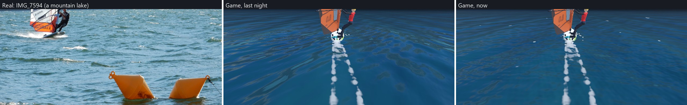

*Near the board.* Real (a mountain lake in a planing wind): short criss-crossing wavelets everywhere, small ragged whitecaps. Last night: smooth water with pale blotches metres across. Now: short-crested wavelets and a few small whitecaps; still calmer and bluer than the photo.

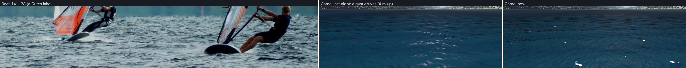

*A gust reaching a camera 4 m above the water.* Real (a Dutch lake in a strong wind): dark, rough, whitecaps. Last night: the gust darkens the water like a cloud's shadow, the surface unchanged and no whitecaps. Now: the same darkening, the short waves rougher and whitecaps in the gust.

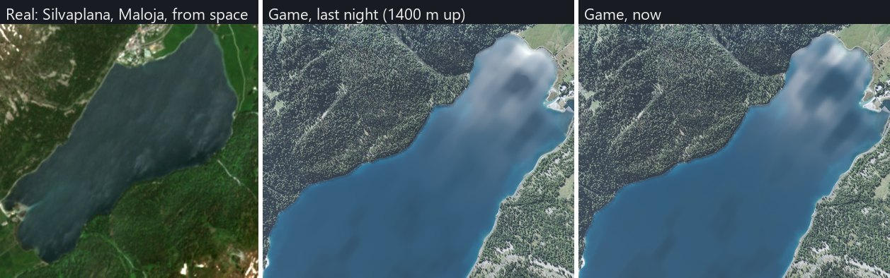

*From above.* Real: Lake Silvaplana in a Maloja, grey and streaky. The game from 1400 m (looking almost straight down, slightly oblique): the gust patches show the same in both versions (lighter where the wind is less: the mirror is glassier there). The game's water is bluer and its patches rounder than the satellite's streaks (the map's gust model has 100 to 900 m patches; its lanes are rounder than the real ones, `MALOJA_WIND_RESEARCH.md`).

### Before and after, the same moment

All at 14:30 in the map's 18.2 kt, 1280 × 720 unless marked; "before" is last night's e9f3709.

| View | Before | After |
|---|---|---|
| The start (camping beach), follow camera | 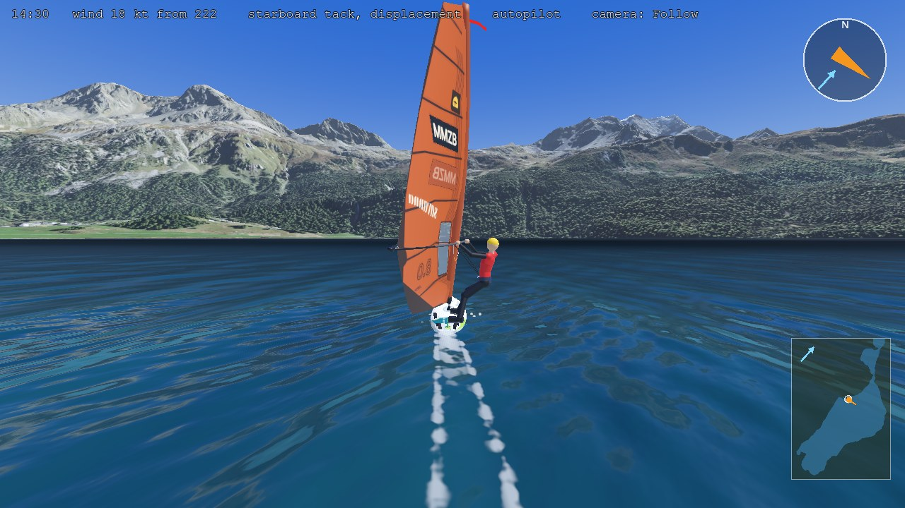 | 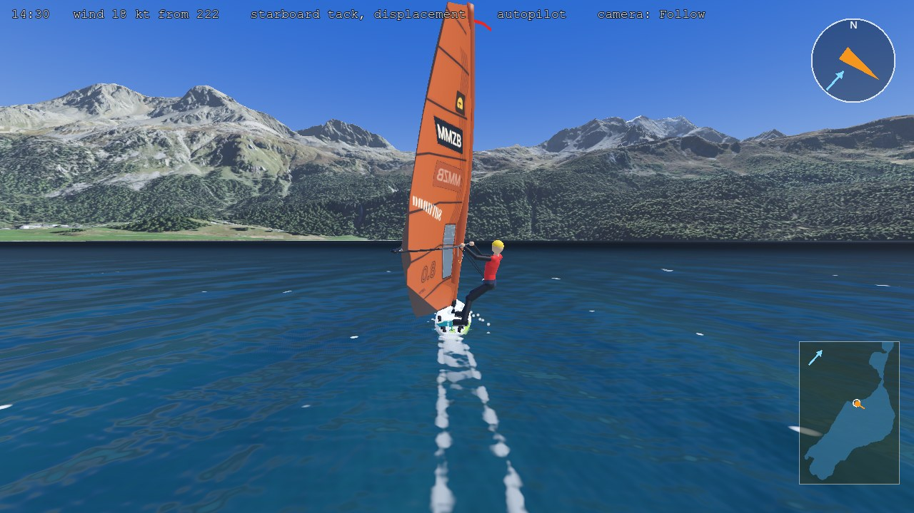 |
| Mid-lake | 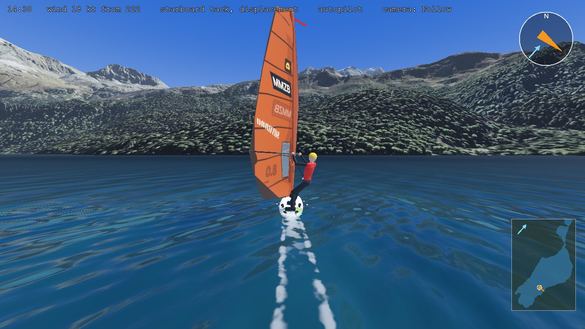 | 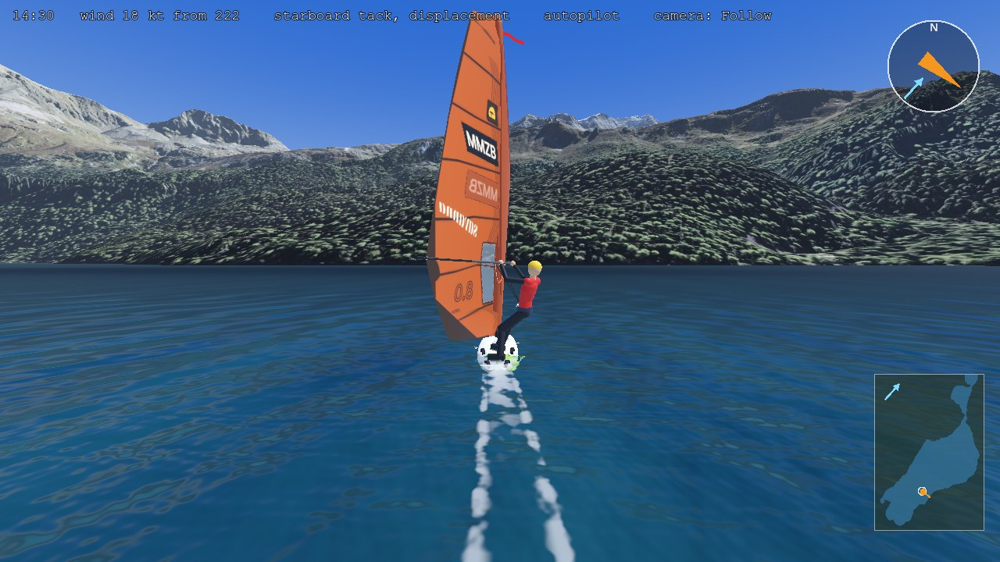 |
| 300 m from Sils | 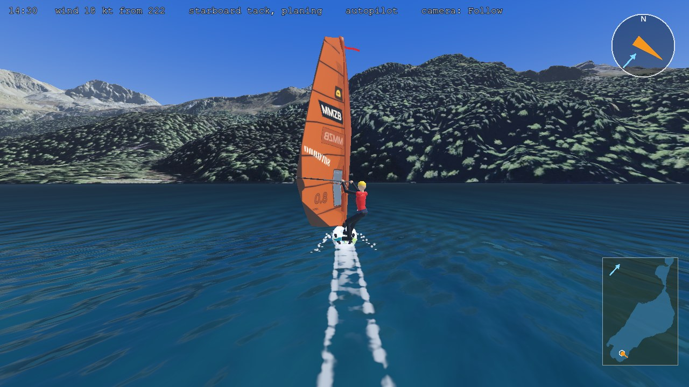 | 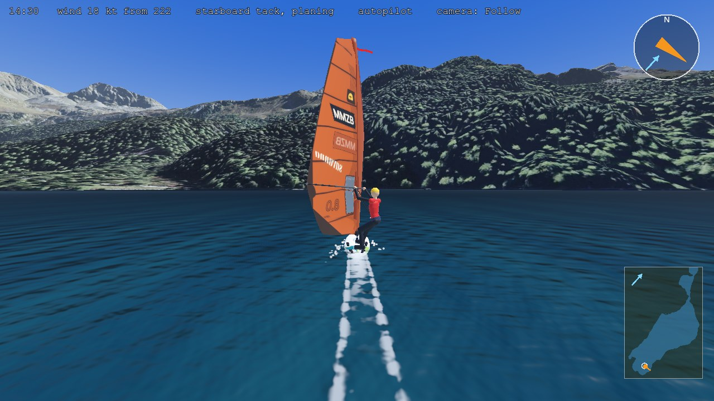 |
| From above the village toward Sils (`--overview=2781300,1148000,250`) | 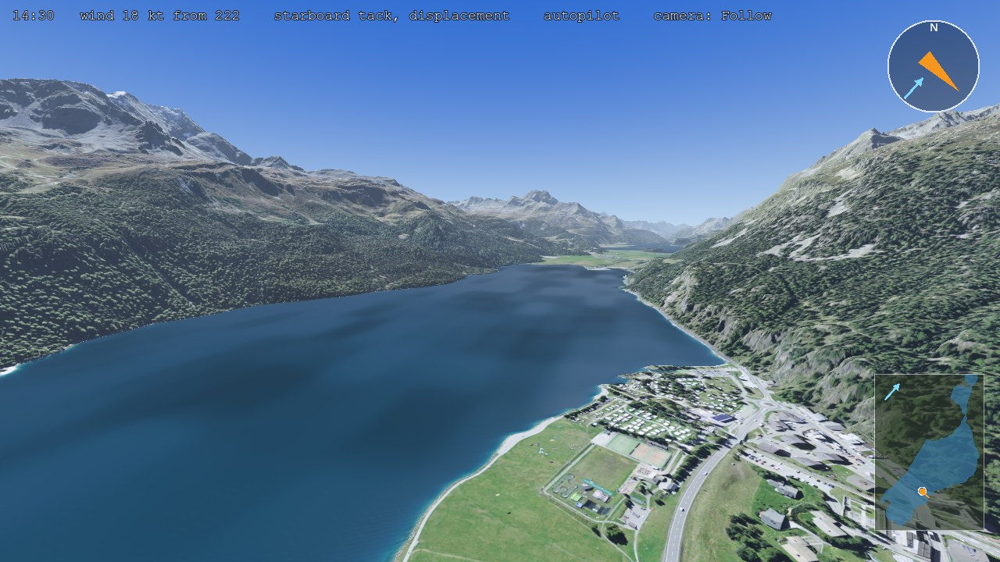 | 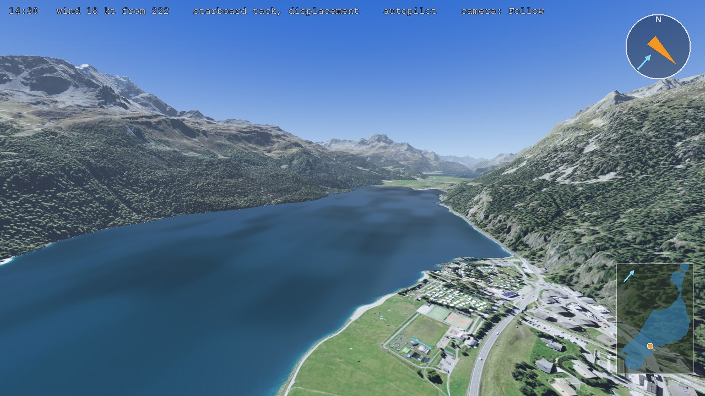 |
| A gust coming down the lake toward a camera 40 m up at the camping beach, 40 to 60 s after 14:30, every 6.7 s (`--overview=2781250,1147300,40 --overview_look=2780300,1146150`; the gust reaches the near water in the last two) | 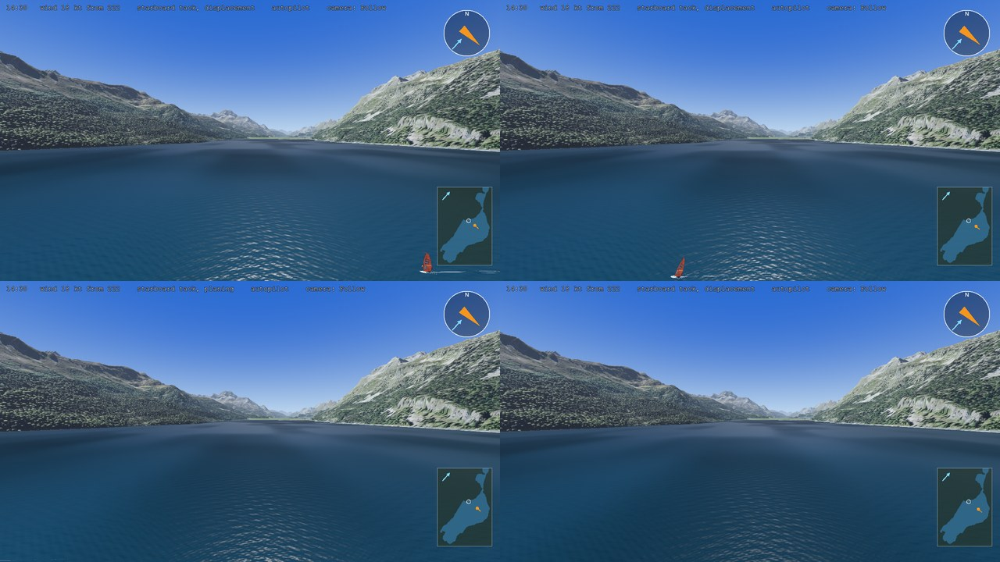 | 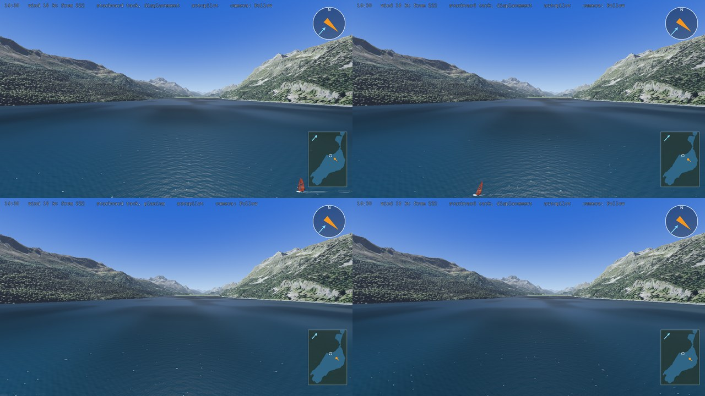 |
| The same 4 m above the water | 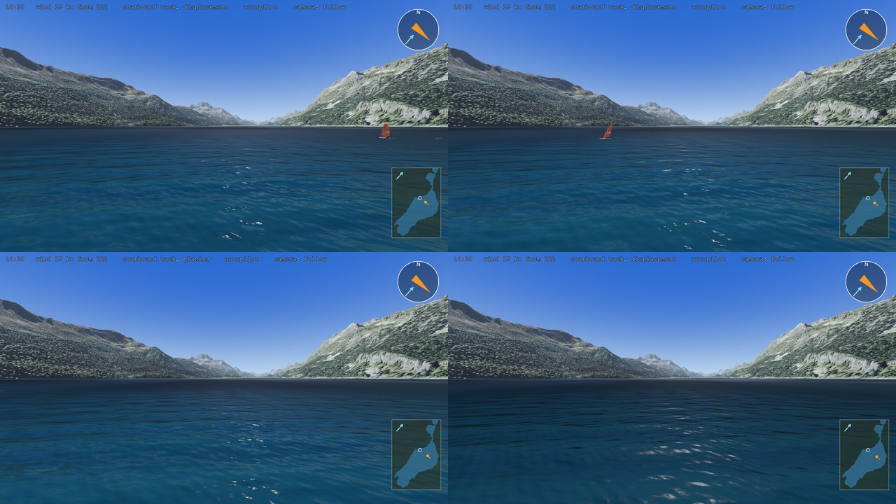 | 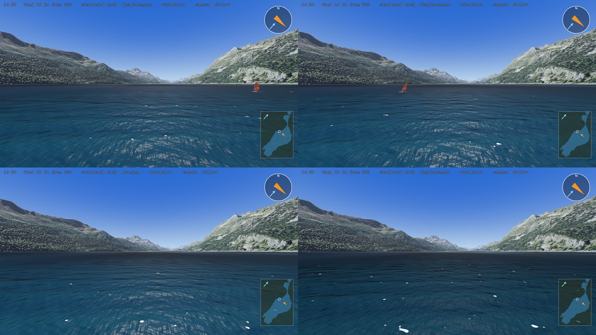 |
| 3137 × 1263: the start | 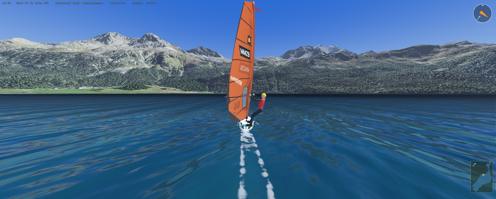 | 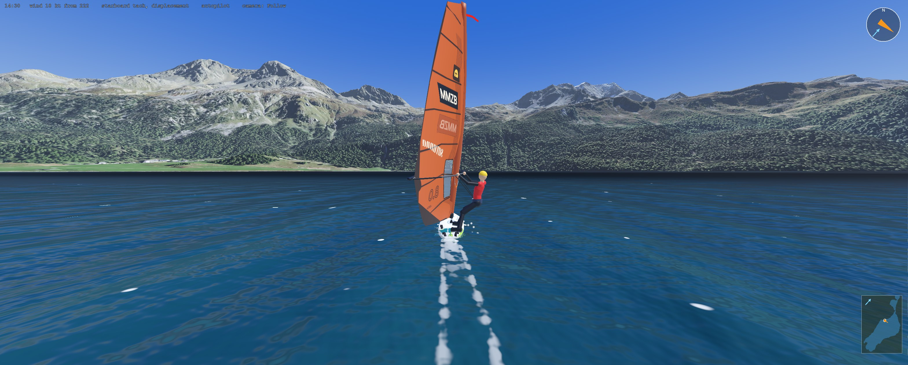 |
| 3137 × 1263: from above the village | 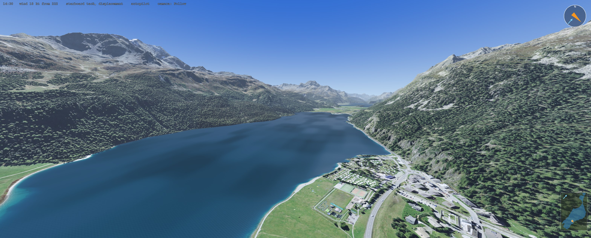 |  |
| 3137 × 1263: the gust, 40 m up (53 s) | 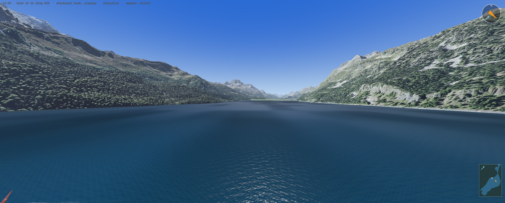 | 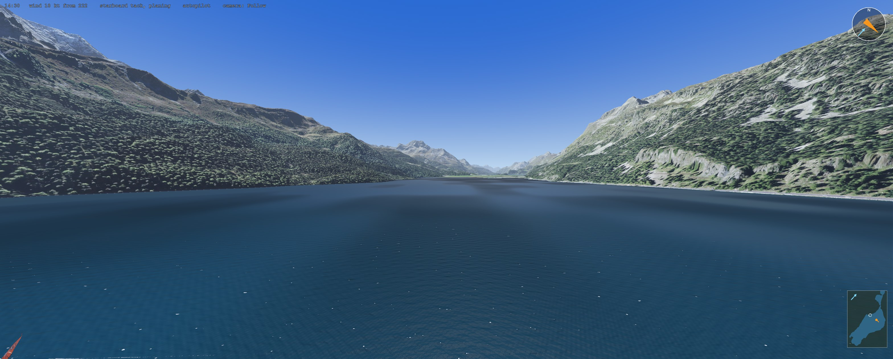 |
| 3137 × 1263: 4 m up (40 s) | 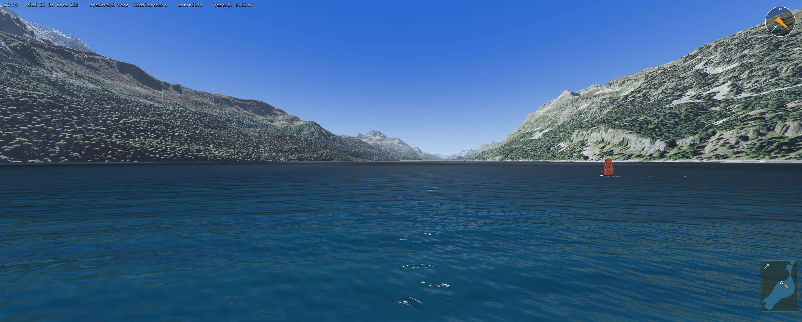 | 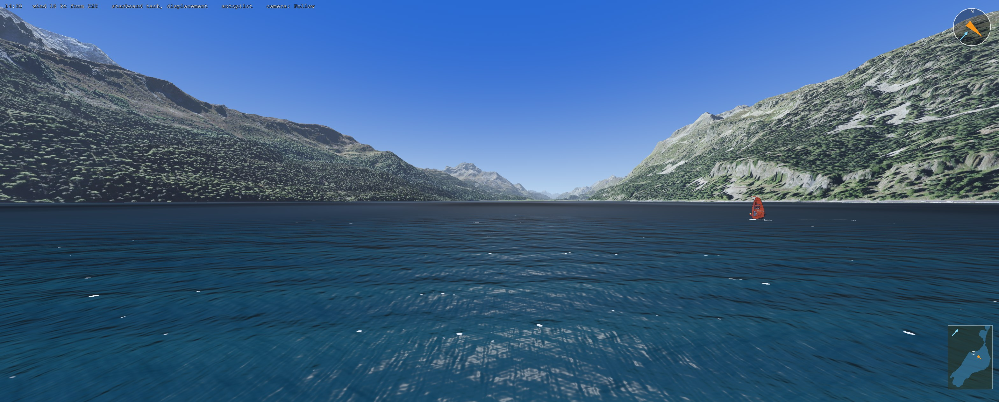 |

Looked at for stripes, seams and tiling: none show at either size, near or far (shimmer needs the moving game). In the sequences the patches move toward the camera with the wind (they are the map's gusts, drawn every frame). The wide pictures are drawn at the full 3137 × 1263 (this PC's screen is 1920 × 1080; `--render_size`).

## What changed (plain language)

All of it is in a new shader include, `Game/world/lake_look.gdshaderinc`, with a small GDScript helper, `Game/world/lake_look.gd` (`LakeLook`), that works out the fixed numbers once and holds the formulas for the tests. `water.gdshader` uses it only on a lake's own waves (`lake_waves_on`); the open sea, and the lake with *Lake waves* off, are drawn exactly as before.

1. **The wind here, now.** Each pixel reads the gust picture (last night's `WindRippleMap`: the wind there over the lake's mean) and the lake's mean wind of the moment (new: `lake_wind_ms`, set every frame by the lake scene from the map's wind at 10 m and 12.5 m). Their product is the wind of this moment at this place, with the map's pattern, gusts, lulls and lee in it: where the physics feels the gusts.
2. **How rough the water is: Cox and Munk.** The mean square slope of the surface is 0.003 + 0.00512 U (U at 12.5 m). The lake's trains already hold part of it; the rest is the short waves', split equally over four octaves from 35 cm down to about 2 cm. A gust 10 % stronger is about 9 % rougher, at once.
3. **The short waves.** The two longest octaves (25 and 12.5 cm) are drawn as four waves each, fanned out around the wind by Donelan-Banner spreading, their crests bent by a noise twice their length so a crest runs for a wavelength or two (long straight crests showed as streaks toward the horizon). Where a pixel is too big for a wave (from 6 pixels a wavelength down to 3), its slope goes into the mirror's roughness instead, so near and far water hold the same roughness and nothing shimmers. The old ripples' noise picture is not used on the lake any more.
4. **The trains as shading** (the lake's trains away from the board, and the 0.5 m look train): five parts each instead of three, at equal shares of Donelan-Banner's spread for the train's frequency against the lake's typical peak: the 2 m train within about 30 degrees of the wind, the 0.5 m train out to about 70 (at 12 and 32, and 28 and 72 degrees either side; the short octaves out to 80 to 95). Last night: three parts at plus and minus 26 degrees, "a choice for the look".
5. **Whitecaps.** The crest squeeze of all trains (the Jacobian's first-order part, the same sum as `gerstner_lake()`'s crest); the share of whitecaps by Zhao and Toba for the wind here over the lake's own peak period here; white where the squeeze is above the value that just that share of the water reaches, with ragged edges and a little froth.
6. **The gust's look.** GR2's darkening and glassiness are kept, now driven by how much rougher the water is by Cox and Munk (times 7: a gust 10 % stronger is two thirds of "full", about as before), and the mirror is 0.15 rougher in a full gust and smoother in a full lull (by eye: at a glancing view only the mirror's roughness shows a gust).
7. **Cost.** The parts' directions, lengths and speeds never change during a run, so `LakeLook` works them out once and the graphics card only adds the waves up; a wave a pixel is too small for is skipped. (Measured below: 0.4 ms more per frame at 1280 × 720, 1.9 ms at 3137 × 1263.)
8. **Tools.** `tools/screenshot.sh ... --sequence=<n> --every=<frames>` saves a series of pictures (to see the gusts move); the lake scene's `--overview_look=<east>,<north>` keeps the overview camera on one point of the water; `--measure` also prints the graphics card's time per frame (the frame rate hides it while the processor is the slower one); `--render_size=<w>x<h>` draws the game at that size whatever the window (this PC's screen is smaller than Max's window).

## Numbers and where they come from

| What | Value | Source |
|---|---|---|
| The surface's mean square slope | 0.003 + 0.00512 U (U at 12.5 m, m/s) | Cox and Munk 1954, as Mobley's *Ocean Optics Web Book* gives it ("Cox-Munk sea surface slope statistics", eq. 4; opened this session). Most of the slope is in the capillary and short gravity waves (Mobley, Hydrolight technical note 1, opened) |
| The short waves' octaves | equal slope per octave from 35 cm to about 2 cm (4 octaves), 2 drawn | Phillips' saturation range has the same slope in every octave; where it ends (near 1.7 cm, the slowest ripple) is an **estimate** |
| How fast the short waves follow a gust | at once (they need 0.2 to 3 s) | the wave research 1.5 (Plant 1982 via Polnikov), for 5 and 10 cm ripples |
| Spreading | D(θ) = β / (2 tanh βπ) sech²(βθ); β = 2.61 (ω/ωp)^1.3 below 0.95, 2.28 (ω/ωp)^−1.3 up to 1.6, 10^(−0.4 + 0.8393 exp(−0.567 ln (ω/ωp)²)) above | Donelan, Hamilton and Hui 1985, with Banner's part above 1.6, as Horvath 2015 eq. 38 gives them (opened this session) |
| The parts' directions | at equal shares (the quantiles) of that spread | a choice; the spread itself is sourced |
| The lake's typical peak | the median peak period over the lake's nodes with at least 1 cm of sea: 1.27 s at 14:30 | measured from `LakeWaves` |
| The short waves' speed | ω² = g k + (σ/ρ) k³, σ/ρ = 7.4 × 10⁻⁵ m³/s² | the capillary-gravity dispersion (the research 1.5 uses the same) |
| Whitecap share | W = 3.88 × 10⁻⁵ R_B^1.09 %, R_B = u*² / (ν ωp), u*² = (0.0008 + 0.000065 U10) U10² | Zhao and Toba 2001, as NOAA's PyGnome codes it (`zhao_toba.py`, opened this session) |
| Whitecap onset | R_B = 1000, softened over 800 to 1200 | Toba and Koga 1986 as Zhao and Toba cite it; the softening an **estimate** |
| The air's viscosity | ν = 1.8 × 10⁻⁵ m²/s | **computed**: 1.76 × 10⁻⁵ Pa s at about 10 °C over the lake air's 0.98 kg/m³ |
| Not used: the open sea's laws | Callaghan et al. 2008: W = 3.18 × 10⁻³ (U10 − 3.70)³ % from 7.2 kt, 4.82 × 10⁻⁴ (U10 + 1.98)³ % above 10.18 m/s; Monahan and O'Muircheartaigh 1980: 3.84 × 10⁻⁴ U10^3.41 % | as Albert et al. 2016 (ACP 16, 13725, eqs. 2 and 3) and Salisbury et al. 2014 (GRL, eq. 1) give them (both opened). Measured at sea over older, longer waves |
| Where a crest whitecaps | the squeeze Σ steepness × sin(phase) above its spread × z(W), z by Abramowitz and Stegun 26.2.23 with the Cornish-Fisher correction for a sum of sine waves | Tessendorf 2004 (J < 0 is a fold; 1 − J is the squeeze to first order); checked below |
| The gust's look | darkening × 7 the roughness ratio; the mirror 0.15 rougher in a full gust | **by eye** (GR2's darkening and glassiness kept) |
| Crest bending, fraying | 0.35 of a short wave's length over twice its length; ± 2 × the squeeze's spread | **a choice for the look** |

### The whitecaps along the lake

Zhao and Toba with the lake's own peak period (the waves the lake builds in the map's 18 kt), against the open sea's laws (the same everywhere), in % of the water:

| Wind (10 m) | Camping beach (1.48 s) | Middle (1.24 s) | 500 m from Sils (1.01 s) | Callaghan 2008 | MOM80 |
|---|---|---|---|---|---|
| 12 kt | 0 | 0 | 0 | 0.05 | 0.19 |
| 15 kt | 0.04 | 0.003 | 0 | 0.21 | 0.41 |
| 18 kt | 0.12 | 0.10 | 0.06 | 0.55 | 0.76 |
| 21 kt | 0.18 | 0.15 | 0.12 | 1.0 | 1.3 |
| 24 kt | 0.26 | 0.21 | 0.17 | 1.4 | 2.0 |

Onset (R_B = 1000): 14.9 kt at the beach, 16.1 kt in the middle, 17.5 kt 500 m from Sils, 22 kt 100 m from Sils (0.57 s) (`test_lake_look.gd` checks two of them). In the real 21 and 24 kt the lake's waves would be a little longer, so a little more.

## Measurements

### How much a gust changes the water's brightness

The same frame drawn three times: as it is, with the gust picture read as 1 everywhere (no gusts, lulls or lee in the look), and with the water painted in nine grey levels of the wind there over the lake's mean (`lake_wind_shading/gust_contrast.py` and its two shader patches, never committed). The change of the water's brightness by how strong the wind is there:

| Wind over the lake's mean | From 250 m above the village: before | after | From 40 m at the beach, gust arriving: before | after | From 4 m: before | after |
|---|---|---|---|---|---|---|
| below 0.85 | | | +29 % | +26 % | | |
| 0.85 to 0.90 | +8 % | +5 % | +24 % | +25 % | | |
| 0.90 to 0.95 | +5 % | +4 % | +13 % | +15 % | +14 % | +14 % |
| 0.95 to 1.00 | +2 % | +1 % | +3 % | +3 % | +4 % | +4 % |
| 1.00 to 1.05 | −3 % | −3 % | −4 % | −4 % | −5 % | −5 % |
| 1.05 to 1.10 | −9 % | −8 % | −13 % | −14 % | −9 % | −9 % |
| 1.10 to 1.15 | −14 % | −14 % | −21 % | −23 % | −5 % | −6 % |
| 1.15 to 1.20 | −9 % | −9 % | | | | |

(Measured with three short octaves drawn, before the last cost step; the tint does not depend on them.) So last night's tint was there (10 to 20 % darker in a gust from 40 m), and the new look keeps it at the same strength on purpose. What changed is what comes with it: in the gust the short waves are rougher (Cox and Munk: 9 % more slope for 10 % more wind), the mirror rougher, and whitecaps appear. Last night the gust only darkened an unchanged surface, like the shadow of a cloud.

### The whitecaps' share

The threshold is checked against the share it should give, by sampling the squeeze of the lake's trains at the start spot (8 m and 4 m whole, 2 m, 1 m and 0.5 m as their spread parts) at many places and moments (`test_lake_look.gd`, and in Python with 400 000 samples):

| Share wanted | Plain Gaussian threshold | With the Cornish-Fisher correction (used) |
|---|---|---|
| 0.05 % | 0.030 % | 0.049 % |
| 0.1 % | 0.066 % | 0.089 % |
| 0.2 % | 0.15 % | 0.19 % |
| 0.5 % | 0.44 % | 0.50 % |
| 1 % | 0.92 % | 0.99 % |

The full Jacobian (with its second-order part) would whiten about half as much: waves crossing at angles fold less. The fraying noise is allowed for in the threshold.

### Cost

The release build (`tools/release.sh build`), the lake's T2 slalom with 19 AI boards and the player (20 boards), 20 s measured (`--measure=20`, which now also prints the graphics card's time per frame). Last night's pack and this branch's were built from the same tree, last night's with its `water.gdshader` and `ocean.gd`, and run alternately. This PC's screen is 1920 × 1080, so for 3137 × 1263 the game was drawn at that size in a smaller window (`--render_size=3137x1263`): the graphics card does the full work.

| The graphics card's time per frame | Last night | Now |
|---|---|---|
| 1280 × 720 | 4.36 and 4.37 ms | 4.79 ms (+0.4 ms, +10 %) |
| 3137 × 1263 | 11.95 and 11.92 ms | 13.87 ms (+1.9 ms, +16 %) |
| 3137 × 1263 with the short waves off (`lake_short_waves_on`) | | 13.05 ms (an earlier step with three short octaves: they cost about 1.1 ms of it) |

The steps on the way: the first version, which worked out the spreading per pixel, cost 1.2 and 2.8 ms (at 1280 × 720 and at 1924 × 1061, the largest window this screen allows); working the parts out once in `LakeLook`, skipping what a pixel cannot show, and fraying the whitecaps only near a crest brought it to the numbers above; drawing two short octaves instead of three saved another 0.3 ms at 3137 × 1263.

**The frame rate could not be measured cleanly tonight**: another session's tests ran 13 Godot processes on the processor the whole time (94 % load), and the races ran at 7 to 30 fps whatever the shader (last night 75 to 88 fps). In those runs before and after were the same within their scatter. **Estimate for Max's PC**, from last night's frame times (88 fps = 11.4 ms a frame at 1280 × 720, 75 fps = 13.3 ms at 3137 × 1263, both set by the processor): at 1280 × 720 the graphics card's 4.8 ms stays far below the frame, so no change; at 3137 × 1263 its 13.9 ms is now a little longer than the processor's 13.3 ms, so the graphics card would set the pace: about 72 fps instead of 75. Worth one `tools/fleet_measure.sh --sizes=19 --course=t2_slalom --seconds=20 --build` on a quiet PC with the wide window; if the 3 fps matter, `lake_short_waves_on = false` buys back about 1 ms.

### Checks

On the branch's final code:
- `tools/check.sh`: 431 files, 0 failed.
- `tools/test.sh`: 769 of 769 pass in 80 scripts (761 before plus the 8 of the new `test_lake_look.gd`: Cox and Munk's slope, Donelan-Banner's spreading and its quantiles, the Gaussian tail and its correction for a sum of sine waves, Zhao and Toba against a hand-worked case and the onsets, the threshold giving the whitecaps' share on the lake's own trains, the lake's numbers for the shader, the shader carrying the same coefficients).
- `tools/lan_test.sh --map=lake`: SYNC CHECK: PASS (every board each PC showed against where its own PC had it: 0.0000 m; the host's judge against the guest's own board 0.001 m).
- `tools/test.sh validation`: not run; nothing in `Game/sim/` changed (`git diff e9f3709 -- Game/sim` is empty), and the physics reads none of the changed files.

## For the lead: merging with `ph44/lake-full`

`ph44/lake-full` changes, in the same files, `gerstner.gdshaderinc` (`wave_omega()`, the finite-depth dispersion) and one line of `water.gdshader`'s `lake_shading_train()` (its phase uses `wave_omega(k)`). This branch replaces `lake_shading_train()` by `lake_spread_train()` in `lake_look.gdshaderinc` and its parts' frequencies come from `LakeLook` (`angular_frequency()`), so that line conflicts: take this branch's version. For the same finite-depth dispersion in the spread parts, `LakeLook.angular_frequency()` would multiply its gravity term by tanh(k h) at the lake's reference depth; on Silvaplana's depths it makes no difference for any wave the picture draws (k h > 3 for 2 m waves in 1 m of water already). With `physics_trains = 4` (lake-full) the 2 m and 1 m trains are drawn exactly near the board and spread elsewhere; the whitecaps and the roughness take whatever `lake_pixel_surface()` draws, so nothing else changes. `sail_silvaplana.gd`: the two branches change different functions; `main.gd`: only this branch.

## Not verified, and open

- **How it looks moving at 60 fps on Max's screen**: shimmer, and how the patches seem to move. Only screenshots and sequences of them were looked at.
- **How many whitecaps** the real lake has at 18 kt (question 5 above).
- **How dark a gust should look** from the board: the darkening and the extra mirror roughness are by eye. The satellite measures roughness from straight above, not what a sailor sees at a glancing angle.
- **The frame rate in a clean run**: tonight another session's tests ran on the processor the whole time, so the races ran at 7 to 30 fps (last night 75 to 88) whatever the shader; the graphics card's own time is the comparison here. Worth one `tools/fleet_measure.sh --sizes=19 --course=t2_slalom --seconds=20 --build` on a quiet PC, and the same race at 3137 × 1263 (`.release/wsim_console.exe --resolution 3137x1263 -- --race=t2_slalom --skippers=... --measure=20`; on a 1920 × 1080 screen add `--render_size=3137x1263` after the `--`).
- **The water's colour** is last night's (Max's October look, from the aerial photo).
- The short waves do not drift with the wind's surface current (a few % of the wind); they run at their own speed.
- With *Lake waves* off the lake is drawn as before (the old ripples and tint).

## Files

- New: `Game/world/lake_look.gdshaderinc` (the look), `Game/world/lake_look.gd` (`LakeLook`: the parts, the formulas), `Game/tests/unit/test_lake_look.gd` (8 tests).
- Changed: `Game/world/water.gdshader` (the lake path calls the look; `lake_shading_train()` replaced by `lake_spread_train()`; the old ripples' noise left out on a lake), `Game/world/ocean.gd` (hands `LakeLook`'s numbers to the water), `Game/maps/silvaplana/sail_silvaplana.gd` (the lake's mean wind of every moment for the water; `--overview_look`), `Game/main.gd` (`--measure` prints the graphics card's time), `Game/dev/dev_capture.gd` and `tools/screenshot.sh` (`--sequence`, `--every`, and `--render_size`, which `SCREENSHOT_RESOLUTION` now passes on, so a wide picture is drawn at its full size on a smaller screen).
- Not changed: anything in `Game/sim/`, the gust picture (`WindRippleMap`), the map's wind, `lake_water.tres`.
- The gust measurement's scripts are in `lake_wind_shading/` beside the pictures (`gust_contrast.py`, and the two shader patches it needs, `shader_without_gusts.py` and `shader_wind_classes.py`, applied to a copy and never committed); the whitecaps' share is checked by `test_lake_look.gd`.
