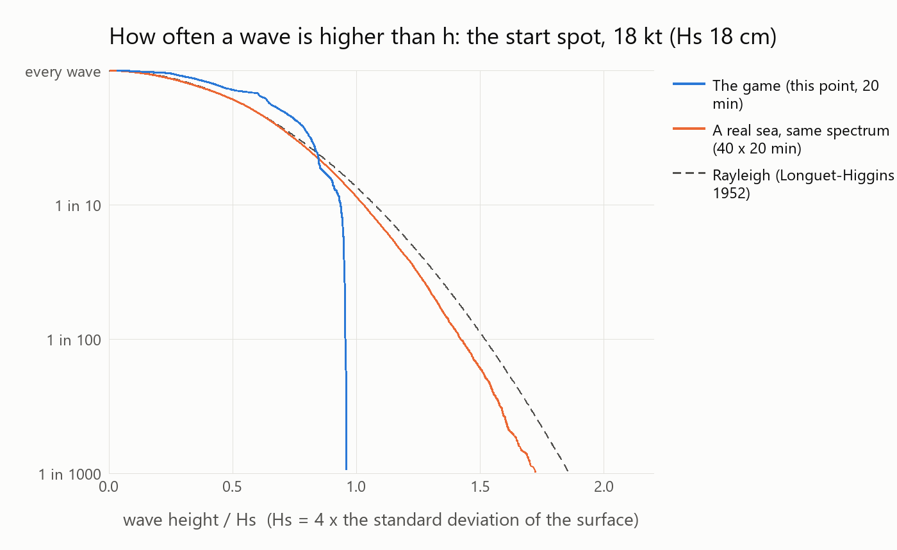
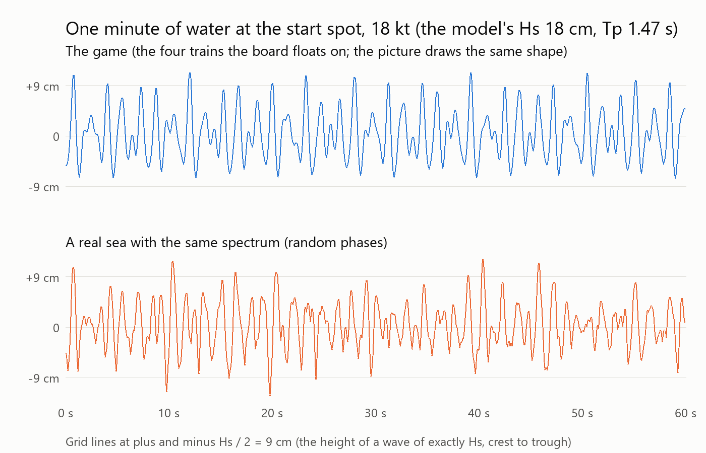
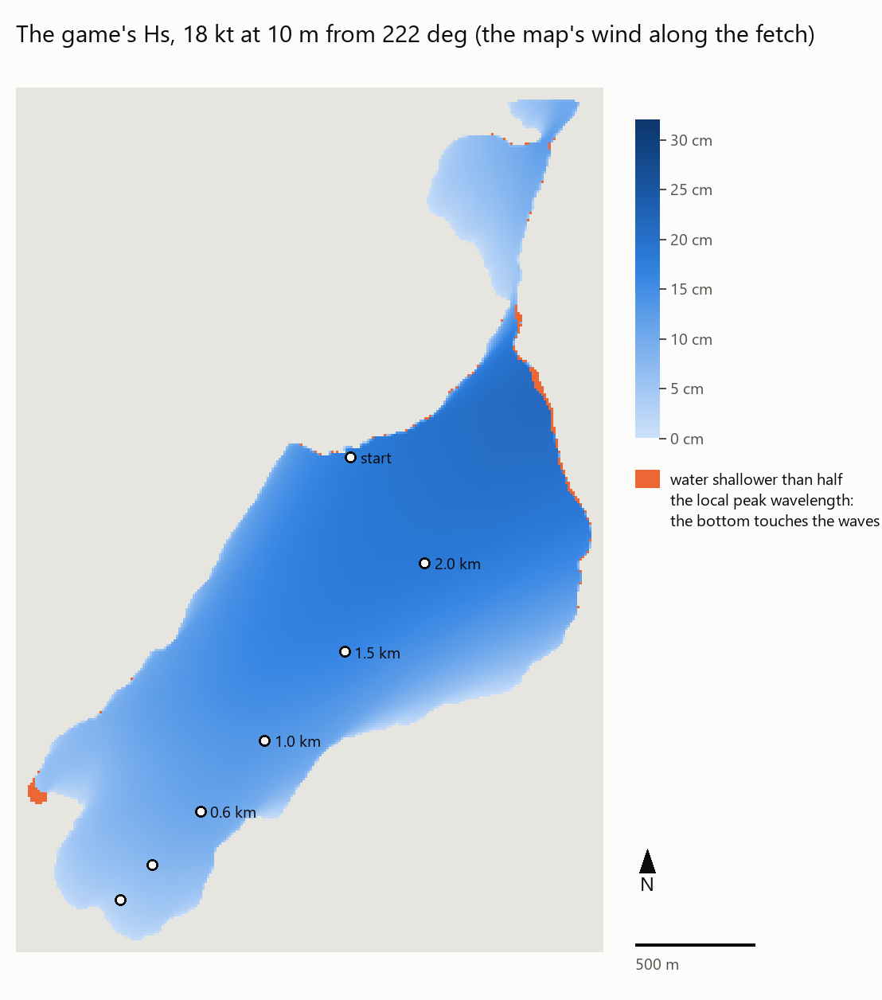

# SWAN on Lake Silvaplana, and what the eye sees (PH44 stage 4, 6 November 2026)

Built on `ph44/swan` (from `night2/look` 707888e, the build Max played this morning) by Claude Opus 5.5 on Max's PC. Not pushed, not merged. Nothing in `Game/sim/` and no default changed.

Max asked two things:
1. To install SWAN (TU Delft's wave model, the "sea-bottom" stage 4 of [wave_system_research.md](wave_system_research.md)): *"yes"*.
2. *"the waves on silvaplana are also nice but seem a little little bit low from my experience. if its correct from the science its ok."*

## In short (for Max)

- **The height of the waves in the game is what the science gives, on average.** Hs, the "significant wave height" forecasts and studies use, is in the game the growth law's (JONSWAP/SPM with the 10 m wind, within 5 % of the newer CEM 2002 law). The water the board floats on carries 91 to 98 % of it where you sail ([lake_waves_full.md](lake_waves_full.md)). At the start spot that is 12 cm in 12 kt, 18 cm in 18 kt and 24 cm in 24 kt (10 m wind); the most anywhere on the lake is 21 cm in 18 kt and 28 cm in 24 kt, near Silvaplana village.
- **But your eye is right: the waves you see in the game are lower than a real sea with that same Hs.** Hs is an average of the bigger waves. A real wind sea is irregular. Every few minutes a "set" wave of 1.5 to 1.9 times Hs comes through, and about one wave in a hundred is 1.5 × Hs. The game's water is four regular wave trains added up. Measured over 20 minutes at five places and three winds (below):
  - **The biggest wave in the game is about half as high as in a real sea**: 16 cm against about 32 cm at the start in 18 kt, and 22 against 42 cm in 24 kt. In 20 minutes at 15 places no wave in the game was higher than 1.05 × Hs. Even in theory four trains can't go past 1.26 × Hs.
  - **The bigger waves you notice (the highest third) are 7 to 17 % lower** than in a real sea of the same Hs: 15 against 17 cm at the start in 18 kt.
  - The game's crests are long and regular, and a real wind sea's are short and broken. That probably makes the water look calmer too (an estimate; not measured).
- **Why it may also look lower than you remember** (each needs your answer, see the questions):
  - **Which wind:** the game's "18 kt" is the wind at 10 m. If your 18 kt was felt or measured at sail height, the 10 m wind that day was about 19 % stronger, and so were the waves (Hs grows in proportion to the wind).
  - **Where on the lake:** downwind (toward Silvaplana village) the waves are 20 % higher than at the start spot.
  - **Strong days:** the game's afternoon is a medium day (18 kt at 10 m at 14:30). A strong day (18 to 22 kt on the water) gives 20 to 30 % higher waves.
- **SWAN is installed, but has not run yet.** Its Windows build needs five runtime files from the compiler it was built with, and its installer doesn't include them. I downloaded the exact compiler package (checksums verified), but placing the five files next to `swan.exe` was blocked by the permission system, so I stopped there (see "SWAN: where it stands"). Everything else is ready: the lake's outline and depth, the map's wind, 15 cases, the tables and maps. It is one command once the files are allowed.
- **What we can do** (each is Michiel's call, since it touches the physics, except the last):

| Option | What changes for the eye | What changes for the sailing | Cost |
|---|---|---|---|
| A. A travelling "set" envelope on the four trains (their heights swell and fade in groups, the same in the physics and the picture) | Set waves of 1.3 to 1.4 × Hs come through (today 1.0) | Every few seconds a bigger wave to time a jump or a bear-away on | Estimated +25 to 40 % of the sea's physics cost (about +0.4 to 0.6 ms per board per tick); next to nothing on the graphics card |
| B. More trains (8 to 12 instead of 4, random frequencies) | Highest wave 1.4 to 1.5 × Hs, close to a real sea at 16 to 32 trains (1.6 to 1.7) | Rougher, less regular water | The sea's physics cost grows with the trains: 8 trains about +1.4 ms per board per tick (estimate), too much for a 20-board race in GDScript |
| C. Move the four train lengths off the exact octaves (8, 4, 2, 1 m are locked 2:1 in time) | Highest wave 1.1 × Hs (today 1.0): a small step | Hardly any | None |
| D. SWAN's wave heights instead of the growth law's (behind a setting) | Waits for SWAN's results: worth it only if SWAN differs clearly | The same | None in the game: a grid made once |
| E. The *Lake wave height* setting (already there, ×0.5 to ×2) | ×1.15 to ×1.2 makes the highest third as high as in a real sea of the science's Hs (but Hs is then 15 to 20 % above the science, and the sets are still missing) | Harder: at ×1.5 a beam reach was 43 % slower, with catapults | None |

My suggestion (an estimate): A together with C. It is cheap, it fixes what the eye misses (the sets), and the average Hs stays the science's. Until then, E at ×1.2 is the quick way for you to see if "a bit higher" feels right.

## 1. Is the game's Hs what the science gives?

**The laws.** `lake_waves_full.md`, "Are the waves correct?", has the line through the lake's middle at 12, 18 and 24 kt: the game's grid holds the SPM law (JONSWAP with the 10 m wind, Hasselmann et al. 1973) at each point's 9-ray fetch, and the CEM 2002 law (Resio et al. 2003) agrees within 5 % on the height. The surface the board floats on carries 91 to 98 % of it from 600 m of fetch on (the 0.5 m train and shorter are picture-only). Nothing there is below the game's own model by mistake: the gap is the 1 m physics cut-off, by design.

**Two laws that give more, and why the game doesn't use them:**
- **The SPM 1984 recipe with its "adjusted wind"** U_A = 0.71 × U^1.23 (U in m/s; the Shore Protection Manual 1984, as quoted by a 2019 MATEC conference paper; the manual itself was not opened) gives 8 / 18 / 27 % more height than the game at 12 / 18 / 24 kt (computed: Hs grows in proportion to the wind in the fetch law). Bishop, Donelan and Kahma (1988, Environment Canada, *Shore Protection Manual's wave prediction reviewed*) tested it against measured fetch-limited waves: the 1984 SPM "tends to overpredict wave height and period" and was "statistically the poorest" of the four methods tested. So the game's choice (the law with U10, the same as CEM within 5 %) is the better-supported one. This is the main number where "data and a law disagree"; both are shown.
- **SWAN** answers this with the lake's real shape, the real spreading of the waves round the wind, and the bottom. Its run is waiting (section 4). The tables it fills are ready (`tools/map/swan_report.py`): SWAN's Hs and Tp at the same points, next to the game, SPM and CEM, for three physics settings.

**Things that would make Silvaplana's real waves *lower* than all these laws** (none is in the game or in SWAN's defaults; listed so nobody assumes the laws are too low):
- **Thin air.** At 1791 m the air is about 20 % thinner (the game's 0.98 against 1.225 kg/m³ at sea level). The same wind speed pushes the water less hard. The effect on Hs was not found in the literature: not quantified.
- **Light wind on lakes.** The Lake Neuchâtel campaign (1996) and two small German lakes measured waves below the JONSWAP law in light wind (wave_system_research.md 1.3).
- **Stable air over cold water** (Kahma and Calkoen 1992, not opened): slower growth.

So, from the science: **the game's average height is right, or if anything high**. A measurement on Silvaplana (none exists) is the only way to settle it.

## 2. What the eye sees (measured)

### Method

- `Game/dev/lake_wave_record.gd` records the game's water surface every 0.05 s for 20 minutes at the start spot and at 600, 1000, 1500 and 2000 m down the line through the lake's middle (the points of `lake_waves_full.md`), at 12, 18 and 24 kt (the lake built as the game builds it at 14:30: the wind from 222°, the map's pattern and lee along the fetch). Two views: **the lake's own view**, the four trains the physics floats on, which is also the shape the picture draws near the camera (`gerstner.gdshaderinc`, `lake_wave_surface()`; the 0.5 m train and the ripples only shade it; `test_lake_waves.gd` checks the shader against the physics); and **the hull's view** of a planing board on a beam reach (each train averaged over its wet bottom, spec 9.18).
- `tools/map/wave_statistics.py` cuts each record into individual waves (zero-down-crossing: a wave runs from one crossing of the mean level downward to the next, a trough then a crest), and measures each wave's height (crest to trough), its crest (above the mean), its period, and its steepness H/L (L from its period, deep water).
- **A real sea for comparison:** the same JONSWAP spectrum as the game's model at that point (its Hs and Tp, peak enhancement 3.3), built from 1500 components with random frequencies and phases: a Gaussian sea, as measured wind seas are to a good approximation (Rayleigh heights: Longuet-Higgins 1952; Tayfun 1980, as Wikipedia's *Significant wave height* cites them). 40 records of 20 minutes each; the median and the 5 to 95 % range. Linear: the second-order lift of real crests is not included, so a real sea's crests would be a little higher still.

**The literature:** Hs was defined by Munk (1944) "to mathematically express the height estimated by a trained observer" (Wikipedia, *Significant wave height*): what a sailor calls "the wave height" is the mean of the highest third. In a Rayleigh sea, one wave in 1000 is higher than 1.86 × Hs ("roughly double the significant wave height"; ibid.); P(H > h) = exp(−2 h²/Hs²) gives one in 90 over 1.5 × Hs.

### Results

Heights relative to each record's own Hs (4 × the standard deviation of its surface). The game (the lake's own view = the picture's shape):

| Wind | Point | Model Hs / Tp | Surface Hs | Waves in 20 min (mean period) | Highest third | Highest wave | Highest crest | Waves over 1.2 / 1.5 × Hs | Steepness H/L, mean / max |
|---|---|---|---|---|---|---|---|---|---|
| 12 kt | start | 0.120 m / 1.29 s | 0.115 m | 1053 (1.14 s) | 0.88 Hs | 0.98 Hs (11 cm) | 0.62 Hs | 0 / 0 | 0.040 / 0.062 |
| 12 kt | middle, 1000 m | 0.095 m / 1.10 s | 0.090 m | 1063 (1.13 s) | 0.89 Hs | 0.93 Hs (8 cm) | 0.55 Hs | 0 / 0 | 0.035 / 0.055 |
| 12 kt | middle, 2000 m | 0.126 m / 1.33 s | 0.123 m | 1071 (1.12 s) | 0.83 Hs | 0.89 Hs (11 cm) | 0.57 Hs | 0 / 0 | 0.039 / 0.062 |
| 18 kt | start | 0.178 m / 1.47 s | 0.169 m | 942 (1.27 s) | 0.89 Hs | 0.96 Hs (16 cm) | 0.66 Hs | 0 / 0 | 0.045 / 0.072 |
| 18 kt | middle, 600 m | 0.109 m / 1.09 s | 0.102 m | 1063 (1.13 s) | 0.93 Hs | 1.03 Hs (11 cm) | 0.54 Hs | 0 / 0 | 0.040 / 0.064 |
| 18 kt | middle, 1000 m | 0.134 m / 1.24 s | 0.129 m | 1066 (1.12 s) | 0.85 Hs | 0.90 Hs (12 cm) | 0.56 Hs | 0 / 0 | 0.046 / 0.073 |
| 18 kt | middle, 1500 m | 0.162 m / 1.39 s | 0.159 m | 996 (1.20 s) | 0.83 Hs | 0.90 Hs (14 cm) | 0.57 Hs | 0 / 0 | 0.046 / 0.076 |
| 18 kt | middle, 2000 m | 0.184 m / 1.50 s | 0.181 m | 887 (1.35 s) | 0.85 Hs | 0.95 Hs (17 cm) | 0.58 Hs | 0 / 0 | 0.044 / 0.089 |
| 24 kt | start | 0.235 m / 1.61 s | 0.221 m | 829 (1.45 s) | 0.90 Hs | 1.00 Hs (22 cm) | 0.68 Hs | 0 / 0 | 0.050 / 0.082 |
| 24 kt | middle, 1000 m | 0.169 m / 1.34 s | 0.164 m | 1063 (1.13 s) | 0.82 Hs | 0.86 Hs (14 cm) | 0.57 Hs | 0 / 0 | 0.052 / 0.085 |
| 24 kt | middle, 2000 m | 0.238 m / 1.64 s | 0.236 m | 806 (1.49 s) | 0.89 Hs | 0.99 Hs (23 cm) | 0.59 Hs | 0 / 0 | 0.048 / 0.120 |

All 15 points and the hull's view are in `.map_data/work/wave_stats/tables.txt` (the full printout of the script). The hull's view has an Hs 8 to 26 % lower again (the board bridges the short chop), with the same shape of distribution.

A real sea of the same spectrum (median and 5 to 95 % range of 40 records of 20 minutes; the same at every point and wind, since the shape is the same):

| | Highest third | Highest wave in 20 min | Highest crest | Waves over 1.2 / 1.5 × Hs in 20 min | Steepness H/L, mean |
|---|---|---|---|---|---|
| A real sea | 0.96 Hs | **1.79 Hs** (1.59 to 1.95) | 0.94 Hs (0.85 to 1.09) | **37 to 46 / 5 to 7** | 0.048 to 0.061 |
| The game | 0.82 to 0.94 Hs | **0.86 to 1.05 Hs** | 0.54 to 0.68 Hs | **0 / 0** | 0.035 to 0.052 |

The same in centimetres, against a real sea with the law's Hs (the game's surface also lacks the picture-only 0.5 m train):

| Wind | Point | Law Hs | Highest third: game / real sea | Highest wave in 20 min: game / real sea |
|---|---|---|---|---|
| 12 kt | start | 12.0 cm | 10.1 / 11.5 cm (0.88) | 11.2 / 21.5 cm (0.52) |
| 18 kt | start | 17.8 cm | 15.0 / 17.1 cm (0.87) | 16.2 / 31.9 cm (0.51) |
| 18 kt | middle, 1000 m | 13.4 cm | 10.9 / 12.9 cm (0.85) | 11.6 / 24.0 cm (0.48) |
| 18 kt | middle, 2000 m | 18.4 cm | 15.3 / 17.6 cm (0.87) | 17.2 / 32.8 cm (0.52) |
| 24 kt | start | 23.5 cm | 19.9 / 22.5 cm (0.88) | 22.1 / 42.0 cm (0.53) |
| 24 kt | middle, 2000 m | 23.8 cm | 21.1 / 22.8 cm (0.92) | 23.4 / 42.6 cm (0.55) |

(Over all 15 points: the highest third 0.83 to 0.93 of a real sea's, the highest wave 0.47 to 0.56.)

**Why the game can't make set waves.** Four sines add up to at most the sum of their amplitudes. On Silvaplana the four trains' amplitudes sum to 0.53 to 0.63 × Hs (`record.json`), so the highest possible crest is 0.63 × Hs and the highest possible wave 1.26 × Hs, anywhere on the lake. At a fixed point it is lower still. In deep water a wave's frequency goes as 1/√length, so the 2 m train has **exactly** twice the frequency of the 8 m one, and the 1 m exactly twice that of the 4 m one. At one spot these pairs keep the same shape for ever, and their crests never all meet there. That is why the measured highest wave is 0.86 to 1.05 × Hs and not 1.26. A real sea has energy at every frequency in random phase, so now and then many crests meet: the sets.

**How many trains it takes** (`tools/map/wave_options.py`: the start spot's spectrum at 18 kt, the part the physics floats on, 0.7 to 11 m; one point, 20 minutes, the median of 40 phase sets; linear):

| How the sea is built | Trains | Highest third | Highest wave | Waves over 1.2 × Hs |
|---|---|---|---|---|
| Today: one per octave, 8/4/2/1 m (locked 2:1) | 4 | 0.91 Hs | 1.00 (0.87 to 1.11) Hs | 0 |
| One per octave, lengths moved off the octaves | 4 | 0.91 Hs | 1.10 (1.03 to 1.15) Hs | 0 |
| One per octave (moved) with a travelling set envelope, depth 0.5 | 4 | 0.93 Hs | 1.28 (1.18 to 1.39) Hs | 4 |
| One per octave (moved) with a travelling set envelope, depth 0.8 | 4 | 0.94 Hs | 1.36 (1.27 to 1.51) Hs | 13 |
| Random frequencies in equal steps | 6 | 0.94 Hs | 1.27 (1.21 to 1.33) Hs | 7 |
| | 8 | 0.95 Hs | 1.38 (1.33 to 1.44) Hs | 17 |
| | 12 | 0.96 Hs | 1.51 (1.45 to 1.65) Hs | 28 |
| | 16 | 0.96 Hs | 1.62 (1.49 to 1.75) Hs | 30 |
| | 32 | 0.96 Hs | 1.72 (1.56 to 1.92) Hs | 36 |
| A real sea (all lengths, 1500 components) | | 0.96 Hs | 1.79 (1.59 to 1.95) Hs | 42 |

The "set envelope" is each train's height swelling and fading as a wave group that travels with the train's group velocity: a(x, t) = a·(1 + m·cos(Δk·x − Δω·t)), with the energy kept the same (a scaled by 1/√(1 + m²/2)). It is the same as two weak side-trains per train, but it costs one extra cosine per train instead of two whole trains. Its group length (sets every 6 to 8 waves here) is an estimate and should be checked against what Max sees.

## 3. Other reasons the lake may look lower than remembered

1. **The wind's height.** The game's wind speeds are at 10 m (WindConfig), and the waves are built from the 10 m wind. At sail height (2 m) the wind is 0.84 times the 10 m wind (the game's open-water profile, exponent 0.11). If Max's "18 kt" was measured or felt on the water, the 10 m wind was about 21 kt, and Hs about 19 % higher than the game's 18 kt (computed: Hs ∝ U). If it was the forecast or the station, it is the 10 m wind already. **Question 1 for Max.**
2. **The day.** The map's afternoon is the median Maloja day (Segl-Maria 13 kt at 14:30, ×1.3 on the water: 18.2 kt at 10 m). Max's competition days run 12 to 22 kt on the water (MALOJA_WIND_RESEARCH.md). A strong day's 22 kt gives 20 to 30 % higher waves than the medium one (computed: Hs ∝ U).
3. **The place.** At the start spot (9-ray fetch 1.4 km) the game has 18 cm in 18 kt. The highest is 21 cm toward Silvaplana village, and within about 500 m of the Sils shore it is under 10 cm (map below).
4. **Gusts.** The game builds its waves for the lake's mean wind. Only the 0.5 m picture train answers a gust. In a real gust of +25 % the 1 to 2 m chop grows about 10 % within tens of seconds (the growth law's bands at the new wind, table 1.4 of the research: an estimate, it assumes they reach the new balance). That is a small effect on the height, though a gust's whitecaps are very visible.
5. **Long, regular crests.** The four trains run at 0, −7, +10 and −14° off downwind, each with one straight crest across the whole lake. A real wind sea spreads ±30° and more round the wind (Mitsuyasu et al. 1975, as `lake_waves_silvaplana.tres` cites it), so its crests are short and broken. A regular, long-crested sea looks smoother. This is an estimate: it was not measured on screen.

The lake's largest game Hs: 14 / 21 / 28 cm in 12 / 18 / 24 kt (median over the lake 10 / 14 / 18 cm).

## 4. SWAN: where it stands

### Installed

- **SWAN 41.51** (the latest; swanmodel.sourceforge.io/download/download.htm), the official Windows build `SWAN-41.51-Windows.exe`, downloaded into its own new folder. **Checksum:** MD5 `2b386e750dd0e63ae4d7f79f71713750` matches SourceForge's published MD5 for that file (the project's RSS feed, `sourceforge.net/projects/swanmodel/rss?path=/swan`; the download page itself offers none). SHA-256 `88ceb562cf972a90d484919a807598718251047343b359ebfeae38eb3819bc35`. The file is not code-signed.
- It is an **Inno Setup 6.5.2** installer, not NSIS, and 7-Zip cannot open it. Its own installer would write to `Program Files` and the machine-wide PATH, which needs admin rights. I unpacked its seven files with a small script instead. The script reverses Inno's "call instruction" filter on `swan.exe` the way innoextract does, and **checks every file against the SHA-256 the installer itself stores**: all seven match. They are in **`%LOCALAPPDATA%\Programs\SWAN\41.51`**: `swan.exe` (SHA-256 `1de4a41b…ee587904`), `swan.edt`, `swanrun.bat`, `swancmd.bat`, `swanprompt.bat`, `Readme.txt`, `swanuse.pdf` (the user manual). No registry, no PATH change, no admin.

### Blocked: five runtime files

`swan.exe` was built with the WinLibs GCC 13.2.0 compiler ("MinGW-W64 x86_64-ucrt-posix-seh, built by Brecht Sanders, r7", as the exe says). It loads `libgfortran-5.dll`, `libgomp-1.dll` and `libwinpthread-1.dll` (and through them `libgcc_s_seh-1.dll` and `libquadmath-0.dll`). **The installer does not include them**, so SWAN stops at once with "DLL not found" (exit code 0xC0000135).

What I did: I downloaded that exact compiler package from its GitHub releases (`brechtsanders/winlibs_mingw`, release `13.2.0posix-18.1.3-11.0.1-ucrt-r7`, file `winlibs-x86_64-posix-seh-gcc-13.2.0-mingw-w64ucrt-11.0.1-r7.7z`, 98 MB) into its own new folder. Its **SHA-512 and SHA-256 match the published `.sha512` and `.sha256` files** (`bb2e10a3…b9537c`, `3656d33f…a577b5`). **Extracting the five DLLs and copying them next to `swan.exe` was refused by the permission system** ("Code from External"), so per the lead's rule I stopped there and looked for no other route.

**What is needed** (one of):
- allow that step: `7z e <the .7z> mingw64\bin\libgfortran-5.dll mingw64\bin\libgomp-1.dll mingw64\bin\libwinpthread-1.dll mingw64\bin\libgcc_s_seh-1.dll mingw64\bin\libquadmath-0.dll -o"%LOCALAPPDATA%\Programs\SWAN\41.51"`. The archive sits in the session's scratchpad (`…\scratchpad\winlibs_download\`), or download it again from the release above;
- or Max does the same by hand: open the `.7z` with 7-Zip, go to `mingw64\bin`, and drag those five files into `%LOCALAPPDATA%\Programs\SWAN\41.51`.

Then from the repo root: `python tools/map/swan_silvaplana.py run report` (about 15 SWAN runs, two at a time with two threads each; the run time is not known yet).

### The set-up (ready, input files written)

- **The lake:** `Game/dev/swan_export.gd` writes the game's own lake on a **10 m grid** (254 × 366 cells, x east and y north from the game's origin, LV95 2780500 / 1146600). The **depth** is the game's depth grid (swissBATHY3D lakebed on 2 m, `shore_heights.bin`), averaged over each cell. The **wind** is the map's pattern and the lee along the south-east shore relative to the lake's mean, as the game's waves use it, with the pattern's local turn. The **game's model** (Hs, Tp, the 9-ray fetch and the wind along it) sits on the same nodes, and so do the points of the lines through the middle and the start. Run: `tools/godot.sh --headless --path Game -s res://dev/swan_export.gd -- --out=<folder>` (about 9 minutes; `swan_silvaplana.py export` does it).
- **SWAN** (`tools/map/swan_silvaplana.py`, one folder per case under `.map_data/work/swan/runs/`, each with its `.swn` input file): stationary, 2D, Cartesian. 36 directions (10°) and 31 frequencies from 0.3 to 6 Hz (Δf/f = 0.10, what SWAN's quadruplet approximation is built for; the manual, CGRID). Fresh water (1000 kg/m³). Depth-induced breaking and JONSWAP bottom friction on. Stopping: Hs changes by less than 0.5 mm or 0.5 % on 99.5 % of the points, at most 80 iterations (SWAN's default 5 mm is too coarse for 5 to 25 cm waves). No open boundaries: the lake is closed. Output: Hs, Tps, RTp, Tm01, Tm02, the mean direction and spread, depth, wavelength, steepness and the breaking share on the grid. A table and 1D spectra at the line's points.
- **The cases** (15): wind 12, 18 and 24 kt at 10 m from 222.07° (the map's lake direction at 14:30):
  - `u<kt>_westh_real`: one wind everywhere, SWAN 41.51's default physics (GEN3 WESTH: van der Westhuysen whitecapping, Yan's wind input), the real bottom;
  - `u<kt>_westh_deep`: the same lake 50 m deep everywhere (the bottom's effect is the difference);
  - `map<kt>_westh_real`: the map's own non-uniform wind (what the game's model uses), to compare with the game cell by cell;
  - `u<kt>_komen_real` and `u<kt>_st6_real`: the older Komen physics and Rogers et al. (2012) ST6 with the manual's recommended calibration (`GEN3 ST6 2.8E-6 3.5E-5 4.0 4.0 UP HWANG VECTAU U10PROXY 32.0 AGROW`, `SSWELL ZIEGER`). The spread between the three is SWAN's own uncertainty.
- **The report step** (`tools/map/swan_report.py`) checks that SWAN's depth lies on the input depth (so the grid's orientation is right), then writes the table along the middle line (game, SPM and CEM for one wind, every SWAN case) and the maps (SWAN's Hs, SWAN over the game, the bottom's effect) to `.map_data/work/swan/report/`.

### Where the bottom matters (from the depth data, before SWAN)

A wave feels the bottom where the water is shallower than half its length. With the game's peak wavelength at every cell, that is **0.7 % of the lake in 18 kt and 0.9 % in 24 kt** (orange on the 24 kt map): a fringe a few cells wide along the shores, and the delta at the Sils end (south-west). 3.2 % of the lake is shallower than 2 m and 5.3 % shallower than 3.5 m (the research measured 5.5 % on the 2 m grid). So the bottom can only matter in the last tens of metres before the shore, where the board is stopped anyway (the shore check at 0.5 m). SWAN's `_deep` cases will show whether refraction over the deltas reaches further.

## What is measured, what is estimated

- **Measured** (on this PC, the scripts named): the game's surface and its individual waves (`lake_wave_record.gd`, `wave_statistics.py`); the game's model at every 10 m cell and the lake's depth (`swan_export.gd`); the share of the lake where the bottom touches the waves; the checksums.
- **Computed from sources:** the real sea's statistics (a Gaussian sea with the JONSWAP spectrum: Hasselmann et al. 1973; Rayleigh heights: Longuet-Higgins 1952, Tayfun 1980); the U_A factors (SPM 1984 as quoted); the wind at sail height (the game's profile); the options table (`wave_options.py`, linear).
- **Estimates:** that long crests make the water look calmer; the set envelope's group length; the costs of options A and B (scaled from the 4-train measurement of 1.42 ms per board per tick in `lake_waves_full.md`; not measured); the gust effect; my suggestion.
- **Not known:** SWAN's answer (not run); any measurement of waves on Silvaplana (none exists); how the game looks to Max on his screen with any of the options.
- **Not opened:** the Shore Protection Manual itself, Kahma and Calkoen (1992), Forristall's crest papers. The literature quotes are from the pages named in "Sources".

## Questions for Max

1. **Your "18 kt" on Silvaplana: what measured it?** The forecast or the station (that is the 10 m wind, like the game's), a hand anemometer or the feel on the water (that is about 2 m, and the 10 m wind was then about 19 % stronger), or your GPS speed?
2. **What looks low:** all the waves, or that there are never bigger ones among them (the "sets")? The measurements say mostly the second. Try `Settings > Waves > Lake wave height` at 1.2 and say if that is "right" (that tells us how much the eye misses).
3. **Where do you remember the biggest waves?** At the start spot, in the middle, or near Silvaplana village (the game has the most there)?
4. **How often does a clearly bigger wave come through,** and how many waves is a set long (for the envelope's group length)?
5. **On a medium afternoon at the start, how high are the waves?** For example "knee-high crest to trough", or "20 cm". That would be the first measurement of Silvaplana's waves.

## Questions for Michiel

1. **The set envelope (option A):** a travelling group envelope per train, in both the physics (`LakeWaveField`) and the shader, with the energy kept: acceptable as a physics change? Its cost would need measuring with `tools/sea_bench.sh`.
2. **The octave lock (option C):** move the four train lengths off the exact octaves (e.g. 8, 4.3, 2.2, 1.1 m) so their crests can meet at every point. A free change in `lake_waves_silvaplana.tres`, but last night's speed and fall measurements on the lake were made with these lengths and would need repeating.
3. **SWAN's physics for a lake:** WESTH (the default), Komen or ST6, once all three have run? And whether the game should take SWAN's Hs as a grid behind a setting (default unchanged) if it differs clearly from the law.
4. **The air's density:** the waves' laws assume sea-level air. Is the 20 % thinner air at 1791 m something to put in (it would lower the waves), or leave it until a measurement says so?

## Files

- `Game/dev/swan_export.gd`: the game's lake for SWAN (depth, the map's wind, the game's model, the lines' points).
- `Game/dev/lake_wave_record.gd`: the game's water surface recorded at points over time.
- `tools/map/swan_silvaplana.py`: export, write and run the SWAN cases, report (the help explains the cases). `tools/map/swan_report.py`: the tables and maps.
- `tools/map/wave_statistics.py`: the individual waves, the real-sea comparison and the two charts. `tools/map/wave_options.py`: what other ways to build the sea would give.
- `Documentation/reports/waves/swan_silvaplana/`: the pictures in this report.
- Not committed (`.map_data/`, rebuilt by the scripts): `work/swan/export/`, `work/swan/runs/` (the 15 input folders), `work/swan/report/`, `work/wave_record/`, `work/wave_stats/` (`tables.txt`, `results.json`).

## Sources

- SWAN download page and user manual 41.51 (`swanuse.pdf`, installed): https://swanmodel.sourceforge.io/download/download.htm
- SourceForge checksums (RSS): https://sourceforge.net/projects/swanmodel/rss?path=/swan
- WinLibs GCC 13.2.0 UCRT r7: https://github.com/brechtsanders/winlibs_mingw/releases/tag/13.2.0posix-18.1.3-11.0.1-ucrt-r7
- innoextract's call-instruction decoder (the algorithm the unpack script follows): https://github.com/dscharrer/innoextract/blob/master/src/stream/exefilter.hpp
- *Significant wave height* (Munk 1944, the trained observer; the Rayleigh distribution, Tayfun 1980; one in 1000 waves; Holthuijsen 2007): https://en.wikipedia.org/wiki/Significant_wave_height
- Bishop, Donelan and Kahma (1988), *Shore Protection Manual's wave prediction reviewed*: https://publications.gc.ca/site/eng/9.849522/publication.html
- U_A = 0.71 U^1.23 as quoted from the SPM: https://www.matec-conferences.org/articles/matecconf/pdf/2019/19/matecconf_concern2018_04024.pdf (search-engine summary; the paper was not opened)
- The earlier reports: [wave_system_research.md](wave_system_research.md), [lake_waves_full.md](lake_waves_full.md).
