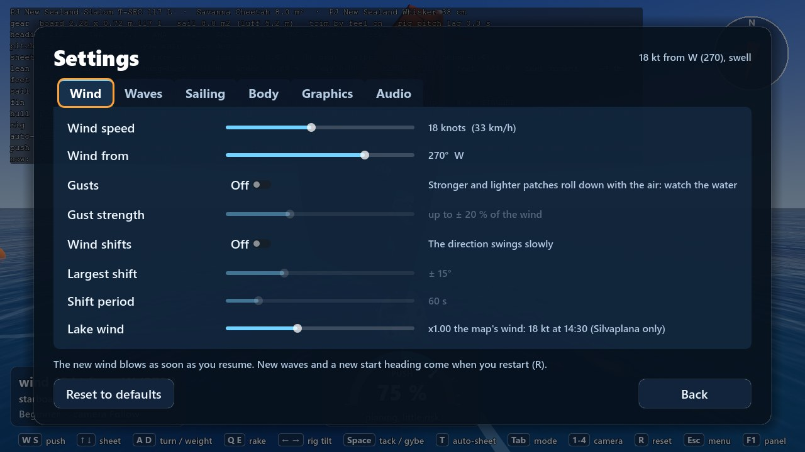
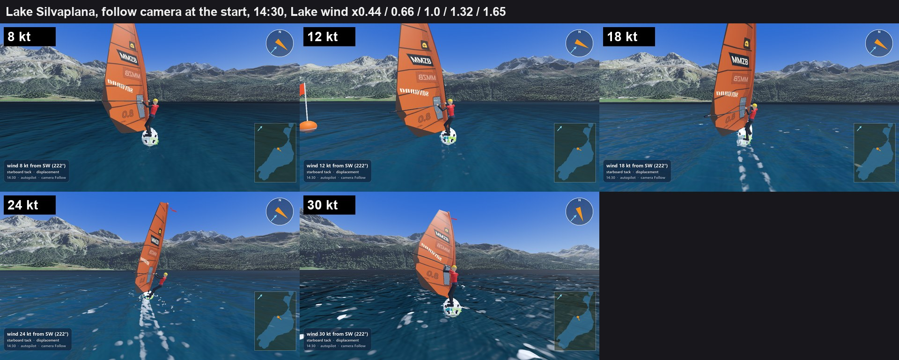
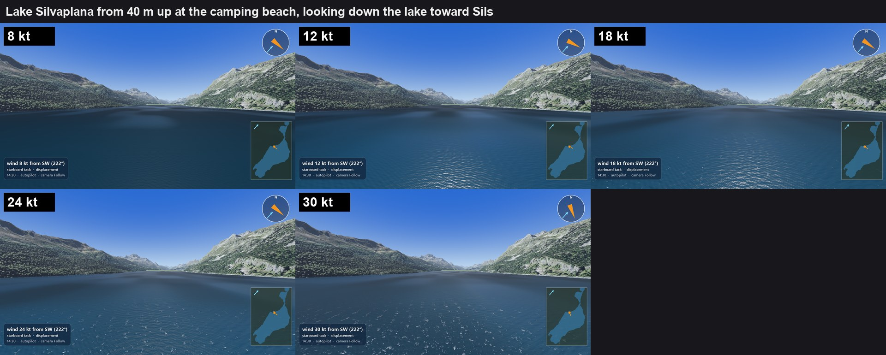
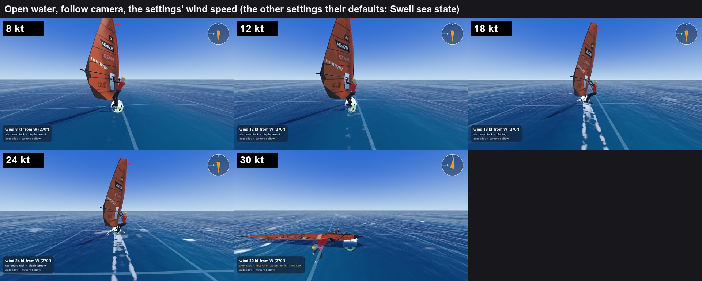
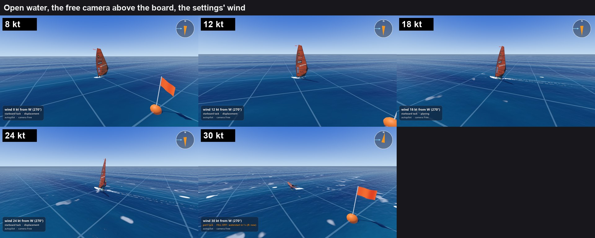
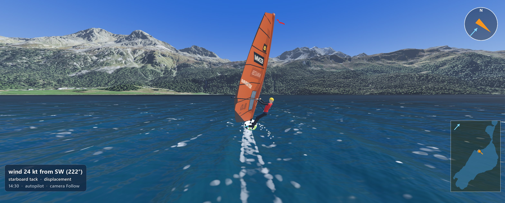
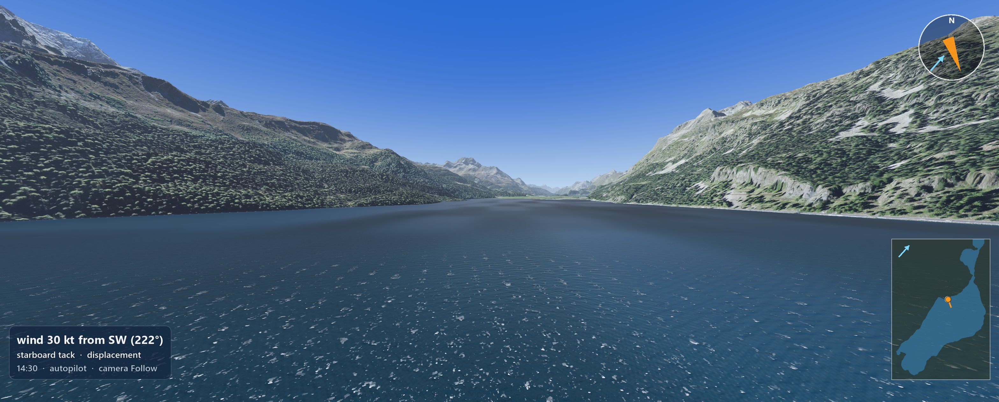

# The wind's strength on the water, and the lake wind multiplier (GR, 6 November 2026)

Built on `gr/wind-on-water` (from `play/6nov-evening` f72f565, today's play-test code) by Claude Opus 5.5 on Max's PC, for the play-test at 15:45. Not pushed, not merged. Nothing in `Game/sim/` changed: the board floats and sails exactly as before; only the lake's wind (A) and the picture of the water (B) changed.

Max's two asks:
- **A.** "Silvaplana changable wind (multiplier)"
- **B.** "Make the windstrength visable to the player. Look at how other games have done this. No white stripes, but effects that happen in real life high winds too. (Visible on watershader)"

## In short

- **A. Lake wind.** Settings > Wind has a new slider, **Lake wind**, from x0.40 to x2.00 of the map's measured Maloja day (x1.00, the default, is today's wind, bit for bit). At 14:30, when a sail on the lake starts, x0.44 is about 8 kt, x0.66 12 kt, x1.00 18 kt, x1.32 24 kt and x1.65 30 kt at 10 m (the slider says the knots). It goes in at one place (the map's wind, `MapWind.set_lake_wind_scale()`), so the gusts, the lulls, the lee, the lake's own waves, the HUD's number, the gust picture on the water and the AI's gear all follow (table below). `--lake_wind_scale=<x>` on the command line does the same for every tool and overrides the setting. In a LAN game the guest sails the host's.
- **B. The wind on the water.** At each place and moment the water now shows the wind the physics feels there (the gust picture), the way real water does, and no white lines anywhere:
  1. **Whitecaps** rise steeply with the wind, by the open sea's measured law (Callaghan et al. 2008) made smaller for the lake's fresh water and young waves: none at 8 kt, a very few at 12, scattered at 18, many at 24, the water speckled white at 30. On the open water the same law (no fresh-water factor).
  2. **Foam that stays behind:** a breaking crest moves on and leaves its foam, which fades in two or three seconds (fresh water, the lake) or four (sea water) and drifts slowly downwind, thinner and lacier than the crest's.
  3. **The roughness and the colour:** the short waves and the mirror get rougher with the wind (Cox and Munk, as last night), so 8 kt is a glassy, sky-mirroring lake, 30 kt a grey, matt, speckled one; on the open water the mirror now follows the wind the same way (it stopped changing above 21 kt before).
  4. **Wind rows:** faint darker and lighter lanes along the wind in the short waves' roughness (Langmuir circulation), from about 6 kt.
  5. **Spray** blown off the crests above about 25 kt: **not built** (time); the rest was shipped first.
- **Cost:** about +1 ms a frame on the graphics card at 1280 x 720 and at 3137 x 1263 (measured with one board while another game shared the PC; see Cost).
- **Tidy-up:** the eight "OpVectorExtractDynamic is not supported yet" lines at every start are gone (the loop over the lake's trains is written out).

## A. The lake wind multiplier

### What follows it

The multiplier is put on the map's day: `MapWind.set_lake_wind_scale(x)` gives the map's wind its own copy of the measured day with `WindDay.lake_wind_scale = x`, so `day.lake_speed_ms()` (the lake's mean wind of every moment) is x times the measured one. The measured day's file and resource are never changed (other tools share it). Everything made from the mean follows by itself:

| What | Follows? | How |
|---|---|---|
| The lake's mean wind of the day | yes | `WindDay.lake_speed_ms()` times x |
| The gusts and lulls (their size in knots) | yes | `WindGusts.spread_ms(mean)`: 0.48 kt + 0.087 per knot of the mean, so a little less than x times |
| The gusts' drift down the lake | yes | `WindGusts.drift_ms(mean)` = 1.1 x the mean; the travel table is worked out again |
| The lee along the south-east shore | yes | `WindLee.band_lee(direction, mean in knots)`: the deeper or shallower lee of a lighter or stronger day |
| The wind every board's physics feels | yes | `MapWindField` asks `MapWind` every step; all the boards of a race share the session's map wind |
| The HUD's wind number, the controller's | yes | `MapWindField.current_speed_ms` (the mean at 10 m) |
| The lake's own waves (PHYSICS_SPEC.md 9.17, 9.18) | yes, at the start and at every restart | `EnvironmentConfig.lake_waves_for()` reads `map_wind.day.lake_speed_ms()` at the session's time: the waves are **built once** for the wind of that moment (as today), now the scaled one. A new multiplier from the menu rebuilds them (in a race at R, like the waves' own settings). The console says "built for 30.0 kt at 10 m" at x1.65 |
| The gust picture the water shader draws (`wind_ripple_map`) and the wind viewer's colours and streaks | yes | they draw from `WindMoment.shader_parameters()` (the scaled mean) |
| The water's look (whitecaps, roughness) | yes | `lake_wind_ms`, set every frame from the scaled mean |
| The AI personas' gear at a start (`Persona.gear_for()`) | yes | the race runner gives it the player's wind at 10 m (`telemetry.tws_10m_kt`) |
| The race director's wind (the course maker) | yes | `wind.day.lake_speed_ms()` of the session's map wind |
| The wind viewer (start menu, the course maker) | yes | it puts the settings' multiplier (or the command line's) on its own map wind |
| The lake's direction, the day's cycle, the pattern over the terrain | unchanged | only the strength is scaled |
| The open water | unchanged | it has its own wind (the settings' Wind speed) |
| Tools: `run_lake.gd`, `run_race.gd --map=lake`, the AI's training, `fit_courses.gd` | yes with `--lake_wind_scale=<x>` | `MapWind.load_from()` reads the command line, so every tool that loads the map's wind takes it |

### The setting

- `[wind] lake_wind_scale` in the settings file, read clamped to 0.4 to 2.0 (`SettingsValues.LAKE_WIND_SCALE_MIN/MAX` = `MapWind`'s). The range goes below the brief's 0.5 so that 8 kt can be had at 14:30.
- Settings > Wind > **Lake wind**: "x1.32 the map's wind: 24 kt at 14:30 (Silvaplana only)".
- The command line `--lake_wind_scale=<x>` (game, `tools/screenshot.sh`, `tools/release.sh`, `run_lake.gd`, `run_race.gd`) wins over the setting.
- In a LAN game the [wind] section is the host's, so the guest sails the host's multiplier.
- Changed in the pause menu while sailing alone: the new wind blows and the lake's waves are built again at once (the gusts jump to where their new drift has carried them); in a race it waits for R.

### Tests

`Game/tests/unit/maps/test_lake_wind_scale.gd`, 8 tests: at 1 the wind at four places and three times is exactly the same (and again after 1.5 and back); at 1.5 the wind at a point and time is 1.5 times (without gusts exactly; with gusts and lee 1.5 times on average over the lake, the gusts' drift 1.5 times); the simulation's mean at 10 m and the HUD's number 1.5 times (and 18.2 kt at x1 at 14:30); the lake's waves are built for 1.5 times the wind and higher; the multiplier is kept within its range in the map wind and in a hand-edited settings file; it is saved in [wind] and changes the sea's signature; the command line overrides the settings.

## B. The wind's strength on the water

### What other games do (research)

Sources found by a web search on 6 November (a helper agent; some pages could not be opened, marked):

- **Sea of Thieves** (Ang, Catling, Ciardi and Kozin, "The Technical Art of Sea of Thieves", SIGGRAPH 2018 Talks, https://history.siggraph.org/wp-content/uploads/2022/09/2018-Talks-Ang_The-Technical-Art-of-Sea-of-Thieves.pdf): an FFT ocean after Tessendorf; foam made at the wave peaks, blurred over time so it spreads and fades, and its amount set by the weather: "Stormy water will have more foam ... calm water will only show foam generation around intersecting objects." The wind's strength is shown by how much foam and whitecap there is, not by lines.
- **Tessendorf, Reinhard and Gao 2023**, "Whitecap Phenomenology for Ocean Surface Simulation" (https://jtessen.people.clemson.edu/reports/papers_files/whitecap_fraction.pdf): most graphics oceans whiten where the surface's Jacobian folds, with a threshold set by eye and a decay; they tie the threshold to a measured whitecap fraction (W = 1.2 % at 12 m/s, 11.5 % at 23 m/s) and a foam half-life of 4 to 8 s. This is the approach used here (last night's threshold already gave a measured share; now the foam that stays is added).
- **Wind Waker**: its white swirling wind lines are the stylised "white stripes" Max does not want (not opened; well known).
- **Windbender** (a small windsurf game, https://stuurboord.itch.io/windbender): little arrows on the water for the wind.
- **Virtual Regatta**: a forum thread "can we see wind strength on water" (https://forum.virtualregatta.com/topic/9872-can-we-see-wind-strength-on-water/) could not be opened; the game shows the wind with coloured map overlays, not on the water.
- **Assassin's Creed IV, Skull and Bones, Sailaway, eSail, Crest's foam**: no primary source found in the time (only a forum thread on the AC IV ocean talk, https://gamedev.net/forums/topic/652966-assassins-creed-iv-black-flag-ocean-technology-talk/). From memory, not checked: AC IV and Skull and Bones show a storm with more and bigger whitecaps, foam and spray off the crests; Sailaway shows gusts as darker patches.

So the games that show wind on the water do it with whitecaps and foam that grow with the wind, darker rougher patches for gusts, and spray in a storm; lines are a stylised or map-overlay choice.

### What real strong wind does to water

- **The Beaufort scale** (US National Weather Service, https://www.weather.gov/media/pqr/beaufort/beaufort.pdf): force 3 (7 to 10 kt) "Large wavelets, crests begin to break. Foam of glassy appearance. Perhaps scattered white horses"; force 4 (11 to 16) "Small waves, becoming longer. Fairly frequent white horses"; force 5 (17 to 21) "Moderate waves ... Many white horses are formed (chance of some spray)"; force 6 (22 to 27) "Large waves begin to form. White foam crests are more extensive everywhere (probably some spray)"; force 7 (28 to 33) "white foam from breaking waves begins to be blown in streaks along the direction of wind"; force 8 (34 to 40) spindrift. Sailors' rule (Bay Nature, https://baynature.org/article/how-to-read-the-wind-like-a-sailor/): scattered whitecaps from 7 to 10 kt, steady whitecaps about 15 kt, cat's paws as dark ruffled patches from about 12 kt.
- **How much of the water is white** rises with about the wind's cube: Monahan and O'Muircheartaigh 1980 (J. Phys. Oceanogr. 10, 2094) W = 3.84 x 10⁻⁶ U¹⁰^3.41; Callaghan, de Leeuw, Cohen and O'Dowd 2008 (GRL 35, L23609; the brief's "Callaghan, Deane and Stokes 2008" is their JGR paper on swell, which finds a third less cover in swell-dominated seas) two cubic fits, 3.18 x 10⁻³ (U − 3.70)³ % to 10.18 m/s and 4.82 x 10⁻⁴ (U + 1.98)³ % above (as Albert et al. 2016, ACP 16, 13725, give them, opened last night); Zhao and Toba 2001 (J. Oceanogr. 57, 603) from the breaking-wave parameter R_B = u*² / (ν ω_p), which knows the waves' age. The measured cover counts both the fresh, bright foam of a breaking crest (stage A) and the thinner foam it leaves behind (stage B), which covers 1.5 to 40 times stage A's area and fades with a time of 1.4 to 4.8 s in the sea (Callaghan et al. 2012, JGR, https://data-ww3.ifremer.fr/BIB/Callaghan_etal_JGR2012.pdf, through a search excerpt).
- **Fresh water foams less**: whitecap foam decays in about 2.54 s in fresh water against 3.85 s in salt water (Monahan and Zietlow 1969, J. Geophys. Res. 74, 6961, as Wu 2000, J. Phys. Oceanogr., https://data-ww3.ifremer.fr/BIB/Wu_JPO2000.pdf, gives it; the 1969 paper itself not seen); at the same wind, sea whitecaps last longer than lake ones.
- **Spray and spindrift**: Beaufort puts "some spray" at force 5 to 6 and spindrift at force 8 (34 kt); spume torn off the crests is a gale-force regime (Troitskaya et al. 2016, Sci. Rep.); Veron 2015 ("Ocean Spray", Annu. Rev. Fluid Mech. 47) could not be opened for a threshold. So about 25 kt for the first spray is an estimate.
- **Wind rows** (Langmuir circulation): within minutes of a wind of about 3 m/s the top metres turn into rolls along the wind; their lines (foam, slicks, rougher and smoother lanes) are 2 to 300 m apart, wider in stronger wind (Leibovich 1983, Annu. Rev. Fluid Mech. 15; Thorpe 2004, Annu. Rev. Fluid Mech. 36). Real, along the wind, and not white unless foam collects in them.
- **Gusts as darker patches**: rougher water tilts the surface's facets and blurs the mirror (NOAA's glitter page, https://psl.noaa.gov/outreach/education/science/glitter: gusts roughen the surface, slicks smooth it); that a gust looks darker because less bright sky is mirrored was found in no source (it depends on the view and the sun): treated as by eye, as last night.
- **Cox and Munk 1954** (J. Opt. Soc. Am. 44, 838; https://oceanopticsbook.info/view/surfaces/cox-munk-sea-surface-slope-statistics): the mean square slope 0.003 + 0.00512 U, U at 12.5 m (as last night).

### What the game already had (last night's `gr/lake-wind-shading`, in today's play-test)

On the lake: the roughness of the short waves by Cox and Munk from the gust picture (a gust darker and rougher, a lull glassier), short-crested wavelets near the board, and whitecaps on the crests by Zhao and Toba with the lake's own young waves (very few at 18 kt: none below 15 kt at the camping beach). On the open water: gust patches as a tint and rougher ripples, ripples that stopped growing at 21 kt, and foam only where the waves are steeper than 0.3, the same in every wind.

### What was built

| What | Where | Numbers and their sources |
|---|---|---|
| Whitecap laws: Zhao and Toba (0), Callaghan 2008 (1), Monahan and O'Muircheartaigh 1980 (2) | `lake_look.gdshaderinc`: `whitecap_cover()`, `sea_whitecap_percent()`; `LakeLook` the same in GDScript | the laws as above; `whitecap_law` per look: **the lake now 1** (was Zhao and Toba), the sea 1 |
| The lake's fresh water and young waves | `whitecap_water_factor` 0.66 (lake_water.tres), `whitecap_young_onset` 500 | 0.66 = 2.54 / 3.85 s (an **estimate**: cover in proportion to the foam's life); none where the lake's waves are too young to break, R_B below 500, all from 1000 (Toba and Koga's 1000; the softening an **estimate**) |
| Fresh crests and the foam they leave | `lake_whitecap()`, `foam_lags_add()`, `foam_left()` | the breaking crests take `whitecap_active_share` 0.35 of the cover (an **estimate** inside the measured 2 to 40 %, chosen so the crests and their foam together are about the measured cover); the foam fades with `foam_life_s` 2.54 s on the lake, 3.85 s at sea (Monahan and Zietlow); 8 earlier moments `foam_lag_s` apart (0.35 s lake, 0.5 s sea); `foam_left_opacity` 0.55, `foam_lace` 0.6, `foam_spread_per_s` 0.05 (**by eye**) |
| The foam's and the rows' drift | `OceanNode._drift_the_foam()`, `foam_drift_ms`, `foam_offset_m` | 3 % of the wind at 10 m (`FOAM_DRIFT_SHARE`, the usual wind drift of the surface; an **estimate** for foam), along the run's mean wind |
| Wind rows | `wind_rows()`: the short waves' mean square slope times 1 ± up to 0.5 | lanes about 90 m along and 14 m across (inside Thorpe's 2 to 300 m, an **estimate**), from 3 m/s (Leibovich), full from 12 m/s (an **estimate**), strength 0.5 (**by eye**), fixed to the run's mean wind direction so they never swing |
| The open water | `water.gdshader`: `sea_breaking()`, `sea_foam`, `sea_roughness`; `ocean.gd` hands it the mean wind (`lake_wind_ms`) | whitecaps by Callaghan 2008 on its four waves, the foam that stays, the mirror's roughness times √(Cox-Munk at the wind / at 15 kt) (`open_look_wind_ms` 7.95 m/s at 12.5 m), wind rows; ripples now grow up to 30 kt (`RIPPLE_MAX_FACTOR` 1.4 → 2.0); bigger, more ragged whitecaps for its longer waves (`whitecap_fray_scale` 3, `whitecap_fray` 4, **by eye**) |
| Kept from last night | the colours (Max's October look), Cox and Munk's roughness, the short waves, the gust tint and glassiness, the squeeze threshold with its Cornish-Fisher correction | |
| Not built | spray off the crests above about 25 kt | time; see Open |

How the foam that stays is drawn, in plain words: the shader has no memory of earlier frames, so it asks, for every pixel, "was there a breaking crest here a moment ago?". The water here now was a little upwind then (the foam drifts), and each wave's phase then is its phase now turned back by its speed; so the same sums that find the whitecaps now also find them 0.35, 0.7, ... 2.8 s ago, with one sine and cosine more per wave. Where a crest broke a second ago, a fainter, lacier, slightly bigger patch of foam is drawn; the crest itself has moved on. Real whitecaps look like that: a bright head with a fading tail of foam on its upwind side.

### The cover at the five winds (percent of the water white, crests and their foam)

| Wind at 10 m | 8 kt | 12 kt | 18 kt | 24 kt | 30 kt |
|---|---|---|---|---|---|
| Open water, Callaghan 2008 | 0.0002 | 0.05 | 0.55 | 1.4 | 2.5 |
| Lake at the camping beach, waves built for that wind (fresh water x0.66, young waves) | 0 | 0.003 (just starting) | 0.36 | 0.94 | 1.7 |
| Lake, last night's Zhao and Toba (`whitecap_law = 0`) | 0 | 0 | 0.12 | about 0.3 | about 0.6 |
| Monahan and O'Muircheartaigh 1980 (`whitecap_law = 2`) | 0.05 | 0.19 | 0.76 | 2.0 | 4.3 |

`Game/tests/unit/test_wind_on_water.gd` checks these numbers, the fits meeting at 10.18 m/s, the fresh water and young waves, each look's law and the shader carrying the same coefficients.

### The contact sheets

The same views at 8, 12, 18, 24 and 30 kt (scripts: `wind_on_water/shoot.sh` takes the pictures, `wind_on_water/sheet.py` makes the sheets).

Lake Silvaplana, the board at the start (Lake wind x0.44, 0.66, 1.0, 1.32, 1.65):

Lake Silvaplana from 40 m up at the camping beach, looking down the lake toward Sils:

Open water, follow camera (the settings' Wind speed; the other settings their defaults: the Swell sea state):

Open water from above:

Max's wide window, 3137 x 1263:

What the pictures show (each looked at full size):

- **The lake from the board**: 8 kt is a dark, glassy lake mirroring the mountains; 12 kt rougher and lighter, no whitecaps; 18 kt rougher still with the first small whitecaps; 24 kt clearly more, small and ragged, each with a short thin tail; 30 kt the water darker and greyer (the rough mirror shows less bright sky) and speckled with whitecaps. The step from 12 to 18 kt is the subtlest near the board.
- **The lake from 40 m**: the clearest of the views: glassy and mirroring at 8 kt, an even rough grey-blue at 12 and 18 (18 lighter), scattered whitecaps at 24, the near half of the lake speckled at 30. The whitecaps thin out with distance where the pixels become too big for the lake's waves (beyond about 300 m from 40 m up, more evenly whitened, faintly); at 30 kt that edge can be seen as the speckles ending (wide picture). The darker gust patches are there as last night.
- **The open water**: the mirror and the ripples change with the wind; whitecaps appear from 18 kt and grow in number to 30, but they stay few and oval (the open water's four long waves). The open water's change is the weakest of the four views.
- **Stripes, seams, tiling**: none seen at either size. The wake behind the board is the existing wake. The wind rows are too faint to pick out in these pictures (they are meant to be faint; from high up over the whole lake they may show, not checked).
- The lake's 40 m series was taken in two goes (8 and 30 kt after the last change of the wind rows' strength from 0.3 to 0.5, 12 to 24 kt before it; the rows do not show in these views either way). The pictures and the scripts that take them are in `wind_on_water/`.

## Cost

Measured on this PC: an AMD Radeon RX 6950 XT and a 3440 x 1440 screen, so 3137 x 1263 is a real window here. **While measuring, the PC was busy**: other sessions ran six headless Godot races and a test run on the processor, and a release game (`wsim.exe`, the lead's LAN play-test from the evening play folder) was running on the same PC and graphics card.

1. **The 20-board race on the lake** (the T2 slalom, 19 AI boards and the player, the release build, Lake wind x1.32 = 24 kt, 20 s each; `wind_on_water/measure.sh`): the race ran at 8 to 9 fps (the processor), and the graphics card's time per frame jumped from run to run (today's look 9.3 ms at 1280 x 720 and 13.3 ms at 3137 x 1263; this branch 17.7 ms and 10.8 ms). Not usable: the other game shared the graphics card.
2. **Instead: the lake with one board, today's look and this branch's alternately, three rounds** (the editor build, which draws exactly the same; one board keeps the processor out of the way; Lake wind x1.32; `wind_on_water/measure_alternating.sh`). The graphics card's time per frame:

| | Today's look (f72f565) | This branch | Difference |
|---|---|---|---|
| 1280 x 720 | 3.18, 3.25, 3.14 ms | 4.18, 4.19, 4.07 ms | **+1.0 ms** |
| 3137 x 1263 | 3.19, 3.20, 3.15 ms | 4.13, 4.21, 4.08 ms | **+0.95 ms** |

So about +1 ms a frame at both sizes: at the budget at 1280 x 720 (+1 ms), well inside it at 3137 x 1263 (+3 ms). That both sizes take the same time says the graphics card was not working at full clock in this light, shared load, so these are not the full-load times; the before-after difference, measured the same way within minutes, is the comparable part. The extra work is the foam that stays (the eight earlier moments: one more sine and cosine per breaking wave and eight small sums), the open water's per-pixel whitecaps and the wind rows' noise. If it matters: `foam_lag_s` larger with fewer moments, or the open water's whitecaps only near the board. **Worth one clean `tools/fleet_measure.sh --sizes=19 --course=t2_slalom --seconds=20 --build` on a quiet PC**, with and without this branch.

## What Max should look at on his screen

`tools/play.sh lake`, Settings > Wind > Lake wind, in his wide window.

1. **Lake wind x1.00 (18 kt)**: the lake as today, with a few more whitecaps (now about 0.36 % of the water at the camping beach, last night 0.12 %), each with a short fading tail of foam. Are there too many or too few? (One number: `whitecap_law` in `lake_water.tres`, 0 for last night's Zhao and Toba, 2 for Monahan.)
2. **Slide it through x0.44, x0.66, x1.32, x1.65** (8, 12, 24, 30 kt; the HUD's wind follows): can you tell the five apart at a glance, near the board and toward Sils? 8 kt glassy and mirroring, 12 kt rougher with hardly a whitecap, 24 kt many, 30 kt speckled grey and white.
3. **The foam that stays**: behind each whitecap a thinner, lacy patch that fades in two or three seconds and drifts slowly downwind. Does it look like foam, or like copies of the whitecap (stamps)? (`foam_lag_s`, `foam_left_opacity`, `foam_lace` in `lake_look.gdshaderinc`.)
4. **Wind rows**: from high up (camera keys, or `--overview=2781300,1148000,250`) faint darker and lighter lanes along the wind. Visible? Too strong? (`wind_rows_strength`.)
5. **No stripes, no shimmer, no seams** while sailing (screenshots cannot show shimmer at 60 fps), especially the whitecaps far away and the rows.
6. **The open water** (`tools/play.sh res://main.tscn`, Settings > Wind > Wind speed 8 to 30): whitecaps and the mirror's roughness now change with the wind. The open water's four long waves make longer, more oval whitecaps than the lake's: are they acceptable, or do they read as lines?
7. **A gust coming** (as last night): darker, rougher, and now with more whitecaps in it than around it.
8. **LAN**: the guest sails the host's Lake wind.

## Open questions and what is left

- **Spray** off the crests above about 25 kt is not built. A small particle system around the board, emitting where the water is white, is the next step (about an hour); the shader's whitecap sums would have to be done for the particles too.
- **The lake's law** is now the open sea's measured law made smaller for fresh water and young waves, instead of last night's Zhao and Toba (about three times more whitecaps at 18 kt). Max's eye on the real lake decides; one number switches back.
- **The foam's numbers** (how much of the cover is fresh crests, how fast the foam fades, how lacy) are estimates inside the measured ranges or by eye; the total white was not measured in the pictures.
- **The open water's whitecaps** sit on four long-crested waves, so they are longer and more regular than the lake's; giving the open water the lake's short-crested parts would fix that (a bigger change).
- **Beaufort 7's foam streaks** (28 kt and more) are real, but they are white lines along the wind: left out on purpose (Max's "no white stripes"). The darker wind rows are there instead.
- Not verified: how it looks moving at 60 fps (shimmer, the foam's fading), and the frame rate in a clean run (see Cost).

## Checks

On the branch's final code (b1c568f and the report):
- `tools/test.sh`: 886 of 886 pass in 92 scripts (872 before plus the 8 of `test_lake_wind_scale.gd` and the 6 of `test_wind_on_water.gd`).
- `tools/check.sh`: 461 files, 0 failed.
- `tools/test.sh validation`: 38 of 48 pass, 2 pending (the planing wet-area targets 3 and 4), 8 red: the known eight (force sanity on the beam reach, the planing onset, the polar's shape, the real-world speeds, top speed, the broad reach on waves, the all-rounder's T1 without a fall, the strain before a catapult). Nothing in `Game/sim/` changed (`git diff f72f565 -- Game/sim` is empty).
- Not run: `tools/lan_test.sh` (a live LAN play-test was running on this PC; the lead asked not to). The multiplier travels in the settings' [wind] section, which the LAN guest already takes from the host.
- The shader logs no "OpVectorExtractDynamic" lines any more (the screenshot runs' logs).

## Files

- Changed: `Game/maps/wind/wind_day.gd`, `Game/maps/wind/map_wind.gd` (the multiplier), `Game/ui/settings_values.gd`, `Game/ui/settings_menu.gd` (the slider), `Game/maps/silvaplana/sail_silvaplana.gd`, `Game/maps/silvaplana/wind_viewer.gd`, `Game/dev/run_lake.gd`, `Game/dev/run_race.gd` (A); `Game/world/lake_look.gdshaderinc`, `Game/world/water.gdshader`, `Game/world/ocean.gd`, `Game/world/lake_look.gd`, `Game/world/sea_water.tres`, `Game/maps/silvaplana/lake_water.tres` (B).
- New: `Game/tests/unit/maps/test_lake_wind_scale.gd` (8 tests), `Game/tests/unit/test_wind_on_water.gd`, this report and `wind_on_water/` (the sheets, the wide pictures, `shoot.sh`, `sheet.py`, `measure.sh`, `measure_alternating.sh`).
- Not changed: anything in `Game/sim/`.

## Tokens

About 0.5 M tokens for this session (Opus, reading the code, building, the screenshots and the report), plus about 0.11 M for the research helper (one Sonnet agent, 61 web searches and fetches).
