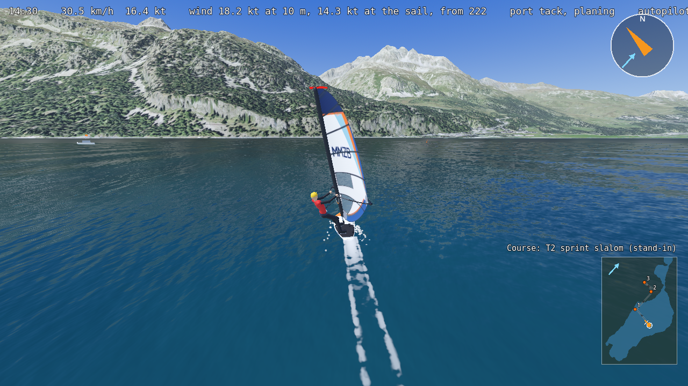
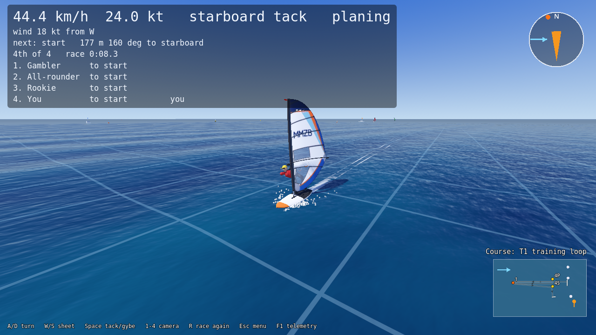

# 🏄 Windsurfing Simulator

A physics-first 3D windsurfing game by the MMZB team, built with **Godot 4.7.2** and GDScript. You sail a real board with a real sail on open water or on Lake Silvaplana in the Engadin, and you race against AI skippers with their own characters.




**Version 0.1.0 (21 October 2026)** is the first release: the first version you can download and play without installing Godot. What it contains is below; what changed over time is in [CHANGELOG.md](CHANGELOG.md); what comes next is in [ROADMAP.md](ROADMAP.md).

## Download and play

1. Download `WindsurfingSimulator-0.1.0-windows.zip` from the [Releases page](https://github.com/michielinwarmte/WindsurfingMMZB/releases).
2. Unzip it anywhere and start `wsim.exe` (`wsim_console.exe` is the same game with a console window that shows the log).
3. Windows 10 or 11, 64-bit, with a graphics card from the last several years. No installation, no sound files, no internet.

Or run it from the source with Godot (see [Running from the source](#running-from-the-source)).

## Features

### Sailing physics

The physics is a simulation, not an animation: every force is computed from the board, the sail, the fin, the water and the wind, in SI units, 6 degrees of freedom, at a fixed step with 3 substeps. The whole model is written up in [Documentation/PHYSICS_SPEC.md](Documentation/PHYSICS_SPEC.md), every number with its source.

- **Apparent wind** from the true wind and the board's own speed, with a height gradient (the wind at 10 m and at the sail differ).
- **The sail:** lift and drag by angle of attack, the centre of effort, the sail side, sheeting, luffing and stall. The sail bends with the simulation.
- **The fin:** lift, slip, stall, and since U2 it **bends** as a beam (stiffness from a measured flex test), which changes how the board rides.
- **The hull:** displacement drag, planing lift after Savitsky, a 1 degree tail vee and a flat tail, the heeled hull's lift, the wet length that shrinks as you plane.
- **Buoyancy** (Archimedes) and water damping; the board sits, pitches and heels in the water as it should.
- **The sailor is a body of their own:** weight, stance, hips, knees, the rig held through the harness, the mast foot and the hands. A technique layer trims the stance to the ride.
- **Falls instead of capsizes,** catapults in gusts, and a waterstart after a few seconds.
- **Wind:** base wind, gusts, lulls and shifts, all adjustable; on the lake the wind comes from the map's own Maloja pattern.
- **Waves:** Gerstner waves, a swell from far away plus the wind's own chop (fetch and depth), from flat water to strong chop; the same formulas drive the physics and the water shader.
- **Wind shadows:** a sail leaves a cone of slower air behind it, so a pack of boards slows itself.
- **Thin air and fresh water** on the lake at 1,791 m.
- **Verified:** 533 unit tests, a slow validation suite of sailing checks (steady reaches, tacks and gybes, polar speeds against real boards) and a manoeuvre matrix at 12, 18 and 24 kt.

### Controls

Two modes, switched with Tab while sailing.

| Key | Beginner mode | Advanced mode |
|---|---|---|
| W / S (Up / Down) | Sheet in / out | Sheet in / out |
| A / D | Turn left / right (the sailor does the rest) | Move your weight |
| Q / E | Fine rake | Rake the rig forward (bear away) / back (head up) |
| ← / → | | Tilt the rig sideways |
| Space | Tack or gybe (the game picks the right one) | Tack or gybe |
| T | Auto-sheet on / off | Auto-sheet on / off |
| 1, 2, 3, 4 | Camera: follow, orbit, top-down, free | |
| Right mouse, wheel | Orbit camera: look around, zoom | |
| R | Back to the start; after a fall, climb on now; in a race, race again | |
| F1 | The detail panel: forces, trim and the key help | |
| F3 | Force arrows on the board | |
| Esc | Pause menu | |

A gamepad works in the menus (stick or d-pad, A, B, Start, the shoulder buttons switch the settings tabs); sailing with a gamepad comes later. The in-game pages **Controls** and **How to sail** explain all of it.

### Where you sail

- **Open water:** 18 kt from the west with a swell by default; everything adjustable in Settings.
- **Lake Silvaplana:** the real lake and its mountains from Swiss open data (the terrain, the lakebed, 10 cm aerial photos), with see-through water, the Engadin light and haze, and the **Maloja wind**: its direction over the terrain from a WindNinja run, its strength from satellite photos, gusts and lulls in lanes along the wind, pulses, shifts and the day's cycle. You start off the camping beach at 14:30 with the time on the screen. The shore stops you.
- **The Silvaplana wind viewer:** the Maloja wind over the lake through the day, and the **race course maker** with the ten iQFOiL course templates at the class's distances (drag, turn, resize, add and rename marks, fit the course to the water, save).
- **Fly over the map:** the lake and the mountains from the air.

### Racing



- **Two courses:** the **T1 training loop** on open water (a start line with the committee boat and the pin, mark 1 556 m upwind, a gate, the finish) and the **T2 sprint slalom** on the lake, fitted to the water at 60 % of the class's size with every mark at least 200 m from the shore. Buoys, boats and the lines are on the water and on the mini-map.
- **A real race:** a countdown of 30 s, 60 s or 3 minutes, the fleet gathering from where it sails free, the gun, over early (OCS) and going back round the nearer end, the roundings checked by geometry, the splits at every mark, the race clock, your place, the results table. R starts it again.
- **The racing HUD:** your speed and tack, the wind (and when you are in someone's wind shadow), the next mark with its distance and the turn to it, the place and the clock, the fleet in race order with each board's gap to you; the next mark on the compass rose; the countdown, the splits and the warnings in the middle.
- **The racing rules:** port keeps clear of starboard, windward of leeward, the board clear astern keeps clear, room at the mark. A touch by the board that had to keep clear is a penalty: a full turn clears it, otherwise 20 s at the finish. The AI boards turn their circles too. Wind shadows and the rules can each be switched off.
- **The Race page:** the water, the course, the fleet's size, who sails (the twelve personas, the four characters, both, or the trained brain and the personas), the countdown, the shadows and the rules.
- **Up to 20 AI boards and you at 60 fps** on the release build (the opponents' physics runs on worker threads; the editor build is far slower).

### The AI skippers

- **The scripted skipper** sails the course like a club racer: laylines, tacks and gybes, a timed start with a loop or a hold-back, picking the favoured end from the line bias, keeping clear by the rules, a penalty turn when it has to. Between races it sails free around the start area.
- **Four characters:** the all-rounder, the cautious one, the gambler and the rookie, each a sheet of numbers (timing, nerve, boat speed, risk).
- **Twelve personas** with names and profiles (Lena, Tobias, Mara, Jonas, Aiko, Sven, Ines, Marco, Noor, Pavel, Elin, Kofi): a skill sheet of start timing and nerve, tacking, gybing, boat speed, upwind and downwind sense, gust appetite, risk, aggression and consistency, drawn afresh for every race. The specialists show on the right course.
- **Learned skippers (experimental):** a small neural network that reads 68 numbers about the race and steers the board, trained on the full physics by evolution (inside Godot, one process per core) or by PPO (Python, over a bridge to headless Godot workers) on a curriculum of random courses. The brains shipped in `Game/race/brains/` start and beat to the first mark but do not round it yet; `tools/gens.sh` lets you watch a night's generations race each other.
- Every AI board runs **the same physics and the same controller** as you: no cheap models, no cheating.

### Look and sound

- One water shader for the sea and the lake: depth colour, sky reflection, sun glint, foam on the crests, gust patches on the lake; a water mesh that follows the camera.
- Sky, sun and haze with the Silvaplana light; spray from the rails, wake and foam behind the tail, a splash on landing; a red streamer at the masthead and an orange wind flag on a buoy.
- The board, sail, boom, mast and fin are Blender models built from the configuration's own sizes; the sailor figure hangs in the harness.
- Four cameras; a mini-map; a one-line telemetry strip and a detail panel with every force.
- **Sound without sound files:** every sound is made from noise at startup and shaped by the simulation: the apparent wind in your ears, lapping and the planing hiss, splashes, the sail flapping when it luffs and cracking when it fills. Master, wind, water and sail sliders.

### Settings

Wind (speed, direction, gusts and their strength and period, shifts and their size and period), waves (sea state presets, wave height, swell from the wind or a bearing, swell height, chop direction, fetch, depth), sailing (mode, auto-sheet, start heading, the camera at the start, the detail panel), graphics (window, vsync, anti-aliasing, resolution scale, shadows, a frame-rate cap) and audio. Saved between runs.

### Tools for the team and the AI sessions

Everything is scriptable from the repo root (Git Bash on Windows): the tests, the project check, screenshots, the manoeuvre matrix on open water and on the lake, headless races and race matrices, the persona matrix, the trainers, the release build. The full table is in [CLAUDE.md](CLAUDE.md).

## Known gaps in 0.1

- Boards pass through each other and through the marks: there are no collisions yet.
- On the lake the AI opponents can run aground; you stop at the shore, they do not.
- No countdown sounds. The fleet list fills half the screen with 17 boards or more.
- The learned skippers are experimental: no shipped brain rounds a mark yet.
- The effects and the sound have not yet been checked by the team; nobody has listened to the audio with care.
- Sailing with a gamepad is not there yet.
- The physics of U2 (the bending fin, the heeled hull, the sailor's technique) and the thread-safe rewrite of the physics files still wait for Michiel's review; the measured answers are identical, bit for bit.
- One check in the validation suite is red on purpose: the planing onset at 13.4 kn against the 8 to 10 kn of real boards, kept red until the team decides.

The complete list, with who decides what, is in [ROADMAP.md](ROADMAP.md).

## Running from the source

### Windows (this is what the team uses)

Install **Godot 4.7.2, the standard build (not .NET)** from [godotengine.org](https://godotengine.org/download/archive/). Git for Windows includes Git LFS; run `git lfs install` once before cloning, or the lake's terrain comes down as small pointer files. Then open `Game/project.godot` in Godot, or use the scripts from Git Bash with the `GODOT` environment variable pointing at the Godot executable:

```bash
export GODOT=/c/Users/<you>/AppData/Local/Programs/Godot/Godot_v4.7.2-stable_win64_console.exe
tools/play.sh            # the start menu (double-clicked, it asks what to start)
tools/play.sh lake       # straight to Lake Silvaplana
tools/test.sh            # the unit tests
tools/check.sh           # does every script, scene and resource load?
tools/release.sh build   # the game as a release build in .release/ (needs the export templates once)
```

### Linux

```bash
git lfs install
git clone https://github.com/michielinwarmte/WindsurfingMMZB.git
cd WindsurfingMMZB
tools/install_godot.sh   # installs Godot 4.7.2 for your user (no sudo), once
tools/edit.sh            # open the project in the Godot editor
```

### Everyday commands

| What | Command |
|---|---|
| Play the game | `tools/play.sh` (`lake`, `silvaplana`, `wind` for the other scenes) |
| Open the editor | `tools/edit.sh` |
| Run the tests | `tools/test.sh` (fast), `tools/test.sh validation` (slow physics checks) |
| Check that every file loads | `tools/check.sh` |
| A screenshot of the game | `tools/screenshot.sh` (writes `.screenshots/latest.png`) |
| A race, headless | `tools/race.sh --course=t1_loop --skippers=allrounder,gambler,rookie` |
| The release build with a big fleet | `tools/release.sh --race=t1_loop --skippers=allrounder,cautious,gambler,rookie` |

In the editor, the **GUT** panel at the bottom also runs the tests.

## Project structure

```
WindsurfingMMZB/
├── README.md            # this page
├── CHANGELOG.md         # what each version contains
├── ROADMAP.md           # what comes next, what waits for whom, how a release is made
├── CLAUDE.md            # the rules and commands every AI session follows
├── Documentation/       # the physics spec, the plans, the research, the reports (see its README.md)
├── Game/                # the Godot project (open Game/project.godot)
│   ├── sim/             # the physics: plain classes, no engine bodies, headless and tested
│   ├── windsurfer/      # the board in the scene: visuals, effects, the camera's target
│   ├── race/            # racing: the race, courses, skippers, personas, brains, the trainer's side
│   ├── maps/            # Lake Silvaplana: terrain, water, wind, the course maker
│   ├── world/, camera/, ui/, audio/   # the scenes around the board
│   ├── config/          # every tuning number, as .tres resources
│   ├── dev/             # developer helpers run by the tools
│   ├── tests/           # unit/ (fast) and validation/ (slow physics runs)
│   └── addons/gut/      # the GUT test framework
├── tools/               # the scripts: play, edit, test, check, screenshot, race, train, release, map, blender
├── Art/                 # source art
└── Legacy/              # the frozen Unity version (2025 to September 2026), reference only
```

## Working with AI

Most of the code is written with Claude (Fable 5.1 leads, Opus 5.5 agents build packages in their own worktrees). The setup is made so the AI can check its own work: it runs the tests, loads every file, takes screenshots and looks at them, and measures the physics headless before anyone plays.

- [CLAUDE.md](CLAUDE.md) holds the rules and commands every AI session follows.
- [ROADMAP.md](ROADMAP.md) says what to build next and what waits for a decision.
- [Documentation/PROGRESS_LOG.md](Documentation/PROGRESS_LOG.md) records what each session did.

To continue, start a Claude Code session in this folder and ask it, for example: *"Read CLAUDE.md and ROADMAP.md, then continue with the next item."* It stops at the end of each package so the team can play-test.

## History

The game started in December 2025 as a Unity project (Sessions 1 to 27), kept in [`Legacy/`](Legacy) for reference. In September 2026 the team restarted from scratch in Godot with a physics specification first; the Unity physics work and its lessons fed the new version. Version 0.1.0 is the state after Session 53, 21 October 2026.

## License

The original README named the MIT License, but the repository has no LICENSE file yet; the team decides (see the roadmap). The GUT test framework in `Game/addons/gut` is MIT licensed (see its `LICENSE.md`). The Silvaplana map is built from Swiss open data (swisstopo) under its open terms.

## Team

**MMZB Development Team.** Michiel does the physics; Max does the map, the wind, the play-testing and leads the racing and the AI fleet.
